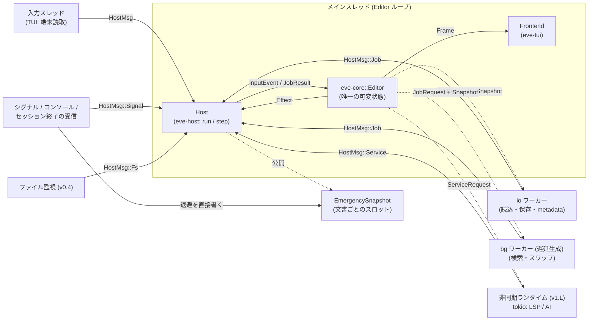
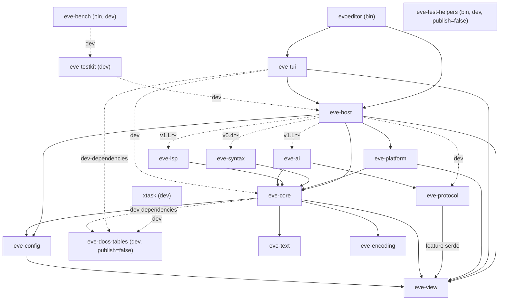

# 02. アーキテクチャ (Architecture)

| 項目 | 内容 |
|---|---|
| 文書ID | 02-architecture |
| 状態 | ドラフト |
| 前提 | [00-overview](00-overview.md) / [01-requirements](01-requirements.md) |
| 決定記録 | [10-decisions](10-decisions.md) (本書の判断は ADR 番号で参照) |
| 正本 | 構造・境界型・Ports・スレッドモデル・緊急退避・Proposal 型など、複数文書にまたがる概念の名前と意味 ([§12.3](#123-正本マップ-本書が正本の概念)) |

> 本書のコード片は **仕様説明のための擬似コード (Rust 風)** であり、そのまま実装する API ではない。ただし [§12.3](#123-正本マップ-本書が正本の概念) で「02 が正本」とした型・規則は、**名前と意味の正本** であり、03〜07 は再定義せず参照する (変更が必要なら先に本書を改訂する)。境界型 (`eve-view`) の変更は [§8.4](#84-境界型の契約と凍結段階) の手続きに従う。その他のフィールドの追加・細部の型は詳細設計で確定してよい。
>
> 本書の判断のうち PO の判断を要するものは OQ 番号を付けて「(提案、OQ-<番号>)」と記す。ADR の状態は [10](10-decisions.md) が正。版 (v0.1〜v1.0、v1.L、v1.X) の定義は [08](08-roadmap.md)。

---

## 目次

1. [目的とスコープ](#1-目的とスコープ)
2. [全体像](#2-全体像)
3. [アーキテクチャ上の主要判断 (要約)](#3-アーキテクチャ上の主要判断-要約)
4. [crate 構成 (Cargo workspace)](#4-crate-構成-cargo-workspace)
5. [状態モデル](#5-状態モデル)
6. [コマンド / アクション駆動設計](#6-コマンド--アクション駆動設計)
7. [入力抽象 (Key / Mouse / Text / IME)](#7-入力抽象-key--mouse--text--ime)
8. [状態と描画の分離 (ViewModel)](#8-状態と描画の分離-viewmodel)
9. [イベントループとスレッドモデル](#9-イベントループとスレッドモデル)
10. [拡張点 (Extension Points) とプラグイン方針](#10-拡張点-extension-points-とプラグイン方針)
11. [エラー処理・パニック・ログ](#11-エラー処理パニックログ)
12. [後続文書との責務境界](#12-後続文書との責務境界)
13. [主要クレート選定](#13-主要クレート選定)
14. [性能設計の要点](#14-性能設計の要点)
15. [セキュリティ境界](#15-セキュリティ境界)
16. [frontend 境界チェックリスト](#16-frontend-境界チェックリスト)
17. [AI 連携に適した開発構成](#17-ai-連携に適した開発構成)

---

## 1. 目的とスコープ

本書は evoeditor の **構造 (何をどこに置くか)** と **境界 (誰が何を知ってよいか)** を定める。各モジュール内部のアルゴリズム・データ構造の詳細は後続文書に委ねる ([§12](#12-後続文書との責務境界))。

本書が満たすべき要件の主なもの:

- G4 / NFR-406 / NFR-701: core のヘッドレス化とフロントエンド分離
- NFR-1xx / NFR-2xx / NFR-3xx: 応答性・巨大ファイル・メモリ・異常終了 (UI スレッドを止めず、際限なく増えるものを作らない構造)
- FR-601: 全操作のコマンド化
- ADR-0038: 公開 crate に外部の消費者があっても境界が保てること
- ADR-0028: 公開面は v0.1 で形を決め、内部構造は v0.1 では最小にする
- ADR-0033: AI コーディング支援と人間が並行して開発しやすい構造
- [01 §4.4](01-requirements.md#44-v01-で残す拡張点-先行投資): 後の版で足す機能 (分割・複数カーソル・LSP・AI・プラグイン・駆動 API) の拡張点

## 2. 全体像

### 2.1 レイヤ図

```
┌──────────────────────────────────────────────────────────────────────┐
│ Binaries          evoeditor (TUI) : 引数解析のみ                         │
├──────────────────────────────────────────────────────────────────────┤
│ Host              eve-host : Composition Root の共通部                 │
│                   (設定読込・Ports 注入・ワーカー・受信口・メインループ・  │
│                    Effect 実行・EmergencySnapshot・シグナル・ログ)       │
│                   Frontend trait を定義                                 │
├───────────────────────────────┬──────────────────────────────────────┤
│ Frontends (Frontend を実装)   │ Services (任意・後の版)                │
│  eve-tui  ratatui/crossterm   │  eve-syntax (v0.4) tree-sitter        │
│  (駆動 API: eve-protocol、v0.2〜)│  eve-lsp    (v1.L) LSP client [async] │
│                               │  eve-ai     (v1.L) LLM bridge [async] │
├───────────────────────────────┴──────────────────────────────────────┤
│ Core (headless, sync, deterministic)                                  │
│  eve-core : EditorState / Document / View / Command / Keymap /        │
│             Transaction・Undo / Job 管理 / Frame 生成 / Query /       │
│             Ports(trait)                                              │
├──────────────────────────────────────────────────────────────────────┤
│ Foundations                                                           │
│  eve-text     : rope・位置変換・書記素・表示幅・ChangeSet               │
│  eve-encoding : 文字コード判定・デコード・照合・不正バイトのエスケープ    │
│  eve-view     : 境界型 (InputEvent / Frame / Style / Effect / CommandId │
│                 / Capabilities / EditorEvent / Proposal)               │
│  eve-config   : 設定スキーマ・読込・検証・キーマップ定義・テーマ解決     │
├──────────────────────────────────────────────────────────────────────┤
│ Platform Adapters                                                     │
│  eve-platform : FS(原子的保存)・パス・監視・秘密情報 等                │
│                 (core の Ports trait を実装) + Host 部品 (クリップボード・ │
│                 コンソールハンドラ・所有者のみの作成・緊急退避の書込・  │
│                 緊急の端末復元)                                        │
└──────────────────────────────────────────────────────────────────────┘
          依存は原則「上 → 下」。core は Host / Frontends / Services / Platform を知らない。
```

### 2.2 実行時の構成要素



要点:

- **EditorState は 1 スレッド (メインスレッド) だけが所有する。** ロック (Mutex/RwLock) で共有しない。
- 他スレッドへは **不変スナップショット** (rope の O(1) clone) とリクエストを渡し、結果は **メッセージ** で受け取る。
- core 自身はスレッドもランタイムも生成しない。生成は Host (`eve-host` + frontend) が行い、core には `JobSpawner` などの Port 越しに依頼させる ([§9](#9-イベントループとスレッドモデル))。
- TUI とヘッドレス参照レンダラは同じ `eve-host` を使い、違いは `Frontend` trait の実装だけにする ([§9.2](#92-メインループ-擬似コード))。

## 3. アーキテクチャ上の主要判断 (要約)

| # | 判断 | ADR | 状態 |
|---|---|---|---|
| 1 | core はヘッドレスで、端末/OS API に依存しない | [ADR-0002](10-decisions.md#adr-0002-core--frontend-の厳密分離) | 確定 |
| 2 | Cargo workspace を Foundations / Core / Host / Frontends・Services / Platform / bin に分割。`eve-encoding` と `eve-host` を独立 crate にする | [ADR-0003](10-decisions.md#adr-0003-cargo-workspace-と-crate-分割) | 確定 |
| 3 | テキストは ropey を `TextStorage` 抽象越しに使う | [ADR-0004](10-decisions.md#adr-0004-テキストバッファのデータ構造) | 条件付き確定 (S-02) |
| 4 | TUI は ratatui + crossterm | [ADR-0005](10-decisions.md#adr-0005-tui-ライブラリ) | 条件付き確定 (S-06 / S-07) |
| 5 | 単一所有のメインループ + 固定 2 本の std スレッドワーカー。受信口は上限なしで生産側がまとめる。async (tokio) は LSP/AI の内側に閉じ込める | [ADR-0006](10-decisions.md#adr-0006-スレッドモデルと-async-境界) | 確定 |
| 6 | 全操作を名前空間付き CommandId + 型付き引数で表現し、呼び出し元と権限を照合する | [ADR-0007](10-decisions.md#adr-0007-コマンド駆動設計) | 確定 |
| 7 | core が「テキスト領域はレイアウト済みセルグリッド、UI 部品は意味的モデル」の ViewModel を生成 | [ADR-0008](10-decisions.md#adr-0008-viewmodel-による描画分離) | 確定 |
| 8 | 内部文字列は UTF-8、位置の正準表現はバイトオフセット | [ADR-0009](10-decisions.md#adr-0009-内部文字コード-utf-8-と入出力時変換) / [ADR-0010](10-decisions.md#adr-0010-位置の正準表現) | 確定 |
| 9 | 文書変更はすべて Transaction 経由 (Origin 付き) | [ADR-0007](10-decisions.md#adr-0007-コマンド駆動設計) / [ADR-0013](10-decisions.md#adr-0013-ai-連携の基本方針) | ADR-0007 は確定、ADR-0013 は提案中 |
| 10 | v0.x ではプラグインなし。外部からの操作は駆動 API (Stage D)、外部プラグインは v1.X で外部プロセス + JSON-RPC を第一候補 | [ADR-0014](10-decisions.md#adr-0014-拡張プラグイン機構の方針) / [ADR-0032](10-decisions.md#adr-0032-拡張点の追加と駆動-api-stage-d) | ADR-0032 は確定、ADR-0014 は提案中 |
| 11 | core はメインスレッドで I/O (stat/canonicalize 含む) を行わない (起動時の設定読込は例外)。FileSystem Port の正本は本書 §4.5 | [ADR-0020](10-decisions.md#adr-0020-core-はメインスレッドで-io-を行わないfilesystem-port-の正本は-02) | 確定 |
| 12 | クリップボードは Effect 経路 (Port にしない)。文字列化は Host のワーカー | [ADR-0021](10-decisions.md#adr-0021-クリップボードは-effect-経路) | 確定 |
| 13 | キーマップ解決の意味論 (Text/Key、チョード、競合、`mod`) は core に置き本書 §7.2 が正本 | [ADR-0022](10-decisions.md#adr-0022-キーマップ解決の意味論) | 確定 |
| 14 | 緊急退避は `EmergencySnapshot` (文書ごとのスロット) から受信スレッドが直ちに書く | [ADR-0023](10-decisions.md#adr-0023-緊急退避は-emergencysnapshot-から別スレッドで書く) | 条件付き確定 (S-11) |
| 15 | 既定テーマは TrueColor。縮退段 (256 / 16 / mono) の Style を事前に計算し、core が段を選んで Style を解決する (v0.1 の組込みテーマが明示するのは truecolor と mono の 2 段で、256 / 16 は truecolor の値からの自動近似。01 FR-513、07 §8) | [ADR-0027](10-decisions.md#adr-0027-既定テーマは-truecolor縮退段を明示する) | 確定 |
| 16 | CommandId カタログと設定キー・既定値の正本は 07 | [ADR-0025](10-decisions.md#adr-0025-commandid-カタログと設定キーの正本は-07) | 確定 |
| 17 | レガシー文字コードの保存は encode→decode 照合 (v0.1) + 復号専用文字の保持方式 (v0.3) | [ADR-0026](10-decisions.md#adr-0026-レガシー文字コード保存の黙示置換検出と保持方式) | 条件付き確定 (S-01) |
| 18 | リリース最優先の段階リリース。公開面は v0.1 で決め、内部構造は最小にする | [ADR-0028](10-decisions.md#adr-0028-リリース最優先の段階リリース) | 確定 |
| 19 | `eve-host` + `Frontend` trait。境界型は `#[non_exhaustive]` + 契約版 + 凍結段階。frontend-parity CI (ヘッドレス参照レンダラと TUI を比較。v0.1 はヘッドレス参照レンダラまでで、Frame JSON ゴールデンと parity の CI ジョブは TUI 完成時のレビューで作る) | [ADR-0030](10-decisions.md#adr-0030-eve-host-と-frontend-trait境界型の契約と凍結段階) | 確定 (ユーザー回答) |
| 20 | 安定性・性能のための簡略化と危険箇所の是正 | [ADR-0031](10-decisions.md#adr-0031-安定性性能のための簡略化と危険箇所の是正) | 確定 |
| 21 | 拡張点 X16〜X24 (External 主体、EditorEvent、Query、Proposal 型の移動、権限フック等) と駆動 API | [ADR-0032](10-decisions.md#adr-0032-拡張点の追加と駆動-api-stage-d) | 確定 |
| 22 | AI 連携に適した開発構成 (規範行 ID・`spec:`・spec-index・シナリオ DSL・ヘッドレス駆動・モジュール所有境界) | [ADR-0033](10-decisions.md#adr-0033-ai-連携に適した開発構成) | 確定 |
| 23 | ローカル LLM を一級市民とする。既定は外部の `llama-server` 等へのループバック HTTP 接続、子プロセスとしての管理はオプトイン、プロセス内推論はしない | [ADR-0034](10-decisions.md#adr-0034-ローカル-llm-を一級市民とする接続方式) | 一部提案中 (方針と接続形態の既定は確定 (ユーザー回答、OQ-129)。方式の細目 OQ-128 / OQ-133 は提案中) |
| 24 | LLM の能力モデル (`LlmCaps`) と、サーバのトークナイザでの予算計算・先頭を固定したプロンプトによるキャッシュ再利用・制約付きの構造化出力・1 スロット前提の要求スケジューラ。core から見た AI は `AiService` のままで、これらは eve-ai の内部 | [ADR-0035](10-decisions.md#adr-0035-llm-の能力モデルとキャッシュを活かすプロンプト構築) | 提案中 |
| 25 | **公開 crate の外部の消費者**: core・TUI・ヘッドレスを OSS で公開する。外部の消費者が依存してよい公開 crate を限り (§4.1)、境界型の互換は契約版で守る。core は frontend を知らない | [ADR-0038](10-decisions.md#adr-0038-公開-crate-の外部の消費者と寄稿の方針) | 確定 (ユーザー回答) (Apache-2.0 単独の OSS、寄稿は DCO、外部の消費者の依存範囲と契約の運用) |
| 26 | **v0.1 の範囲の整合と先行投資の縮小**: 01 を版の正本とし、最初の利用者が v0.1 にいない拡張点は型・名前の予約に留める (駆動 API の実装、`EditSummary` の生成、C3 の固定等は後の版) | [ADR-0039](10-decisions.md#adr-0039-v01-の範囲の整合と先行投資の縮小) | 確定 (ユーザー回答) |
| 27 | **v0.1 の最小核**: 単一文書 (文書の集合は内部で残す、§5.1)・UI は日本語のみ (MessageKey の外部化は残す)・Windows のみ出荷 (core は OS 非依存を保ち、Unix の実装は出荷する版、§4.7) | [ADR-0042](10-decisions.md#adr-0042-v01-の最小核-案-lwindows-のみの出荷日本語のみの-ui) | 確定 (ユーザー回答) |
| 28 | Windows のビルドは C ランタイムを静的にリンクする (`+crt-static`。`.cargo/config.toml` に書く、§13 / §17.1) | — | 確定 (ユーザー回答) |

## 4. crate 構成 (Cargo workspace)

### 4.1 crate 一覧

crate の接頭辞 `eve-` と bin の名前 `evoeditor` は [OQ-01](10-decisions.md#oq-01-正式名称とバイナリ名) で確定 (ユーザー回答)。「版」は最初に必要になる版。

| crate | 種別 | 版 | 責務 | 主な外部依存 (案) | 禁止事項 | 禁止 crate |
|---|---|---|---|---|---|---|
| `eve-text` | lib | v0.1 | rope ラッパ (`TextStorage`)、位置変換 (byte ⇔ char ⇔ UTF-16 (v1.L) ⇔ 行/桁)、書記素・単語境界、表示幅と **幅危険書記素の分類**、`ChangeSet` (挿入/削除の合成・逆変換・位置写像)、`Range`/`Selection` (データと写像・正規化) | ropey, unicode-segmentation, unicode-width | 他の `eve-*` crate への依存、I/O | `ratatui`, `crossterm`, `tokio`, `reqwest`, `hyper`, `windows-sys`, `libc`, `eve-encoding`, `eve-view`, `eve-config`, `eve-core`, `eve-platform`, `eve-host`, `eve-tui`, `eve-protocol`, `eve-syntax`, `eve-lsp`, `eve-ai`, `eve-testkit`, `eve-docs-tables` |
| `eve-encoding` | lib | v0.1 | 文字コード判定 (BOM・UTF-16 パターン・ISO-2022-JP のエスケープ・UTF-8 妥当性・推定)、チャンク単位のデコード / エンコード、**encode→decode 照合** (黙示置換の検出)、区分 B (復号専用文字) の検出 (v0.1) と保持方式 (v0.3)、不正バイトの PUA エスケープ。入出力は `&[u8]` チャンク → `&str` + メタ情報 | encoding_rs, chardetng | 他の `eve-*` crate への依存、I/O、`Document` への依存 | `ratatui`, `crossterm`, `tokio`, `reqwest`, `hyper`, `windows-sys`, `libc`, `eve-text`, `eve-view`, `eve-config`, `eve-core`, `eve-platform`, `eve-host`, `eve-tui`, `eve-protocol`, `eve-syntax`, `eve-lsp`, `eve-ai`, `eve-testkit`, `eve-docs-tables` |
| `eve-view` | lib | v0.1 | core ⇔ frontend の **境界型** のみ: `InputEvent`, `KeyEvent`, `Frame` (ViewModel), `Style`/`Color`, `Effect`, `CommandId`, `Capabilities`, `EditorEvent`, `Proposal`/`Hunk` (データ), `Query`/`Answer`, `CONTRACT_VERSION`、緊急の端末復元に渡す平文の型 (`RawTermHandle(usize)` / `SavedTermMode` / `TermRestoredFlag`。eve-platform と eve-tui の両方から見えるようにここに置く、§9.2)。境界型が参照する **ID 型** (`DocumentId` / `ViewId` / `WindowId` / `Revision` / `ViewRevision` / `ProposalId` / `AiRequestId` / `HunkId` / `ChoiceId` / `ClipboardHandleId` / `ClipboardToken` / `ClientId` / `PluginId` 等。一覧は §12.2) もここで定義する ([§12.2](#122-境界をまたぐ型の所有者))。enum は v0.1 から `#[non_exhaustive]`、struct は C3 から ([§8.4](#84-境界型の契約と凍結段階)、提案、OQ-177。`RawTermHandle` と `TermRestoredFlag` は C3 の後も対象外の公開タプル struct、§9.2) | なし (serde は optional feature。**v0.x の配布ビルドでは無効**。テスト・駆動 API 用。**公開 cargo feature は `serde` の 1 つだけで、既定は無効 (`default = []`)**。追加・改名は公開 crate の semver と契約版 (§8.4) で扱う。確定 (ユーザー回答)、OQ-120。配布ビルドで有効になる条件は下の「cargo feature」の注) | ロジック、他の `eve-*` crate への依存 | `ratatui`, `crossterm`, `tokio`, `reqwest`, `hyper`, `windows-sys`, `libc`, `eve-text`, `eve-encoding`, `eve-config`, `eve-core`, `eve-platform`, `eve-host`, `eve-tui`, `eve-protocol`, `eve-syntax`, `eve-lsp`, `eve-ai`, `eve-testkit`, `eve-docs-tables` |
| `eve-config` | lib | v0.1 | 設定スキーマ、既定値、TOML 読込・マージ (v0.1 はユーザー層のみ。`--config` は v0.2、言語別・ワークスペースは v0.4)、検証、キーマップ定義の解析 (書式は v0.1 で確定、ファイル読込は v0.2)、**テーマ解決** (4 段の Style 表の事前計算と、省略された段の近似。v0.1 の組込みテーマは truecolor と mono を明示し、256 / 16 は近似で埋める)、同梱の言語ファイルの解析と検証 (v0.1 は `ja` のみ) | serde, toml, globset (v0.4), regex (遅延コンパイル), toml_edit (書き戻し、v0.4), schemars (optional、スキーマ生成) | ファイル I/O (内容文字列を受け取る)、core 依存、起動経路での正規表現コンパイル | `ratatui`, `crossterm`, `tokio`, `reqwest`, `hyper`, `windows-sys`, `libc`, `eve-core`, `eve-platform`, `eve-host`, `eve-tui`, `eve-protocol`, `eve-syntax`, `eve-lsp`, `eve-ai`, `eve-testkit`, `eve-docs-tables` |
| `eve-core` | lib | v0.1 | `Editor` ファサード、`EditorState`、Document/View/Layout、View への Selection 格納と Motion、Transaction/Undo、Command レジストリと実行 (権限判定フック)、キーマップ解決 (§7.2)、検索、Job 管理、Frame 生成、`Query` 応答、`EditorEvent` の発行、**Ports (trait) 定義**、`ThreadGuard` の印と検査関数 `assert_not_main_thread_fs()` (§4.4)。モジュール所有境界は [§4.6](#46-eve-core-のモジュール所有境界) | eve-text, eve-encoding, eve-view, eve-config, regex (v0.1 は大文字小文字を区別しないリテラル検索の経路だけで使う。正規表現の検索は v0.2、03 §12.3), memchr, twox-hash | 端末クレート、tokio、直接の OS API (std::fs 含む。Port 経由) | `ratatui`, `crossterm`, `tokio`, `reqwest`, `hyper`, `windows-sys`, `libc`, `eve-platform`, `eve-host`, `eve-tui`, `eve-protocol`, `eve-syntax`, `eve-lsp`, `eve-ai`, `eve-testkit`, `eve-docs-tables` |
| `eve-platform` | lib | v0.1 (Windows の実装のみ。Unix の実装は macOS / Linux を出荷する版、§4.7) | Ports の実装: ファイル読み書き (原子的保存・権限維持)、パス正規化、設定/状態ディレクトリ、ファイル監視 (v0.4)、外部プロセス起動 (v0.4)、資格情報ストア (v1.L)。**Host 側部品** (eve-host が呼ぶ安全な関数。`unsafe` と OS API はこの crate の中に閉じる、R5): `ClipboardProvider` (core には注入しない、§6.3)、コンソールイベントの受信 (`SetConsoleCtrlHandler` の登録と、受けたイベントを eve-host のコールバックへ渡す部分)、所有者のみの DACL (Unix は 0600 / 0700) でのファイル・ディレクトリの作成、緊急退避の書込 (`std::fs` を直接使う。§11.2.1)、緊急の端末復元 `emergency_restore(handle, bytes, saved_mode, restored)` (受信スレッドが使う。§9.6)、Windows のセッション終了通知受信 (§11.2.1、v0.2)、Unix のシグナル受信 (macOS / Linux を出荷する版) | eve-core (Port の trait と型), eve-view (`emergency_restore` が受け取る平文の型 `RawTermHandle` / `SavedTermMode` / `TermRestoredFlag`、§9.2), windows-sys (ディレクトリの解決は自前で行う。05 §7.2), libc と signal-hook (Unix の実装と同時), 純 Rust のハッシュ (§13.7), notify (v0.4), process-wrap または windows-sys 直接 (v0.4), keyring (v1.L)。arboard は v0.1 では採用せず v0.2 以降の選択肢 (OQ-111) | UI ロジック | `ratatui`, `crossterm`, `eve-host`, `eve-tui`, `eve-testkit`, `eve-docs-tables` |
| `eve-host` | lib | v0.1 | **Composition Root の共通部**: 設定読込、Port 実装の注入、`JobSpawner` 実装 (固定 2 ワーカー)、単一受信口 `HostMsg`、メインループ (`Host::run()` と `Host::step(msg)`)、Effect ディスパッチ、`EmergencySnapshot` の公開と緊急退避の起動 (書込そのものは eve-platform の Host 部品を呼ぶ)、シグナル/コンソール/セッション終了の受信後の処理 (v0.1 は Windows のコンソールイベント。セッション終了通知は v0.2、Unix のシグナルは macOS / Linux を出荷する版。OS API の呼出しは eve-platform の Host 部品)、パニックハンドラ、ログ (自前の最小購読者)。**`Frontend` trait** と、部品を差し替えて Host を組み立てる **`HostBuilder`** を定義 ([§9.2](#92-メインループ-擬似コード)) | eve-core, eve-view, eve-config, eve-platform, arc-swap (`EmergencySnapshot` のスロット、§11.2.1) | 編集ロジック、端末クレート、`unsafe` (R5) | `ratatui`, `crossterm`, `eve-tui`, `eve-testkit`, `eve-docs-tables` |
| `eve-tui` | lib | v0.1 | `Frontend` の TUI 実装: 端末の初期化/復元、入力の正規化 (Unix は自前の VT 解析 `vt_input`、Windows は自前の `ReadConsoleInputW` ループ → `InputEvent`、連続 Text の集約。ADR-0005 の改訂)、`Frame` → ratatui Buffer 描画、端末能力と色深度の判定、256 / 16 段への色の近似表 (04 §12.3)、OSC 52 書込 (v0.2) | ratatui, crossterm | 編集ロジック (core にあるべきもの) | `eve-testkit`, `eve-docs-tables` |
| `evoeditor` (bin) | bin | v0.1 | 引数解析と `eve_host::Host::new(args)?.run(&mut TuiFrontend::new())` だけ (`Host::new(args)` は本番の部品で組み立てる `HostBuilder::new(args).build()` の短縮、§9.2。設定読込は `Host::new`、`Frontend::init` → Editor 構築 → 入力開始の順序は `Host::start` の中、§9.2 / §9.5) | lexopt (案), anyhow | ビジネスロジック | `eve-testkit`, `eve-docs-tables` |
| `eve-protocol` | lib (dev) | v0.2 以降 (dev。ADR-0039) | 駆動 API ([§10.5](#105-駆動-api-stage-d)) の JSON-RPC の型とフレーミング (`Content-Length`)。eve-view の serde 型を運ぶ。sidecar モードと、その上の MCP サーバの写像 (v1.L-b 候補、06 §3.5)。外部プラグインのプロトコル (v1.X、§10.3) も本 crate に足す (プラグイン用に別の crate を作らない)。配布同梱は OQ-120 | eve-view (feature `serde`), serde, serde_json | 編集ロジック | `ratatui`, `crossterm`, `eve-core`, `eve-platform`, `eve-host`, `eve-tui`, `eve-testkit`, `eve-docs-tables` |
| `eve-bench` | bin (dev) | v0.1 | ベンチマークの実行と集計 (09 §5 の BM-xxx。`xtask bench` が呼ぶ)。計測対象は公開 crate と `evoeditor` の隠しフラグ (`--bench-*`) で、本体からは依存しない | eve-testkit, 公開 crate | 本番コードからの依存 | — |
| `eve-testkit` | lib (公開。テスト用で、本番コードは依存しない) | v0.1 | ヘッドレス駆動ハーネス、Fake Ports (`MemFs`、偽クリップボード、`ManualClock`、`ManualJobSpawner`、§4.4)、Frame のスナップショット比較、`VirtualScreen` (TUI)、**ヘッドレス参照レンダラ** (`HeadlessFrontend`: `Frontend` trait のテスト用実装。Frame から直接 `CellOccupancy` を作り、TUI との parity の比較相手になる、§8.4)、`CellOccupancy` の比較、シナリオ DSL ランナー (v0.2。v0.1 は Rust の Harness)、`ThreadGuard` を使う検査モード (§4.4)。外部の消費者も正確な版で固定して使える公開 crate として publish する (§4.1 の注、12 §4.1) | insta, proptest, serde・toml (シナリオ DSL の読み込み、v0.2) | 本番コードからの依存 | — |
| `eve-docs-tables` | lib (dev、`publish = false`) | v0.1 | docs の Markdown の表を 11 §8.5 の機械可読の規則 (見出し・列名・列の順) で読む小さな lib。利用者は **`xtask`、`eve-tui` の dev 依存、`eve-core` の dev 依存** の 3 つ (`xtask` は `check-deps --docs`・`i18n`・`check-themes`、`eve-tui` は横取り表の到達性検査、`eve-core` はコマンドカタログ等の表との突合。09 §6.2 の `docs-tables`) | なし (std のみ) | 本番コードからの依存、他の `eve-*` crate への依存 | `eve-text`, `eve-encoding`, `eve-view`, `eve-config`, `eve-core`, `eve-platform`, `eve-host`, `eve-tui`, `eve-protocol`, `eve-syntax`, `eve-lsp`, `eve-ai`, `eve-testkit` |
| `eve-test-helpers` | bin (dev、`publish = false`、feature なし) | v0.1 | テスト用の補助プロセス: `console-event` (別コンソールから CTRL_C / CTRL_BREAK を送る) と `clip-delay` (クリップボードの応答を遅らせる)。feature `test-hooks` のビルドのテスト (09 §3.4 / §3.6) からだけ使い、配布物に入れない | windows-sys (補助プロセスの中だけ) | 本番コードからの依存、配布物への同梱 | — |
| `xtask` | bin (dev、`publish = false`) | v0.1 | 開発用のタスクの入口 (`cargo xtask <サブコマンド>`。サブコマンドの一覧と版の正本は 11 §1)。依存規則の検査 (`check-deps`、§4.3)、docs の表の突合 (`i18n` / `check-themes`)、コーパスと生成リファレンスの生成、ベンチ (`eve-bench`) と夜間ジョブの起動。Windows と Linux の両方でビルドする (§4.7) | eve-docs-tables、`cargo metadata` の出力の解析、配布 zip の作成・検査 (`dist`) のための `zip`・`sha2` | 本番コードからの依存、配布物への同梱 | — |
| `eve-syntax` | lib | v0.4 | tree-sitter による解析・ハイライト・インデント・構文選択。core の `SyntaxProvider` trait を実装 | tree-sitter, 各言語文法 | frontend 依存 | `ratatui`, `crossterm`, `eve-tui`, `eve-lsp`, `eve-ai`, `eve-testkit`, `eve-docs-tables` |
| `eve-lsp` | lib | v1.L | LSP クライアント (プロセス管理・JSON-RPC・位置変換)。core の `LanguageService` trait を実装 | tokio, lsp-types (案) | frontend 依存 | `ratatui`, `crossterm`, `eve-tui`, `eve-syntax`, `eve-ai`, `eve-testkit`, `eve-docs-tables` |
| `eve-ai` | lib | v1.L | AI プロバイダ抽象と **ローカル LLM アダプタ** (`llama-server` ネイティブ / OpenAI 互換。能力検出・サーバのトークナイザでの予算計算・キャッシュを活かすプロンプト構築・FIM・制約付き出力・要求スケジューラ)、管理モードのサーバ起動要求 (実行は `ProcessRunner`)、プロンプト構築、秘密情報の伏字化、Proposal 生成 (差分計算)、監査ログ。詳細は 06 | tokio, HTTP クライアント (feature `ai`: TLS なしのループバック HTTP、`ai-remote`: rustls を追加), serde_json, eve-protocol (外部プロセス系 (ACP クライアント・MCP クライアント、v1.X) の JSON-RPC の配管とフレーミングを共用する。06 §3) | frontend 依存、文書の直接変更、`std::fs` / `std::process` (R7)、推論エンジン (llama.cpp 等) へのリンク (ADR-0034) | `ratatui`, `crossterm`, `eve-tui`, `eve-syntax`, `eve-lsp`, `eve-testkit`, `eve-docs-tables` |

> **禁止 crate 列**: その crate から (推移的にも) 到達してはならない crate を完全な crate 名で列挙した機械可読の列で、リポジトリ直下の `deps-policy.toml` の禁止リストと 1:1 に対応する (書式は 11 §8.5、検査は 09 §7 の `xtask check-deps --docs`)。`ratatui` / `crossterm` / `tokio` / `reqwest` / `hyper` / `windows-sys` / `libc` を持たない core 系は `eve-text` / `eve-encoding` / `eve-view` / `eve-config` / `eve-core` の 5 つ (R1)。**対象は normal 依存だけ** で、dev 依存 (`[dev-dependencies]`) は対象外とする (`eve-testkit` / `eve-docs-tables` を禁止 crate に載せた crate も、dev 依存としては使ってよい。例: `eve-core` と `eve-tui` の dev 依存の `eve-docs-tables`、§4.2 の点線)。§4.3 の R1〜R11 の依存の検査も同じ (09 §7)。`禁止事項` 列は説明の文で、突合しない。workspace 内で依存してよい crate (§4.2 の辺) は `deps-policy.toml` の許可リストで別に検査する (09 §7)。

> **cargo feature**: `test-hooks` (パニック注入コマンド `internal.debug_panic`、保存途中 kill フック、`--bench-*` 隠しフラグ。09 §3) は eve-core / eve-host / eve-platform に置き、**配布ビルドでは無効**。`bench-trace` (tracing-subscriber / tracing-chrome による計測。span を JSON lines で `EVE_TRACE_FILE` に出す、§11.3) も配布ビルドでは無効。**計測用ビルド** = release プロファイル + `test-hooks` + `bench-trace` (09 §5 のベンチはこのビルドで測る)。`headless` (bin、駆動 API) は v0.2 以降に dev のみで入れる (ADR-0039、配布同梱は OQ-120)。`eve-encoding` の `legacy` (Shift_JIS 等。無効にすると UTF-8/16 のみ、組込み用途で依存を減らす)、`ai` / `lsp` (tokio 系の分離、§9.4)、`ai-remote` (クラウド用の TLS。ローカル LLM だけを使うビルドは TLS 依存を含まない、ADR-0034)。
>
> **配布ビルドで `eve-view` の `serde` が有効になる条件**: (a) 駆動 API (sidecar モードを含む) を配布ビルドに同梱すると決めた場合 (OQ-120。v0.4 着手前に判断。06 の MCP サーバ (v1.L-b 候補) はこれを前提にする)、(b) feature `ai` を有効にしたビルド (v1.L 以降。eve-ai → eve-protocol → eve-view の `serde`)。どちらにも当たらない v0.x の配布ビルドでは無効で、`xtask check-deps` が検査する (09)。

> crate 数は「境界を型で強制したい箇所」と「1 作業者 (人間または AI エージェント) の作業集合として独立させたい箇所」に絞った。`eve-text` / `eve-encoding` / `eve-view` を core から分けるのは、(1) テキスト層・文字コード層を単独でベンチ・fuzz・再利用したい、(2) frontend が core 内部型に触れず境界型だけに依存できるようにする、ため。frontend (`eve-tui`) が直接依存するのは `eve-view` と `eve-host` だけで (§4.2 の図の矢印のとおり)、**参照してよいのは `eve-host` の `Frontend` / `Host` / `HostMsg`** とする。`eve-core` には直接依存しない (dev 依存を除く。eve-tui の統合テストは `eve-core` を dev 依存にする、09 §6.2 の `docs-tables`・§4.2 の図の `dev` の点線。`Frontend` は `Frame` / `Effect` / `InputEvent` (eve-view) だけを受け渡すので `Editor` を要しない。`eve-core` へは `eve-host` を通して推移的に届くだけ)。`eve-config` と `eve-platform` には依存しない (設定は `FrontendConfig` で受け取る、§9.2)。

> **Port の trait の crate (提案、OQ-191)**: Port の trait (`FileSystem` / `Clock` / `JobSpawner` / `Paths`、§4.4 / §4.5) とその型 (`FsPath` / `FsError` / `FileMeta` / `SaveOptions` / `CancelToken` / `ReplacingCount` 等) を、`eve-core` から小さな lib `eve-ports` (依存は `eve-view` だけ。ロジックを持たない) に分ける。`eve-platform` は今は Port を実装するためだけに最大の crate の `eve-core` に依存しており (§4.2)、`eve-core` を変えるたびに `eve-platform` と `eve-host` を作り直すことになる。分ければ `eve-platform` → `eve-ports` だけになり、`eve-core` の変更が OS の実装に波及しない (偽 Port を持つ `eve-testkit` も同じ)。`eve-core` は `eve-ports` を再公開し、Port の正本は本書のまま (定義する crate だけが変わる)。crate は 1 つ増えるが、上の 2 つの基準 (境界を型で強制する・作業集合として独立させる) の両方に当たるので、crate 数として過剰ではない。分けない場合の代替は 10 の OQ-191 に置く。

> **外部の消費者の依存範囲** ([ADR-0038](10-decisions.md#adr-0038-公開-crate-の外部の消費者と寄稿の方針)): 公開 crate を外部の消費者が使う場合は、正確な版または git のタグで固定して使う。依存してよい範囲の正本は [12 §4.1](12-licensing-distribution.md#41-外部の消費者が依存してよい範囲) で、`eve-host` (`Frontend` / `Host` / `HostMsg` の公開部分)・`eve-view` (境界型すべて)・`eve-config` (解決済み設定の型)・`eve-core` の公開ファサード (`Editor`)・`eve-testkit` (テスト部品: `HeadlessFrontend` / `CellOccupancy` / Harness / 偽 Port。dev 依存として正確な版で固定して使う) だけである。`eve-platform` と `eve-docs-tables` は含めない (Port の実装と Host 部品は `eve-host` を通して使う)。`eve-docs-tables` は `publish = false`。`eve-platform` は `eve-host` の normal 依存なので、`eve-host` を crates.io に公開するときは依存順で一緒に公開する (09 §9.2 の手順 11) が、外部の消費者が直接依存してよい範囲 (公開 API) には含めず、semver の互換を約束しない内部用の crate として扱う (crate の説明に明記する。提案、OQ-20)。この範囲が外部の消費者に対する **公開 API** になり、互換の規則は [12 §4](12-licensing-distribution.md#4-公開-api-の安定性-外部の消費者) (契約版の並行期間、crates.io での 0.x の扱い。外部の消費者は正確な版か git タグで固定)。公開 crate に frontend 別の分岐を書かない。

### 4.2 依存グラフ



### 4.3 依存規則 (CI で機械的に検査する)

| 規則 | 内容 | 根拠 |
|---|---|---|
| R1 | `eve-core`, `eve-text`, `eve-encoding`, `eve-view`, `eve-config` は ratatui / crossterm / tokio / reqwest に (推移的にも) 依存しない。`eve-host` も端末クレートに依存しない | ADR-0002, ADR-0006, ADR-0030 |
| R2 | Service (`eve-syntax`, `eve-lsp`, `eve-ai`) 同士は相互依存しない。連携は core の trait/メッセージ経由 | 交換可能性 |
| R3 | `eve-core` は `std::fs` / `std::process` / `std::net` を直接使わない (Port 経由)。`std::thread` も `Instant::now` も使わない (JobSpawner / Clock 経由) | テスト容易性・決定性 |
| R4 | `eve-view` は外部依存ゼロ (serde のみ optional)。公開 cargo feature は `serde` の 1 つだけ (既定は無効: `default = []`)。feature の追加・改名は公開 crate の semver と契約版 (§8.4) の変更として扱う (確定 (ユーザー回答)、OQ-120) | 境界型の安定性 / 駆動 API |
| R5 | `unsafe` は `eve-platform` / `eve-tui` の FFI 部分のみに限定 (`#![forbid(unsafe_code)]` を他 crate に付与。`eve-host` も含む)。OS API を要する Host の処理 (コンソールハンドラの登録、所有者のみの DACL での作成、緊急退避の書込、緊急の端末復元 (`emergency_restore`)、セッション終了通知、シグナル) は `eve-platform` が安全な関数 (Host 部品) として提供し、`eve-host` はそれを呼ぶだけにする | NFR-704 |
| R6 | 新規外部依存は ADR または依存追加チェックリスト ([§13.0](#130-依存追加の評価基準)) を通す。推移的依存の総数と C を含む依存の有無を CI で監視する (NFR-207)。依存のライセンス・禁止依存・既知の脆弱性は cargo-deny と cargo-audit で CI 検査する (NFR-507、09 §6.2) | NFR-706, NFR-207, NFR-507 |
| R7 | `eve-ai` は `std::fs` (自身の監査ログ書込を除く) / `std::process` を使わない。ファイル内容は core から受け取る (v1.L) | 06 AI-INV-3、P2 |
| R8 | 公開 API の増加を検知する: `cargo public-api` の差分を CI に出し、`eve-view` / `eve-core` の `pub` の増加はレビュー項目にする (v0.4 から。それまでは `pub(crate)` を既定とする規約のみ) | ADR-0030, ADR-0033 |
| R9 | frontend crate の PR は `eve-core` / `eve-view` / `eve-config` のファイルを変更しない。必要なら契約変更要求 ([§8.4](#84-境界型の契約と凍結段階)) を先に出す。CI は変更ファイル集合と PR ラベル (`area:tui` 等) の整合を検査する (CI の検査 (area-check) は v0.2。v0.1 はレビューで確認) | ADR-0030 |
| R10 (案) | `eve-encoding` の normal 依存は `encoding_rs` と `chardetng` のみ (dev 依存は対象外)。文字コード処理に別の外部 crate を足すときは本規則を先に改訂する | §13.4、NFR-207 |
| R11 (案) | `std::thread::spawn` (と `thread::Builder`) を使ってよいのは `eve-host` のみ。例外は [§9.1](#91-スレッド一覧-adr-0006) の表に載るスレッド (`eve-tui` の入力スレッド、`eve-platform` のクリップボードの所有者ウィンドウ (Windows)・緊急の端末復元の使い捨てスレッド・セッション終了通知・ファイル監視) で、許可する crate とファイルを列挙して検査する。`eve-host` が作るのも §9.1 の表のもの (`io` / `bg`、ログ、クリップボード取得の使い捨てスレッド) に限る。作業スレッドは `JobSpawner` の固定 2 本 (`io` / `bg`) だけとし、他の手段でワーカーを増やさない (クリップボードの文字列化も `bg` で行う) | ADR-0006、§9.1 |
| R12 | `eve-core` の単体テスト (`src/` の中の `#[cfg(test)]`) は `eve-testkit` を使わない。`eve-testkit` は `eve-core` に依存するので、`src/` の中のテストから使うと、テスト用にビルドした `eve-core` と `eve-testkit` が依存する `eve-core` が別の crate になり、型が一致せず渡せない。`eve-testkit` (Harness・偽 Port) を使うテストは統合テストとして `crates/eve-core/tests/` に置く (09 §3.4)。`src/` の中の単体テストに偽の Port が要るときは、そのテストの中に最小の実装を書く。検査は `xtask check-deps` が `crates/eve-core/src/` の中の `eve_testkit` の参照を探して行う | 型の不一致によるビルドエラーと、テストの置き場所の迷いを防ぐ |

検査方法: `xtask check-deps` (`cargo metadata` 解析。依存の規則 (R1・R2・R10 と禁止 crate 列) が見るのは normal 依存の辺だけで、dev 依存は対象外。§4.1 の「禁止 crate 列」の注) + clippy の `disallowed_methods` / `disallowed_types` (R3, R7)。詳細は 09 §7。

### 4.4 Ports (core が定義し、外側が実装する trait)

core を OS から切り離すための差し替え点 (Hexagonal / Ports & Adapters)。

**規則 (ADR-0020、確定)**

1. core は Port 以外の手段で OS に触れない。
2. **I/O を伴う Port (`FileSystem`, `ProcessRunner`, `SecretStore`) は、メインスレッドから呼ばない。** `stat` / `canonicalize` / 存在確認も I/O であり、ネットワーク FS では秒単位でブロックし得る (P3)。core はジョブ (JobSpawner) を投入し、ジョブ内で Port を呼ぶ。したがってこれらの Port は `Send + Sync` を要求する。
3. メインスレッドから呼んでよいのは非ブロッキングな Port (`Clock`、`JobSpawner`、`Paths` (起動時に解決済みの値を返すだけ。構文的な正規化 `normalize` も I/O をしない)、`FileWatcher` の登録要求、サービス Port の submit/cancel) のみ。
4. **例外**: 起動時、最初の Frame より前の設定読込は `eve-host` がメインスレッドで同期に行ってよい (UI がまだ無く、固まって見える画面がない。§9.5)。大きすぎる設定ファイルとネットワーク上の設定ディレクトリへの備え (上限 1 MiB、読込を `io` で行い 200 ms だけ待つ案) は §9.5 の手順 2 (提案、OQ-190)。
5. Port の **trait シグネチャ・型名・エラー分類の正本は本書** (§4.5 ほか)。05-platform は各 OS での実装規則 (手順・エラー写像・再試行・属性保持) を、03-core-design は core が「いつ・何を」呼ぶかの論理手順を書き、**trait を再定義しない**。シグネチャ変更が必要になったら先に本書を改訂する。
6. **trait は最初の利用者と同時に定義する** (ADR-0028)。v0.1 で定義・実装するのは `FileSystem` / `Clock` / `JobSpawner` / `Paths` のみ。下表の後の版の Port は予定であり、形はその版の着手時に確定する。
7. **OS 別の実装の版**: trait と規則は OS 共通で、v0.1 の本番実装 (eve-platform) は Windows のみ。Unix の実装 (rename + fsync、モード・所有者、シンボリックリンク・ハードリンクの `lstat` / `st_nlink`、XDG のパス、シグナル、Keychain 等) は macOS / Linux を出荷する v0.2 で入れる (確定 (ユーザー回答)、OQ-15)。trait・型・エラー分類と 05 の Unix の実装規則は仕様として残し、Windows だけに通じる形に変えない (§4.7)。

| Port | 分類 | 責務 | 呼出しスレッド | 本番実装 | テスト実装 | 版 |
|---|---|---|---|---|---|---|
| `FileSystem` | I/O | 読込 (ストリーム)、原子的保存 / 直接上書き、メタデータ、正規化、退避ディレクトリの作成と走査 (v0.1)、一般のディレクトリ列挙 (v0.4)。**§4.5 が正本** | ジョブのみ | eve-platform | `MemFs` (障害注入可能) | v0.1 |
| `Clock` | 非ブロッキング | 単調時計 (`Tick`)。タイマ・Undo 結合・スワップ間隔・ジョブ進捗 | 任意 (`Send + Sync`) | eve-host (std の `Instant` から換算) | `ManualClock` | v0.1 |
| `JobSpawner` | 非ブロッキング | バックグラウンドジョブの投入 (JobId の採番、結果は `HostMsg::Job`)。ジョブ種別で `io` / `bg` のどちらに載せるかを決める (§9.1) | メイン | eve-host (固定 2 ワーカー) | `ManualJobSpawner` | v0.1 |
| `Paths` | 非ブロッキング | `config_dir` / `state_dir` / `data_dir` / `runtime_dir` の解決結果と、入力パスの構文的な正規化 `normalize` (起動時に解決済み。ログ・スワップ・recovery・backup は `state_dir` の下、05 §7.5。作成はジョブ、ログは最初の書込時) | 任意 | eve-platform | 一時ディレクトリ | v0.1 |
| `FileWatcher` | 非ブロッキング (登録のみ) | 監視登録/解除。通知は `HostMsg::Fs` | メイン | eve-platform (notify) | 手動イベント注入 | v0.4 |
| `ProcessRunner` | I/O | 短命の外部コマンド (フィルタ・フォーマッタ)。**常にユーザー承認後のみ**。長寿命プロセス (LSP・ローカル LLM サーバの管理モード (06 §3.3.3)・プラグイン・外部エージェント) 向けの `spawn_long_lived` (`LongLivedSpec`・`terminate(grace)`) は v1.L で入れ、trait の正本は本節の下の「長寿命プロセスの API」(OS 別の実装は 05 §2.6 / §13.4 / §13.7)。承認は 07 §12 の信頼で代替 (管理モードの起動コマンドはユーザー設定のみ) | ジョブ / サービス | eve-platform | 記録のみ | v0.4 (長寿命 v1.L) |
| `SecretStore` | I/O | API キー等の取得/保存 | ジョブ / サービス | eve-platform (keyring) | メモリ | v1.L |
| `SystemInfo` | 非ブロッキング | 利用可能メモリ・論理コア数。巨大ファイル警告のメモリ連動用 (OQ-05: v0.1 は固定閾値で不要)、ローカル LLM サーバの管理モードでのモデルの必要メモリの確認とスレッド数の既定 (06 §3.3.3) | 任意 | eve-platform | 固定値 | v0.4 以降 (予約)。最初の利用者が v1.L になる場合はそこで定義 |

**v0.1 の Port のシグネチャ (正本)**: `FileSystem` は §4.5。残りの 3 つと、それらを束ねて `Editor::new` に渡す `Ports`、ジョブが受け取る `JobPorts`、キャンセルの `CancelToken` を次に定める。

```rust
// 擬似コード。eve-core が定義する。
struct Tick(u64);                                // 単調時刻 (ミリ秒)。起点は任意 (本番はプロセス開始、テストは 0)。
                                                 // eve-core の時刻はすべてこの型 (テスト用の時計は std の Instant を作れないので、独自の型にする)
struct Millis(u64);                              // Tick の期間 (ミリ秒)。定数 (300 ms 等) と待ち時間はこの型
impl Tick {
    fn add(self, d: Millis) -> Tick;             // `Tick + Millis`。飽和加算 (u64 の上限で止まる)
    fn saturating_sub(self, earlier: Tick) -> Millis; // self - earlier。earlier の方が後なら Millis(0) (期限切れの待ち時間を 0 にしてパニックしない)
}                                                // 比較 (Ord) も持つ。Tick 同士の加算は持たない
impl Millis { fn as_duration(self) -> std::time::Duration; } // eve-host が recv_timeout に渡すときだけ使う (eve-core は Duration を待ちに使わない)
trait Clock: Send + Sync {
    fn now(&self) -> Tick;                       // 単調時計。これ 1 本だけ (壁時計は持たない。下の「時刻の源」)
}                                                // 本番は eve-host (起動時の Instant からの経過ミリ秒)、テストは ManualClock (advance(ms))

trait JobSpawner {                               // メインスレッドからだけ呼ぶ (Send を要求しない)。メソッドは &self で、採番は内部可変性 (Cell<u64>) で行う
    fn spawn(&self, doc: Option<DocumentId>, base: Revision, kind: JobKind) -> JobId;
        // doc は対象の文書。文書に属さないジョブ (起動時の退避の走査 RecoveryScan) は None で、base は使わない (§9.3)
        // 直ちに戻る。JobId を単調増加の u64 で採番し (プロセス内で再利用しない)、JobRequest { id, doc, base, kind } を作って
        // kind.lane() (Io | Bg) のワーカーのキューに積む (§9.1)。ワーカーは run_job (§9.3) を呼び、結果は HostMsg::Job(JobResult)
    fn cancel(&self, id: JobId);                 // そのジョブの CancelToken を立てるだけ (待たない)。未実行なら run_job を呼ばずに JobResult::Failed { err: JobError::Cancelled } を送る。
}                                                // 実行中なら run_job がチャンクの区切りで止めて同じ結果を返す (保存は置換・上書きを始めていれば止めずに完了する、§4.5 の「取消し」)。本番は eve-host (固定 2 ワーカー)、テストは ManualJobSpawner

// eve-host が定義する (core は知らない)。Host 自身の bg 作業 (クリップボードの文字列化、§6.3) の投入口。JobRequest ではなく、結果は core に返さない
trait HostTasks {                                // メインスレッドからだけ呼ぶ
    fn spawn_host_task(&self, task: Box<dyn FnOnce() + Send>); // bg のキューに積む (§9.1)。本番は JobSpawner と同じワーカー、テストは ManualJobSpawner が模擬する
}

#[derive(Clone)]
struct CancelToken(Arc<AtomicBool>);             // 相当。cancel() で立て、is_cancelled() で読む (待たない・ブロックしない)。JobSpawner がジョブごとに作る。
                                                 // キャンセルを表す型はこれと JobError::Cancelled の 2 つだけにする (Port のエラーにキャンセルの変種を持たない)。
                                                 // 03 (構文解析の ParseRequest、v0.4)・05 (ProcessRunner、v0.4)・06 (AI のプロバイダ、v1.L) もこの型を使い、別の型を作らない
                                                 // (非同期で待つ仕組みが要るなら、eve-ai の内部でこの型を包む)

trait Paths: Send + Sync {                       // 起動時に解決済みの値を返すだけ (I/O しない)。ディレクトリの存在は保証しない
    fn config_dir(&self) -> &FsPath;             // EVE_CONFIG_DIR が最優先 (07 §3.1)。OS 別の既定は 05 §7.1
    fn state_dir(&self) -> &FsPath;              // ログ・recovery・swap・backup・inflight の親 (05 §7.5)
    fn data_dir(&self) -> &FsPath;               // アプリのデータ (OS 別の既定と用途は 05 §7.1)
    fn runtime_dir(&self) -> Option<&FsPath>;    // Unix のソケット等 (sidecar、v1.L-b 候補)。無い OS・環境は None
    fn normalize(&self, input: &str) -> Result<FsPath, FsError>;
        // 利用者が入力したパス (CLI 引数・file.open / file.save_as のプロンプト) を文書パスにする構文的な正規化 (05 §3.2 の手順 1〜5:
        // チルダ展開・起動時の作業ディレクトリとの結合・Windows の区切りと予約名の検査)。起動時に解決済みの値 (ホーム・作業ディレクトリ) だけを使う
        // 純粋な計算で I/O をしないので、メインスレッドから呼んでよい (core の 03 §9.2 手順 0)。canonicalize はしない (ジョブの中で行う)。
        // 失敗は InvalidPath (予約名は detail = ReservedName)。CLI の非 UTF-8 の引数は bin / eve-host が OsString のまま同じ規則で FsPath にする
}

// eve-core が定義するパスの型。std の PathBuf の newtype (非 UTF-8 のパス・Windows の不正な UTF-16 を保持する。05 §3.5)。
// Port・JobKind・FsError・OpenRequest・DocSnapshot のパスはすべてこの型。中身を取り出す as_path() と、表示用の文字列を作る display() を持つ
struct FsPath(PathBuf);
// eve-view の境界型 (EditorEvent::DocumentSaved.path・DocumentInfo.path 等) はパスを String で運ぶ。変換は eve-core だけが行い、
// FsPath → String は表示用パス (05 §3.3 の簡略化の後。表現できない部分は U+FFFD) の一方向とする。String から FsPath へは戻さない
// (境界から入るパスは Paths::normalize を通す)。ホームの短縮 (`~/…`。ホームは Paths が起動時に解決した値、05 §3.6) もこの変換の中で行い、
// 短縮は eve-core のこの変換関数 1 つに一本化する (Frame の生成・境界型と StderrLine (§6.3) の引数はこれで作る)。Host が自分で表示用パスを
// 要るとき (§9.6 の保存の完了待ちの行) も同じ関数を呼ぶ。frontend は表示用パスを作り直さず、短縮もしない

// eve-core が定義し、Host が起動時に 1 つ作って配る共有状態 (§9.6 の置換中フラグ)。clone は同じ計数を指す
#[derive(Clone)]
struct ReplacingCount(Arc<..>);                // 中身は計数 (AtomicUsize) と置換中の表示用パスの一覧。guard(path) -> ReplacingGuard (作ると +1、drop で -1)、is_zero()、paths()、wait_zero(limit)。待つ側はブロックしない読みだけをする。paths() は終了時の stderr.quit.waiting_save の {path} に使う
                                                 // Host は 1 つを FileSystem の本番実装 (eve-platform) と MemFs の構築時に渡し、もう 1 つを
                                                 // 自分 (通常終了の待ち) と受信スレッド (非対話終了の待ち) で持つ。Port の利用者 (core) は触らない

struct Ports {                                   // Host が組み立てて Editor::new に渡す束 (§5.4)。メインスレッドの Editor が持つ
    fs: Arc<dyn FileSystem>,                     // §4.5。メインスレッドからは呼ばない (規則 2)。ジョブ側は下の JobPorts の同じ Arc を使う
    clock: Arc<dyn Clock>,
    jobs: Rc<dyn JobSpawner>,                    // 同じ実体を Host (HostTasks として) とテスト (run_jobs) がメインスレッドの中で共有する。Send でない
                                                 // (そのため Editor と Host も Send でない。外部のループからの駆動への影響は §9.2、提案、OQ-176)
    paths: Arc<dyn Paths>,
    // 後の版の Port (FileWatcher v0.4、ProcessRunner v0.4、SecretStore v1.L …) は最初の利用者と同時にフィールドを足す (規則 6)
}
#[derive(Clone)]
struct JobPorts {                                // ジョブ本体 run_job (§9.3) が受け取る Port。Send + Sync。JobSpawner の実装が保持してワーカーに渡す
    fs: Arc<dyn FileSystem>,
    clock: Arc<dyn Clock>,                       // 進捗の間隔 (10 Hz 以下) の判定に使う
    paths: Arc<dyn Paths>,
    // ProcessRunner (v0.4)・SecretStore (v1.L) も最初の利用者と同時に足す
}
```

- **ジョブが Port を受け取る方法**: Host は `Ports` と同じ `Arc` から `JobPorts` を作り、`JobSpawner` の実装 (eve-host のワーカー、テストの `ManualJobSpawner`) に持たせる。ワーカーは `run_job(req, &job_ports, &cancel, emit)` (§9.3) を呼ぶだけで、`Editor` にも `Ports` にも触れない。`JobKind` は Port を持たない。I/O を伴う Port が `Send + Sync` を要求するのはこのため (規則 2)。`JobSpawner` は `JobPorts` に入れない (ジョブがジョブを投入しない。`Ports` は `JobSpawner` を含み `Send` でないので、ジョブには渡さない)。
- **JobSpawner の所有と共有**: 本番の実装 (eve-host) とテストの `ManualJobSpawner` は、どちらも `JobSpawner` と `HostTasks` を実装する 1 つの実体を `Rc` で持ち、`Ports.jobs` (`Rc<dyn JobSpawner>`) と Host (`HostTasks`)・テスト (`run_jobs()`) がメインスレッドの中で共有する。メソッドは `&self` で、JobId の採番とキューは内部可変性 (`Cell` / `RefCell`) で持つ (Editor のメソッドの中から `spawn` しても借用が衝突しない)。
- **時刻の源**: eve-core の時刻は `Clock::now()` の `Tick` だけ。Host は `step` の **先頭で 1 回** と **各メッセージを処理する直前** と **最後** に `Editor::tick(clock.now())` を呼び (§9.2)、Editor の中の「今」は最後に受けた tick の値とする (コマンドの実行中に Clock を読み直さない。Undo 結合の区切り・チョードの deadline・検索の静止の判定はすべてこの値で行う)。メッセージの処理の直前に tick するので、長いアイドルの後に届いた入力も「その入力を受けた時刻」で判定される。**テスト観点** (09 が書く): 長いアイドル (例: `ManualClock` を 10 秒進める) の後の入力が直前の Undo 単位と結合されないこと、アイドルの後に検索語を 1 文字変えたとき検索の静止 (300 ms) が即座に発火しないこと。壁時計 (UTC の日時)・pid・SID は core では使わない: manifest の `created_at`・退避ディレクトリ名 (形は 05 §7.5)・ログの時刻は eve-host / eve-platform が std で取る。ジョブ (core の `run_job`) が退避ディレクトリを要るとき (「退避先に保存」) も、名前・`created_at`・代替の退避先 (SID) は `FileSystem::create_recovery_dir` (§4.5) の実装が決めて返し、`JobPorts` に壁時計・pid は足さない。テストでのこれらの値の源は 1 つで、09 §3.4 の `MemFs` の行 (時刻は Harness の now、pid と SID は固定値) が定める。
- テスト実装 (`eve-testkit`) は同じ trait を実装する: `MemFs` (障害注入)、`ManualClock` (`advance(ms)` で進める `Tick`)、`ManualJobSpawner`、一時ディレクトリの `Paths`。
- **`ManualJobSpawner`** (テストのジョブ実行の唯一の実装): `spawn` はジョブをキューに積むだけで実行しない。テストが `run_jobs()` を呼ぶと、キューのジョブを積まれた順に **同じスレッドで** `run_job` で実行し、`emit` された結果を順に Host の受信口 (inbox) に積む (ジョブの実行中に生まれた結果も同じ順に積む)。`run_jobs()` は Editor のメソッドの外 (Host の step の間) で呼ぶので、Editor を借用中に結果が再入することは起きない。積まれた結果は次の `Host::step` で処理される。`cancel` は本番と同じ意味 (未実行ならキューから外して `Cancelled` を積む)。`HostTasks::spawn_host_task` も同じキューに積み、`run_jobs()` で同じスレッドで実行する (クリップボードの文字列化の模擬)。
  - **`run_jobs_stale()`**: Revision の不一致を意図的に作る (09 §3.4)。キューのジョブを実行する前に、ハーネスが対象の文書を 1 回編集して (Revision を進めて) から `run_jobs()` と同じ手順で実行する。つまり「`run_jobs()` の前に編集を入れる」ことの短縮形で、ジョブの `base` は編集前の Revision のまま残る。編集はハーネスが Editor の外 (step の間) で入れる。
- **`ThreadGuard`** (メインスレッドでの I/O の検出、規則 2 / ADR-0020 の自動検査。`ManualJobSpawner` とは別の機構): debug ビルドと feature `test-hooks` で有効。**印 (スレッドローカル) とその検査関数は eve-core に置く** (eve-platform は eve-host を知らないため)。Host は Editor のメソッドを呼んでいる間だけ eve-core の関数で印を立て (RAII のガード)、`MemFs` と本番の Port (eve-platform) の各メソッドの入口は eve-core の関数 `assert_not_main_thread_fs()` を呼び、印が立っていれば panic する (どちらでもないビルドでは空の関数)。`ManualJobSpawner` の `run_jobs()` は印の外で走るので誤検出しない。同じ印で、メインスレッドでの 64 KiB 超の `String` の生成 (クリップボードの文字列化、MR5) とワーカーと共有する `Mutex` の取得 (MR9) も `debug_assert` で検出する。

**長寿命プロセスの API (`ProcessRunner::spawn_long_lived`、v1.L。trait の正本は本節)**: LSP サーバ (v1.L-a)、ローカル LLM サーバの管理モード (v1.L-b、06 §3.3.3)、外部エージェント (v1.X) が使う。短命の `spawn` (v0.4) の形は v0.4 着手時に本節で確定する (05 §2.6 の案)。各 OS での実装 (Job Object / プロセスグループ、優先度、プロセス木の終了、ログの上限) は 05 §2.6 / §13.4 / §13.7 が定め、本節の型を再定義しない。フィールドの細部は v1.L 着手時に本節で確定する (規則 6)。

```rust
// 擬似コード。eve-core が定義し eve-platform が実装する。ジョブ / サービスのスレッドから呼ぶ (規則 2)
struct LongLivedSpec {
    argv: Vec<OsString>, cwd: Option<FsPath>, env: Vec<(OsString, Option<OsString>)>, // None = 削除
    stdio: LongLivedStdio,           // Piped (LSP: stdin/stdout をプロトコルに使う) | LogOnly (llama-server: 標準出力・標準エラーは上限付きのログとしてだけ読む)
    log_ring_bytes: usize,           // LogOnly のときの保持上限 (既定 64 KiB。管理モードは 256 KiB、06 §3.3.3。MR8)
    priority: ProcessPriority,       // Normal | BelowNormal (推論サーバの既定)
    kill_tree_on_exit: bool,         // 既定 true (エディタの終了・異常終了で子孫を残さない)
}
trait ProcessRunner: Send + Sync {
    // 承認は 07 §12 の信頼 (ワークスペース層) またはユーザー層の起動コマンドの確認で代替する。
    // 終了・クラッシュは HostMsg::Service(ProcessExited { id, status }) で通知する
    fn spawn_long_lived(&self, spec: LongLivedSpec) -> Result<ProcessHandle, ProcessError>;
}
// ProcessHandle: id / pid、stdin / stdout のパイプ (Piped のとき)、ログのリング、terminate(grace: Duration) (終了要求 → 猶予 → 強制終了)
```

**サービス Port** (長寿命の非同期サービス。v0.4 以降)

| Port | 責務 | API の形 | 版 |
|---|---|---|---|
| `SyntaxProvider` | 解析・ハイライト・インデント | submit (Snapshot + 範囲) / cancel。結果は `HostMsg::Job` | v0.4 |
| `LanguageService` | 補完・診断・定義・ホバー・フォーマット | submit / cancel / shutdown の **同期 API** (内部でキューに積むだけ)。結果は `HostMsg::Service` | v1.L |
| `AiService` | AI 要求 (指示編集・補完・チャット)。送信内容は core が確定済みのものだけを受け取る。ローカル LLM の能力 (`LlmCaps`) と状態 (読込中・準備完了・停止) を `HostMsg::Service` で通知する (06 §4.2) | 同上。ストリーミング断片は `HostMsg::Service` で逐次 | v1.L |

**Port にしないもの**: クリップボードは Port ではなく Effect 経路 (§6.3、ADR-0021)。ブロックし得る取得 (X11/Wayland で数百 ms) を同期 Port にすると P3 に反し、OSC 52 は端末出力ストリームを持つ eve-tui にしか実行できないため。

### 4.5 FileSystem Port (正本)

本節を `FileSystem` Port の唯一の正本とする。名前は 05 の系統に揃える。「所有者のみの書込」(`SaveOptions.private`) と「外部変更の比較キー」(`FileStamp`) を含む。

```rust
// 擬似コード。eve-core が定義し eve-platform が実装する。全メソッドはジョブ内からのみ呼ぶ。
trait FileSystem: Send + Sync {
    fn metadata(&self, path: &FsPath) -> Result<FileMeta, FsError>;          // stat 相当 (シンボリックリンクは辿る。リンク自体の情報は FileMeta.link)。
                                                                             // パスが無いとき、親フォルダも無ければ NotFound + ParentMissing { dir }、親があれば NotFound (detail なし)
    fn canonicalize(&self, path: &FsPath) -> Result<FsPath, FsError>;
    fn open_read(&self, path: &FsPath) -> Result<Box<dyn ReadChunks + Send>, FsError>; // チャンク読込 (既定 1 MiB)。キャンセルはジョブが next_chunk の間で CancelToken を見る (§4.4)。
                                                                             // NotFound の区別は metadata と同じ (親フォルダが無ければ ParentMissing)
    fn write_atomic(&self, path: &FsPath, data: &mut dyn ReadChunks, opts: &SaveOptions) -> Result<SaveReport, FsError>; // data の失敗 (ChunkError) で書込を止め、一時ファイルを消して SourceFailed を返す
        // 取消し: data (core のエンコーダ) が一時ファイルへの書込の間に CancelToken を見て ChunkError::Aborted を返せる。
        // ReplaceFileW (新規ファイルは MoveFileExW、Unix は rename) の呼出しを始めた後は取消しを見ず、完了まで進めて結果 (Saved になる SaveReport、または失敗) を返す (下表「取消し」)
    fn write_in_place(&self, path: &FsPath, data: &mut dyn ReadChunks, len: u64, opts: &SaveOptions, cancel: &CancelToken) -> Result<SaveReport, FsError>;
        // 直接上書き (ADR-0016)。呼ぶ前に core が同じ Snapshot について **乾式走査** (エンコード + 照合。書込なし) を終え、
        // 表現不能が無いことと出力のバイト長 len を確定していること (下表「直接上書き」)。data は乾式走査と同じエンコードをもう一度流す。
        // 取消し: cancel はジョブの CancelToken。Port は上書きの開始 (05 §4.4 手順 6) より前の段 (照合・開く・事前バックアップの書込のチャンクごと) でだけ見て、
        // 立っていれば一時名のバックアップとフラグを消して SourceFailed を返す (元ファイルは無傷。run_job が JobError::Cancelled に写す)。
        // 手順 6 以降は見ず、data も ChunkError::Aborted を返さない (下表「取消し」)
    fn create_dir_all_private(&self, path: &FsPath) -> Result<(), FsError>;  // recovery/swap/state 用 (所有者のみ)
    fn remove_file(&self, path: &FsPath) -> Result<(), FsError>;             // recovery/swap の後始末
    fn inflight_for(&self, path: &FsPath) -> Result<Vec<InflightRecord>, FsError>; // v0.1: 1 パス分の保存中フラグ (recovery/inflight/<hash(path)>/ の中の <pid>-<seq>.toml。保存ジョブごとに 1 件、<seq> はプロセス内の通し番号、05 §7.5) だけを読む。
                                                                             // 開くジョブが **開くたびに 1 回** 呼ぶ (存在するファイルでも NotFound でも。03 §9.2)。キーは開くパスと、
                                                                             // シンボリックリンクならリンク先の 2 つまで (同じなら 1 つ。キーの作り方は下表「保存中フラグのキー」)。ディレクトリを列挙しないので O(1)
                                                                             // (読むのは高々 2 つの小さなディレクトリ)。フラグのディレクトリが無ければ空の Vec
    fn write_recovery(&self, doc: &DocSnapshot) -> Result<FsPath, FsError>; // v0.1: 「退避先に保存」(JobKind::WriteRecovery)。実装が出力先を新しく作り、緊急退避と同じ形式で書いて、書いたディレクトリを返す:
                                                                             // state_dir/recovery/rescue/<UTC timestamp>-<pid>[-<n>]/ を所有者のみで作り (名前の形の定義は 05 §7.5 の「退避ディレクトリの名前の形」)、
                                                                             // 本文 (<n>-<basename>.txt) と manifest.toml (reason = "user_save"、created_at) を書く。state_dir を使えなければ代替の退避先
                                                                             // (§11.2.1、05 §7.5。Windows は %TEMP%\eve-recovery-<SID>\rescue\) の下に同じ名前で作る。壁時計・pid・SID は実装 (eve-platform) が取る
                                                                             // (core は取らない、§4.4「時刻の源」)。全部書けなければ FsError (部分的に書いた分は manifest に written = false で残る)
    fn list_recovery_dirs(&self) -> Result<Vec<RecoveryDirEntry>, FsError>;  // v0.1: 起動時の退避の案内 (msg.recovery.found / found_rescue、§9.3) 用。state_dir/recovery/ 直下と recovery/rescue/ 直下、
                                                                             // 代替の退避先の同じ位置にある、05 §7.5 の名前の形 (<UTC timestamp>-<pid>[-<n>]) に合うディレクトリだけを返す (inflight/ は見ない。
                                                                             // 形に合わない名前は無視。中のファイルは読まない。05 §7.5 の「recovery/ の走査と削除の規則」)。場所が無ければ空の Vec
    fn list_inflight(&self) -> Result<Vec<InflightRecord>, FsError>;         // v0.2: 保存中フラグ (recovery/inflight/) の一覧 = 置換途中のクラッシュ痕跡。書いたプロセスが動いているもの (自分を含む) は除く。
                                                                             // 解析できないフラグは malformed = true (target は空) で返す。状態ディレクトリが無ければ空
    fn rename_no_replace(&self, from: &FsPath, to: &FsPath) -> Result<(), FsError>; // v0.2: from を to の名前に変える。to が在れば失敗する (置き換えない)。同じボリュームだけ。M6e の「退避名を元の名前に戻す」(05 §4.6)
    fn list_orphan_backups(&self) -> Result<Vec<OrphanBackup>, FsError>;     // v0.2: state_dir/backup/ 直下の in-place の事前バックアップ (*.bak / *.bak.tmp、05 §7.5)。名前の pid が動いているもの・サブディレクトリ・
                                                                             // 形に合わない名前は含めない。どのフラグが記録したかは見ない (照合は core)。OrphanBackup { path, pid, partial (.bak.tmp か), len }
    fn read_dir(&self, path: &FsPath) -> Result<Vec<DirEntry>, FsError>;    // v0.4 (ファインダ・パス補完)
}

struct FileMeta  { kind: FileKind /*File|Dir|Other*/, len: u64, mtime: FileTime, readonly: bool,
                   file_id: Option<FileId>, nlink: u32, link: Option<LinkInfo /*dangling 含む*/>, fs_kind: FsKind /*Local|Network|Unknown*/,
                   owner_is_me: Option<bool> /*他ユーザー所有の事前判定 (05 §4.4)。判定できない OS・FS は None*/ }
struct FileStamp { mtime: FileTime, len: u64, file_id: Option<FileId>, hash: Option<ContentHash> } // 外部変更の比較キー (計算規則は 05 §5.5)
struct RecoveryDirEntry { dir: FsPath, kind: RecoveryDirKind /*Emergency (recovery/ 直下) | Rescue (rescue/ の中)*/, alternate: bool }
// write_recovery / list_recovery_dirs の場所 (state_dir と代替の退避先) は、FileSystem の実装が構築時に Host から受け取る
// (本番は eve-platform が Paths と同じ解決結果を持つ。MemFs はテストの Paths の一時ディレクトリ)
// 提案、OQ-200 (採る場合に加える): 退避・事前バックアップの件数と合計容量の上限の確認 (05 §7.5) は、list_recovery_dirs が中のファイルを
// 読まず大きさも返さないので、上の操作だけではできない。採る場合は FileSystem に
//   fn list_backup_stats(&self) -> Result<StorageStats, FsError>;  // v0.1: recovery/ (rescue/ を含む) と backup/ 直下の件数と合計バイト数だけを返す (中身は読まない)
// を加え、RecoveryScan のジョブがこれも呼び、RecoveryFound に stats: Option<StorageStats> (取れなければ None) を加える。
// struct StorageStats { recovery_count: u32, recovery_bytes: u64, backup_count: u32, backup_bytes: u64 }。上限との比較と案内は core が行う
struct FileTime { secs: i64, nanos: u32 }   // ファイルの更新時刻 (UNIX 紀元からの経過。OS の値をそのまま写す)。等しいかどうかの比較にだけ使い、
                                            // 時計としては使わない (Clock とは無関係。表示もしない)。FS が持たない精度は 0
struct ContentHash([u8; 8]);                // 内容ハッシュ (XXH3-64、64 ビット)。16 MiB 以下のファイルだけ、読込ジョブ・保存ジョブの中で計算する。算出の範囲と手順は 05 §5.5 (§13.7)
trait ReadChunks { fn next_chunk(&mut self) -> Result<Option<&[u8]>, ChunkError>; } // 読込では Port が、保存では core のエンコーダが供給する
enum ChunkError {
    Io(FsError)  /*読込側: 読込の途中の I/O 失敗。kind の写像は open_read と同じ (05 §4。例: 共有違反 → Busy、到達不能 → Other + Network、
                   読込中の削除・切り詰め → Other)。開くジョブは JobError::Fs(その FsError) で Failed を返し、文書は開かない (03 §9.2)*/,
    Unmappable   /*保存側: エンコード・照合で表現不能 (黙示置換を含む) を検出したので書込を打ち切る。位置は core が走査を続けて集める (03 §9.3 手順 5b)*/,
    Aborted      /*保存側: **置換の前の段で CancelToken により中断した** ことだけを表す (write_atomic の一時ファイルへの書込の間に CancelToken が立っていた)。
                   run_job が JobError::Cancelled に写す。Port は一時ファイルを消して SourceFailed を返す。
                   write_in_place の data (本書込のエンコーダ) は、03 §9.3 手順 5d で Atomic から切り替わった場合も含めて Aborted を返さない
                   (直接上書きで取消しを見るのは乾式走査の段 (05 §4.4 手順 0) と Port の事前バックアップまでの段だけ。下表「取消し」)*/,
    OutOfMemory { requested: u64 } /*保存側: エンコーダのバッファの try_reserve が失敗した (§11.2.2)。run_job が JobError::OutOfMemory に写す。
                   Port の扱いは Unmappable と同じ (write_atomic は一時ファイルを消して SourceFailed。write_in_place の本書込で返ったら InPlaceFailed { backup }。
                   乾式走査と同じ確保なので、本書込で起きるのは乾式走査の後に空きメモリが減った場合だけ)*/,
}
enum Expect { Absent /*新規作成: 存在しないことを期待*/, Stamp(FileStamp) /*書き始める前と置換の直前の 2 回照合*/,
              Any /*照合しない。利用者のファイルの保存では使わない (上書きを確認した後も、確認の時点の Stamp(current)、削除されていれば Absent を使う、03 §9.3)。
                    evoeditor 自身だけが書く状態ファイル (スワップ等、v0.2、05 §4.1) のための値で、v0.1 では未使用*/ }
struct SaveOptions {
    expected: Expect,              // 書き始める前と置換の直前の 2 回照合。不一致なら FsErrorKind::Conflict (FR-117)
    in_place_backup: InPlaceBackup, // Required (既定) | SkipConfirmed (利用者が「バックアップなしで上書き」を承認した再投入のときだけ)。write_in_place にのみ効く (下の enum、03 §9.3)
    fsync: FsyncLevel,             // 既定値は 07 §5 (OQ-77)
    private: bool,                 // 新しく作るファイル (一時ファイル・最終ファイル) を所有者のみ (Unix 0600 / Windows 所有者のみ DACL) で作る。意味はこれだけで、
                                   // 保存中フラグ・照合の有無には関わらない (05 §2.1)。swap・backup・inflight・退避先に保存は true (NFR-505)。緊急退避は Port を使わない (§11.2.1)
    state_file: bool,              // true = evoeditor 自身の状態ファイル (スワップ・manifest 等) の書込で、保存中フラグを書かない (05 §4.1 手順 0d・7・8)。
                                   // 利用者のファイルの保存では常に false。照合を省くかは expected だけで決まる (Expect::Any のときだけ省く。05 §2.1 / §4.1)
    preserve: PreserveAttrs,       // 置換で保つ属性の方針 (OS 別の手順は 05 §4)。v0.1 (Windows) は READONLY / HIDDEN / SYSTEM の属性を複製し、
                                   // ACL・ADS は ReplaceFileW が保つ。リンク (シンボリックリンク・ジャンクション) はリンク先に書き、ハードリンクは hardlink に従う。
                                   // 読み取り専用属性のファイルは v0.1 では書かない (FR-116。属性を外して書き、置換の後に付け直すのは v0.2)。
                                   // Unix のモード・所有者・xattr は macOS / Linux を出荷する版
    hardlink: HardlinkPolicy,      // nlink > 1 のとき。既定値は 07 §5 (OQ-73 で Ask に確定)
    backup: BackupPolicy,          // 予約 (v0.3、FR-119 の「保存前の版を 1 世代残す」)。v0.1 / v0.2 は常に None。in_place_backup とは別物
}
enum InPlaceBackup {               // SaveOptions.in_place_backup。write_in_place の事前バックアップ (05 §4.4 手順 4) の扱い。write_atomic は見ない
    Required,                      // 既定。事前バックアップを作る (作れなければ書かずに BackupFailed)。保存中フラグに backup と backup_recorded = true を記録する
    SkipConfirmed,                 // 利用者が「バックアップなしで上書き」を確認済み (BackupFailed の確認で承認した再投入のときだけ、03 §9.3)。
                                   // 事前バックアップを作らず、フラグは backup = None・backup_recorded = false。フラグを書けなくても警告して続ける
}
enum HardlinkPolicy { Ask /*書かずに AtomicUnsupported (detail = Hardlink) を返す。core が利用者に BreakLink / WriteInPlace / キャンセルを選ばせて再投入する*/,
                      BreakLink /*原子的置換で書く (このパスだけが新しい内容になり、他のリンクは旧内容のまま)*/,
                      WriteInPlace /*直接上書き (全リンクが新しい内容になる。乾式走査が前提)*/ }
struct SaveReport { method: SaveMethod, new_stamp: FileStamp, warnings: Vec<SaveWarning> }
enum SaveMethod { Atomic /*一時ファイル + 置換*/, InPlace /*直接上書き*/, NewFile /*Expect::Absent で新規に作成 (置換なし)*/ }
struct PreserveAttrs {             // 置換で保つ属性。既定はすべて true。保てなかったものは SaveWarning::AttrsNotPreserved で知らせる (黙って失わない)
    file_attributes: bool,         // Windows の READONLY / HIDDEN / SYSTEM (v0.1)
    security: bool,                // Windows の ACL (ReplaceFileW が保つ)、Unix のモード・所有者 (macOS / Linux を出荷する版)
    streams_xattr: bool,           // Windows の ADS (ReplaceFileW が保つ)、Unix の xattr・POSIX ACL (macOS / Linux を出荷する版)
}
enum BackupPolicy { None /*v0.1 / v0.2 は常にこれ*/, KeepPrevious /*予約 (v0.3、FR-119): 保存前の版を 1 世代残す。置き場所と名前は v0.3 で 05 が定める*/ }
#[non_exhaustive]
enum SaveWarning {                 // 保存は成功したが知らせること。core はメッセージで示す (保存の結果は成功のまま)
    InflightFlagNotWritten,        // 保存中フラグを書けなかった (下表「原子性の主張」)。write_atomic でだけ返す (警告して保存は続けた)。
                                   // write_in_place はフラグを書けなければ書かずに BackupFailed (detail = InflightFlag) を返す (確認を経る)。
                                   // 例外は in_place_backup = SkipConfirmed の再投入で、利用者は痕跡なしの上書きを承認済みなので、この警告を付けて続ける
    AttrsNotPreserved { what: Vec<AttrKind> /*FileAttributes | Security | StreamsXattr*/ }, // PreserveAttrs で求めた属性の一部を保てなかった
    PermissionNarrowed,            // 置換で他の利用者からの権限が元より狭くなった (05 §4.1)
    AclNarrowed,                   // (Windows。S-09 の結果次第で置く) 置換のあと DACL が元より狭くなった。PermissionNarrowed との統合も含めて S-09 で決める
    FileIdMismatch,                // 置換のあとの T の FileId が自分の書いた tmp のものと違う (保存の直後に他のプログラムが変更した可能性、05 §4.1 手順 7 の FileId の確認)。new_stamp には自分の書いた値を入れる
    BackupNotRemoved { path: FsPath }, // Windows。置換の成功後に退避名を消せなかった (保存は成功。フラグを残す、05 §4.1 手順 7)
    EscapeMerge { positions: Vec<Pos> /*先頭 100 件*/ }, // v0.3 (03 §8.3 の隣接エスケープ)。v0.1 では出さない
}
struct InflightRecord {            // 保存中フラグ 1 つ分 (recovery/inflight/<hash(key)>/<pid>-<seq>.toml、キーは下表「保存中フラグのキー」、配置と書式は 05 §7.5)
    target: FsPath,                // 保存先のパス (フラグのキー)
    pid: u32,                      // 書いたプロセス
    started_at: Option<FileTime>,  // 書いたプロセスの起動時刻 (OS のプロセス作成時刻をそのまま写す。05 §7.5)。pid の再利用と区別する生存確認 (v0.2、05 §5.3) に使う。
                                   // 読めない・書かれていない記録は None (v0.1 は書くだけで、写像には使わない)
    method: SaveMethod,            // Atomic | InPlace | NewFile。保存中フラグは新規ファイルの保存 (Expect::Absent) でも書く
    tmp: Option<FsPath>,           // 一時ファイル (.<name>.eve-tmp-*)
    backup: Option<FsPath>,        // 置換の退避名 (.<name>.eve-bak-*) または直接上書きの事前バックアップの **最終名**
                                   // (書込中の実体は一時名 <最終名>.tmp。05 §4.4 手順 4)
    backup_recorded: bool,         // 直接上書きで事前バックアップを作る記録か。InPlace で in_place_backup = Required なら true、
                                   // SkipConfirmed (バックアップなしの承認) なら false (backup も None)。Atomic / NewFile では false
    backup_complete: bool,         // 直接上書き: 事前バックアップを一時名で書き終えて fsync し、バックアップ名に変えた後に true で書き直す。
                                   // false のまま残っていれば、そのバックアップは不完全 (実体は <最終名>.tmp か、無い)。原子的保存では常に false
                                   // (事前バックアップを作らない。置換の退避名は元ファイルの移動なので、在れば完全。読み分けは下表「中断の痕跡の写像」)
    flag: FsPath,                  // フラグのファイル自身 (後始末で消す)
    malformed: bool,               // フラグを解析できなかった (未知の版・必須キーの欠落・値の不正)。true のとき意味を持つのは target (照会のキー)・pid (ファイル名)・flag と、
                                   // 読めた tmp だけ (method 等の他の欄は見ない)。開くジョブは下表「中断の痕跡の写像」の「上書きの可能性あり」の行で扱い、フラグを消さない
}
enum InterruptedMethod { NewFile /*新規ファイルの保存 (置換なし)*/, Atomic /*一時ファイル + ReplaceFileW*/, InPlace /*直接上書き*/ }
struct InterruptedSave {           // 開くジョブが見つけた中断された保存の痕跡 (JobResult::Complete / NewFile の interrupted_save)。
                                   // 記録 × T の有無 × バックアップの状態からの作り方と、案内のキーは下表「中断の痕跡の写像」
    method: InterruptedMethod,     // InflightRecord.method を写したもの
    backup: Option<FsPath>,        // 実在するバックアップのパス。complete = true なら完全なもの (InPlace は最終名、Atomic は退避名 .eve-bak-*)。
                                   // complete = false なら最終名ではなく実在する一時名 <最終名>.tmp (無ければ None)
    tmp: Option<FsPath>,           // InflightRecord.tmp のうち実在するもの (無ければ None)
    complete: bool,                // backup が完全か。InPlace は InflightRecord.backup_complete、Atomic は退避名のファイルが在れば true (元ファイルの移動なので)
}

struct FsError { kind: FsErrorKind, detail: Option<FsErrorDetail>, source: Option<io::Error /*相当。OS のエラーコードとメッセージ (ログ用。本文を含まない)*/> }
enum FsErrorKind {
    // ── 開く・調べる・一般 ──
    NotFound, PermissionDenied, Busy /*共有違反・ロック。再試行は 05 §4.2*/, InvalidPath /*構文・予約名・循環 (ELOOP)*/,
    DiskFull, ReadOnlyFs, Other,     // キャンセルの変種は持たない (キャンセルは CancelToken と JobError::Cancelled、§4.4)
    // ── 保存 ──
    Conflict { current: Option<FileStamp> } /*SaveOptions.expected と不一致。何も書いていない。current は照合の時点の保存先 T の Stamp で、
                                       None = T が存在しない (開いた後に削除された。Expect::Stamp を期待していて T が無い場合で、NotFound ではなくこれを返す)。
                                       Expect::Absent を期待していて T が存在すれば Some(その Stamp)。core は確認の後の再投入で Some なら Stamp(current)、None なら Absent を使う (03 §9.3)*/,
    AtomicUnsupported                /*原子的置換ができない・意味が変わる (ハードリンクの Ask、他ユーザー所有、ディレクトリに書込権限なし、FS が非対応、
                                       ReplaceFileW が元ファイルを変えずに失敗)。何も書いていない。core は利用者の確認を経て write_in_place へ (ADR-0016)*/,
    SourceFailed                     /*ReadChunks の供給側の失敗。元ファイルは無傷 (詳細は ChunkError で core が持つ)*/,
    ReplacedMovedToBackup { backup: FsPath } /*Windows の置換途中失敗: 元ファイルは退避名に完全に残る。core は退避パスを必ず提示し復旧を促す (03 §9.3)*/,
    BackupFailed                     /*write_in_place の事前バックアップ、または保存中フラグの書込に失敗 (後者は detail = InflightFlag)。何も書いていない (元ファイルは無傷)*/,
    InPlaceFailed { backup: Option<FsPath> } /*write_in_place の書込途中の失敗。元ファイルは壊れている可能性がある。Some なら事前バックアップは完全で、core はパスを必ず示す。
                                       None は利用者が「バックアップなしで上書き」を選んだ再投入 (in_place_backup = SkipConfirmed)*/,
}
enum FsErrorDetail {
    ReservedName                     /*Windows の予約名 (CON・NUL 等、05 §3)。kind は InvalidPath*/,
    DanglingLink { target: FsPath }  /*リンク先が存在しない。kind は NotFound (v0.1 は確認なしのエラー、03 §9.3)*/,
    ParentMissing { dir: FsPath }    /*親フォルダが無い。kind は NotFound。保存 (新規ファイルの保存先) ではフォルダは作らず何も書かない (01 FR-101 AC-2、05 §4.1)。
                                       metadata / open_read も返し、開くジョブは NewFile.parent_missing に入れる (msg.open.parent_missing、03 §9.2)*/,
    InflightFlag                     /*保存中フラグを書けなかった。kind は BackupFailed (write_in_place のみ。write_atomic では SaveWarning::InflightFlagNotWritten)*/,
    Hardlink { nlink: u32 }          /*HardlinkPolicy::Ask による AtomicUnsupported*/,
    InPlacePattern                   /*一時ディレクトリ直下の規則 (05 §4.4) に当たるので原子的置換をしない。kind は AtomicUnsupported。
                                       core は確認を出さずに同じジョブで乾式走査 → write_in_place に進む (OQ-34)*/,
    NotAFile                         /*デバイス・FIFO・ソケット (FileKind::Other)。kind は InvalidPath*/,
    Network                          /*ネットワーク上のファイルに到達できない。kind は Other*/,
    CrossDevice                      /*EXDEV。kind は Other (一時ファイルは同じディレクトリに作るので通常は起きない)*/,
}
```

| 規則 | 内容 |
|---|---|
| 責務分担 | **02 (本節)**: trait・型・エラー分類。保存ジョブ内の手順の順序 (エンコード・照合・区分 B の確認・外部変更の照合・`write_atomic`) の正本は **03 §9.3** で、本書 §9.3 は要約のみ。**05**: OS 別の実装手順 (Unix rename + dir fsync、Windows `ReplaceFileW`、属性・ACL・ADS・xattr の保持、`Busy` の再試行間隔、`FsKind` 判定、保存中フラグの配置と命名)。**03**: 開く・保存・再読込・外部変更チェックで core が呼ぶ順序と、エラー → ユーザー向け選択肢の対応 |
| 原子性の主張 | Unix の rename は原子的 (macOS / Linux を出荷する版)。Windows の `ReplaceFileW` は **原子性を保証しない** (内部で複数段の移動を行う)。保存ジョブの開始時 (一時ファイルを作る前) に保存中フラグ (`recovery/inflight/<hash(path)>/<pid>-<seq>.toml`、配置と命名は 05 §7.5) を書き、完了後に消す。書けないときは、原子的保存では警告 (`SaveWarning::InflightFlagNotWritten`) して保存を続け、直接上書きでは書かずに `BackupFailed` (detail = `InflightFlag`) を返して確認を経る (直接上書きの中断は元ファイルを壊すので、痕跡なしでは書かない。`SkipConfirmed` の再投入だけは警告して続ける)。v0.1 は置換途中の失敗をその場で退避パス付きで報告し、さらに **開くジョブが開くたびに 1 回** `inflight_for` (開くパスとリンク先の正規化パスの 2 キー分) で残ったフラグを調べ、見つかれば下の「中断の痕跡の写像」に従って `Complete` / `NewFile` の `interrupted_save` で返して警告する (存在するファイルでも、直接上書きの中断で中身が壊れている可能性があるため)。フラグの pid が生きているか (他のプロセスが保存中か) の扱いは 05 §7.5。起動時に `list_inflight` で残ったフラグを確認して復旧を提案するのは v0.2。**開くたびに同じディレクトリを列挙して痕跡を探すことはしない** (ファイルが多いディレクトリで開くたびに数百 ms かかるため。`inflight_for` はハッシュで決まるディレクトリだけを読む) |
| Windows の置換の失敗 | `ReplaceFileW` が失敗したときに `MoveFileExW` などの別の置換手段へ自動で切り替えない。元ファイルが無傷の失敗は `AtomicUnsupported` として返し、core は利用者の確認を経て直接上書き (`write_in_place`) へ進む (経路は「原子的置換 → 確認 → 直接上書き」の 1 本)。元ファイルが退避名に移った途中失敗は `ReplacedMovedToBackup` |
| 保存中フラグのキー | `InflightRecord.target` (と `<hash(key)>` のキー) は **親ディレクトリを `canonicalize` したパス + ファイル名** とする (ファイル自身が無くても作れる。保存する側と開く側で同じ規則)。シンボリックリンクはリンク自身のキー (リンクの親を正規化 + リンクの名前) と、リンク先のキー (`readlink` でリンク先の名前を得て、その親ディレクトリを `canonicalize` し直したパス + リンク先のファイル名) の 2 つ。リンク先が無い (ダングリング) ときもこの規則でリンク先のキーを作る (05 §7.5) |
| 二重オープン | `FileId` で判定。取得できない FS のみ canonical path で代替 (05 §5.4) |
| 直接上書き (`write_in_place`) | 手順は 1 つ (03 §9.3 が論理手順の正本、OS 別は 05 §4.4)。承認後の直接上書きも、`InPlacePattern` による自動の直接上書きも同じ: (0) **乾式走査 (必須、Port を呼ぶ前に core のジョブが行う)**: Snapshot 全体をエンコード + 照合し、書き込まずに表現不能の有無と出力のバイト長を確定する。表現不能があれば Port を呼ばずに位置一覧を返す (03 §9.3 の Unmappable と同じ)。(1) 書き始める前の照合 (`SaveOptions.expected`) → 保存中フラグを `backup_complete = false` で書く (書けなければ書かずに `BackupFailed`、detail = `InflightFlag`) → 元ファイルを切り詰めずに、他のプロセスの書込を禁じる共有モード (Windows は `FILE_SHARE_READ` のみ) で開き、開いたハンドルで再照合 (不一致なら `Conflict`) → 事前バックアップ (必須。開いたハンドルから読む。一時名で書いて fsync し、バックアップ名に変えてから、フラグを `backup_complete = true` で書き直す。失敗なら書かずに `BackupFailed`。`SkipConfirmed` の再投入では作らない) → (2) 出力長 `len` が元より長ければ書く前に領域を確保 (確保できなければ書かずに `DiskFull`) → (3) 先頭から上書きし、最後に長さを `len` に合わせて fsync → 途中の失敗は `InPlaceFailed { backup }` (バックアップなしの再投入では `backup = None`) → (4) 成功後の後片付けは **フラグを消してからバックアップを消す** 順 (逆にすると、間で中断したとき「完全なバックアップがある」と記録したフラグだけが残る)。OS 別の手順は 05 §4.4。乾式走査で表現不能と長さを先に確定するので、書いている途中で表現不能に気付いて元ファイルを半端に壊す経路も、容量不足で壊す経路も残らない (01 FR-105 AC-2)。2 回目のエンコードが乾式走査と異なる長さ・表現不能を返したら (同じ Snapshot なので起きない不変条件違反) 書込を止めて `InPlaceFailed { backup }` |
| 取消し | main は保存を取り消すとき **常に** そのジョブの `CancelToken` を立てる (`JobSpawner::cancel`)。ジョブが置換・上書きの前か最中かを main は観測せず、取消しを無視するかどうかはジョブと Port が決める。**取消しを見る段**: 乾式走査 (05 §4.4 手順 0)、`metadata` / 開く (照合を含む)、置換の前の書込 (`write_atomic` の一時ファイルへの書込はエンコーダが `ChunkError::Aborted` で、`write_in_place` の事前バックアップの書込は Port が `cancel` を見て止める)。止めたら一時ファイル・一時名のバックアップ・保存中フラグを片付け、元ファイルは無傷のまま `JobError::Cancelled` で終わる。**取消しを見ない段**: `write_atomic` の `ReplaceFileW` (新規ファイルは `MoveFileExW`、Unix は rename) の呼出しの開始以降と、`write_in_place` の上書きの開始 (05 §4.4 手順 6) 以降。取り消されていても完了まで進み、成功なら `Saved` を返す (失敗ならその `FsError`)。03 §9.3 手順 5d で `Atomic` のジョブが `InPlacePattern` により直接上書きへ切り替わった場合も同じで、本書込のエンコーダは `Aborted` を返さない。キャンセル済みの `Saved` は採用する (§9.3 の採否表) |
| ハッシュ | 外部変更検知のハッシュ (`ContentHash`、XXH3-64) は 16 MiB 以下のファイルについて **読込ジョブ内** でストリーミング計算 (純 Rust の実装、§13.7) |

**中断の痕跡の写像 (正本)**: 開くジョブは `inflight_for` で得た記録 (pid が生きている記録の扱いは 05 §7.5) を、保存先 T の有無とバックアップの実在で次のように `InterruptedSave` に写す。案内の文言は 04 §15.2、main が出す手順は 03 §9.2。「報告しない」記録は、記録された一時ファイル・退避名 (T と同じディレクトリの `.eve-tmp-*` / `.eve-bak-*`) がどれも実在しないときだけジョブが黙って掃除する (フラグを `remove_file` で消す。一時ファイル・バックアップは消さない)。どれかが実在すれば、報告せずにフラグを残す (残った一時ファイル・退避名を v0.2 の起動時の走査で見つける手掛かりを失わないため。05 §4.6)。

| 記録 (`method` / `backup_recorded` / `backup_complete`) | T | バックアップの実在 | `InterruptedSave` | 案内のキー |
|---|---|---|---|---|
| `InPlace` / true / true | 無し・有り | 最終名が在る | `{ InPlace, backup: Some(最終名), tmp, complete: true }` | `msg.open.interrupted_save` (T が有れば上書きの途中で壊れている可能性がある) |
| `InPlace` / true / false | 無し・有り | 一時名 `<最終名>.tmp` が在る | `{ InPlace, backup: Some(<最終名>.tmp), tmp, complete: false }` (`backup` は最終名ではなく実在する一時名) | `msg.open.interrupted_save_incomplete` (上書きは始まっていない) |
| `InPlace` / true / false | 無し・有り | 一時名も無い | 報告しない (`None`。上書きは始まっておらず、示す痕跡も無い) | — |
| `InPlace` / false (`SkipConfirmed`) / false | 無し・有り | — (作らない) | `{ InPlace, backup: None, tmp: None, complete: false }` | `msg.open.interrupted_save_no_backup` |
| 上書きの可能性あり: `InPlace` / true / true で最終名が無い (外部で消された)、上の行に無い不正な組合せ (`InPlace` / false / true、`Atomic` / `NewFile` で `backup_recorded` か `backup_complete` が true)、解析できないフラグ (`malformed = true`) | 無し・有り | 最終名が無い (または記録から読めない) | `{ InPlace, backup: None, tmp, complete: false }` (`tmp` は記録から読めて実在するものだけ。読めなければ `None`) | `msg.open.interrupted_save_no_backup` (直接上書きが中断して壊れている可能性がある安全側に倒す)。**報告するがフラグは残す** (掃除しない) |
| `Atomic` | 無し | 退避名 `.eve-bak-*` が在る (`ReplaceFileW` の途中) | `{ Atomic, backup: Some(退避名), tmp, complete: true }` | `msg.open.interrupted_save` (元の内容は退避名に完全に残る) |
| `Atomic` | 無し | 退避名が無い | 報告しない (`None`。T は置換の前後どちらでもなく外部で消えたもので、本書の保存の痕跡ではない) | — |
| `Atomic` / `NewFile` | 有り | — | 報告しない (`None`。T は完全: 置換・作成の前の版か後の版のどちらか) | — |
| `NewFile` | 無し | — | `{ NewFile, backup: None, tmp, complete: false }` | `msg.open.interrupted_new` (「保存が完了していません。ファイルは作成されていません」。新規作成の途中で中断した痕跡) |

**報告した記録を消す時機 (v0.1)**: 「報告する」行の記録は開くジョブが消さないので、そのままでは同じファイルを開くたびに同じ警告が出る。v0.1 は、**同じ保存先 T への保存が成功したとき** に消す: 保存の成功の後片付け (`write_atomic` / `write_in_place` が自分のフラグを消す段、05 §4.1 手順 7 / §4.4) で、Port は同じキーのディレクトリ (`recovery/inflight/<hash(T)>/`) に残る **自分の今回の記録以外の記録** (他の pid と、同じ pid の前の保存の記録) も消す (一時ファイル・バックアップは消さない。ただし記録された一時ファイル・退避名 (`.eve-tmp-*` / `.eve-bak-*`) が実在する記録は消さずに残す。T がある間は上の表で報告しない行になるので警告は繰り返さない。05 §4.1 手順 7)。T が完全な新しい内容になったので、前の中断の痕跡は T の状態を説明しなくなるため。案内で示したバックアップ・退避名のファイルは残り、利用者が手で扱う。v0.1 は pid の生存確認をしないので、他のインスタンスが同じ T を保存中ならその記録も消えるが (中断したときの痕跡を失う)、同じファイルを 2 つのインスタンスで同時に保存する場合に限られるので許容する (生存確認で除くのは v0.2、05 §5.3)。

`tmp` はどの行も `InflightRecord.tmp` のうち実在するもの (無ければ `None`)。1 つのパスに報告する記録が複数あれば、表の上の行に当たるものを 1 つ返す (「上書きの可能性あり」の行は `Atomic` / `NewFile` の行より上なので、不正な組合せの `Atomic` / `NewFile` の記録はそちらで扱う)。

### 4.6 eve-core のモジュール所有境界

`eve-core` は最大の crate であり、複数の作業者 (人間・AI エージェント) が同時に触ると衝突しやすい。crate を割らずに、内部モジュールの所有境界で衝突を防ぐ (ADR-0003 (c)、ADR-0033、OQ-126。いずれも確定)。

| モジュール | 所有するもの | 所有する仕様節 (例) |
|---|---|---|
| `document/` | Document、Transaction の適用、Undo 履歴、保存点 | 02 §5.1〜5.2、03 §6〜7 |
| `view/` | View、Selection の格納、Motion | 03 §4〜5 |
| `command/` | CommandRegistry、高速経路、権限判定フック | 02 §6、07 カタログ |
| `keymap/` | キーマップ解決 (K1〜K8) | 02 §7.2 |
| `layout/` | Frame 生成、レイアウトキャッシュ、テーマ段の適用 | 02 §8、03 §14 |
| `search/` | 検索ジョブの要求と結果の採否 | 03 §12 |
| `io/` | 開く・保存・再読込・外部変更チェックの論理手順 | 03 §9 |
| `jobs/` | ジョブ表、キャンセル、Revision 照合 | 02 §9.3 |
| `ui_model/` | 意味的 UI モデル (Overlay / Message / Status / Hint) の状態遷移 | 03 (意味的 UI モデル) |
| `editor.rs` | `Editor` ファサード、`Query` 応答、`EditorEvent` の発行 | 02 §5、§10.1 |

- 各モジュールは `pub(crate)` の API だけを隣に見せる。`eve-core` の `pub` は `Editor` と境界型の再公開に限る。
- 各モジュールの `mod.rs` 冒頭に「所有する仕様節」を `//! spec: 03 §6–7, 02 §5` の形で書く ([§17](#17-ai-連携に適した開発構成))。
- 人間とエージェントへの割当表 (`docs/ownership.toml`) の形と運用は 11-dev-workflow。

### 4.7 v0.1 の対象 OS と移植性の維持

v0.1 は Windows 版だけを出荷する (01 NFR-401、確定 (ユーザー回答))。macOS / Linux は v0.2 で出荷する (確定 (ユーザー回答)、OQ-15) ので、そのときに構造を作り直さないよう、次を守る。

**用語** (09 などの他文書もこの名前で参照する):

- **core 系 crate**: `eve-text` / `eve-encoding` / `eve-core` / `eve-view` / `eve-config` の 5 つ。OS 非依存で、端末クレート・tokio に依存しない (R1)。
- **Linux CI の対象 crate**: core 系 crate + `eve-host` + `eve-testkit`。v0.1 から PR ごとに Linux x86_64 でビルドとヘッドレスのテストを通す (09 §6)。`eve-platform` の Unix の実装と `eve-tui` は含めない (macOS / Linux を出荷する版で加える)。**v0.2 の M7 (2026-11-01)**: `eve-platform` を加えた (Unix の保存 `UnixFs` の試験が Linux で走る。README §3.9 の 2 本目)。`eve-tui` と bin は Linux の端末の入出力が入ってから加える (同 7 本目)。`eve-host` が Linux でビルドできるよう、`eve-platform` は v0.1 でも Unix 向けにビルドが通る空の実装 (Port と Host 部品が「未対応」を返す) を持つ。Linux CI のヘッドレスのテストは `eve-testkit` の偽 Port で動かす。
- **開発用の道具**: `xtask` と `eve-docs-tables` は Windows と Linux の両方でビルドでき、どちらの OS の CI ジョブからも呼べる (`cfg` で片方の OS を除外しない。09 §6.2 のジョブがどちらの OS で走っても同じ結果になる)。

| 項目 | v0.1 の扱い |
|---|---|
| core 系 crate | OS 非依存のまま (R1 / R3、NFR-406)。`cfg(windows)` を書かない。Linux CI の対象 |
| `eve-host` | OS 共通部はそのまま (`cfg` を書かない)。シグナル・コンソールイベントの受信は eve-platform の Host 部品を呼び、v0.1 で実装するのは Windows の受信 (コンソールハンドラ) だけ。Linux CI の対象 |
| `eve-platform` | Port の trait (§4.4 / §4.5) と OS 別の実装規則 (05) は Unix の分も仕様として残す。v0.1 の実装は Windows だけで、Unix の実装 (rename + fsync、モード・所有者、`lstat` / `st_nlink`、XDG のパス、シグナル、クリップボードの外部コマンド、Keychain 等) は macOS / Linux を出荷する版 |
| `eve-tui` | Windows Terminal と conhost を対象にする (01 NFR-402)。crossterm の Unix 経路はビルドが通る状態を保つが、v0.1 では検証しない |
| `Frontend` trait | v0.1 で使うのは `init` / `start_input` / `surface_size` / `render` / `apply_effect` / `restore` / `emergency_restore_info` / `wake_after`。`suspend` / `resume` (Unix のジョブ制御) は trait に残し、TUI の実装は macOS / Linux を出荷する版 (v0.1 の Windows では no-op)。`RenderOutcome::SurfaceChanged` は予約で、TUI は常に `Done` を返す (§9.2) |
| 国際化 | MessageKey による外部化は v0.1 から。言語は `ja` 固定で、言語の選択は持たない (§12.2)。言語の追加は言語ファイルを足すだけで入る |
| 文書の集合 | 内部は集合のまま。v0.1 は単一文書 (§5.1) |

## 5. 状態モデル

### 5.1 所有構造

```
Editor (ファサード。frontend と Host が触る唯一の入口)
└─ EditorState
   ├─ documents: SlotMap<DocumentId, Document>
   │    └─ Document { text: TextStorage, path, file_id, disk_stamp: Option<FileStamp>,
   │                  format: TextFormat { encoding, has_bom, default_eol, eol_stats, final_newline,
   │                                       roundtrip: RoundtripInfo /*v0.1: 区分 B の検出結果 (件数 + 先頭 100 箇所)、v0.3: lossy_roundtrip 表*/ },
   │                  revision: Revision, history: UndoHistory { .., saved: Option<NodeId> },
   │                  pending_changes: ChangeLog /*§5.3。v1.L で導入*/,
   │                  language, decorations, read_only: ReadOnlyReasons /*理由の集合 (下記)*/,
   │                  load_state /*Loading | Ready | Failed。Partial は値のみ予約 (v0.3)*/ }
   │                  // 編集の可否 = read_only が空 かつ load_state == Ready。読込中は load_state から導出し、理由の集合には入れない
   ├─ views: SlotMap<ViewId, View>
   │    └─ View { doc: DocumentId, selection: Selection, scroll: ScrollPos { top: Pos /*先頭可視行の行頭*/, wrap_idx: u32 /*折り返し ON での行内の表示行 (v0.2)*/, left_col: u32 /*水平スクロール量 (表示列)。折り返し ON では 0*/ }, wrap, viewport_size, ... }
   ├─ windows: [Window]          // v0.x は 1 つ
   │    └─ Window { root: ViewId /*v0.4 で LayoutTree<ViewId> に置換*/, focus, overlays/panels }
   ├─ registers (内部クリップボード・検索履歴 (上限 100 件))
   ├─ keymap_state (保留中のキーシーケンス、モード)
   ├─ jobs: JobTable (未完了ジョブの JobId → (Option<DocumentId> (文書に属さないジョブは None), base Revision, 種別, キャンセル済みの印)。キャンセルは JobSpawner::cancel(id) と印。行は終端の結果で消す、§9.3)
   ├─ messages (通知キュー・履歴 (上限 1,000 件、履歴の閲覧は v0.2))
   ├─ events: Vec<EditorEvent> (drain_events で取り出す、§10.1)
   ├─ config: Arc<ResolvedConfig>   // 解決済みテーマの 4 段 Style 表を含む
   └─ registry: CommandRegistry
```

- **文書の集合**: `documents` は v0.1 から集合 (SlotMap) のまま持つ。v0.1 は単一文書で、UI と CLI は 1 つの文書だけを扱い、別のファイルを開くと今の文書を置き換える (集合に 2 つ入るのは置き換えの途中だけ、03 §9.2。その間、旧文書は表示し続けるが編集を受け付けない: 読み取り専用として扱い、`ReadOnlyReasons` には入れず「置き換えの読込中」であることから導出する)。複数文書 (FR-103) は v0.2 で UI (バッファ一覧・`buffer.*`) と CLI の複数パスを足すだけで入れる (公開面を壊さない、01 §4.4)。
- **Document と View の分離**: 同じ Document を複数 View で開ける (分割、v0.4)。選択はビューごと。v0.1 は Window が View を 1 つ持つだけで、`LayoutTree` の型は分割と同時に入れる (内部構造、ADR-0028)。
- **ID による参照**: 相互参照は `DocumentId` / `ViewId` で行い、所有権の循環や `Rc<RefCell>` を避ける。
- **Selection は最初から複数 Range** (v0.1〜v0.3 は 1 個に制限。複数カーソル FR-211 は v0.4)。後から複数にすると全コマンドの書き直しになるため、型は v0.1 から配列にする。
- **Window 単位**: Frame は Window ごとに生成する API とする (v0.x は 1 Window)。入力も `Editor::handle_input(window: WindowId, ev)` で宛先 Window を受ける。
- **保存点 = 履歴ノード ID** (FR-204): dirty 判定は `Some(history.current) != history.saved` で行う。Revision は単調増加するため、Undo で保存時点に戻ったときに「未変更」と判定するには履歴ノードの同一性が要る (03 §7.4)。保存ジョブ完了時に「Snapshot 取得時点のノード」を `saved` にする (保存中の編集は許可され、その分は dirty のまま残る)。ただし完了時にそのノードが `base`・`undo`・`redo` のどこにも無ければ (保存中に Undo してから新しい編集をして redo ごと捨てた、予算の破棄で底より古くなった) `saved = None` とする (03 §7.4、INV-H3)。
- **`NodeId` は文書ごとの単調増加の通番 (`u64`)** で、破棄したノードの番号も再利用しない。スタック上の深さ (位置) では表さない: 予算超過で底のノードを捨てると深さがずれ、別の内容の位置が保存点と一致して「未変更」と誤判定する (FR-107 の確認が出ずに未保存の内容を失う)。結合で内容が変わったノードには新しい番号を振り直す。保存点に戻れなくなったら (redo の破棄・底の破棄で古くなった) `saved = None`。規則の詳細は 03 §7.1 / §7.4。
- **Undo の構造** (確定 (ユーザー回答)、OQ-114): v0.1 は **線形の 2 本のスタック** で実装する。`NodeId` の意味は木構造でも同じ (位置の通番)。API (`undo` / `redo` / `seal` / `is_dirty` と `history.saved`) は木構造と同じにし、`document/` モジュールの中に閉じる。履歴は永続化しない (OQ-18) ので、木構造 (FR-213、v1.L) への入れ替えは crate の内部で完結する。
- **改行コード** (元の改行を保持する。確定 (ユーザー回答)、OQ-04): `default_eol` は **新規に挿入する改行** の既定であり文書全体の改行コードではない。混在は `eol_stats` で表す。**新規文書 (無題・存在しないパス) の `default_eol` は全 OS で LF** (確定 (ユーザー回答)、OQ-04。`native` は設定の選択肢として残す)。
- **読み取り専用の理由** は **複数の理由の集合** `ReadOnlyReasons` で保持する (理由は同時に複数付き得る。例: 読み取り専用属性のファイルで不正バイトも含む)。変種の一覧・付く時点・解除の可否と版・表示の優先順の正本は 03 §9.6 の表で、本書は型の形だけを定める。v0.1 は理由の表示と編集の拒否だけで、解除のコマンド (`file.toggle_read_only`、07 カタログ、v0.2) は無い。不正バイトを含む文書の回復の手段は「文字コードを指定して開き直す」(FR-111)。

```rust
// eve-core (Document の状態。境界型ではない)
enum ReadOnlyReason {              // 変種名は 03 §9.6 の表と同じ。宣言順は 03 §9.6 の表の行の順 (= 表示の優先順) に合わせる (下の並びは名前の一覧)
    FileAttribute, UserRequested, NoWritePermission, InvalidBytes, StatefulEncodingWithInvalidBytes,
    Binary, LargeFileViewer, LoadIncomplete, LongLine,
}                                  // 「読込中」は理由にしない (load_state == Loading から導出する)
struct ReadOnlyReasons(u16);       // ビットセット (理由ごとに 1 ビット)。insert / remove / contains / is_empty / iter (優先順)
impl ReadOnlyReasons { fn primary(&self) -> Option<ReadOnlyReason>; } // 表示に出す 1 つ (優先順で先頭)。ステータスと msg.edit.read_only の {reason} に使う
```

### 5.2 変更の唯一の経路

```
Command 実行 ─▶ Transaction 生成 (ChangeSet + selection_before/after + Origin)
            ─▶ Document::apply(tx)   ← 文書テキストを変える唯一の関数
                 ├─ revision += 1
                 ├─ UndoHistory へ記録 (結合規則は 03。削除テキストの持ち方は §14.1)
                 ├─ 全 View の selection / scroll を ChangeSet で写像
                 ├─ Decoration / 検索結果 の位置を写像 (または無効化)
                 ├─ EditorEvent::DocumentChanged を発行 (§10.1)
                 └─ 変更通知を内部購読者へ (EmergencySnapshot、(v0.2) swap、(v0.4) syntax、(v1.L) lsp / ai)
```

- `Origin` の例: `User` / `Command(id)` / `Paste` / `Reload` / `Recovery` / `Ai{request, proposal}` / `Plugin(id)` / `External(ClientId)` / `Lsp` / `System` (利用者の選択を受けて core が組み立てる編集。03 §8.6 E3 の表現不能文字の置換。Undo 可で、前後と結合しない)。Undo の結合可否、監査ログ、AI 提案の識別に使う。**列挙の正本は 03 §6.3** (本書と 00 は例示)。`External` は駆動 API・MCP サーバ等の外部クライアントで、監査・Undo 結合の規則は `Plugin` と同じ。Undo/Redo で適用される Transaction は独立した Origin を持たず、「元の Origin + `is_undo` フラグ」とする (監査で元の主体が分かる、OQ-59)。
- **非メインスレッドへの公開**: `eve-host` は Editor の状態を変える呼出し (`handle_input` / `on_job_result` 等) の直後に毎回、変更された文書のスロットだけ `EmergencySnapshot` を更新する (§11.2.1)。
- 外部 (LSP の編集、AI の Proposal、プラグイン、駆動 API) も **必ず Transaction として core に渡す**。core 以外が rope を直接変更することはできない。`eve-text` の可変 API (`Text::apply`) は crate をまたいで eve-core から呼ぶので Rust の可視性だけでは閉じられない。`#[doc(hidden)] pub` にし、`xtask check-deps` (clippy の `disallowed_methods`) で eve-core の `document/` モジュール以外からの呼出しを禁じる (§4.3 R3 と同じ検査)。

### 5.3 Revision とスナップショット

- `Revision` は Document ごとの単調増加整数。**型は eve-view が定義する** (境界型の ID 型、§12.2)。eve-text の `Snapshot` は Revision を持たない (eve-text は他の `eve-*` に依存しない)。Revision と Snapshot を結びつけるのは Document (eve-core) で、ジョブ・退避・購読者へは常に `(Snapshot, Revision)` の対として渡す。
- ジョブ・サービスには `(DocumentId, Revision, Snapshot)` を渡す。結果を受け取ったとき Revision が進んでいれば、(a) ChangeSet の合成で位置を写像して採用、または (b) 破棄して再要求、をジョブ種別ごとに決める。
- **v0.1 の規則 (ADR-0031、確定)**: v0.1 では **(a) の写像を使わず**、`pending_changes` は作らない。Revision が進んでいた結果は、ジョブ種別ごとに「採用 (Revision に依らない結果)」か「破棄 (必要なら再要求)」のどちらかにする。種別ごとの採否の正本は [§9.3 の採否表](#93-ジョブとキャンセル) (保存は Snapshot と履歴ノードで足りるので採用、検索の一致は編集で無効にして 300 ms の静止後に可視範囲から再検索 (300 ms は定数。設定キーにしない)、Undo の実体化は Revision ではなく `SliceKey` で決める)。
- **v1.L 以降の `pending_changes` (写像用の変更ログ) の保持規則**: 最初の利用者 (AI 提案・LSP 診断) と同時に導入する。件数の上限は設けない (上限は下の 3 のバイト量)。
  1. 保持範囲は「その文書に対する **最古の未決ジョブ / サービス要求の base Revision**」以降。未決要求がなければ空。
  2. 保持範囲のうち、どの未決要求の base にも当たらない区間の ChangeSet は `compose` で 1 つに畳み込む (要求 k 個に対し ChangeSet は最大 k+1 個)。
  3. 上限は **バイト量** (ChangeSet の挿入テキスト + 固定オーバーヘッド。既定 16 MiB、設定キーは 07)。超過したら最古の要求を「写像不能 = 失効」として通知し、保持範囲を縮める。
- 位置写像の結果は `Mapped(pos)` / `Overlapped` の 2 値。`Overlapped` の扱い (失効・破棄) は利用側が決める。

### 5.4 Editor の公開 API (正本)

`Editor` は eve-core の `pub` の唯一の入口 (§4.6) で、Host・frontend・テストのハーネス・(後の版の) 駆動 API はこれだけを使う。すべてメインスレッドから呼び、どのメソッドも I/O をせずブロックしない (ADR-0020)。

| メソッド | 呼ぶ者・時期 | 内容 |
|---|---|---|
| `new(ports: Ports, config: Arc<ResolvedConfig>, caps: Capabilities) -> Editor` | `Host::start` (`Frontend::init` の後、§9.5) | 空の EditorState を作る。I/O もジョブ投入もしない |
| `open_initial(req: OpenRequest)` | `Host::start` (最初の `Resize` の後、最初の Frame の前) | CLI で渡された開き方。`OpenRequest { path: Option<FsPath> /*None なら無題の文書*/, readonly: bool /*--readonly → OpenOptions.pending_reasons に UserRequested (§9.3)*/, encoding: Option<EncodingName> /*--encoding → FR-111 の明示指定*/ }`。読込ジョブを投入するだけ (§9.3 の「開く」)。続けて起動時の退避の走査 (`JobKind::RecoveryScan`、§9.3) を 1 回投入する (読込の後に `io` で走る。結果は `msg.recovery.found` / `found_rescue`、§11.2.1 の「復旧 (v0.1)」)。`path` は bin / eve-host が `Paths::normalize` (§4.4) の規則で作ったもの。引数の解析と検証は bin / eve-host (07 §18.3) |
| `handle_input(window: WindowId, ev: InputEvent)` | Host (`HostMsg::Input`) | キーマップ解決 (§7.2) → コマンド実行 |
| `on_job_result(r: JobResult)` | Host (`HostMsg::Job`) | ジョブ結果の採否 (§5.3) と状態の更新 (§9.3) |
| `tick(now: Tick)` | Host (各 step の先頭・各メッセージの処理の直前・最後、§9.2。`now` は `Clock::now()`) | Editor の「今」を `now` に更新し (§4.4「時刻の源」)、期限の来たもの (チョードの曖昧の解決、Undo 結合の区切り、検索の静止 300 ms、(v0.2) スワップ) を処理する |
| `next_deadline() -> Option<Tick>` | Host (待機の前) | 次に `tick` が要る時刻。`None` なら無期限に待ってよい (NFR-204)。Host はこれと、自分の描画の間引きの期限・`Frontend::wake_after` (§9.2) の早い方まで待つ |
| `drain_effects() -> Vec<Effect>` | Host (各 step) | 溜まった Effect (§6.3) を取り出す |
| `drain_events() -> Vec<EditorEvent>` | Host (各 step) | 溜まった EditorEvent (§10.1) を取り出し、内部購読者・駆動 API に渡す。`EmergencySnapshot` のスロットの更新はこれに依存しない (下の `take_snapshot_updates`) |
| `take_snapshot_updates() -> Vec<DocumentId>` | Host (Editor の状態を変える呼出し (`open_initial` / `handle_input` / `on_job_result` / `tick` / `execute`) の直後に毎回) | 前回の呼出しから退避用の公開物が変わった文書 (Transaction の適用・保存の完了・読込の完了・閉じた文書) を返す。Host はそれぞれ `emergency_snapshot(doc)` でスロットを更新する (§11.2.1)。`step` が `Signal` / `Fatal` で抜ける前に処理済みのメッセージの分は必ず公開されている |
| `needs_render() -> bool` / `frame(window: WindowId) -> Frame` | Host (各 step) | 前回の Frame から状態が変わったか / 可視範囲の Frame の生成 (§8) |
| `query(q: Query) -> Result<Answer, QueryError>` | テスト・(後の版の) 駆動 API | 読み取り専用の問い合わせ (§10.1 X18、型は §10.1)。副作用なし |
| `execute(inv: CommandInvocation) -> CommandResult` | テスト・駆動 API・(後の版の) AI / プラグイン | キーマップを通さずにコマンドを実行する。権限判定フック (§6.1) を通る |
| `emergency_snapshot(doc: DocumentId) -> Option<DocSnapshot>` | Host (`take_snapshot_updates` が返した文書ごと) | 退避用の公開物を作る。dirty でない文書・`Loading` の文書・閉じた文書は `None` (スロットを空にする) |
| `take_clipboard(h: ClipboardHandleId) -> Option<ClipboardSource>` | Host (`Effect::SetClipboard` の実行時、§6.3) | ハンドルの中身 (Snapshot と範囲) を取り出す。`ClipboardSource` は `Send` で、Host が `bg` ワーカーで文字列化する (§9.1)。取り出した後のハンドルは無効 |
| `report(r: HostReport)` | Host (起動時の診断は `Host::start` の `Editor::new` の直後。Host の作業の結果は `HostMsg::Report` を受けた `step` の中、§9.2) | Host が自分で行った処理のうち利用者に示す結果 (型は下記) を Message キュー (FR-505) に積む **唯一の口**。どの MessageKey で・いつ・何回示すか (例: `msg.clipboard.fallback` は同じ起動の中で最初の 1 回だけ、FR-205 AC-2) は core が決め、Host は文言を持たない。文書の状態は変えない |
| `on_fs_event` (v0.4) / `on_service_message` (v1.L) | Host | 最初の利用者の版で足す |

```rust
// eve-core。Send + Sync。EmergencySnapshot のスロット (§11.2.1) に入れ、受信スレッドが Editor に触れずに読む
struct DocSnapshot {
    doc: DocumentId,
    snapshot: Snapshot,              // eve-text。O(1) clone
    format: TextFormat,              // encoding・BOM・default_eol・改行の混在・final_newline・不正バイトのエスケープの有無 (manifest の各キー)
    revision: Revision,
    saved_node_exists: bool,         // history.saved が Some か (保存点がある = ディスク上に保存済みの版がある)。復旧の案内に使う
    sensitive: bool,                 // 秘密ファイルパターン (正本は 07) に一致する。manifest の sensitive (§11.2.1)
    path: Option<FsPath>,            // manifest の path / path_bytes。無題は None
    untitled_name: Option<String>,   // 無題の文書の表示名
}

// eve-core (#[non_exhaustive]。変種は最初の利用者の版で足す)。Host → core の報告 (Editor::report の引数)
enum HostReport {
    ClipboardWriteFailed { reason: ClipboardFailure },   // システムクリップボードに書けなかった (ClipboardProvider の失敗・非対応と上限の超過、§6.3)。内容は core が
                                                         // 内部レジスタに入れ済み。core は reason に応じて示す (失敗・非対応は msg.clipboard.fallback を
                                                         // 最初の 1 回だけ、FR-205 AC-2。TooLarge は上限の超過の通知、04 §15.2)
    ConfigDiagnostics(Vec<ConfigDiagnostic>),            // 起動時の設定の診断 (eve-config の型、07 §4.2)。core が msg.config.problem / problems に要約し、
                                                         // 最初の Frame の後に示す (07 §4.3)。「未対応」の情報診断を数えない規則も core が適用する
    StartupDiagnostics(Vec<StartupDiagnostic>),          // 起動を止めない引数・環境変数の診断 (起動を止めるものは stderr と終了コード 2、07 §18.3 / §18.4)。
                                                         // v0.1 は空の列でもよい (変種と型の中身は最初の利用者と同時に足す)
    IoJobStalled { job: JobId },                         // io ジョブが監視時間を超えた (§9.1、提案、OQ-179)。core が「応答のない I/O を待っている」ことを示す
}
enum ClipboardFailure { Unavailable /*開けない・他のプロセスが握っている*/, Unsupported /*この環境に手段が無い*/, TooLarge /*64 MiB 超、§6.3*/, Failed }
```

- **`HostReport` と `HostMsg` の関係**: `HostMsg` (§9.2) は他のスレッドからメインの受信口に届くメッセージ、`HostReport` はメインスレッドの Host が Editor に渡す報告で、別の型にする。メインスレッドで分かる結果 (起動時の設定・引数の診断) は Host が `Editor::report` を直接呼ぶ。他のスレッドで分かる結果 (`bg` で文字列化してから `ClipboardProvider` に渡した書込の失敗、§6.3) は、その Host の作業が `HostMsg::Report(HostReport)` を受信口に送り、それを受けた `step` が `Editor::report` に渡す (ジョブの結果 `HostMsg::Job` と同じく、Editor の状態を変えるのはメインスレッドだけ)。frontend は `HostMsg::Report` を送らない。

## 6. コマンド / アクション駆動設計

### 6.1 基本方針 ([ADR-0007](10-decisions.md#adr-0007-コマンド駆動設計))

すべての操作 (キー入力の結果、コマンドパレット、マウス、マクロ、AI ツール呼び出し、プラグイン、駆動 API) は **CommandInvocation** に正規化されて core で実行される。

```rust
// 擬似コード
struct CommandId(&'static str | Arc<str>);         // 例: "file.save", "cursor.move_left", "ai.propose_edit"
struct CommandInvocation { id: CommandId, args: Args, source: InvocationSource }
enum   InvocationSource { Keymap /*チョードを含む*/, Palette, Mouse /*v0.2*/, Macro, Cli, Ai{request}, Plugin{id}, External{client: ClientId} /*変種のみ予約。使うのは駆動 API の実装時 (v0.2 以降)*/ }

struct CommandSpec {
    id: CommandId,
    title: MessageKey,          // i18n キー (コマンドパレット表示)
    args: ArgSchema,            // 型付き引数の宣言 (int/IntOrLast (仮称。07 の `int|"$"`)/string/enum/pos/bool …)
    when: ContextExpr,          // 実行可能条件 例: "editor.focus && !doc.read_only"
    kind: CommandKind,          // Edit / Motion / Ui / File / External …(Undo・権限判定に使う)
    permission: Permission,     // 主体ごとの呼び出し可否 (§10.4)。必須項目
    handler: Handler,           // fn(&mut CommandCtx, Args) -> CommandResult
}

enum CommandResult { Done, Pending(JobId), Rejected(Reason) }

enum Permission {                   // CommandSpec.permission の値 = User 以外の主体 (External・AI・プラグイン) からの呼出し可否。User は常に全権
    None,                           // 外部から呼べない (07 カタログの perm 列の `-`。例: file.save)
    Read,                           // 読み取りだけ (`read`)
    Propose,                        // 結果が Proposal を経る (`propose`)
    Ui,                             // 通知・オーバーレイ等の UI 操作 (`ui`)
}                                   // 変種は 07 §11.6 の perm 列の値と 1 対 1。exec 等の段階を要するコマンドの変種は最初の利用者の版で足す
```

| `Permission` (07 の perm 列) | §10.4 の段階 | External の既定 (駆動 API の実装時、v0.2 以降) |
|---|---|---|
| `None` (`-`) | — (どの段階でも外部から呼べない) | 不可 |
| `Read` (`read`) | `read.visible` (`read.workspace` 等の広い読取は v1.X で変種を足す) | 可 (承認不要。除外は適用) |
| `Propose` (`propose`) | `edit.propose` | 可 |
| `Ui` (`ui`) | `ui` | 可 |
| (変種なし) | `edit.apply` / `exec` / `net` / `fs.mutate` | 常に拒否 (コマンドの値としては v0.x では使わない) |

- **権限判定フック** (ADR-0032 X20、確定): `CommandRegistry::execute(invocation)` は実行前に `(invocation.source, spec.permission)` を照合する。v0.1 の主体は「ユーザー (Keymap / Palette / Mouse / Macro / Cli)」だけで、フックは全コマンドを通る形で v0.1 から実装する。「External」(駆動 API・MCP の外部クライアント) は駆動 API の実装 (v0.2 以降、ADR-0039) と同時に足し、その既定は上の表のとおり (`Read` (`read.visible` は承認不要) / `Propose` / `Ui` 可、`None` (外部から呼べない: `file.save` など) は不可、`exec` / `net` / `edit.apply` は常に拒否。§10.4、06 §8.2)。各コマンドの `permission` の既定値 (FR-601 AC-2 の「既定値」) は **07 §11.6 の perm 列の値** である。AI・プラグインの主体は v1.L / v1.X で足すだけにする。

### 6.2 命名規約 (案)

- `<名前空間>.<動詞>[_<目的語>]`、小文字スネークケース。**名前空間の一覧は 07 §11.1 が正** (例: `file.*`, `edit.*`, `cursor.*`, `select.*`, `search.*`, `pane.*`, `ui.*`, `lang.*`, `ai.*`)。例: `file.save_as`, `edit.undo`, `cursor.move_left`, `pane.split_vertical`, `ui.palette_open`。
- 名前空間 `ext.<plugin_id>.*` は外部拡張用に予約。`internal.*` はパレット非表示。
- **ID は公開 API** (キーマップ設定・マクロ・AI ツール・駆動 API から参照される) なので一度公開した ID は互換性を維持し、廃止は別名 (alias) で移行する。互換性維持の義務は 1.0 から (OQ-44)。
- **CommandId カタログの正本は 07 の付録** (ADR-0025、確定)。カタログは ID・title (MessageKey)・kind・args・when・permission・既定キー・ヒント表示文脈を持つ。04 は「既定キー」列の設計を担い、03/05/06 は ID をカタログから引用するだけで独自 ID を作らない。**v0.1 で実装するコマンドだけを確定し、後続の版のコマンドは名前空間だけを予約する**。
- **設定キー名と既定値の正本は 07 §5**。03/04/05/06 が設定可能と書く項目は 07 §5 に載ったものだけが設定キーになる (載せないものは定数)。v0.1 の公開キーは 7 個 (一覧と個数の正本は 07 §5.0) とし、03 由来の多くの調整項目は定数にして後の版で公開する。
- 生成物 (`--list-commands` / `--dump-keymap` (v0.1 は CI 照合用の隠しオプション)、`--dump-config` (v0.2)) はカタログ・スキーマから生成し、CI で仕様表と突合する。差分が出たら **どちらを直すか判断** する (生成物が自動的に仕様を上書きするのではない)。

### 6.3 コマンド・Transaction・Effect の関係

| コマンド種別 | 文書変更 | 出力 | 例 |
|---|---|---|---|
| Edit | Transaction を 1 つ以上生成 | 状態変化 | 挿入、削除、置換、インデント |
| Motion | なし (Selection のみ) | 状態変化 | カーソル移動、選択拡張 |
| Ui | なし | 状態変化 (overlay/panel) | パレットを開く、分割 |
| File / External | 必要に応じ | Job 起動 + Effect | 保存、再読込、外部フィルタ |
| Host 要求 | なし | `Effect` | 終了、クリップボード書込、ベル、URL を開く |

`Effect` は core が直接実行できない副作用 (frontend / OS に依存) の **要求** である。`eve-host` が `Frontend::apply_effect` に渡し、frontend が扱わない (`Unhandled`) ものは Host が実行する。結果が必要なものは `InputEvent` / `HostMsg` で core に返す。型は eve-view に置く (`Editor::drain_effects`、§5.4)。

```rust
// eve-view (#[non_exhaustive]。変種は最初の利用者の版で足す)
enum Effect {
    Quit { code: u8 /*終了コード (値の正本は 07 §18.4)*/, rescue: QuitRescue, stderr: Vec<StderrLine> },
        // Host が実行する (§9.2 の exit_normally)。順序: rescue の退避 → Frontend::restore → 置換中フラグの待ち (§9.6) → stderr の各行を出力 → exit。
        // stderr は端末の復元の後に出す行 (03 §9.7 (f))。core は文言を解決せず、MessageKey の名前と引数 (StderrLine) で渡し、Host が自分の定数表
        // (§12.2) から文言を引く (stderr.* は言語ファイルに無いので core は引けない、07 §17.1)。退避の結果の行 (stderr.recovery.*) も Host が同じ表から足す
    SetClipboard { content: ClipboardText /*下記*/, target: ClipboardTarget /*System | Primary*/ },
    RequestClipboard { token: ClipboardToken, target: ClipboardTarget }, // 応答は InputEvent::ClipboardContent { token, text }
    Bell,                           // frontend が扱う (視覚ベルの復帰の時間は Frontend::wake_after、§9.2。表現は 04 §6.9)
    OpenUrl { url: String },        // 利用者の操作に起因する場合だけ出す (05 §13.6)。最初の利用者の版で使う
    Suspend,                        // Unix のジョブ制御 (v0.2、05 §11.3)
}
enum QuitRescue {
    None,                           // 通常の終了 (FR-107 の確認を経ている)
    DirtyDocuments,                 // 「保存を中止して終了」(§9.6、03 §9.7 (f))。Host が exit の前に EmergencySnapshot の dirty な文書を
                                    // 緊急退避と同じ書き手・形式で退避する (manifest の reason = "quit_aborted_save"。§11.2.1 の「1 回だけ」の規則に従う)
}
struct StderrLine {                 // 端末の復元の後に stderr へ出す 1 行の指定
    key: String,                    // MessageKey の名前 (stderr.* のみ。例 "stderr.quit_abort.moved_to_backup"。目録は 04 §15.2)
    args: Vec<(String, String)>,    // プレースホルダの名前と値。パスは core が表示用パスにしてから入れる (§4.4 の変換)
}
struct ClipboardToken(u64);         // RequestClipboard ごとに core が採番する。次の RequestClipboard を出したときだけ、古い token の応答を捨てる
```

- **stderr の文言の解決**: `stderr.*` / `panic.*` の文言は言語ファイルに入れず eve-host の定数表に置く (07 §17.1。パニックの経路で言語ファイルを引かないため) ので、`Effect::Quit.stderr` の行も Host が定数表から解決する。Host は `StderrLine.key` を表で引き、`args` をプレースホルダに入れて出力する。表に無いキーはキー名と引数をそのまま 1 行に出す (欠落を CI で検出するので開発中のビルドのための経路、07 §17.3)。**v0.2 の英日併記** (OQ-67) もこの経路で作る: Host は 1 つの `StderrLine` について英語 (ASCII) の行と日本語の行を定数表から引いて続けて出す。core は言語を知らずに済み、`Effect` の形は変わらない。

端末のタイトルは Effect にしない: core は `Frame.title` (§8.2) に入れ、frontend は前回の描画と変わったときだけ端末に出す (TUI は OSC 0/2、04 §3.1)。タイトルの経路はこの 1 本とする。

**クリップボード (ADR-0021、確定)**: クリップボードは **Effect 経路のみ** とし、core に Port として注入しない。

```rust
// eve-view (serde 可能。eve-text の型を参照しない、§12.2)
enum ClipboardText {
    Inline(String),                 // 小さい選択 (64 KiB 未満) は core が文字列化して直接入れる
    Handle(ClipboardHandleId),      // 大きい選択。中身 (文書の Snapshot と範囲) は eve-core の Editor が持つ表にあり、
}                                   // Host が Editor::take_clipboard(id) で取り出す (§5.4)。ID はプロセス内でだけ意味を持つ
```

駆動 API (§10.5) の `editor/effects` 通知では、Host が `Handle` を文字列化 (中身のテキストに解決) して `Inline` として送る。ハンドルの ID をプロセスの外に出さない。

| 段 | 内容 |
|---|---|
| 書込 | core → `Effect::SetClipboard{content: ClipboardText, target: System \| Primary}` → Host が `Handle` なら `Editor::take_clipboard` で中身を取り出して **`bg` ワーカーで文字列化** し (`HostTasks::spawn_host_task`、§4.4 / §9.1) `ClipboardProvider` (eve-platform) に渡す。システムクリップボードへの上限 (64 MiB。v0.1 は定数で、設定キーの公開時期は 07 §5) を超えたら内部レジスタだけに入れて通知する。失敗または非対応なら eve-tui が OSC 52 を書く (v0.2。Capabilities.osc52_write、上限 100,000 bytes は 07)。内部レジスタには core が常に保存する (FR-205 のフォールバック。v0.1 はこれだけ)。**通知の経路**: 上限の超過と、`ClipboardProvider` の失敗・非対応 (OSC 52 でも書けなかったとき) は、Host が `HostReport::ClipboardWriteFailed { reason }` にして core に渡す (`bg` の作業からは `HostMsg::Report` で受信口へ送り、`step` が `Editor::report` を呼ぶ、§5.4)。メッセージ (`msg.clipboard.fallback` 等) と、出すのを最初の 1 回に限る判断は core が行う |
| 読込 | core → `Effect::RequestClipboard{token, target}` → Host が **使い捨てのスレッドで** 取得 (X11/Wayland は数百 ms ブロックし得る。所有者ウィンドウのスレッドとは別、§9.1) → `InputEvent::ClipboardContent{token, text: Option<String>}` で返す。読取は `try_reserve` で確保し、失敗したら `None` + メッセージ (§11.2.2)。`None` なら core は内部レジスタを使う。待機中も入力は受け付ける。貼り付け先は応答が届いた時点 (到着時) の発行 View の Selection で、要求時の Selection は保存しない。token が古くなって応答を捨てるのは、次の `RequestClipboard` を出したときだけ (待つ間の編集・移動・検索では古くならない。03 §12.6) |
| 実装 | 確定 (ユーザー回答、OQ-111): OS 付属の手段で実装し、専用ライブラリを使わない。v0.1 は Windows (windows-sys の Win32 API を直接) だけ。macOS (`/usr/bin/pbcopy` / `/usr/bin/pbpaste`) と Linux (OSC 52 + 内部レジスタ + `/usr/bin` 配下の `wl-copy` / `wl-paste` / `xclip` / `xsel`。root しか書けないディレクトリに限って検出) は macOS / Linux を出荷する版。S-14 で成り立たない環境があれば arboard (feature 最小) を退路とする |
| 初期化 | 起動経路では行わず、**初回の Set/Request 時に別スレッドで遅延初期化** する (NFR-101)。Windows のセッション終了通知用の隠しウィンドウ (v0.2) はクリップボードと無関係に起動時に作る (§11.2.1)。クリップボードの所有者ウィンドウにはその隠しウィンドウを使ってよい (05 §8.2) |
| 実装詳細 | プロバイダの選択順・外部コマンドの扱いは 05 §8 |

### 6.4 when コンテキスト

キーマップ・パレット・ヒントの有効判定に共通の述語を使う (VS Code の when 句に類似)。コンテキスト変数は core が公開する固定集合とし、**変数名と式の書式の正本は [07 §7.3](07-config-extensibility.md)** (例: `editor.focus`, `overlay.active == "palette"`, `doc.read_only`, `doc.language == "rust"`, `selection.empty`)。v0.1 は定義済み変数の論理積 (`&&`)・否定 (`!`)・文字列の等価比較 (`==` / `!=`) を評価する (例: `!doc.read_only`、`overlay.active != ""`、`frontend == "tui"`。07 §7.3 / §11.6)。`||`・括弧・`=~` を含む完全な式の構文解析はユーザーキーマップと同時 (v0.2 以降) に入れる (書式は v0.1 で確定)。

### 6.5 利点とトレードオフ

| 観点 | 利点 | コスト / リスク | 緩和 |
|---|---|---|---|
| AI / マクロ / プラグイン / 駆動 API | 同じ ID と権限モデルで呼べる | 権限設計が必要 | `permission` を CommandSpec 必須項目にし、判定フックを v0.1 から持つ |
| テスト | コマンド列の再生で再現テスト。シナリオ DSL がコマンドを直接書ける | — | — |
| 性能 | — | 文字挿入ごとの動的ディスパッチ・引数の動的型 | 高頻度コマンド (挿入・移動) は内部で型付き enum の高速経路を持ち、ID 経由の呼び出しはそこへ委譲 |
| 型安全 | — | 文字列 ID の誤記 | 組込みコマンドは定数で定義し、設定読込時に未知 ID を警告 |

## 7. 入力抽象 (Key / Mouse / Text / IME)

### 7.1 InputEvent (eve-view)

```rust
#[non_exhaustive]
enum InputEvent {
    Key(KeyEvent),                  // 修飾付きキー (ショートカット判定用)
    Text(String),                   // 確定済みテキスト入力 (IME 確定、通常の文字入力)。入力スレッドが連続分を集約 (上限 64 KiB)
    Paste(String),                  // ブラケットペースト
    Mouse(MouseEvent),              // 位置は「Frame 内のセル座標」 + ヒット対象 (TUI は v0.2 から)
    Resize { cols: u16, rows: u16 },  // Window の編集面サイズ (セル単位)
    Focus(bool),
    ClipboardContent { token: ClipboardToken, text: Option<String> }, // RequestClipboard の応答 (§6.3)
    CapabilitiesChanged(Capabilities),                  // 実行中に判明・変化した能力 (拡張キーの検出 等)。色深度は起動時に 1 回だけ判定し、この経路では変えない (04 §5)
}
// 宛先 Window は引数で渡す: Editor::handle_input(window: WindowId, ev: InputEvent)
struct KeyEvent { code: KeyCode, mods: Modifiers /*Ctrl|Alt|Shift|Super*/, kind: Press|Repeat|Release }
```

- **Key と Text を分ける**: 「キー押下」と「生成された文字」を別イベントにする (IME 確定はキー押下と無関係に届く)。TUI では修飾なしの印字可能文字は `Text` に正規化する (eve-tui の責務)。
- **Release は core に渡さない**。Windows は自前の `ReadConsoleInputW` ループが KeyUp (Release) も受け取るが、frontend が捨てる。型には残す。
- **Text の集約 (生産側の規則、ADR-0031)**: 入力スレッドは連続する Text を 1 メッセージ (上限 64 KiB) にまとめて送る。Windows ではブラケットペーストを使わず貼り付けが個別キーとして届く (バースト検出で合成する、04 §6.6、OQ-33) ので、受信口に 1,000 万個のイベントが積まれることを防ぐ。S-07 の結果によらず v0.1 で入れる。
- **貼り付けの安全**: `Paste` の本文、および個別キーのバーストとして届いた貼り付けの中の制御文字 (例 0x13) は **コマンドとして解釈せず文字として扱う** (内容による操作実行の禁止、NFR-502 の精神)。
- **貼り付けの改行**: 改行の正規化は **core の貼り付けの入口 1 か所** で行い、`\r\n`・単独の `\r`・単独の `\n` をそれぞれ 1 つの `default_eol` に置き換える (03 §8.4)。`Paste`、`ClipboardContent` (システムクリップボード)、内部レジスタのどの経路も同じ処理を通る。frontend の `\r\n` / `\r` → `\n` の前処理は任意 (結果は変わらない)。

**Capabilities (骨格の正本)**: frontend の差を core に伝える唯一の手段。型は eve-view、TUI での判定方法は 04/05。

```rust
#[non_exhaustive]                   // struct への付与は C3 から (v0.1 は付けない。§8.4、提案、OQ-177)
struct Capabilities {
    color_depth: ColorDepth,        // Mono | Ansi16 | Ansi256 | TrueColor。TUI は起動時に環境変数だけで判定 (04 §5)、実行中は変えない
    mouse: bool,
    enhanced_keys: bool,            // kitty keyboard protocol 等で修飾が区別可能 (起動時は false、イベント形式から判明したら CapabilitiesChanged。Windows で真にするかは S-07 の後に決める)
    bracketed_paste: bool,
    focus_events: bool,
    sync_output: bool,              // DEC 2026
    osc52_write: bool,
    clipboard_read: bool,           // システムクリップボードの読取が可能か (Host が判断)
    can_suspend: bool,              // Unix ジョブ制御
    dark_mode: Option<bool>,        // 端末背景の明暗のヒント。v0.1 は常に None (v0.2 で COLORFGBG から埋める案、OQ-124)
    ascii_only: bool,               // 罫線・記号を ASCII に限定 (曖昧幅 2、または Windows Terminal でないと推定したとき (WT_SESSION が無い・TERM_PROGRAM がある) は自動で縮退する。
                                    // 色深度の判定の順位とは独立に判定する、04 §3.7 の A1 / A2)
    screen_reader: bool,            // 読み上げ配慮モード
    ambiguous_width_hint: Option<u8>, // 端末種別からの曖昧幅の推定 (設定が優先)
    min_surface: CellSize,          // frontend が描ける最小の端末サイズ (TUI の値は 04)。core は ChromeTexts.too_small の引数に使うだけ
    intercepted_keys: Vec<KeyStroke>, // 端末が横取りして届かない既定キー (eve-tui が 04 §7.3a の表と端末種別から埋める。不明な端末は空)。
                                      // core はヒントと `{key:…}` の表記の解決 (届く割当を選ぶ、07 §17.2) に使う
}
// 初期値: Editor::new(ports, config, caps) (§5.4)。以降の変化: InputEvent::CapabilitiesChanged。
```

フィールドの追加は後方互換 (未知は既定値) とし、各文書は独自フィールドを定義せず本骨格への追加を本書に依頼する ([§8.4](#84-境界型の契約と凍結段階) の手続き)。

**端末の概念を境界型から外す (提案、OQ-192)**: `Capabilities` は「core が読むもの」だけにする。core が読まない項目 (`sync_output` / `osc52_write` / `bracketed_paste` / `focus_events`) は frontend の内部状態にして、`Capabilities` から外す (使うのは eve-tui の描画・OSC 52 の書込・入力の正規化だけで、core と Host の判断に入らない。境界型に置くと、端末にしか意味の無い項目のために C2 以降の契約を変える手続きが要る)。`can_suspend` は when 句 (`caps.can_suspend`、07 §7.3 / §11.6 の `app.suspend`) で core が読むので残す。同じ考えで、緊急の端末復元に渡す `SavedTermMode` (§9.2) は、`{ input: u32, output: u32 }` の形をやめて **不透明なバイト列** (`SavedTermMode(Box<[u8]>)`) にする: eve-tui が OS の値を詰め、eve-platform の `emergency_restore` だけが解釈する。Unix の termios も同じ型で運べ、eve-view に OS ごとの形を持たない。外した項目を参照する文 (§6.3 の `Capabilities.osc52_write`、§9.5 手順 4 の `bracketed_paste` を false にして知らせる規則、04 / 05 の該当箇所) は、この提案の確定と同時に「frontend の内部状態」に書き換える。

- **端末の癖は frontend で吸収**: Ctrl+H ⇔ Backspace、Ctrl+I ⇔ Tab、Alt ⇔ ESC 前置、拡張キーボードプロトコルの有無などは eve-tui が正規化し、core は「正規化済みのキー」だけを見る。
- **IME (TUI)**: 端末が IME を処理し、確定文字列のみが届く。eve-tui はハードウェアカーソルを入力の行き先に置く (候補ウィンドウ位置の追従、FR-605): 編集面にフォーカスがあれば core が Frame に入れた `primary_cursor`、入力欄 (オーバーレイ・検索バー) にフォーカスがあれば、eve-tui が配置した欄の位置と `InputFieldModel` の幅付きセル列から求めた位置 (§8.2)。前編集文字列のインライン表示は端末次第で、evoeditor 側では制御しない。

### 7.2 キーマップ解決は core で行う

キーマップ解決を frontend ではなく core に置く理由: キーマップの挙動を frontend の実装に依存させず、ヘッドレスのテスト・駆動 API でも同じ解決を通すため。ショートカット表示 (ヒント・パレット) も core のキーマップから逆引きする (`Query` の逆引きは v0.1 では変種名の予約のみ、ADR-0039)。

**本節が解決意味論の正本** (ADR-0022 / OQ-26、確定 (ユーザー回答))。04 は既定キー割当と端末上の癖、07 はキーマップの **書式** (キー表記・配列値・when・層の宣言方法)、09 はその性質テストを書き、意味論を再定義しない。

```
InputEvent::Key  ─▶ KeymapResolver (core)
                     ├─ (1) アクティブ層を優先順に列挙 (when で有効なもの)
                     │      overlay 固有 > モード (将来 Vim 等) > ワークスペース > ユーザー > 既定
                     ├─ (2) 保留中シーケンス + 今回のキー で照合
                     │      完全一致のみ          → CommandInvocation を実行、保留クリア
                     │      プレフィックスのみ    → 保留 (無期限)。Esc で取消、ヒントバーに続きの候補
                     │      完全一致かつプレフィックス (曖昧) → 層が chord_timeout_ms を宣言していれば
                     │                               deadline 後に完全一致側を実行。宣言がなければ設計エラー (既定キーマップでは作らない)
                     │      Esc (保留中)         → 他のどの層より先に保留だけを取り消す (K2)。未割当の通知は出さない
                     │      不一致 (保留中)      → 保留を破棄し「未割当」通知。今回のキーは捨てる
                     └─ (3) 不一致 (保留なし) → 修飾なし印字可能なら Text と同じ扱い / それ以外は無視 + 未割当通知 (情報)
InputEvent::Text ─▶ チョード保留中、または captures_text を宣言した層 (v0.1 は組込みの dialog 層) があれば、
                     単一書記素の Text を Key{Char(c)} として (1)(2) で先に照合
                     (複数書記素の Text: 保留中は先頭の書記素だけを照合に使う / dialog はすべて捨てる。K1)
                     一致しなければ: 確認ダイアログなら捨てる / 入力欄 (overlay・検索バー) にフォーカスがあればその欄へ / edit.insert_text
```

| 規則 | 内容 | 理由 |
|---|---|---|
| K1 Text の扱い | `Text` は **既定ではキーマップを通らない**。層が `captures_text = true` を宣言した場合 (Vim 風 Normal モード等) のみ、単一書記素の `Text` を `Key{Char}` として照合する。`insert_on_unbound_printable` のような設定は不要。**例外 (v0.1 から)**: (a) チョードの保留中 (K2) は、単一書記素の `Text` を `Key{Char(c)}` として照合する (`Ctrl+K S` の 2 打目の `s` は端末から `Text("s")` で届くため)。(b) 組込みの dialog 層 (確認ダイアログ) は `captures_text` を宣言する層とし、単一書記素の `Text` を選択肢のアクセラレータ (`Choice.key`、大小を区別せず、全角英字は半角に畳む) と照合して `ui.dialog_choose { choice }` を実行する。一致しない文字は捨てる (ユーザー層の `captures_text` は v0.4)。**複数書記素の `Text` と `Paste` の扱い (提案、OQ-180)**: 保留中は `Text` の先頭の書記素だけを照合に使う。保留中は、先頭が一致して実行・保留継続・不一致のいずれになっても、残りの書記素は **捨てる** (チョードの 2 打目に続く文字が本文に混ざる事故を避ける。IME 確定や高速タイプで 1 打目と 2 打目が 1 つの `Text` に合体して届く場合も、先頭 1 書記素を 2 打目として扱うのでチョードは成立し、残りが失われる点は既知の制約)。dialog では複数書記素の `Text` と `Paste` を **すべて捨てる** (先頭の書記素も照合に使わない。貼り付けの内容でダイアログの選択肢が実行されないようにする)。単一書記素の `Text` だけがアクセラレータ照合の対象 | 既定で文字入力がキーマップに奪われる事故 (「`a` を割り当てたら入力できない」) を構造的に防ぐ。Vim 層への拡張性も保つ |
| K2 純プレフィックス | タイムアウトしない (無期限保留)。`Esc` で取消。**保留中の `Esc` は、他のどの層 (オーバーレイを閉じる処理を含む) よりも先に保留だけを取り消し、「未割当」の通知は出さない** (オーバーレイ上でチョードを始めて `Esc` を押しても、オーバーレイは閉じない。もう一度 `Esc` を押すとオーバーレイが閉じる。04 §7.5 の優先順の先頭)。保留中はヒントバー/which-key (v0.2) に続きを表示 | 初心者・運動機能への配慮。時間制限で操作が失敗しない |
| K3 曖昧 | 「完全一致かつプレフィックス」は層が `chord_timeout_ms` (07) を宣言した場合のみ許し、deadline (Clock 由来) で完全一致側を実行。既定キーマップには作らない。ユーザー設定で生じたら警告 + チョード優先 (07 §7.6) | タイムアウト依存を Vim 層等の明示 opt-in に限定 |
| K4 同一層・同一キー | 配列値は先頭から順に when が真の最初を採用 (先勝ち)。別々の定義行が同じキーを定義した場合は後勝ち + 情報診断 | 07 §7.1 の配列書式と 04 §7.5 の上書きを両立 |
| K5 層の優先 | overlay 固有 > モード > ワークスペース > ユーザー > 既定。ワークスペース層は追加のみで既存割当を上書きできない (提案中、OQ-35)。各層の中で参照するコンテキスト (`global` / `editor` / `search` / `prompt` / `palette` / `list` / `dialog` / `help`) とその参照順の正本は 07 §7.1。`Frame.focus` (§8.2) が `SearchBar` のときのコンテキストは `search`、確認ダイアログは `dialog` だけを参照する (モーダル) | 高い層ほど文脈が具体的 |
| K6 修飾 `mod` | キーマップ書式に主修飾 `mod` を置き、正準化時に解決する: TUI (全 OS) = `ctrl`。既定キーマップは `mod+s` 等で書く。表示は解決後の名前 (確定 (ユーザー回答)、OQ-29) | 主修飾の解決を 1 箇所にまとめ、キーマップの書き方を固定する |
| K7 Release | core は Release を受け取らない (§7.1) | 端末差の吸収 |
| K8 区別困難キー | Ctrl+H/Backspace、Ctrl+I/Tab 等は eve-tui が正規化してから渡す。core は Capabilities.enhanced_keys を見て、区別できないキーにしか割り当てられていない Must 操作がないことを検査できる (FR-606、09 の到達性検査) | 端末の癖を core に持ち込まない |

- **実装範囲 (v0.1)**: 意味論は上表のとおり変えないが、v0.1 で実装するのは組込みキーマップと `Ctrl+K` プレフィックス (K2 と Esc 取消) まで。層の宣言 (`captures_text` / `chord_timeout_ms`)・重複の診断・ユーザー層はユーザーキーマップと同時に入れる (単一キー v0.2、チョード v0.4)。利用者の設定がないうちは衝突が起きないため。v0.1 は設定の `[keys]` (`keys.preset` を含む)・`[keys.*]` (ユーザー層) と `keymap.toml` を読まず、書いてあれば「このバージョンでは未対応」の情報診断を出す (`keys.preset` も v0.2。07 §5.7 / §7.1、ADR-0039)。
- **既定キーマップの格納**: 既定キーマップは Rust の定数表 (ビルド時生成) とし、起動時に TOML を解析しない (NFR-101)。TOML は `--dump-keymap` の出力形式に留める。

### 7.3 マウス

frontend はセル座標を **Frame のヒットマップ** (各 Pane の矩形・行→文書位置の対応) を使って `(ViewId, 表示行, 表示列)` などのヒット対象に変換して渡す。座標→文書位置の確定 (折り返し・タブ・全角を考慮) は core が行う。TUI のマウス (FR-307) は v0.2 (v0.1 はマウスを取得せず、端末の選択とスクロールをそのまま使えるようにする、OQ-63)。**v0.2 で決めた型は 03 §5.8.1**: `MouseEvent { kind, mods, at: MouseAt { view, row, col } }` (編集面の左上を原点とするセル。ボタン押下中は面の外も渡す)。`HitMap` は v0.2 では実体を作らず (`PaneFrame.hit` は予約のまま)、TUI は `PaneFrame.rect` と `gutter_width` で (セル → `MouseAt`) を作る。

## 8. 状態と描画の分離 (ViewModel)

### 8.1 方針 ([ADR-0008](10-decisions.md#adr-0008-viewmodel-による描画分離))

**テキスト領域はレイアウト済み、UI 部品は意味的モデル** のハイブリッドとする。

| 領域 | core が出すもの | frontend の自由度 | 理由 |
|---|---|---|---|
| 編集テキスト領域 (Pane) | **セルグリッドにレイアウト済み** の行 (折り返し・タブ展開・全角幅・水平スクロール適用後) + スタイル付きスパン + カーソル/選択位置 + ガター | 描画方法のみ (フォント、背景、カーソル形状アニメ等) | 折り返しや幅計算を frontend 側で二重実装すると core と挙動が食い違う。カーソル移動 (上下移動の目標列) とレイアウトが不可分 |
| ステータスバー・ヒントバー・検索バー | 項目の意味的リスト。文言は長い形と短い形を core が解決済みで入れ、幅も core が計算し、優先度を付ける (§8.2 の `StatusItem` / `HintItem` / `SearchBarModel`) | 配置・装飾、どの項目を落とすか・短い形に替えるか (優先度の順) は自由。文言は作らない | 画面幅に応じた省略は frontend が決める。frontend は言語ファイルを持たない |
| オーバーレイ (パレット、ファインダ、確認ダイアログ、補完、AI 差分承認) | 意味的モデル (`List{query, items, selected}`, `Confirm{message, choices}` 等) + 推奨アンカー | 位置・見た目は自由 | frontend が画面の大きさに合わせて配置できる |
| パネル (v0.4 以降: ファイルツリー、検索結果、AI チャット) | 意味的モデル (Tree / List / Log / Chat) + **希望サイド・希望サイズ** | 配置・大きさの最終決定は frontend | 同上。TUI は端末幅に応じて畳む |
| メッセージ行 | `MessageModel` (現在のメッセージ、未読件数) | 配置 (TUI はクローム 1 行) | FR-505 |

### 8.2 Frame の構造 (擬似コード)

```rust
// eve-view。#[non_exhaustive] の付け方は §8.4 (enum は v0.1 から、struct は C3 から。提案、OQ-177)。
pub const CONTRACT_VERSION: u32 = /* §8.4 */;
struct Frame {
    window: WindowId,
    size: CellSize,                         // 編集面全体 (cols, rows)
    panes: Vec<PaneFrame>,                  // レイアウト済み
    status: StatusModel, hints: HintModel,
    messages: MessageModel,                 // { current: Option<Message{level, text: CellText, hint: Option<CellText>}>, unread: u16 } (FR-505)
    search: Option<SearchBarModel>,         // 検索バー (クロームとして描く。04 §8.4)。表示中だけ Some
    overlays: Vec<OverlayModel>,            // 前面順
    panels: Vec<PanelModel>,                // v0.4 以降 (希望サイド・希望サイズを含む)
    focus: FocusTarget,                     // 入力の行き先: Pane(ViewId) | Overlay(usize /*overlays の添字*/) | SearchBar
    primary_cursor: Option<CursorPlacement>,// 編集面にフォーカスがあるときだけ Some: ハードウェアカーソル / IME 候補窓の位置 (編集面のセル矩形) と形状。
                                            // 入力欄 (オーバーレイ・検索バー) にフォーカスがあるときは None で、frontend が欄の配置と InputFieldModel から求める
    title: String,                          // 端末タイトル。内容規約は 04 §3.1。タイトルの経路はこれだけ (Effect にしない、§6.3)
    texts: ChromeTexts,                     // frontend が自分の判断で出す場面の、core が解決済みの文言
    dirty: Option<DirtyMask>,               // 型のみ予約。v0.x は None (frontend はセル差分で足りる)
}
struct ChromeTexts { too_small: CellText /*ui.too_small。端末が frontend の描ける最小より小さいときに frontend が出す。{cols}x{rows} は Capabilities.min_surface*/ }
// ── クローム・オーバーレイの文字列 (幅は core が計算済み。frontend は幅関数を持たない) ──
struct CellText { spans: Vec<Span>, width: u16 /*Σ spans.width*/, cut: CutPolicy /*Never | End | Middle: 切り詰めてよい位置*/ }
                                            // cut が Never 以外なら 1 書記素 = 1 Span で渡す (frontend が書記素の途中で切らずに `…` を入れられる)
                                            // frontend 自身が足す装飾記号 (`…` `‹` `›` 等) の幅だけは frontend の定数表で持つ (曖昧幅の記号は FrontendConfig.ambiguous_width に従う。04)
struct InputFieldModel { cells: Vec<Span> /*1 書記素 = 1 Span (無害化済み・幅付き)。カーソルを含む最大 1,024 書記素の窓*/,
                         first: usize /*cells[0] の欄内の書記素番号*/, len: usize /*欄全体の書記素数*/,
                         cursor: usize /*欄内の書記素番号*/, selection: Option<Range<usize>>, placeholder: Option<CellText> }
                                            // カーソルのセル位置 = Σ cells[..cursor - first].width。横スクロール (‹ / ›) も幅の足し算で行う
struct SearchBarModel { input: InputFieldModel, case: CaseMode /*Smart | Sensitive | Insensitive*/, regex: bool /*v0.2。v0.1 は常に false*/,
                        count: SearchCount, count_text: CellText /*件数の表示文言 (ui.search.count.*、解決済み)。frontend は SearchCount から文言を作らない*/,
                        error: Option<CellText> /*正規表現の構文エラー等*/, labels: Vec<CellText> /*解決済みの見出し・説明*/,
                        replace: Option<ReplaceFieldModel> /*置換欄 (FR-403。開いているときだけ Some。04 §8.4)*/,
                        focus: SearchBarFocus /*Search | Replace | ReplaceAllButton。ハードウェアカーソルを置く欄 (ボタンのときは先頭セル)*/ }
struct ReplaceFieldModel { input: InputFieldModel, label: CellText /*ui.search.replace_label*/, button: CellText /*ui.search.replace_all_button*/ }
enum SearchCount { Idle, Running { found: u32 }, Exact { current: Option<u32>, total: u32 },
                   AtLeast { current: Option<u32>, total: u32 } /*件数上限で打ち切り*/, Approx { total: u32 } /*編集後の「約」(03 §12.2)*/, NoMatch }
struct StatusModel { items: Vec<StatusItem> }
struct StatusItem { kind: StatusKind /*Path | Dirty | ReadOnly | Encoding | Eol | Position | Loading | Saving | ...*/,
                    long: CellText, short: Option<CellText> /*core が言語ファイルから解決した短い形*/, priority: u8 /*大きいほど残す*/,
                    align: StatusAlign /*Left | Right: ステータスバーの左詰め群・右詰め群のどちらに置くか (04 §8.7)*/ }
struct HintModel { context: HintContext, items: Vec<HintItem> }
enum HintContext { Normal /*編集面にフォーカスがあり、チョードの保留もない*/, Overlay /*オーバーレイ・検索バーにフォーカスがある、またはチョードの保留中 (04 §8 / 07 §11.6 の overlay)*/,
                   /* Palette | Prompt | Confirm | Search | Chord … は v0.2 以降の予約 (文脈を細かく分ける版で足す) */ }
struct HintItem { keys: Vec<KeyLabel>, text: CellText, short_text: Option<CellText> /*予約。v0.1 のヒント語は短い形を持たない (07 §17)*/, priority: u8 /*07 カタログの「ヒント」列の優先度*/ }
                                            // ステータス項目の優先度と短い形の MessageKey の正本は 04 §8.7
struct KeyLabel { strokes: Vec<KeyStroke> }  // `Ctrl+K H` は 2 ストローク。表記 (`Ctrl+S` / `^S`) は言語に依存しない ASCII 表記で frontend が作る
struct KeyStroke { mods: Modifiers, key: KeyName }
struct PaneFrame {
    view: ViewId, rect: CellRect, revision: (Revision, ViewRevision),
    gutter_width: u16,
    rows: Vec<RenderRow>,                    // 可視行
    cursors: Vec<CellPos>, focused: bool,
    hit: HitMap,                             // セル → 文書位置 の逆引き情報 (v0.1 は空でよい)
}
struct RenderRow { source: RowSource /*doc line + wrap index (折り返しは v0.2) | virtual*/,
                   gutter: Vec<Span>, spans: Vec<Span>,
                   clipped_left: bool, clipped_right: bool,   // 水平スクロールで左右に続きがある (FR-506)
                   width_risky: bool }                        // 幅危険書記素を含む (TUI は行単位で再出力する、04 §4.7)
// オーバーレイの文言 (title・error・footer・nav_hint・no_match 等) はすべて core が解決済みの CellText で渡す。frontend は MessageKey を解決しない (§8.2 の後の箇条)
enum OverlayModel {
    List    { title: CellText, input: InputFieldModel, items: Vec<ListItem>, selected, total: usize, truncated: bool,
              no_match: Option<CellText> /*0 件のときの文言 (パレットは ui.palette.no_match)*/, footer: Option<CellText> /*件数・操作の案内*/ },
    Prompt  { title: CellText, input: InputFieldModel, hint: Option<CellText>, error: Option<CellText> /*入力の検証エラー (例: 行番号の欄に数値でない文字列。範囲外の行番号はエラーにせず最終行に丸める、FR-306)*/ },
    Confirm { title: CellText, message: CellText, details: Option<Vec<CellText>> /*対象の一覧などの補足行 (解決済み)*/, choices: Vec<Choice>, default: ChoiceId, focused: ChoiceId /*Tab・矢印で移動。初期値は default*/,
              nav_hint: Option<CellText> /*ui.confirm.nav_hint (04 §8)*/,
              reason_untrusted: bool /*v1.L: 要求理由が非信頼であることの表示指示 (03 §14.6)*/ },   // 破壊的操作・AI 承認の既定は「拒否」側
    Help    { sections: Vec<HelpSection>, scroll: usize },               // v0.2 (ヘルプ画面、FR-514)。v0.2 はタブなしの 1 本のスクロールで、help.keys / help.commands は該当の節へスクロールして開く。v0.1 は変種の予約のみ
    Diff    { .. },                                                         // v1.L (AI 差分承認・ディスク比較)
}
struct Choice { id: ChoiceId, label: CellText, key: Option<char> /*アクセラレータ (§7.2 K1)*/, destructive: bool /*既定ボタンにしない*/ }
struct ListItem { label: CellText, detail: Option<CellText>, match_ranges: Vec<Range<usize>> /*label の書記素番号の半開区間。バイト位置ではない、03 §14.6*/, keys: Vec<KeyLabel>, disabled_reason: Option<CellText> /*解決済みの文言 (幅は core が計算済み)*/ }
struct Span { text: SpanText, width: u16, style: Style }  // style は解決済み。SpanText は eve-view 内の小さな文字列型 (短い文字列はインライン。外部依存なし、§4.3 R4)
struct Style { fg: Color, bg: Color, mods: Modifiers /*bold/italic/underline(種類)/reverse/dim...*/, underline_color: Option<Color> }
enum Color { Default, Rgb(u8,u8,u8), Indexed(u8) }
```

- **スタイルは core で解決済み** (テーマ・シンタックス・選択・検索一致・診断の Decoration を優先度順に合成した結果)。
- **色の段 (ADR-0027)**: テーマ解決 (eve-config) は各ロールについて truecolor / 256 / 16 / mono の **4 段の Style を事前に計算** して `ResolvedConfig` に持つ (v0.1 の組込みテーマが明示するのは truecolor と mono の 2 段で、256 / 16 は truecolor の値からの近似で埋める。ユーザーテーマ (v0.2) も省略した段は近似。近似規則は 04 §12.3 / 07 §8)。core は Frame 生成時に `Capabilities.color_depth` の段を選び、その段の色 (`Rgb` / `Indexed` / `Default`) と属性で Style を作る。セルごとの変換はしない。frontend は再縮退しない (eve-tui は最終防衛として、段を超える色が来たときだけ近似する)。
- **端末既定色**: 既定テーマ (OQ-27 で確定) は本文に `Color::Default` を使う。TUI はそのまま端末の既定前景/背景で描く。
- **不変条件 INV-F1**: Frame に入る **すべての外部由来文字列** (ファイル内容、ファイル名・パス、外部プロセス・LSP・AI 由来のメッセージ、タイトル) は無害化済みであり、**制御文字と不正バイトのエスケープ文字 (PUA `U+10FF00..`) を含まない** (可視記号に展開済み、NFR-503)。frontend は Span をそのまま出力してよい (eve-tui は最終防衛線として再検査する、04 §4.9)。
- **幅の計算は core だけが行う**: 編集面に加えて、クローム (ステータスバー・ヒントバー・メッセージ行・検索バー) とオーバーレイのすべての文字列の幅を、core が eve-text の幅関数と `view.ambiguous_width` の設定で計算して `Span.width` / `CellText.width` に入れる。frontend (eve-tui) は幅関数を持たず (eve-tui は eve-text に依存しない。自分で足す装飾記号の幅だけを定数表で持つ)、幅の足し算、優先度による項目の省略、`CellText.cut` に従う Span 単位の切り詰め、入力欄の横スクロールだけを行う。これで曖昧幅の設定がクロームと入力欄のカーソル位置 (IME の候補窓) にも同じく効く (NFR-605 / FR-605)。
- **Span の契約 (編集面)**: `RenderRow.spans` の各 `Span` は **1 書記素**、または **含まれる全書記素の幅が同じ** (例: ASCII の連続で全書記素の幅が 1) のどちらかにする。frontend は幅関数を持たないので、Span の中のセル位置は `width` を書記素数で割って求め、継続セル (全角の右半分) の置き方もこれで決める。幅の異なる書記素を 1 つの Span に混ぜない (タブの展開結果は空白の Span)。クロームとオーバーレイの Span は `CellText.cut` の規則 (上記) に従う。
- **幅危険書記素の分類は eve-text (03 §13) が所有** する (幅関数と同じ場所)。04 は端末実測に基づく補正値と、`width_risky` 行の再出力戦略を持つ。
- **可視範囲のみ生成**: Frame 生成コストは「可視行数 × 可視列数」に比例し、文書サイズに依存しない (§14)。
- **差分**: TUI では ratatui のセル差分が最終的な出力量を最小化する。`dirty` は将来用の予約。
- **シリアライズ**: `eve-view` の型は serde (optional feature `serde`) 対応とし、feature は v0.1 で定義する (§4.3 R4、OQ-120)。用途は版ごとに増える: v0.1 はテスト (型のシリアライズの単体テスト) だけ、駆動 API は v0.2 以降 (dev)、契約テスト (Frame JSON ゴールデン) は後の版 (§8.4)。v0.1 のスナップショットは serde を使わない ASCII の Frame (09 §3)。**配布ビルドでは serde を有効にしない** (サイズ。駆動 API の同梱は OQ-120)。
- **UI 文言は core が解決してから Frame に入れる** (NFR-603): Frame・`MessageModel`・`StatusModel` 等の文言は、core が `MessageKey` と引数を選択中の言語で文字列に解決したもの (`{key:<command_id>}` の表記の解決を含む) で、frontend は言語ファイルを持たず `MessageKey` を解決しない。狭い画面で使う **短い形** (例 `[読込中 45%]` → `45%`、`行 6, 桁 22` → `6:22`) も言語に依存するので、core が言語ファイルから解決して `short` / `short_text` に入れる (FR-503 AC-2)。frontend は優先度 (`priority`) の低い項目から落とすか短い形に替えるだけで、文言を作らない。オーバーレイの見出し・エラー・案内 (`title` / `error` / `footer` / `nav_hint` / `no_match`)、検索の件数 (`count_text`)、小さすぎる端末の文言 (`ChromeTexts.too_small`) も同じく core が解決して入れる。frontend が自分で作ってよい文字は、言語に依存しない ASCII のキー表記 (`KeyLabel`) と装飾記号 (`…` `‹` `›` 等) だけ。言語ファイルの書式・言語の選択順は 07 §17、置き場所は §12.2。
- **意味的 UI モデルの詳細** (各 OverlayModel の状態遷移・操作) は 03 に節を設ける (02 は骨格)。

### 8.3 レイアウト責任

- 論理レイアウト (分割ツリー・比率) と **ペインのセル矩形** の計算は core (編集面サイズは `Resize` で受け取る)。
- クローム (ステータスバー・メッセージ行・ヒントバー) とパネルの配置は frontend が決め、**編集面** のセル数だけを core に伝える。

### 8.4 境界型の契約と凍結段階

TUI と、ヘッドレスの消費者 (シナリオ・駆動 API・ヘッドレス参照レンダラ) が同じ境界型 (`eve-view`) を消費し、公開 crate の外部の消費者もあり得るため、境界型を **契約** として扱う (ADR-0030、確定)。**本節が契約規則の正本**。契約変更要求の運用 (Issue テンプレート等) は 11-dev-workflow。

**v0.1 の運用**: 型レベルの防御 (下記) と `CONTRACT_VERSION` は v0.1 から入れ、下表の C0〜C2 の段階 (C2 の「追加のみ」の制限は M2 の完了時から、OQ-123) も v0.1 から守る。手続きと成果物のうち、契約変更要求の起票 (Issue・RFC)・Frame JSON ゴールデン・frontend-parity の CI ジョブは **v0.1 には入れず、後の版で作る**。それまでは、境界型を変える PR が TUI と `HeadlessFrontend` (ASCII の Frame) を同じ PR で更新し、`CONTRACT_VERSION` を上げて `docs/contract-changes.md` に 1 行記録する。

**型レベルの防御 (v0.1 から)**

- `eve-view` の enum は v0.1 から `#[non_exhaustive]` にする (frontend の `match` に既定の腕を強制し、変種の追加を非破壊にする)。**struct は C3 で付ける** (提案、OQ-177): 外部の消費者は C3 (TUI 完成時のレビュー) まで存在せず、それまでの消費者 (eve-tui・`eve-testkit`・`eve-host`) は同じリポジトリにあって、フィールドの追加は §8.4 の C1 / C2 の手続きで同じ PR で直せる。struct に v0.1 から付けると、他 crate からの構築がすべて `Default` / ビルダー経由になり、テストの組み立て (Frame の期待値、`Capabilities` のプリセット等) の手間が C3 まで続く。C3 では全 struct に付け、構築を `Default` / ビルダー経由に切り替える。例外は緊急の端末復元に渡す平文の型のうち `RawTermHandle` と `TermRestoredFlag` で、C3 の後も公開フィールドのタプル struct のまま他 crate (eve-tui) から直接作る (§9.2)。`eve-view` 以外の公開型 (`eve-host` の `HostMsg` 等) も同じ規則に従う。
- frontend は `match` に必ず既定描画 (`_ =>`) を持つ。意味的 UI モデルに新しい変種を足すときは、公開リポジトリの消費者 (TUI とヘッドレス参照レンダラ) の描画を同じ PR に含めるか、未知の変種を Confirm / List に退化させる既定描画で受ける。
- `pub const CONTRACT_VERSION: u32` を置き、契約の変更ごとに上げる。Frame JSON (と、実装後は駆動 API の `initialize`) に含める。
- frontend 固有の挙動は `Capabilities` か `[frontend.<name>]` 設定で表現し、core に「TUI なら」のような frontend 別の分岐を書かない。TUI 固有の表現 (罫線・記号) は 04 に置き、core の文書に書かない。

**凍結段階**

| 段階 | 時期 | 許す変更 | 必要な手続き | 成果物 |
|---|---|---|---|---|
| **C0 流動** | v0.1 の M1 (ヘッドレス core) 完了まで | 何でも (ただし §8.2 の骨格は維持) | core 内で完結 | — |
| **C1 二重消費** | v0.1 の M2 (TUI 表示)。消費者は TUI とヘッドレスの Frame 消費者 (シナリオの ASCII Frame・ヘッドレス参照レンダラ。契約テストの Frame JSON は後の版、駆動 API は v0.2 以降) | 追加・変更可。ただし **すべての消費者を同一 PR で更新** | v0.1 は PR の説明に変更内容を書く (契約変更要求の Issue の起票は後の版、上の「v0.1 の運用」) | 変更ごとに `CONTRACT_VERSION` +1 と `docs/contract-changes.md` に変更記録 1 行 |
| **C2 ソフト凍結** | v0.1 の M2 の完了時 (M3 の端末に依存する部分を始める時点。08 §2.2、OQ-123) | **追加のみ** (`#[non_exhaustive]` 型への変種・`Option` / `Default` 付きフィールドの追加)。削除・意味の変更は不可 | 破壊的変更は PR で core と各消費者の担当が合意する (RFC の手続きは後の版) | 全シナリオの ASCII Frame のスナップショット。後の版で Frame JSON ゴールデンを全シナリオで固定 (契約テスト) |
| **C3 契約版 1** | **TUI 完成時のレビュー** (OQ-151。v0.1 のリリースゲートにしない、ADR-0039。v0.1〜v1.0 は C2 を維持し、`CONTRACT_VERSION` の値はリリースごとに報告する) | C2 と同じ。`CONTRACT_VERSION = 1` を固定し、以降の追加はマイナー扱い | 破壊的変更は契約版 2 として並行期間を置く (直近 2 版を eve-host / 駆動 API が受理。外部の消費者があるときは公開側のリリース 2 回分以上、12 §4.2) | — |

- **C2 を M2 の完了時にする理由**: M2 で TUI が v0.1 のすべての UI 部品 (パレット・プロンプト・確認・検索バー・メッセージ行。バッファ一覧とヘルプは v0.2) を一度描くので意味的モデルの不足は M2 で出尽くす。その後の M3 以降は文字コード・保存・検索で Frame は変わらない。
- **予約型を C2 の対象から外す** (提案、OQ-178): v0.1 で生成も発火もしない予約の型と変種 (`Proposal` / `ProposalItem` / `Hunk` / `HunkState` / `HunkFlags` (§10.2.1)、`EditSummary` / `EditDelta` (§10.1)、`EditorEvent` と `Query` の予約の変種 (§10.1)、`OverlayModel::Diff`、パネルのモデル (§8.2)) は、最初の利用者 (v1.L の AI・LSP、v0.2 以降の駆動 API) の前に形を検証できないのに、M2 の完了時の C2 で「追加のみ」に凍結されると、形の誤りを直すのに破壊的変更の手続きが要る。そこで、予約の型は `eve_view::unstable` モジュール (`#[doc(hidden)]`) に置き、C2 / C3 の凍結の対象外とする (`CONTRACT_VERSION` も上げずに変えてよい)。既存の型の予約の変種 (`EditorEvent::SelectionChanged` 等・`OverlayKind::Diff`) は変種名だけを残し、中身の型は `unstable` の型を指す。最初の利用者の版でその型を `unstable` から通常の位置に移し、そこから凍結の対象にする。代替は「型を置かず名前だけを予約する」(本文の型の定義を文書だけに残し、コードには最初の利用者の版で入れる。10 の OQ-178)。
- **外部の消費者の追従** (ADR-0038): 契約変更要求は **公開リポジトリの消費者 (TUI とヘッドレス参照レンダラ) を同一 PR で更新** し、外部の消費者は並行期間内に追従する。1 つの消費者の都合だけで破壊的変更を入れない。
- **C1 で潰しておく破壊的変更の候補**: `PaneFrame.hit` の粒度、`CursorPlacement` の形状・IME 候補窓位置、`OverlayModel::List` のスクロール位置、`StatusModel` 項目の優先度 (省略順)、アクセシビリティ用に編集面の論理行テキストを Span から再構成できるか。
- **CI の検査** (後の版。v0.1 は `HeadlessFrontend` の ASCII Frame のテストを置く): frontend-parity ジョブと Frame JSON ゴールデン (`CONTRACT_VERSION` の更新を伴わない変化は失敗)。parity は全ヘッドレス統合シナリオを TUI (仮想端末 `VirtualScreen`) と `eve-testkit` のヘッドレス参照レンダラの 2 つで実行し、編集面のセル占有 (`CellOccupancy`) を比較する (クロームは差があってよい)。TUI が Frame を忠実に描いていること (幅・継続セル・スタイルの段) と、Frame がレンダラ非依存に解釈できることを確かめる。詳細は 09。

## 9. イベントループとスレッドモデル

### 9.1 スレッド一覧 ([ADR-0006](10-decisions.md#adr-0006-スレッドモデルと-async-境界))

| スレッド | 所有者 | 役割 | 生成時期 | 版 |
|---|---|---|---|---|
| メイン (Editor ループ) | eve-host | `Editor` の唯一の所有者。メッセージ処理・コマンド実行・Frame 生成・描画出力 | 起動時 | v0.1 |
| 入力 | eve-tui | 端末からブロッキングで読み、正規化・Text の集約をして `HostMsg::Input` を送る | 起動時 | v0.1 |
| `io` ワーカー | eve-host (JobSpawner) | ファイル読込・デコード、保存、metadata、外部変更チェック、起動時の退避の走査 (`RecoveryScan`、§9.3) を **直列** に実行 | 起動時 | v0.1 |
| `bg` ワーカー | eve-host (JobSpawner) | 検索、Undo の実体化 (§14.1 MR1)、E3 の置換の ChangeSet の構築 (`ReplaceUnmappable`)、すべて置換と改行コードの変換の ChangeSet の構築 (`ReplaceAll` / `ConvertEol`)、クリップボードの文字列化 (`Effect::SetClipboard` の `Handle`。JobRequest ではなく Host の作業として `HostTasks::spawn_host_task` (§4.4) でこのキューに積み、結果は core に返さずに `ClipboardProvider` に渡す、§6.3)、スワップ書出し (v0.2。`FileSystem` Port を `SaveOptions { private: true, state_file: true, expected: Expect::Any, .. }` で使う、§11.2.1)、「退避先に保存」の書出し (`WriteRecovery`。I/O を伴うが `io` ではなくこのワーカーで `FileSystem` Port を使う。§9.3、03 §9.7 (e))。新しい要求が来たら同種の古い要求をキャンセルする。例外: Undo の実体化はキャンセルしない。`WriteRecovery` は古い要求を取り消さない (利用者の操作ごとに 1 回書く)。スワップは書込中のものをキャンセルせず、完了後に **最新の Snapshot で 1 回だけ** 再実行する (待っている要求は文書ごとに 1 つに畳む。書きかけのスワップを残さない) | 最初の bg の作業で遅延生成 | v0.1 |
| ログ | eve-host | warn 以上のログをファイルへ書く | 最初の warn 以上のイベントで遅延生成 | v0.1 |
| シグナル / コンソールハンドラ | eve-host (受信の OS API は eve-platform の Host 部品。コンソールハンドラのスレッドは OS が作る) | シグナル・コンソールイベントを受け、緊急退避を直接書いてからメインへ通知し、必要なら置換中フラグを待って端末を緊急復元する (§9.6、時間は §11.2.1) | 起動時 (OS 依存) | v0.1 (Windows のコンソールハンドラ)。Unix のシグナルは macOS / Linux を出荷する版 (Linux の受信スレッド `eve-signal` は eve-platform の `signals` が作る。v0.2 の M7、05 §11.1) |
| クリップボード取得 (使い捨て) | eve-host | `Effect::RequestClipboard` ごとに作り、`ClipboardProvider` の取得 (ブロックし得る) を呼んで `InputEvent::ClipboardContent` を送って終わる (§6.3)。所有者ウィンドウのスレッドとは別 | `RequestClipboard` ごと | v0.1 |
| クリップボードの所有者ウィンドウ (Windows) | eve-platform | メッセージ専用ウィンドウ (`HWND_MESSAGE`) を作ってメッセージループを回し、`WM_DESTROYCLIPBOARD` 等を処理する (05 §8.2) | 最初の `SetClipboard` / `RequestClipboard` で遅延生成 | v0.1 |
| 緊急の端末復元 (使い捨て) | eve-platform (`emergency_restore` の中) | 受信スレッドの代わりに描画先へ復元のバイト列を書き、コンソールのモードを戻す (§9.6)。書込が止まっても受信スレッドは最大 200 ms で先へ進む | 非対話終了でメインが終わらなかったとき (プロセスで 1 回) | v0.1 |
| セッション終了通知 (Windows) | eve-platform | **非表示のトップレベルウィンドウ** (メッセージ専用ウィンドウではない) で `WM_QUERYENDSESSION` / `WM_ENDSESSION` を受け、緊急退避を起動する (ベストエフォート、§11.2.1)。`WM_QUERYENDSESSION` ごとに使い捨てのスレッド (`eve-session-query`) を作り、そこで退避を書く (メッセージループは待たずに戻る。05 §11.2) | 起動時 (専用スレッドで作り、起動経路をブロックしない) | v0.2 (M9d) |
| ファイル監視 | eve-platform (notify) | 変更通知を `HostMsg::Fs` へ (デバウンス済み) | 必要時 | v0.4 |
| 非同期ランタイム | eve-host が起動、eve-lsp / eve-ai が使用 | tokio (専用スレッド、少数ワーカー)。LSP の stdio、HTTP ストリーミング | 必要時 | v1.L |

- **ワーカーは固定 2 本** (ADR-0006、確定。再評価は OQ-103)。保存が検索に待たされないことは `io` と `bg` の分離で満たす。検索は 1 スレッドでも 1 GB/s 出るので v0.1 では並列化しない。優先度付きプールと rayon の検討は v0.4 (横断検索・tree-sitter)。`JobSpawner` の形は変えないので後から差し替えられる。
- **`bg` のキューの順序**: 高い方から `WriteRecovery` (保存の失敗の後に利用者が選んだ退避。データ保全、P1) → `Materialize` (§14.1 MR1。会計外のメモリを持つ時間を短くする) → `ReplaceUnmappable` / `ReplaceAll` / `ConvertEol` (と v0.2 の `Swap`) → 検索 (`Search` / `SearchFrom` / `SearchLines`) の順に先頭へ積み、同じ段の間は投入順とする (提案、OQ-198)。検索は 1 MiB ブロックを処理するごとに、続きを自分でキューに積み直して譲る (長い全件検索が上の段のジョブを待たせない)。検索の中での優先 (可視範囲を先に、等) は 03 §12 が決める。`ManualJobSpawner` の `run_jobs()` も同じ順で実行する (§4.4)。
- **`io` ワーカーが OS の呼出しで止まったとき** (提案、OQ-179): `io` は 1 本なので、ネットワーク共有の応答が無い等で 1 つのジョブが OS の呼出しの中で止まると、開く・保存・走査がすべて止まる (取消しは呼出しから戻るまで効かない)。そこで Host は `io` ジョブに **監視時間** (5 s。定数) を設ける。ワーカーはジョブを始めるときに (JobId, 開始の Tick) を原子変数に書き (Mutex は使わない、MR9)、Host は待機の期限にその監視の期限を加えて (§9.2 の `wait_deadline`)、超えていたら (1) `HostReport::IoJobStalled { job }` で core に知らせ (§5.4)、(2) そのワーカーを **切り離し**、(3) 新しい `io` ワーカーを作って、キューに残るジョブをそちらで続ける。切り離したワーカーは、止まっていたジョブの結果 (終端を含む) を送り終えたら次のジョブを取らずに終わる。止まっていたジョブは失敗にしない (保存なら置換が後で完了し得る。ジョブ表の行は残り、終端の結果が届けば通常どおり採否を決める、§9.3)。切り離したワーカーが残っている間に新しい `io` ワーカーも止まったら、それ以上は作らない (同時に切り離しておくのは 1 本まで)。R11 の「作業スレッドは固定 2 本」は **「同時に有効なのは 2 本」** と読み替える (切り離した 1 本は数えない)。代替は、`FsKind::Network` (§4.5) と分かった文書のジョブだけを専用の 3 本目のレーンに載せる案 (最初の `metadata` までは分からない) (10 の OQ-179)。
- **スレッドのパニック**: ワーカーはジョブ単位で `catch_unwind(AssertUnwindSafe(|| run_job(..)))` で包み、パニックを `JobResult::Failed { err: JobError::Panic }` に変換して **そのジョブの終端の結果** として送る (ジョブの失敗として通知し、ワーカーは次のジョブへ進む)。パニックの前に `emit` 済みの非終端の結果 (`Progress`・`Identity`・`SearchHits { done: false }` 等) は届いたまま有効で、core は `Failed { Panic }` を受けた時点でジョブを終える。終端の結果を `emit` した後にパニックした場合、`Failed { Panic }` は「終端の後に届いた結果」として破棄される (§9.3。ログには残る)。Host の作業 (`HostTasks::spawn_host_task`) も同じく包み、失敗として扱う (クリップボードは書込失敗のメッセージ)。**パニックフックはどのスレッドでも端末に触れない**: ワーカーが `run_job` (と Host の作業) を実行している間はスレッドローカルの印 `IN_JOB` を立て、印が立っているスレッドのフックは **ログ (クラッシュログではなく error のログ) だけを書き、`HostMsg::Fatal` を送らない** (上の `catch_unwind` で回復するため)。メイン以外で `IN_JOB` が立っていないスレッド (入力スレッド等) のフックはメインへ `HostMsg::Fatal` を送るだけで、緊急退避は書かず (退避の「1 回だけ」の CAS にも参加しない、§11.2.1)、**退避と端末の復元はメイン (Host) が `Fatal` を受けて行う**。メインのパニックは `catch_unwind` で捕まえた後に Host が退避と復元を行う (§11.2)。入力スレッドの終了 (パニック・読取不能) は Fatal として扱い、緊急退避 (§11.2) してから終了する。
- **共有の禁止**: ワーカーとメインの間で Mutex を共有しない (メッセージのみ)。ワーカーのパニックでロックが poison されることを防ぐ。例外はログで、それも専用スレッドへのチャネルにする。

### 9.2 メインループ (擬似コード)

`eve-host` は、TUI のように **Host がループを回す形** と、**外部のループが Host を駆動する形** の両方を許す。前者は `Host::run()`、後者は `Host::step(msg)` を使う (ADR-0030、確定)。

```rust
// eve-host。frontend は Frontend trait を実装するだけ。
trait Frontend {
    fn init(&mut self, cfg: &FrontendConfig) -> Result<Capabilities, FrontendError>; // 端末の確認・初期化 (raw モード等、04 §14.1)・能力と色深度の判定 (04 §5.2a)。
                                                                                   // Host が設定を読んだ後、Editor を作る前に 1 回だけ呼ぶ (§9.5)。失敗なら起動エラー
    fn start_input(&mut self, tx: InputSink) -> Result<(), FrontendError>;     // 入力スレッド / イベント源の起動。tx は受信口への送信口 (下記の InputSink)
    fn surface_size(&self) -> CellSize;                                           // 編集面サイズ (最初の Resize 用)
    fn render(&mut self, frame: &Frame) -> RenderOutcome;                         // Done | SurfaceChanged{cols, rows} (SurfaceChanged は予約。v0.1 の TUI は常に Done)
    fn apply_effect(&mut self, eff: &Effect) -> EffectOutcome;                    // Handled | Unhandled (Host が処理: Quit, クリップボード等)
    fn restore(&mut self);                                                        // 端末復元 (どの終了経路でも)。EmergencyRestoreInfo.restored の CAS に勝ったときだけ行う (§9.6 手順 4)
    fn wake_after(&self) -> Option<Duration>;                                     // frontend 自身の時間で再描画が要るまでの待ち時間 (視覚ベルの復帰 (04 §6.9)。frontend は std の Instant で測ってよい)。
                                                                                   // Host は待ちの期限に加え、期限が来たら needs_render が偽でも render を呼ぶ。要らなければ None (ヘッドレスは常に None)
    fn emergency_restore_info(&self) -> Option<EmergencyRestoreInfo>;            // 受信スレッドが Frontend に触れずに端末を戻すための情報。Host が init の直後に 1 回取得して保持する。
                                                                                   // 端末を持たない frontend (ヘッドレス) は None
    fn suspend(&mut self); fn resume(&mut self);                                  // TUI のみ意味を持つ (ヘッドレスは no-op)
}

// Host が解決済み設定から作って Frontend::init に渡す。載せるのは frontend が読む公開キー (07 §5.0) だけ。
// フィールドの追加は Capabilities と同じ手続き (§7.1 / §8.4)。#[non_exhaustive] (struct なので C3 から、§8.4、提案、OQ-177)
struct FrontendConfig {
    color_mode: ColorModeSetting,          // theme.color_mode (値は 07 §5)。NO_COLOR との優先順位は 04 §5.2a の判定表
    synchronized_output: SyncOutputSetting, // ui.synchronized_output (v0.1 は定数 auto。設定キーの公開は v0.2)
    ambiguous_width: u8,                   // view.ambiguous_width。Frame の文字列の幅は core が計算済み (§8.2)。frontend が使うのは、自分で足す装飾記号 (`…` 等) の幅と
                                           // 端末への出力の補正 (04 §4.7) の判断だけ
}

// 単一受信口のメッセージ (eve-host)。変種は最初の利用者の版で足す (v0.1 は Input / Job / Report / Signal / Fatal / Tick)。
// #[non_exhaustive] (外部の frontend・外部のループが変種の追加で壊れないように。外部のループで match するときは既定の腕を持つ)
#[non_exhaustive]
enum HostMsg {
    Input(WindowId, InputEvent),    // 入力スレッド (TUI)
    Job(JobResult),                 // io / bg ワーカー (§9.3)
    Report(HostReport),             // Host の作業 (bg のクリップボードの書込等) の結果。step が Editor::report に渡す (§5.4)。frontend は送らない
    Fs(FsEvent),                    // v0.4 (ファイル監視)
    Service(ServiceMsg),            // v1.L (LSP / AI)
    Rpc(RpcRequest),                // 駆動 API (v0.2 以降、dev)
    Signal(SignalKind),             // シグナル・コンソールイベント・セッション終了 (§9.6)
    Fatal(FatalReason),             // 入力スレッドの死亡・非メインスレッドのパニック (§9.1)
    Tick,                           // run() の待機が deadline で終わった (メッセージなし)
}
enum StepOutcome { Continue, Exit(ExitCode) }

// Frontend::emergency_restore_info の戻り値。Send + Sync。eve-platform の Host 部品 emergency_restore(handle, bytes, saved_mode, restored) にそのまま渡す (§9.6)
struct EmergencyRestoreInfo {
    handle: RawTermHandle,          // 描画先の生ハンドル (Windows: 起動時に保存したコンソールの出力ハンドル、リダイレクト時は CONOUT$。Unix: 端末の fd)。
                                    // 型は整数の newtype `struct RawTermHandle(usize)` (下記)。ポインタ (HANDLE) ⇔ 整数の変換は eve-tui (作る側) と
                                    // eve-platform (emergency_restore の中) だけが行い、eve-host は整数のまま運ぶ (eve-host は unsafe を持たない、R5)
    bytes: &'static [u8],           // 先頭の CAN (0x18) + 復元の固定のバイト列 (04 §14.3)
    saved_mode: SavedTermMode,      // 起動時に保存したモード (Windows: 入出力の SetConsoleMode の値。Unix: termios)
    restored: TermRestoredFlag,     // 「復元済み」の原子フラグ。frontend が init で作り、自分の restore() と同じものをここで渡す。
                                    // Host はこれを受信スレッドに配り、emergency_restore に渡す。CAS (false → true) に勝った側だけが復元する (§9.6 手順 4)
}
// eve-view に置く平文の型 (OS の型を含まない)。eve-platform は eve-host を知らない (依存は host → platform) ので、
// eve-platform の emergency_restore と eve-tui の両方から見える eve-view に置く。EmergencyRestoreInfo 自体は eve-host
// RawTermHandle と TermRestoredFlag は §8.4 の #[non_exhaustive] の規則の対象外 (C3 の後も公開フィールドのタプル struct)。eve-tui が他 crate から
// RawTermHandle(h) / TermRestoredFlag(Arc::new(..)) で作るため。中身が OS の値の入れ物で、契約の変種・フィールドを足す型ではない
struct RawTermHandle(pub usize);
struct SavedTermMode { input: u32, output: u32 }  // v0.1 (Windows) の形。Unix の termios の持ち方は macOS / Linux を出荷する版で足す (#[non_exhaustive]。
                                                  // 他 crate (eve-tui) からは eve-view の構築関数 (例: SavedTermMode::new(input, output)) で作る)
#[derive(Clone)]
struct TermRestoredFlag(pub Arc<AtomicBool>);     // eve-view に置く平文の型 (eve-tui と eve-platform の両方が使う)。メソッドは持たず、使う側が compare_exchange で立てる

impl Host {
    // 1 メッセージ (と溜まっている分) を処理し、Effect を実行し、必要なら 1 回描画する。外部のループで駆動する場合はそのループから呼ぶ。
    fn step(&mut self, frontend: &mut dyn Frontend, first: HostMsg) -> StepOutcome {
        let budget_end = self.clock.now().add(STEP_BUDGET);                      // 約 8 ms (Millis)
        self.editor.tick(self.clock.now()); self.sync_emergency();               // step の先頭: アイドル中に過ぎた deadline を先に処理する (§4.4)
        let mut next = Some(first);
        while let Some(msg) = next.take() {
            self.editor.tick(self.clock.now());                                   // 各メッセージの処理の直前: Editor の「今」をこのメッセージの受信時刻にする
            self.sync_emergency();                                                // (長いアイドルの後の入力が古い「今」で Undo 結合・検索の静止を判定しない)
            match msg {
                HostMsg::Input(w, ev)  => { self.editor.handle_input(w, ev); self.sync_emergency(); }
                HostMsg::Job(result)   => { self.editor.on_job_result(result); self.sync_emergency(); }
                HostMsg::Report(r)     => self.editor.report(r),                 // Host の作業の結果 (§5.4)。文書は変えない
                HostMsg::Fs(ev)        => self.editor.on_fs_event(ev),           // v0.4
                HostMsg::Service(m)    => self.editor.on_service_message(m),     // v1.L
                HostMsg::Rpc(req)      => self.drive.handle(&mut self.editor, req), // 駆動 API (§10.5、dev。v0.2 以降)
                HostMsg::Signal(s)     => return self.shutdown_noninteractive(frontend, s), // §9.6
                HostMsg::Fatal(f)      => return self.emergency_exit(frontend, f),
                HostMsg::Tick          => {}                                     // 下の tick で deadline を処理する
            }
            // 予算の判定は「次を取り出す前」に行う (取り出したメッセージを捨てない)。残りは受信口に残り、次の step で処理する
            if self.clock.now() >= budget_end { break; }
            next = self.inbox.try_recv().ok();
        }
        self.editor.tick(self.clock.now());                                       // 最後: 処理中に来た deadline を処理する (Editor の「今」の源、§4.4)
        self.sync_emergency();
        for eff in self.editor.drain_effects() {
            if frontend.apply_effect(&eff) == EffectOutcome::Handled { continue; }
            match self.apply(eff) {                                              // Host が実行する Effect (Quit・クリップボード等)
                Ok(Applied::Exit(quit)) => return self.exit_normally(frontend, quit), // Effect::Quit { code, rescue, stderr } (§6.3): rescue の退避 → restore →
                                                                                 // 置換中フラグが下りるまで待つ (§9.6) → stderr の行 (+ 退避の結果の行) を出す → exit
                Ok(Applied::Done)       => {}
                Err(e)                  => self.log_effect_error(e),            // 失敗しても step は続ける (`?` で抜けない)。利用者への通知が要るもの
                                                                                 // (クリップボード) は HostReport で core に渡す (その場なら report、bg の作業からは HostMsg::Report、§5.4 / §6.3)
            }
        }
        self.publish_events(self.editor.drain_events());   // 内部購読者・駆動 API への通知 (§10.1)
        // 描画の間引き (04 §4.4): 入力・ペーストの結果は即時に描く。それ以外 (ジョブの結果等) だけの変化は直前の描画から 16 ms 未満なら描かず、
        // render_due = 直前の描画 + 16 ms を待ちの期限に加える (Host の状態。core は描画の時刻を知らない)。Frontend::wake_after の期限が来たときも描く
        if self.editor.needs_render() && self.render_allowed() || self.frontend_wake_due() {
            let w = self.window;                                                 // Host が持つ Window は 1 つ (v0.x)。複数の Window は v0.4 以降の拡張点 (下の箇条)
            if let RenderOutcome::SurfaceChanged { cols, rows } = frontend.render(&self.editor.frame(w)) {
                // 2 パス目 (v0.1 は型だけ予約し、この分岐は通らない、ADR-0039)。
                // v0.1 の TUI の render は常に Done を返し、端末のサイズ変化は入力スレッドから InputEvent::Resize で届く
                self.editor.handle_input(w, InputEvent::Resize { cols, rows });
                frontend.render(&self.editor.frame(w));
            }
        }
        StepOutcome::Continue
    }

    // Editor の状態を変える呼出しの直後に毎回呼ぶ (drain_events には依存しない、§11.2.1)。
    // Signal / Fatal で step を抜ける前に、処理済みのメッセージの分は必ずスロットに公開されている
    fn sync_emergency(&mut self) {
        for doc in self.editor.take_snapshot_updates() {
            self.emergency.set(doc, self.editor.emergency_snapshot(doc));    // 文書のスロットだけを差し替える (None は空にする)
        }
    }

    // 起動の後半 (§9.5): frontend.init(&self.frontend_config()) → frontend.emergency_restore_info() を保持 (§9.6)
    //   → Editor::new(ports, config, caps) → frontend.start_input(tx)
    //   → Resize (surface_size) → editor.open_initial(OpenRequest) (CLI のパス・--readonly・--encoding) → sync_emergency → 最初の Frame。
    //   init が失敗したら起動エラー (端末を変更していなければ復元は不要)
    fn start(&mut self, frontend: &mut dyn Frontend) -> Result<(), StartError>;

    // TUI の既定ループ
    fn run(&mut self, frontend: &mut dyn Frontend) -> ExitCode {
        if let Err(e) = self.start(frontend) { return self.startup_error(e); }
        loop {
            // 待機: 次のメッセージ or 次の deadline (キーシーケンスのタイムアウト、Undo 結合、スワップ。カーソル点滅なし)。
            // wait_deadline() = editor.next_deadline()・render_due (間引いた描画)・frontend.wake_after() の最も早いもの (どれも無ければ None)
            let first = match self.wait_deadline(frontend) {
                Some(d) => self.inbox.recv_timeout(d.saturating_sub(self.clock.now()).as_duration()).ok(), // Tick の差 (Millis、§4.4)。期限切れなら 0 でパニックしない
                None    => self.inbox.recv().ok(),                                                     // deadline なし: 無期限に待つ (NFR-204)
            };
            if let StepOutcome::Exit(code) = self.step(frontend, first.unwrap_or(HostMsg::Tick)) { return code; }
        }
    }

    // ── 外部のループから駆動するための API (X21。run() は使わない) ──
    // 次に step が要る時刻 (run() の wait_deadline と同じ値。editor.next_deadline・render_due・frontend.wake_after・io の監視の期限の最も早いもの)。
    // None なら、受信口にメッセージが来るまで step は要らない。外部のループはこの時刻に step(frontend, HostMsg::Tick) を呼ぶ
    fn wait_hint(&self, frontend: &dyn Frontend) -> Option<Tick>;
    // 他のスレッドが受信口にメッセージを送るたびに呼ばれる関数を登録する (InputSink とワーカー・受信スレッドの送信の直後)。外部のループは
    // これで自分の待機を起こし、自分のスレッドで step(frontend, HostMsg::Tick) を呼ぶ (step は Tick の後に受信口の残りを取り出して処理する)。
    // 送信したスレッドで呼ばれるので、短く・ブロックせずに終える (自分のイベントキューへの投函だけ)。複数のスレッドから同時に呼ばれる
    fn set_waker(&mut self, waker: Box<dyn Fn() + Send + Sync>);
}

// 受信口への送信口 (eve-host)。Frontend::start_input に渡す。std の mpsc の Sender を包む自前の newtype で、
// 公開面に std::sync::mpsc の型を出さない (受信口の実装を crossbeam 等に替えても Frontend の実装を壊さない)。clone して入力スレッドに渡してよい
#[derive(Clone)]
struct InputSink { .. }
impl InputSink {
    fn send(&self, msg: HostMsg) -> Result<(), Closed>;   // 送信して、set_waker の関数があれば呼ぶ。Host が終わっていたら Closed
}
```

- **メッセージ受信口は 1 本** (`std::sync::mpsc` の受信側 1 つ、送信側を各スレッドに clone)。`select` が不要になり、依存も減る。公開面 (`Frontend::start_input`) には送信側を `InputSink` で包んで渡し、`std::sync::mpsc` の型を固定しない (上の擬似コード)。
- **受信口は上限なし・生産側で必ずまとめる** (ADR-0006 / ADR-0031): (1) 入力スレッドは連続する Text を 1 メッセージ (上限 64 KiB) にまとめる、(2) 進捗の送信は 10 Hz 以下、(3) 検索結果は 256 件または 20 ms ごとにまとめる、(4) debug ビルドでは受信口の滞留数を計測し 1 万件を超えたら警告する。
- **入力の合体**: 連続キー入力・ペースト・リサイズ連打は 1 フレームにまとめて描画する。
- **描画はメインスレッド**: TUI は 1 フレームを 1 回の `write` + `flush` で出力する。端末が同期出力 (DEC mode 2026) を支持する場合は使い、ちらつきを防ぐ (04 で詳細)。
- **アイドル時は完全停止**: deadline もメッセージもなければ無期限待機 (NFR-204)。カーソル点滅は端末に任せる。
- **`run()` は `start()` の後の `step()` のループとして実装する** (上の擬似コードのとおり。`run()` に固有の処理を書かない)。これで「外部のループから `step()` で駆動しても同じ動作になる」ことを構造で保証する。外部ループから `Host::step` を 1 メッセージずつ呼んで `run()` と **同じ Frame 列** になることを検査する契約テスト (`eve-testkit` の `SteppingHarness`、09 §3.4) は v1.0 までに入れる (v0.1 の毎 PR には入れない、ADR-0039)。
- **外部のループからの駆動 (X21)**: 外部のループ (他のアプリのイベントループ等) は `start` を呼んだ後、`set_waker` で受信口への送信のたびに起こしてもらい、`wait_hint` の時刻か起こされたときに `step(frontend, HostMsg::Tick)` を呼ぶ (自分で受信口を待たない)。`run()` は同じことを受信口の待機で行うので、両者は同じ Frame 列になる。
- **Host は `Send` でない**: `Ports.jobs` が `Rc` (§4.4) なので、`Editor` と `Host` は作ったスレッドから動かせない。v0.1 は「外部のループは Host を作ったスレッドで `step` を呼ぶ」規則とする。ループのスレッドが先に決まっていて Host をそこへ移したい組込みのために、`JobSpawner` の `Send + Sync` 版 (採番とキューの内部可変性を原子変数とチャネルにした実装) を `HostBuilder::jobs` で選べるようにし、`Ports.jobs` を `Arc` でも持てる形にする方針とする (提案、OQ-176。作るのは最初の組込みの利用者の版で、v0.1 は `Rc` のまま)。
- **`Frontend` trait へのメソッドの追加**: `Frontend` は外部の消費者も実装する trait (12 §4.1) なので、メソッドを足すときは **既定の実装付き** (何もしない・`None` を返す等) に限る。既定の実装の無いメソッドの追加は破壊的変更で、C3 (§8.4) の後は契約版を上げる手続きになる。
- **Window は 1 つ**: Host は `WindowId` を 1 つだけ持つ (`self.window`)。複数の Window (タブや別のウィンドウを持つ組込みの frontend) は v0.4 以降の拡張点で、そのとき Host は Window の表を持ち、描画を Window ごとに行う形に広げる (Editor の API は v0.1 から Window 単位なので変えない、§5.1)。v0.4 の分割は 1 つの Window の中の `LayoutTree` で、これには当たらない。

**Host の組み立て (`HostBuilder`、正本)**: Host の部品は `HostBuilder` で差し替える。`Host::new(args)` は本番の部品で組み立てる `HostBuilder::new(args).build()` の短縮で、テストの Harness (09 §3.4)・駆動モードの `--fake-ports` (§10.5)・組込みはこの builder を使う。部品ごとに別の差し替えの口を作らない。

```rust
// eve-host
struct HostBuilder { .. }
impl HostBuilder {
    fn new(args: HostArgs) -> HostBuilder;                                   // 既定はすべて本番の部品 (下表)
    fn fs(self, make: impl FnOnce(ReplacingCount) -> Arc<dyn FileSystem>) -> Self; // Host が作った置換中フラグの計数 (§4.4) を渡して作らせる
    fn clock(self, c: Arc<dyn Clock>) -> Self;
    fn paths(self, p: Arc<dyn Paths>) -> Self;                               // 設定の読込 (config_dir)・ログ・退避の場所 (state_dir) もこの Paths に従う
    fn jobs(self, make: impl FnOnce(JobPorts, InputSink) -> Rc<dyn HostJobs>) -> Self; // JobSpawner + HostTasks (§4.4) の実装。結果は InputSink で受信口へ
    fn clipboard(self, c: Box<dyn ClipboardProvider>) -> Self;               // trait は eve-platform が定義し eve-host が再公開する
    fn log_sink(self, s: Box<dyn LogSink + Send>) -> Self;                   // ログの出力先。ログスレッドが呼ぶ (§11.3)
    fn rescue_writer(self, w: Arc<dyn RescueWriter>) -> Self;                // 緊急退避の書き手 (下記)
    fn build(self) -> Result<Host, StartError>;                              // 設定読込 (§9.5 手順 2) とログの準備 (手順 3) まで。端末には触れない
}
// 緊急退避 (と「保存を中止して終了」の退避) の書き手 (eve-host が定義)。受信スレッド・メインの catch_unwind から呼ぶ (§11.2.1)
trait RescueWriter: Send + Sync {
    fn write(&self, reason: RescueReason, docs: &[Arc<DocSnapshot>], deadline: Instant) -> RescueOutcome;
        // ブロックするロックを取らない。deadline を過ぎたら残りを書かずに manifest を complete = false で残して返す。
        // RescueOutcome は実際の退避先と書けた文書の数 (stderr.recovery.* の引数)。本文と manifest は本番と共用のシリアライズ関数で作る
}
```

| 部品 | 本番 (既定) | テスト (`eve-testkit` の Harness) | `--fake-ports` (v0.2、§10.5) |
|---|---|---|---|
| Port (`fs` / `clock` / `jobs` / `paths`) | eve-platform / eve-host (§4.4) | `MemFs` / `ManualClock` / `ManualJobSpawner` / 一時ディレクトリの `Paths` | 左と同じ。`Paths` は **起動ごとに作る一時ディレクトリ** に固定する (`config_dir` / `state_dir` / `data_dir` をすべてその下にし、終了時に消す) |
| `ClipboardProvider` | eve-platform (Windows は Win32 API、§6.3) | `FakeClipboard` (失敗と遅延を注入、09 §3.4) | 記録だけの偽物 (システムクリップボードに触れない) |
| ログの出力先 (`LogSink`) | `state_dir` のログファイル (最初の warn で開く、§11.3、05 §7.3) | メモリ (テストが読んで本文が無いことを検査する、NFR-504) | 上の一時ディレクトリの中 |
| 緊急退避の書き手 (`RescueWriter`) | eve-platform の Host 部品 (`std::fs` で直接書く、§11.2.1) | `fs` と同じ `MemFs` に書く偽物 | 同左 (`MemFs` に書く) |

- **`--fake-ports` で偽物の書き手を使う理由**: 駆動モードの偽の文書は退避の対象になり得る (パニック・シグナル)。書き手が本番のままだと、偽の文書が実際の `state_dir/recovery/` に書かれ、次の通常の起動で `msg.recovery.found` が出てしまう。`Paths` を一時ディレクトリに固定し、書き手も `MemFs` に書く偽物にして、駆動モードが実際の状態ディレクトリに何も残さないようにする。
- **退避の往復をヘッドレスで検査できる**: 起動時の走査 (`RecoveryScan`) は `FileSystem` Port で読む (§9.3) が、本番の書き手は `std::fs` で書くので、`MemFs` の Harness では「書いた退避を次の起動で見つける」往復を検査できない。書き手の偽物が同じ `MemFs` に、本番と共用のシリアライズ関数で書けば、パニック → 退避 → 再起動 (同じ `MemFs` で Harness を作り直す) → `msg.recovery.found` の往復をヘッドレスで検査できる (09 §3.4)。本番の書き手の `std::fs` の部分 (所有者のみの DACL・fsync・manifest の置き換え) は eve-platform の L0 テストと M3 の kill テストで検査する。

### 9.3 ジョブとキャンセル

```rust
// eve-core が定義する。ジョブ本体 (デコード・エンコード・検索等) も eve-core の関数で、Host のワーカー (テストは ManualJobSpawner、§4.4) はそれを呼ぶだけ
struct JobRequest {
    id: JobId,                     // JobSpawner が単調増加の u64 で採番する (§4.4)
    doc: Option<DocumentId>,       // 対象の文書 (開くジョブも、先に作った Loading の文書を指す、03 §9.2)。文書に属さないジョブ (RecoveryScan) は None
    base: Revision,                // 渡した Snapshot の Revision (開くジョブは Loading の文書の Revision)
    kind: JobKind,
}

fn run_job(req: JobRequest, ports: &JobPorts, cancel: &CancelToken, emit: &mut dyn FnMut(JobResult));
    // 1 つのジョブを実行する。結果はすべて emit で送る (進捗・検索結果のように 1 つのジョブが複数の結果を送る種別がある)。
    // 最後に送るのは終端の結果 1 つ (Complete / NewFile / NeedsConfirm / Saved / Meta / UnmappableReplacement / ChangesBuilt /
    // SearchHits { done: true } / Materialized / SwapWritten / RecoveryWritten / RecoveryFound / Failed のどれか)。cancel は長い処理の区切りで見る
    // (検索: 一定バイト毎、デコード・エンコード: チャンク毎)。立っていたら一時ファイル等を片付けて Failed { err: JobError::Cancelled } を送る。
    // 保存 (Save) では main は取り消すとき常に cancel を立て、見るかどうかはジョブが決める: 見るのは乾式走査・metadata / 開く・
    // 置換の前の書込 (一時ファイル・事前バックアップ) だけで、ReplaceFileW の呼出しの開始以降と直接上書きの上書きの開始 (05 §4.4 手順 6) 以降は見ずに
    // 完了まで進めて Saved (または失敗) を送る。手順 5d で InPlacePattern により直接上書きへ切り替わったジョブも同じで、本書込のエンコーダは
    // ChunkError::Aborted を返さない。Port から SourceFailed が返り、原因が ChunkError::Aborted か事前バックアップの段での cancel なら Cancelled に写す (§4.5 の「取消し」)
    // パニックはワーカーが catch_unwind(AssertUnwindSafe(..)) して Failed { err: JobError::Panic } を終端として送る。それまでに emit 済みの
    // 非終端の結果は有効のまま。ワーカーのスレッドは run_job の実行中だけ印 IN_JOB を立て、パニックフックは Fatal を送らずログだけ書く (§9.1)

enum JobKind {                     // Port は持たない (run_job が JobPorts から取る、§4.4)。lane() で io / bg を決める
    Open     { path: FsPath, opts: OpenOptions },                                                     // io
    Save     { path: FsPath, snapshot: Snapshot, format: TextFormat, node: NodeId,
               opts: SaveOptions, method: SaveMethodRequest },                                       // io
    Metadata { path: FsPath, purpose: MetaPurpose },                                                  // io
    ReplaceUnmappable { snapshot: Snapshot, format: TextFormat },     // bg。03 §8.6 E3 の置換: 全文に E1 の照合を走らせ、表現不能の全件から ChangeSet を作る
                                                                      // (ISO-2022-JP の保存での半角カナ → 全角カナ、それ以外 → `?`)
    ReplaceAll { snapshot: Snapshot, query: SearchQuery /*v0.1 は Literal*/, replacement: String }, // bg。03 §12.5 のすべて置換: 全一致から ChangeSet を直接作る (一致は保持しない)
    ConvertEol { snapshot: Snapshot, eol: LineEnding },              // bg。03 §8.4 の改行コードの変換: `eol` 以外の改行をすべて `eol` に置き換える ChangeSet を作る
    Search   { snapshot: Snapshot, query: SearchQuery, range: ByteRange },                            // bg。全件の走査。1 MiB ブロックを処理するごとに続きを自分で積み直して譲る (§9.1)
    SearchFrom { snapshot: Snapshot, query: SearchQuery, pos: Pos, dir: SearchDir },                  // bg。単発の find_next_from (03 §12.2 の search.next / prev)。全件の Search とは別に 1 つだけ
    SearchLines { snapshot: Snapshot, query: SearchQuery, ranges: Vec<ByteRange> },                   // bg。可視範囲の行検索 (03 §12.2 の可視範囲のハイライトで 16 KiB を超える行の範囲)。結果は SearchHits
    Materialize { snapshot: Snapshot, key: SliceKey, range: ByteRange },                             // bg (§14.1 MR1)
    Swap     { dir: FsPath, doc: DocSnapshot /*1 文書分*/ },                                          // bg (v0.2)。SaveOptions { private: true, state_file: true, expected: Expect::Any, .. } で書く
    WriteRecovery { doc: DocSnapshot /*1 文書分*/ },               // bg。03 §9.7 (e) の「退避先に保存」。I/O を伴うが io ではなく bg ワーカーで FileSystem Port を使う
                                                                      // (SaveOptions { private: true, state_file: true, expected: Expect::Absent, .. })。
                                                                      // ジョブは FileSystem::write_recovery (§4.5) を呼ぶ。実装が出力先を作り (場所・名前 (05 §7.5 の名前の形)・created_at・
                                                                      // state_dir を使えないときの代替の退避先は Port の実装が決める)、その中に緊急退避と同じ形式
                                                                      // (<n>-<basename>.txt + manifest.toml、reason = "user_save") を緊急退避と共用のシリアライズ関数で書く (§11.2.1)。
                                                                      // 書く順は本文 → manifest (complete = true・written = true で 1 回だけ)。どちらも新しいディレクトリへの新しいファイルなので
                                                                      // Expect::Absent で書け、上書きは起きない (manifest を書く前に中断したら manifest の無い退避として読み手が扱う、§11.2.1)
    RecoveryScan,                                                     // io。起動時に 1 回 (open_initial が投入する、§5.4)。FileSystem::list_recovery_dirs (§4.5) で前回までの退避を探す。
                                                                      // JobRequest の doc は None (文書に属さない。base は使わない。結果の採否は文書に依らない)
}
struct OpenOptions {               // 開くジョブの指定。確認 (ConfirmAsk) の回答で立てて先頭から再投入する。前の回答で立てたものは引き継ぐ (選択肢の正本は 03 §9.2 の表)
    forced_encoding: Option<EncodingName>, // --encoding (OpenRequest.encoding) か「文字コードを指定して開く」(FR-111)。判定とバイナリ・UTF-32 の BOM の確認を行わない
    read_only_requested: bool,     // 確認 (HugeFile / Binary / UnsupportedBom / ManyInvalidBytes) で「読み取り専用で開く」を選んだ。以降の
                                   // Binary / UnsupportedBom / ManyInvalidBytes の確認を出さずに続ける (二重確認を避ける。下の表)。
                                   // --readonly (OpenRequest.readonly) では立てない (そちらは pending_reasons に UserRequested を入れるだけで、確認は通常どおり)
    confirmed_large: bool,         // HugeFile の確認で「読み取り専用で開く」を選んだ (再び確認しない。HugeFile の選択肢は 読み取り専用で開く / 中止 の 2 つだけで、
                                   // 編集可で開く選択肢は無いので、立つときは read_only_requested も立つ)
    confirmed_invalid_bytes: bool, // ManyInvalidBytes の確認を済ませた (forced_encoding を変えて開き直すときは立てない)
    pending_reasons: ReadOnlyReasons, // 開いた文書に付ける読み取り専用の理由 (§5.1) のうち、確認の回答と --readonly で決まったもの。
                                   // 理由の保持場所はここだけにする (再投入で JobId が変わっても OpenOptions ごと引き継ぐので失われない)。
                                   // main は Complete を受けたら pending_reasons ∪ Complete.detected ∪ (meta から決まる理由、03 §9.6) を文書に付ける
}
enum SaveMethodRequest {
    Atomic,                        // 既定: write_atomic で書く。InPlacePattern (§4.5) なら同じジョブで乾式走査 → write_in_place に進む
    InPlace,                       // 利用者が直接上書きを承認した再投入 (AtomicUnsupported の確認、ハードリンクの WriteInPlace)、
                                   // または file.save_strategy = "in_place" (07 §5.2) のとき core が最初から選ぶ (確認なし。保存先 T が存在するときだけ。
                                   // T が無ければ Atomic の新規ファイルの経路、05 §4.4)。いずれも乾式走査 → write_in_place
}
enum MetaPurpose {
    UnchangedSave,                 // 未編集の上書き保存の照合 (03 §9.3 手順 0)
    SaveAsTarget,                  // 名前を付けて保存の保存先の照合 (03 §9.7 (a) の CheckTarget)
    ExternalCheck,                 // フォーカス復帰時・明示コマンドの外部変更確認 (v0.2、03 §9.5)
}
enum ConfirmAsk {                  // 開くジョブが確認のために終了するときの理由 (03 §9.2)
    HugeFile { len: u64 },         // file.huge_file_warn_bytes 超 (FR-127)
    ManyInvalidBytes { ratio: f32 /*sniff 範囲の不正バイトの比率*/, encoding: EncodingName /*判定した文字コード*/,
                       memory_factor: f32 /*メモリを約何倍使うか*/ }, // sniff 範囲の不正バイトが 1% 超 (03 §8.3、MR4)
    Binary,                        // バイナリの判定 (FR-115、03 §8.2 手順 4)
    UnsupportedBom { kind: UnsupportedBomKind /*Utf32Le | Utf32Be*/ }, // 対応しない文字コードの BOM (03 §8.2 手順 1 / §8.9)。選択肢は Binary と同じで、文言だけが違う
}
#[non_exhaustive]
enum DecodeError {                 // 開くジョブがデコードを始められないとき。不正バイトはエラーにしない (03 §8.3 でエスケープして読む)
    UnknownEncoding { name: String },  // forced_encoding の名前が WHATWG の名前として解決できない
    NotBuiltIn { name: EncodingName }, // このビルドで扱えない (eve-encoding の feature legacy なし等)
}

const LIST_MAX: usize = 100;       // 結果に入れる位置の一覧の上限 N (表現不能の位置・置換の対象)。件数は別に全件を数える

// 結果。HostMsg::Job(JobResult) で届く。変種は最初の利用者と同時に足す (#[non_exhaustive] 相当の扱い。境界型ではない)
// 全変種が job を持ち、core はジョブ表 (jobs/) から (DocumentId, base Revision, 種別) を引いて下の採否表で採否を決める
enum JobResult {
    // ── 開く (io、03 §9.2) ──
    Progress     { job: JobId, bytes: u64, total: Option<u64> },            // 50 ms 以内に最初の 1 回、以後 10 Hz 以下
    NeedsConfirm { job: JobId, ask: ConfirmAsk }, // ジョブはここで終了 (下の「確認を待ってブロックしない」)
    Identity     { job: JobId, file_id: Option<FileId>, canonical: FsPath }, // 二重オープン判定用 (読込は続く)
    NewFile      { job: JobId, interrupted_save: Option<InterruptedSave> /*§4.5。残っていた保存中フラグ*/,
                   parent_missing: Option<FsPath> /*親フォルダが無い (FsErrorDetail::ParentMissing の dir)。msg.open.parent_missing を出す (03 §9.2)*/ }, // パスが存在しない
    Complete     { job: JobId, text: Text, format: TextFormat, meta: FileMeta, stamp: FileStamp, changed_during_load: bool,
                   detected: ReadOnlyReasons /*ジョブが内容から判定した理由。read_only_requested で確認を省いたときの Binary / InvalidBytes /
                                               StatefulEncodingWithInvalidBytes 等。どの理由をジョブが入れるかは 03 §9.2 / §9.6*/,
                   interrupted_save: Option<InterruptedSave> /*§4.5。存在するファイルでも、直接上書きの中断の痕跡があれば返す*/ },
    // ── 保存 (io、03 §9.3) ──
    Saved        { job: JobId, node: NodeId /*Snapshot 取得時点の履歴ノード*/, report: SaveReport,
                   canonical: FsPath /*保存したファイルの正規化パス (名前を付けて保存では新しいパス。表示用の簡略化は 05 §3.3)*/,
                   meta: FileMeta /*保存後のメタ情報 (file_id・readonly 等。二重オープン判定と読み取り専用の理由の付け直しに使う)*/ },
    // ── metadata の照合 (io) ──
    Meta         { job: JobId, meta: FileMeta, stamp: FileStamp },          // MetaPurpose のいずれか (未編集の上書き保存の照合、名前を付けて保存の保存先、フォーカス復帰時の確認 (v0.2))
    // ── E3 の置換 (bg、03 §8.6) ──
    UnmappableReplacement { job: JobId, changes: ChangeSet /*base Revision の全文に対する置換*/,
                            targets: Vec<(Pos, char, char)> /*位置・元の文字・置換後。先頭 LIST_MAX 件。位置は base Revision の座標*/,
                            counts: ReplaceCounts /*{ kana: u64 (半角カナ → 全角カナ), compat: u64 (互換文字 → CP932 の文字。03 §8.6 の置換先 (a')), question: u64 (`?` への置換) }。全件の内訳で、合計 kana + compat + question が対象の総数*/ },
                                                                            // core は置換前に対象の一覧を示し、承認後に Origin::System の Transaction として適用する
    // ── すべて置換・改行コードの変換 (bg、03 §12.5 / §8.4) ──
    ChangesBuilt { job: JobId, changes: ChangeSet /*base Revision の全文に対する変更*/, count: u64 /*置き換えた一致・改行の数*/ },
                                                                            // ReplaceAll / ConvertEol の終端。count = 0 なら changes は空で、core は文書を変えずに通知だけする
    // ── bg ──
    SearchHits   { job: JobId, hits: Vec<ByteRange>, done: bool },          // 256 件または 20 ms ごとにまとめる (§9.2)
    Materialized { job: JobId, key: SliceKey, rope: Text },                // §14.1 MR1
    SwapWritten  { job: JobId, revision: Revision },                        // v0.2
    RecoveryWritten { job: JobId, path: FsPath /*実際に書いたディレクトリ (代替の退避先を含む)*/ }, // WriteRecovery の成功。core は info.save.to_recovery で示す (03 §9.7 (e))
    RecoveryFound   { job: JobId, dirs: Vec<RecoveryDirEntry> /*§4.5。空なら何も示さない*/,
                      swaps: Vec<SwapEntry>, leftovers: Vec<Leftover> /*v0.2: 置換途中の痕跡の提案、新しい順。05 §4.6*/ }, // RecoveryScan の結果 (io)
    // ── 共通 ──
    Failed       { job: JobId, err: JobError },
}
enum JobError {
    Fs(FsError),                   // §4.5。読込の途中の I/O 失敗も ChunkError::Io の FsError をそのまま入れる
    Unmappable { positions: Vec<Pos> /*先頭 LIST_MAX 件*/, total: u64 }, // 保存の表現不能 (03 §9.3 手順 5b)
    Decode(DecodeError),
    OutOfMemory { requested: u64 },// 利用者のデータ量で決まる確保 (読込用の事前確保、保存のバッファ等) の try_reserve が失敗した (§11.2.2)。プロセスは続ける
    Cancelled,                     // CancelToken が立った (§4.4)。キャンセルを表す唯一の結果
    Panic,                         // ワーカーの catch_unwind
}
```

**確認の回答と読み取り専用の理由 (`OpenOptions`)**: 確認の回答で付く読み取り専用の理由は `OpenOptions.pending_reasons` に入れて再投入する (付けるのは `Complete` を受けた main。選択肢の一覧の正本は 03 §9.2 の表、理由の変種と優先順の正本は 03 §9.6)。`read_only_requested` の値だけから理由を決めない。

| 確認 (`ConfirmAsk`) | 選んだ選択肢 | `OpenOptions` に立てるもの | `pending_reasons` に足す理由 | 以降の確認 |
|---|---|---|---|---|
| `HugeFile` | 読み取り専用で開く | `confirmed_large`、`read_only_requested` | `LargeFileViewer` | `Binary` / `UnsupportedBom` / `ManyInvalidBytes` は出さない。該当すればジョブが判定して `Complete.detected` に `Binary`、または `InvalidBytes` (ISO-2022-JP なら `StatefulEncodingWithInvalidBytes`) を入れる |
| `Binary` / `UnsupportedBom` | 読み取り専用で開く | `read_only_requested` | `Binary` | `ManyInvalidBytes` は出さない (不正バイトの理由はジョブが `detected` に入れる) |
| `ManyInvalidBytes` | 読み取り専用で開く | `confirmed_invalid_bytes`、`read_only_requested` | `InvalidBytes` (判定した文字コードが ISO-2022-JP なら `StatefulEncodingWithInvalidBytes`)。`LargeFileViewer` は付けない | — |
| `Binary` / `UnsupportedBom` / `ManyInvalidBytes` | 文字コードを指定して開く | `forced_encoding = Some(enc)` (`confirmed_invalid_bytes` は立てない) | — | 判定とバイナリ・UTF-32 の BOM の確認は出さない。指定した文字コードでも不正バイトが 1% を超えれば `ManyInvalidBytes` をもう一度出す |
| (確認なし) `--readonly` | — | (立てない) | `UserRequested` (`open_initial` が最初の投入で入れる) | 通常どおり |

- 新しい要求が古い要求を無効にする場合 (検索語の変更、可視範囲の変更) は古いジョブをキャンセルする (`bg` の例外は §9.1)。
- 結果は `JobId` 付きで返り、core はジョブ表から `(DocumentId, base Revision, 種別, キャンセル済みか)` を引いて、下の採否表で採用 / 破棄する。
- **ジョブ表の行の寿命**: 行は `spawn` で作り、**終端の結果 (§9.3 の `run_job` の注記) を受けた時点で消す**。`cancel` は行を消さずに「キャンセル済み」の印を付けるだけ (キャンセルの後にも終端の結果が 1 つ必ず届く)。終端の結果の後に届いた結果 (終端の後のパニックの `Failed { Panic }` 等) と、ジョブ表に無い `JobId` の結果は、どの種別でも破棄する (debug ビルドでは `debug!` ログ)。

**ジョブ種別ごとの結果の採否 (正本)**: v0.1 では写像 (§5.3 の (a)) を使わない。03 §17.2 はこの表を参照する (v0.4 以降の種別 (構文解析・横断検索) と v1.L の AI・LSP は 03 §17.2 が書く)。`Failed { err: Cancelled }` は **`Save` だけ** `info.save.aborted` (保存を中止した) を出し、他の種別では黙って破棄する (キャンセルした側が状態を持っている)。

| ジョブ (`JobKind`) | 結果 | Revision が base より進んでいたとき | 文書が閉じられていたとき | JobId がジョブ表に無い / キャンセル済み | 詳細 |
|---|---|---|---|---|---|
| `Open` | `Progress` / `Identity` / `NeedsConfirm` / `NewFile` / `Complete` / `Failed` | 起きない (`Loading` の文書は編集できない)。起きたら不変条件違反として破棄し `error!` ログ | 破棄 (閉じるときにキャンセル済み) | 破棄 | 03 §9.2 |
| `Save` | `Saved` / `Failed` (cancel の出どころ (`User` / `QuitAbort`) は core の `SaveChain` が持つ (`Saving.cancel_origin`)。ジョブ側は区別せず、どちらも `Failed { Cancelled }` を返す。出し分けは 03 §9.7) | **採用**: `history.saved` を `node` (Snapshot 取得時点のノード) にし、`disk_stamp` を `report.new_stamp` にする。保存後の編集は dirty のまま残る (§5.1)。名前を付けて保存は `canonical` / `meta` で文書のパスと同一性を更新する。`Failed` も採用 (失敗の確認・メッセージを出す) | 文書には反映しない (破棄)。`Failed` はメッセージで示す (閉じる手順は保存の完了を待つ、03 §9.2) | キャンセル済み: **`Saved` は必ず採用** (書いた事実は取り消せない。左の列と同じ更新をする)。`Failed { Cancelled }` は `info.save.aborted` を出す。それ以外の `Failed` (`ReplacedMovedToBackup` / `InPlaceFailed` 等) も採用してメッセージを出す (退避パスを必ず示す)。ジョブ表に無い: 破棄 (終端の後) | 03 §9.3 / §9.7 |
| `Metadata` | `Meta` / `Failed` | `UnchangedSave`: 受け手は 03 §9.7 の `CheckingUnchanged`。Revision が進んでいたら結果を破棄し、現在の状態で保存を最初からやり直す (照合の間に dirty になったら書く必要がある)。`SaveAsTarget` / `ExternalCheck` (v0.2): 採用 (ディスク側の情報で、文書の Revision に依らない) | 破棄 | 破棄 (読むだけのジョブで、副作用が無い) | 03 §9.3 / §9.5 / §9.7 |
| `Search` / `SearchFrom` / `SearchLines` | `SearchHits` / `Failed` | 破棄。入力が 300 ms 止まった後に可視範囲から再要求する | 破棄 | 破棄 | 03 §12.2 |
| `Materialize` | `Materialized` / `Failed` | Revision では決めない: `SliceKey` の Slice がまだ履歴 (undo / redo) にあれば採用、無ければ破棄 | 破棄 | 破棄 (実体化はキャンセルしないので、通常は文書を閉じたときだけ) | 03 §6.5 |
| `Swap` (v0.2) | `SwapWritten` / `Failed` | 採用 (書いた Revision を記録するだけ)。待っている要求があれば最新の Snapshot で 1 回だけ再実行 | 破棄 | キャンセル済み: `SwapWritten` は採用 (書いた事実の記録だけ)。ジョブ表に無い: 破棄 | 03 §10.2 |
| `ReplaceUnmappable` | `UnmappableReplacement` / `Failed` | 破棄 (ChangeSet と一覧は base の座標なので適用しない)。E3 の確認は続いているので、現在の Snapshot で再要求する。一覧を示している間 (承認待ち) に Revision が進んだ場合も、承認の時点で照合して同じく再要求する | 破棄 | 破棄 | 03 §8.6 |
| `ReplaceAll` / `ConvertEol` | `ChangesBuilt` / `Failed` | 破棄し、現在の Snapshot で 1 回だけ再要求する。再要求の結果も古ければ適用せず `msg.search.replace_stale` / `msg.eol.convert_stale` を出す (入力が続いている) | 破棄 | 破棄 (検索バーを閉じた・同じ種別の新しい要求が来た) | 03 §12.5 / §8.4 |
| `WriteRecovery` | `RecoveryWritten` / `Failed` | **採用** (書いた場所を `info.save.to_recovery` で示すだけで、文書の状態 (`saved`・dirty・format) は変えない)。`Failed` も採用して `msg.save.recovery_failed` を示す | **採用** (同じメッセージを示す。書いた事実と場所は文書が無くても利用者に要る) | キャンセル済み: **採用** (書いた事実は取り消せない。左の列と同じ)。ジョブ表に無い: 破棄 (終端の後) | 03 §9.7 (e) |
| `RecoveryScan` | `RecoveryFound` / `Failed` | **採用** (ディスク側の情報で、文書の Revision に依らない)。`dirs` が空でなければ起動時の退避の案内 (04 §15.2) を 1 回示す。v0.1 の案内は退避の中身 (manifest・本文) を読まず、名前と場所だけで決める (形式の版も見ない。形式不明・新しい版の形式の案内は v0.2 の復旧 UI、§11.2.1)。キーは、`kind = Emergency` の退避 (代替の退避先のものを含む) が 1 件以上あれば `msg.recovery.found`、`Rescue` だけなら `msg.recovery.found_rescue`。`{dir}` はそのキーの kind の退避のうち名前の UTC timestamp が最も新しい 1 件のディレクトリ **自身** の絶対パス (緊急退避は `recovery/` 直下、「退避先に保存」は `recovery/rescue/` の中、代替の退避先 (`alternate = true`) はさらに別の場所で、親が揃わないため親は示さない)。`{count}` は `dirs` の全件数 (両方の kind と代替の退避先を含む)。`Failed` は `warn!` ログだけで、利用者には示さない (案内は補助で、起動を妨げない) | **採用** (同上。走査は文書と無関係) | 破棄 (キャンセルしないので通常は起きない) | 03 §10.1 |
- **開く**: core はまず Document を `Loading` 状態で作成し (パスだけを持つ)、`metadata` → `canonicalize` → `FileId` による二重オープン判定 → 読込をすべて **`io` ジョブ内** で行う (ADR-0020)。メインスレッドでは `stat` もしない。
- **大きいファイルの読込**: ワーカーがチャンク単位でデコードし、進捗 (10 Hz 以下) を返す。core は開く操作から 50 ms 以内に進捗を表示し、読込中も入力に応答し、キャンセルを受け付ける (NFR-104、FR-122)。読込中は Document を `Loading` として扱う。先頭部分を読み取り専用で先に表示する `Partial` は v0.3 (`load_state` の値だけ予約)。16 MiB 以下はハッシュも同じジョブで計算する (§4.5)。読込用の事前確保は `try_reserve` (§11.2.2)。
- **保存**: 常に `io` ジョブで行う (Snapshot を渡す)。ジョブ内では、エンコードと黙示置換の照合 (§13.4、表現不能文字があれば書込前に中止して位置を返す、FR-112)、区分 B の確認 (v0.1、§13.4)、`SaveOptions.expected` による外部変更の照合 (FR-117)、`write_atomic` を行う。直接上書き (承認後の `write_in_place`、および `InPlacePattern` による自動の直接上書き) は、書く前に必ず乾式走査 (エンコード + 照合、書込なし) で表現不能の有無と出力長を確定する (§4.5)。保存のエンコーダ `SaveEncoder` (Snapshot と format から作り、`ReadChunks` を実装する) は `SaveEncoder::dry_scan(&snapshot, &format, cancel) -> Result<DryScan { out_len: u64 }, Unmappable { positions, total }>` (書き出さずに全文を encode + 照合し、BOM と ISO-2022-JP の終端エスケープを含む出力のバイト数を数える) と、同じ規則で 2 回目のエンコードをチャンクで供給する `SaveEncoder::new(snapshot, format)` を持つ。ジョブは `out_len` を `write_in_place` の `len` に、後者を `data` に渡す (`ReadChunks` に長さのメソッドは足さない。03 §9.3 の「乾式走査と出力長」)。**手順の順序と分岐の正本は 03 §9.3** (本書は要約)。保存中の編集は許可し、完了時に「Snapshot 取得時点の履歴ノード」を `history.saved` にする (§5.1)。
- **未編集の上書き保存** (確定 (ユーザー回答)、OQ-116): dirty でなく、かつディスク上のファイルが `disk_stamp` と一致する (照合は `io` ジョブで `metadata`) ときの上書き保存は **書き込まない** (「変更はありません」と表示)。別のファイルへの名前を付けて保存と文字コードの変更 (`file.set_encoding`) では書き込む。名前を付けて保存で今の文書と同じファイルを指したときは上書き保存と同じ扱い (未編集なら書かない)。操作ごとの一覧は 03 §9.3 の「手順 0 の適用対象」。
- **外部変更チェック** の `metadata` もジョブで行う。v0.1 は保存直前の照合のみ。フォーカス復帰時の確認は v0.2、ファイル監視通知時は v0.4。明示の再読込 (`file.reload`、v0.1) は `Open` ジョブ (`OpenOptions.forced_encoding` に今の文字コード) で読み直し、`Complete` を `Origin::Reload` の Transaction として適用する (03 §9.5)。
- **閉じる**: 実行中の保存ジョブは完了を待ち、それ以外 (読込・検索等) はキャンセルする (03 §9)。
- **ジョブはユーザーの確認を待ってブロックしない**: `io` ワーカーは 1 本なので、確認待ちでブロックすると他の文書の保存も止まる。確認が要る場合 (区分 B・巨大ファイル・バイナリ等) はジョブを「確認が必要」という結果で一度終了し、回答の後に新しいジョブとして再投入する。回答で決まった状態 (済ませた確認・付ける読み取り専用の理由) は再投入する要求 (`OpenOptions`、保存は `SaveOptions` / `SaveMethodRequest`) に持たせる (再投入で JobId が変わるので、JobId には紐づけない)。

### 9.4 async 境界

- core は `async fn` を公開しない・使わない。`Future` も扱わない。
- tokio ランタイムは eve-lsp / eve-ai の内部に閉じ、core とは「リクエストメッセージ (Snapshot 付き)」と「`HostMsg::Service` 応答」だけでやり取りする。
- AI のストリーミング応答は小さな断片メッセージとして届き、core は Proposal/チャットを逐次更新する。キャンセルは core → サービスへのキャンセルメッセージ。
- これにより v0.x のバイナリは tokio を含まない (起動時間・サイズ。cargo feature で分離)。駆動 API (§10.5) も stdio の同期読み書きで実装し、tokio を使わない。

### 9.5 起動シーケンス (NFR-101 対応)

順序の要点: **設定読込 (`Host::new`) → `Frontend::init(&FrontendConfig)` (端末初期化と Capabilities の判定) → `Editor::new(ports, config, caps)` → `start_input` → `Editor::open_initial` → 最初の Frame** (`Frontend::init` 以降は `Host::start`)。bin は `Host::new(args)?.run(&mut frontend)` を呼ぶだけで (`Host::new` は `HostBuilder` の既定の組み立て、§9.2)、`run` は `start` の後にループに入る。外部のループで駆動する場合は `start` を呼んでからそのループで `step` を呼ぶ (§9.2)。

1. 引数解析 (軽量パーサ)。`--version` / `--help` はここで終了。
2. 設定読込 (**メインスレッドで同期**。ADR-0020 の例外。数 KB の TOML、予算 ≤ 2 ms (p50。テーマの段の解決と同梱の言語ファイルの読込を含む。07 §3.2、09 BM-101a の内訳と同じ)、正規表現は遅延コンパイル。エラーは保留して後で表示)。テーマ解決で 4 段の Style 表を作る (色の数はたかだか数十)。保留した診断は `Editor::new` の直後に `Editor::report(HostReport::ConfigDiagnostics(..))` で core に渡し、core が最初の Frame の後に示す (§5.4、07 §4.3)。
   - **大きすぎる設定と遅い設定ディレクトリへの備え** (提案、OQ-190): (a) `config.toml` が **1 MiB** を超えたら読まずに (内容を解析せず) 診断を 1 件出し、ユーザー層を欠いた状態 (既定値) で起動する (数 KB を想定した 2 ms の予算と NFR-101 を守る。TOML 構文エラーと同じ「そのファイルを無視」の扱い、07 §3.3)。(b) 設定の読込を `io` ワーカーのジョブで行い、メインは最大 **200 ms** だけ待つ。間に合わなければ既定値で起動を続け、届いた時点で反映する (ネットワーク上のホーム・`EVE_CONFIG_DIR` で読込が止まっても起動が止まらない)。後から反映するときは、`FrontendConfig` に載る項目 (`Frontend::init` に渡し済み) だけは次の起動から効くことを診断で示す。(b) を採るなら §4.4 規則 4 の例外 (メインスレッドでの同期の読込) は不要になる。
3. ログの準備 (購読者の登録だけ。**ファイルを開く・state_dir を作るのは最初の warn 以上のイベントまで遅延**。既定レベル warn。`EVE_LOG` は単純なレベル名のみ受理)。
4. `Frontend::init(&FrontendConfig)` で端末初期化 (raw モード、代替スクリーン、ブラケットペースト (Unix のみ。Windows は送らない)。拡張キーボードプロトコル (kitty keyboard protocol) の有効化は v0.2 で入れ、そのときも **問い合わせず無条件に push** する。v0.1 は push しない (ADR-0039、01 FR-606))。端末への能力問い合わせは起動経路で行わない (応答待ちが NFR-101 を圧迫し、応答の解析が入力ストリームと混ざるため)。能力は受信したイベントの形式から後で判明し `CapabilitiesChanged` で core に伝える。色深度は `theme.color_mode` と環境変数だけで判定する (04 §5)。`init` が返した Capabilities で `Editor::new` を呼ぶ。`init` の直後に `Frontend::emergency_restore_info()` を取得して保持する (受信スレッドが使う、§9.6)。
   - **任意の端末機能の有効化の失敗は起動エラーにしない**: ブラケットペーストの有効化 (`?2004h`) や拡張キーボードプロトコルの push が `Unsupported` 等のエラーを返したら、無視して起動を続け、`Capabilities` の該当項目 (`bracketed_paste` / `enhanced_keys`) を false にして知らせる。起動エラーにするのは raw モード・代替スクリーン等の必須の初期化の失敗だけ (04 §14.1)。kitty keyboard protocol の push は Unix だけで行い、Windows では行わない。Windows はブラケットペースト (`?2004h`) を送らない (入力は自前の `ReadConsoleInputW` ループで、貼り付けは個別のキーとして届くのでバースト検出で合成する、04 §6.6。`Capabilities.bracketed_paste` は false)。
5. 入力スレッドと `io` ワーカーの起動 (`bg` とログスレッドは遅延)。Windows ではセッション終了通知のスレッドも起動する (v0.2。隠しウィンドウの作成はそのスレッドで行い、メインスレッドは待たない。§11.2.1。コストは 09 BM-101a で計測)。クリップボードはここでは初期化しない (§6.3)。
6. 端末サイズ取得 → `Resize` を core に送る → `Editor::open_initial(OpenRequest)` (ファイル読込ジョブ投入) → **空/読込中の最初の Frame を即描画**。
7. 以降、遅延初期化: 検索ワーカー・ログファイル・クリップボード・(v0.4) シンタックス文法・ファイル監視・(v1.L) LSP/AI は必要時に起動。

予算の目安 (プロセス内、p50): 引数解析 0.05 ms → 設定読込 ≤ 2 ms → 端末初期化 ≤ 1 ms (Windows ≤ 2 ms) → スレッド起動 ≤ 0.3 ms → 最初の Frame の生成と書込 ≤ 1 ms。合計は Windows で ≈ 5.4 ms で、NFR-101 (a) の判定値 8 ms に対して約 1.5 倍の余裕。

### 9.6 終了・シグナル

| 契機 | 対話 | 手順 |
|---|---|---|
| ユーザー操作 (`app.quit`、`Ctrl+Q`) | **あり** (未保存確認、FR-107) | 確認 → 実行中の保存ジョブの完了を待つ。**5 秒** を超えても終わらなければ `ui.confirm.quit_saving` (`[W] 待つ` ★ / `[Q] 保存を中止して終了`。`Esc` は「待つ」。04 §15.2、05 §11.5) を出す。「保存を中止して終了」は実行中の保存ジョブに cancel を送り (ジョブの段は見ない。置換・上書きを始めたジョブは取消しを無視して完了する、§4.5 の「取消し」)、ジョブの終端の結果を待ち、**dirty な文書を退避してから** (§11.2.1 の書き手と形式。`reason = "quit_aborted_save"`。core は `Effect::Quit { rescue: QuitRescue::DirtyDocuments, stderr, .. }` で Host に求める、§6.3) 進む → `Frontend::restore` → **置換中フラグが下りるまで待つ** (タイムアウトなし。下記) → stderr の行 (`Effect::Quit.stderr` と、退避したときの `stderr.recovery.*`) を出す → 終了 |
| Windows のコンソールクローズ・外部からの CTRL_C / CTRL_BREAK (v0.1)、ログオフ・シャットダウン (v0.2、ベストエフォート)、SIGTERM / SIGHUP / 外部からの SIGINT / SSH 切断 (macOS / Linux を出荷する版) | **なし** (送信者は停止を期待しており、対話は届かない) | 下記の役割分担 |
| SIGTSTP (Unix) | なし | 端末復元 → 停止 → SIGCONT で再初期化・全再描画 (04 §14.5)。サスペンドのコマンドは v0.2 |

**非対話終了の役割分担** (ADR-0023、条件付き確定 (S-11)): メインスレッドが端末への書込でブロックしていても (SSH の停止、ConPTY の詰まり) 退避できるよう、メインに依存しない。

順序は 1 つに決め、段ごとの時間と合計の上限は [§11.2.1 の「終了の順序と時間予算」](#1121-緊急退避の方式-正本adr-0023) の表を正本とする。

1. **退避**: シグナル・コンソールハンドラ (またはセッション終了通知) のスレッドが **直ちに `EmergencySnapshot` から退避を書く** (§11.2.1)。メインを待たない。退避はプロセスで 1 回だけで、既に他の経路が書いていれば、その完了 (または時間予算の満了) を待つ (§11.2.1 の「1 回だけ」の規則)。
2. **メインへの通知と終了待ち**: `HostMsg::Signal` を送り、**最大 2 秒** メインが終了するのを待つ。メインは `Signal` を受けたら、退避の完了 (`Done`) を待つ → `Frontend::restore` → 置換中フラグが下りるのを待つ → 終了する (通常終了と同じ「restore → フラグ待ち」の順)。**`CTRL_CLOSE_EVENT` とセッション終了では送るだけで待たない** (端末はコンソールごと閉じられるので復元は要らず、OS の猶予の中で 3 を済ませて戻るため)。
3. **置換中フラグの待ち**: メインが終わらなかったとき (CTRL_CLOSE とセッション終了では 2 の直後に)、受信スレッドが **置換中フラグ** が下りるのを待つ (合計上限の残りの範囲)。置換中フラグは **計数** (`ReplacingCount`。eve-core の型で中身は `Arc<AtomicUsize>`。Host が起動時に作って FileSystem の実装と受信スレッドに配る、§4.4) で、保存ジョブ (FileSystem の実装の中) が RAII ガード `ReplacingGuard` (作るときに 1 増やし、drop で 1 減らす) で上げ、0 のとき「下りている」とする。上がっているのは **利用者のファイルの置換 (`ReplaceFileW` / rename) と、直接上書きの書込 (05 §4.4 手順 6〜7、書込の全体) の間** だけである (置換の途中でプロセスが終わると Windows では元ファイルが退避名に移ったままになり、直接上書きの途中では元ファイルが半端に書き換わるため)。状態ファイルの書込 (`SaveOptions.state_file = true`: スワップ・「退避先に保存」) と緊急退避の manifest の更新は上げない。置換の前 (一時ファイルの書込中) と直接上書きの事前バックアップ中の保存ジョブは待たない (一時ファイル・一時名のバックアップが残るだけで元ファイルは無傷)。
4. **端末の緊急復元** (CTRL_CLOSE とセッション終了では行わず、ハンドラから戻る): 受信スレッドが eve-platform の Host 部品 `emergency_restore(handle, bytes, saved_mode, restored)` を、Host が `Frontend::init` の直後に `Frontend::emergency_restore_info()` で取得して保持していた値で 1 回だけ呼び、`128+n` で終了する。復元はメインの `restore()` と「復元済み」の原子フラグ (`EmergencyRestoreInfo.restored` の `TermRestoredFlag`。frontend が作り、Host が受信スレッドに配る、§9.2) を共有し、CAS で立てた側だけが行う。**Windows (v0.1)**: コンソールには非ブロッキングの書込が無いので、std の `stdout()` のロックを通さず、描画先の生ハンドル (コンソールの出力ハンドル、またはリダイレクト時の `CONOUT$`) に、コンソールなら `WriteConsoleW`、そうでなければ `WriteFile` で直接書く。内容は先頭の **CAN (0x18)** (書きかけの VT シーケンスを打ち切る) + 復元の固定のバイト列で、最後に `SetConsoleMode` を保存値に戻す。書込は `emergency_restore` の中の使い捨てのスレッドで行い (コンソールの選択モード中などは書込が止まるため。§9.1)、受信スレッドは最大 200 ms だけ待って先へ進む (正本は 05 §11.2、固定のバイト列は 04 §14.3)。**Unix (macOS / Linux を出荷する版)**: 非ブロッキング書込で 1 回だけ試す (05 §11.4)。

外部からの CTRL_C / CTRL_BREAK は 1〜4 の手順。`CTRL_CLOSE_EVENT` はハンドラから戻るとプロセスが終了させられる (約 5 秒の猶予) ので、1・2 (送るだけ)・3 を受信から 4.5 秒の中で行って戻る (3 の待ちは t = 4.3 s で打ち切る。§11.2.1 の表)。ログオフ・シャットダウンは対話的なアプリにはコンソールイベントとして届かず、セッション終了通知 (隠しウィンドウ) で受ける **ベストエフォート** の扱い (v0.2、§11.2.1。手順は CTRL_CLOSE と同じ)。手順の時系列の詳細は 05 §11。

- **保存中の終了**: 終了の要求の時点で保存ジョブが実行中なら、5 秒待ってから `ui.confirm.quit_saving` を出す (04 / 05 / 07 と同じ方式。既定と `Esc` は「待つ」)。「保存を中止して終了」を選ぶと、実行中の保存に cancel を送り (main はジョブの段を見ない)、ジョブの終端の結果を待つ。置換の前の段のジョブは `Failed { Cancelled }` (`info.save.aborted`、§9.3) で終わり、置換・上書きを始めたジョブは取消しを無視して完了する (§4.5 の「取消し」)。その後 dirty な文書を退避してから終了する (未保存の内容は退避先に残る。終了時のメッセージで退避先を示す)。
- **通常終了と置換中フラグ**: ユーザー操作の終了 (`app.quit`) と `Effect::Quit` は、`Frontend::restore` の後、置換中フラグが下りるまで `exit` しない (原子的置換は通常数 ms で終わり、直接上書きは書込を途中で止めると元ファイルが壊れるので、時間予算を設けない。§11.2.1 の表)。**待つ前に知らせる**: 端末を復元した後は画面に何も出ないので、フラグが上がっていたら Host は待ち始める前に stderr へ 1 行 `stderr.quit.waiting_save` (「保存の完了を待っています: {path}」) を出す (待たずに済むときは出さない)。`{path}` は Host の `JobSpawner` が覚えている実行中の `Save` ジョブの保存先 (投入時に記録し、終端の結果を受信口で受けたら消す) を、core と同じ表示用パスの変換 (§4.4) で文字列にしたもの。複数あれば保存先ごとに 1 行ずつ出す。この行は終了の順序 (§11.2.1 の表) の段 3 の前に出る行で、段 5 の行 (`Effect::Quit.stderr` と `stderr.recovery.*`) より前に出る。

- **終了コード表の正本は [07 §18.4](07-config-extensibility.md#184-終了コード)** (OQ-28 で確定) とし、本書は値を再掲しない。05 は OS 差のみを書く。
- OS ごとのシグナル・コンソールイベントの受け方は 05-platform。

## 10. 拡張点 (Extension Points) とプラグイン方針

### 10.1 MVP 時点で用意する拡張点 (内部 API)

外部プラグインは作らない (NG9) が、以下は **最初から登録 API・型として設計** し、組込み機能自身がそれを使う。ただし trait は **最初の利用者と同時に定義** し (ADR-0028)、v0.1 では型・ID・列挙を残す (予約する) ものと実装するものを分ける。最初の利用者が v0.1 にいないものは予約に留める ([ADR-0039](10-decisions.md#adr-0039-v01-の範囲の整合と先行投資の縮小))。

| 拡張点 | 形 | v0.1 の扱い | 最初の利用者 | 将来の利用者 |
|---|---|---|---|---|
| Command 登録 | `CommandRegistry::register(CommandSpec)` (実行時登録可能) | **実装** | 全組込みコマンド | プラグイン、AI ツール、駆動 API |
| 権限判定フック (X20) | `execute` が `(source, permission)` を照合 | **実装** (v0.1 の主体は User のみ) | 全組込みコマンド | 駆動 API (External)、AI、プラグイン |
| `InvocationSource::External` / `Origin::External` (X16) | enum 変種 | **予約** (変種のみ) | 駆動 API (v0.2 以降) | MCP サーバ (v1.L-b 候補) |
| `EditorEvent` (X17) | eve-view の列挙 (serde 可) と `Editor::drain_events()`: 変種は下の `EditorEvent` (v0.1 で発火するのは `DocumentOpened` / `DocumentChanged` / `DocumentSaved` / `DocumentClosed` / `MessageShown` / `OverlayChanged`。他は変種の予約)。編集範囲の要約 `edits: Option<EditSummary>` は v1.L で追加する (下記) | **実装** (Document 系 + Message + Overlay のみ発火)。`EditSummary` は **型の予約のみ** | EmergencySnapshot の更新、シナリオの検査 | swap (v0.2)、syntax、lsp (増分同期)、ai (ローカル LLM のキャッシュ境界の判定・補完の破棄、06 §6.7)、プラグイン |
| 読み取り専用 `Query` API (X18) | `Editor::query(Query) -> Result<Answer, QueryError>` (型は下記): 文書一覧・文書テキスト範囲・選択・ステータス項目・オーバーレイモデル・能力・コマンド一覧 (when 評価済み)・キーマップ逆引き。すべて Snapshot / Frame 由来の不変データで副作用なし | **実装** (文書一覧・Window 一覧・テキスト範囲・選択・ステータス・オーバーレイ・能力。01 NFR-707 AC-4)。コマンド一覧とキーマップ逆引きは **変種名の予約のみ** | テストの assert (シナリオ) | 駆動 API、MCP サーバの read 系ツール、AI の ContextBuilder (除外・予算の適用点を 1 箇所にする) |
| キーマップ層 | 層の追加/優先度 | 既定層のみ (ユーザー層は v0.2) | 既定 | ユーザー、Vim モード、プラグイン |
| Decoration Provider | `fn decorations(doc, visible_range) -> Iterator<Decoration>` + 優先度 | **trait は定義しない** (v0.1 は選択と検索一致のスタイルを Frame 生成で直接合成) | tree-sitter (v0.4) と同時に trait にする | シンタックス、診断、AI 差分 |
| 仮想テキスト Provider | 行内/行間の仮想テキスト | 型だけ予約 | — | インレイヒント、AI ゴーストテキスト |
| `SyntaxProvider` trait | 解析・ハイライト・インデント | 定義しない | eve-syntax (v0.4) | — |
| `LanguageService` trait | 補完・診断・定義・ホバー・フォーマット (非同期結果) | 定義しない | eve-lsp (v1.L) | eve-ai (補完) |
| パネル/オーバーレイモデル | 意味的 UI モデル (List / Tree / Chat / Diff) | List / Prompt / Confirm を実装 (Help は v0.2) | パレット、確認 | ファイルツリー、AI チャット、差分承認 |
| Ports | §4.4 | 4 つを実装 | eve-platform | テスト、サンドボックス化 |
| `Frontend` / `Host::step` (X21) | §9.2 (外部のループ向けの `wait_hint` / `set_waker`、送信口の `InputSink`、部品の差し替えの `HostBuilder` を含む) | **実装** | eve-tui、eve-testkit の `HeadlessFrontend` (ヘッドレス参照レンダラ) | 他アプリへの組込み (アプリが `Frontend` を実装して自分のウィジェットに描く) |
| `#[non_exhaustive]` + `CONTRACT_VERSION` (X22) | §8.4 | **実装** | — | — |
| cargo feature 境界 (X23) | `eve-encoding` の `legacy`、bin の `headless` | **枠だけ (headless の中身は v0.2)** | — | 組込み用途での依存削減 |
| シナリオ DSL (X24) | 書式を公開形式扱い (正本は 11-dev-workflow) | **v0.2** (v0.1 は Rust の Harness で書き、その API の語彙を DSL と同じにしておく) | テスト、AI エージェント | ヘッドレスのバッチ編集 (`--script`) |

**`DocumentChanged` の編集範囲の要約 (型は v0.1 で予約、生成は v1.L、OQ-136 / ADR-0039)**: v0.1 は下の型を eve-view に置くだけで、`DocumentChanged` には載せない。最初の利用者 (LSP の増分同期・ローカル LLM のキャッシュ境界) と同時に、`edits: Option<EditSummary>` として追加する (C2 / C3 で許される「追加」)。`edits` は、その Transaction の ChangeSet を旧 Revision 上の座標で要約したもの。購読者が「どこから先が変わったか」を文書全体を走査せずに知るために使う (LSP の増分同期、ローカル LLM のプロンプトキャッシュの境界の判定と補完の破棄 (06 §6.7)、MCP / 駆動 API の購読者、swap の差分判定)。ChangeSet は既に手元にあるので、要約のコストは編集箇所の数に比例するだけである。

```rust
// eve-view (#[non_exhaustive])
enum EditSummary {
    Exact(Vec<EditDelta>),          // 編集箇所が 64 以下 (旧 Revision 上で昇順・重なりなし)
    Coarse { first_old: usize, last_old_end: usize, len_delta: isize }, // 64 を超えたら範囲だけ
    Replaced,                       // 全置換 (Reload・復旧)
}
struct EditDelta { old: ByteRange /* 旧 Revision 上 */, new_len: usize }
```

- 本文 (挿入されたテキスト) は運ばない。必要な購読者は `Query` (X18) で新しい Revision から取り出す (除外・権限の適用点を `Query` の 1 箇所に保つ)。
- `origin_kind` は `Origin` の種別と `is_undo` フラグだけ (下の `OriginKind`。Undo / Redo は `Origin` の変種ではなく、元の Origin + `is_undo`。03 §6.3)。AI 由来の変更で自分の補完を破棄しない等の判定に使う。

**`EditorEvent` / `Query` / `Answer` の型 (正本)**: eve-view に置く (serde 可、`#[non_exhaustive]`)。変種の追加は §8.4 の手続き。v0.1 は「発火・応答する」変種と「名前だけ予約する」変種を分ける (ADR-0039)。

```rust
// eve-view
enum EditorEvent {
    // ── v0.1 で発火する ──
    DocumentOpened  { doc: DocumentId },                          // 読込が完了した (Complete / NewFile)、または無題の文書を作った
    DocumentChanged { doc: DocumentId, revision: Revision, origin_kind: OriginKind }, // Transaction を適用した (§5.2)。edits は v1.L で追加 (上記)
    DocumentSaved   { doc: DocumentId, revision: Revision /*保存した Snapshot の Revision (= JobRequest.base)*/, path: String /*保存先の表示用パス (05 §3.3)*/ },
    DocumentClosed  { doc: DocumentId },
    MessageShown    { level: MessageLevel /*Info | Warn | Error*/, key: String /*MessageKey の名前 (例 "info.save.done")。MessageKey の型は eve-core なので名前で運ぶ。文言は Frame の MessageModel*/ },
    OverlayChanged  { window: WindowId, overlay: Option<OverlayKind> /*List | Prompt | Confirm | Help | Diff。None は閉じた*/ },
    // ── 予約 (変種名のみ。最初の利用者の版で発火させる) ──
    SelectionChanged { view: ViewId },                            // LSP・AI (v1.L)
    FocusChanged     { window: WindowId, focus: FocusTarget },    // 駆動 API (v0.2 以降)
    JobProgress      { doc: DocumentId, bytes: u64, total: Option<u64> }, // 駆動 API
    CapabilitiesChanged(Capabilities),                            // 駆動 API
}
struct OriginKind { origin: OriginTag, is_undo: bool }
enum OriginTag { User, Command, Paste, Reload, Recovery, Ai, Plugin, External, Lsp, System } // Origin (03 §6.3) から中身を除いた種別。Origin に変種が足されたら同時に足す

enum Query {
    // ── v0.1 で応答する (01 NFR-707 AC-4 の検査に使う) ──
    Documents,                                     // 文書一覧 (各文書の ViewId を含む)
    Windows,                                       // Window の一覧 (WindowId と、その Window の ViewId・フォーカス)。テストと駆動 API が宛先の ID を得る手段
    DocumentText { doc: DocumentId, range: Option<ByteRange> /*None は全文*/ }, // 決定性は 03 §6.5 (同じ Revision・同じ範囲 → 同じバイト列)
    Selection { view: ViewId },
    Status { window: WindowId },
    Overlay { window: WindowId },
    Capabilities,
    // ── 予約 (変種名のみ。QueryError::Unsupported を返す) ──
    Commands { window: WindowId },                 // when 評価済みのコマンド一覧 (駆動 API・MCP)
    KeymapReverse { command: CommandId },          // キーマップ逆引き (ヘルプ・ヒント、v0.2)
}
enum Answer {
    Documents(Vec<DocumentInfo>),
    Windows(Vec<WindowInfo>),
    DocumentText { doc: DocumentId, revision: Revision, range: ByteRange, text: String /*改行は非正規化、不正バイトは PUA エスケープのまま*/ },
    Selection { view: ViewId, doc: DocumentId, revision: Revision, ranges: Vec<SelRange { anchor: u64, head: u64 } /*バイトオフセット*/>, primary: usize },
    Status(StatusModel),                           // Frame と同じ型 (§8.2)
    Overlay(Option<OverlayModel>),                 // 最前面のオーバーレイ (§8.2)。無ければ None
    Capabilities(Capabilities),
}
enum QueryError {
    UnknownDocument(DocumentId), UnknownView(ViewId), UnknownWindow(WindowId),
    NotLoaded(DocumentId),                         // load_state が Ready でない (DocumentText / Selection)
    RangeOutOfBounds { len: u64 },                 // range が文書の外、または UTF-8 の境界でない
    Unsupported,                                   // 予約の変種 (この版では応答しない)
}
struct DocumentInfo {
    doc: DocumentId,
    path: Option<String>,                          // 表示用 (05 §3.3)
    untitled_name: Option<String>,
    revision: Revision,
    dirty: bool,
    load_state: LoadStateView,                     // eve-view 用の列挙 (eve-core の load_state を写したもの)
    read_only: Vec<String>,                        // ReadOnlyReason (§5.1) の変種名を PascalCase のまま優先順に (例 "FileAttribute", "InvalidBytes")
    views: Vec<ViewId>,                            // この文書を表示している View (v0.1 は 1 つ)
}
enum LoadStateView { Loading, Ready, Failed }      // Partial は v0.3 で足す (§5.1 の予約)
struct WindowInfo { window: WindowId, views: Vec<ViewId>, focus: FocusTarget /*§8.2*/ }
struct ByteRange { start: u64, end: u64 }          // eve-view の位置の範囲 (バイトオフセット、ADR-0010)。eve-text の同名の型 (ByteOff (usize) の組、03 §19) とは別の型で、
                                                   // eve-view は他の eve-* に依存しないので別に持つ。所有と変換規則は §12.2
```

### 10.2 AI 連携のアーキテクチャ上の位置づけ ([ADR-0013](10-decisions.md#adr-0013-ai-連携の基本方針))

詳細は 06-ai-integration。ここでは境界のみ規定する。AI 連携は v1.L から。

```
            ┌────────────── eve-core ──────────────┐
User ─────▶ │ Command (ai.propose_edit 等)          │
            │   └─ ContextRequest を組み立て        │──(Snapshot + 範囲 + メタデータ)──▶ eve-ai
            │        ・Query で範囲を取り出し        │                                   ├ 伏字化 (秘密情報検出)
            │        ・除外パターン適用 (core 側)   │◀── 承認待ち ───────────────────────┤ 送信先ポリシー
            │        ・送信プレビュー/承認 UI       │                                   ├ Provider (OpenAI互換/Anthropic/ローカル)
            │ Proposal 受信 (Hunk@base_rev)         │◀── HostMsg::Service (stream) ──────┘
            │   └─ 差分オーバーレイで提示           │
            │   └─ 承認 → Transaction(Origin::Ai)  │  ← 文書変更はここだけ
            └───────────────────────────────────────┘
```

規約:

1. **AI は文書を直接変更できない。** 出力は常に `Proposal` (Hunk + base Revision + 説明) で、ユーザー承認後に core が Transaction として適用する。
2. **送信内容の決定権は core (ユーザー) 側**: どのファイル・範囲を送るかは core がポリシー (除外パターン・ワークスペース境界・承認設定) を適用して確定し、eve-ai は受け取ったものしか送らない。eve-ai はさらに秘密情報検出で二重に防御する。
3. **AI からのツール呼び出し** (v1.X) は CommandInvocation に変換され、CommandSpec の `permission` と承認ポリシーで許否が決まる (§10.4)。
4. **プロバイダは trait で抽象化** し、**ローカル LLM を一級市民** として扱う (ADR-0034)。クラウド API より先に、llama.cpp の `llama-server` のネイティブ API (能力の取得・トークン計数・プロンプトキャッシュ・FIM・文法制約) まで深く使い、OpenAI 互換のローカルサーバ (Ollama / LM Studio / vLLM / llamafile 等) は能力の範囲で使う。接続先は既定でループバック (定義の正本は 06 §11.3) のみで、LAN のホストは設定で明示した場合だけ (06 §11.3)。ネットワーク到達先は設定で明示されたエンドポイントのみ。能力モデル・プロンプト構築・要求の調停は eve-ai の内部に閉じ、core から見た AI は `AiService` (submit / cancel、結果は `HostMsg::Service`) のままにする (ADR-0035)。
5. 外部プロセス連携 (外部エージェント (ACP)・MCP) は §10.3 / §10.5 の JSON-RPC 基盤を共用する ([OQ-11](10-decisions.md#oq-11-mcp-対応の方針))。
6. AI 関連の設定 (`ai.enabled`・`ai.providers`・`ai.approval`) はワークスペース層では **信頼済みでも適用しない** (提案中、OQ-36 の (a))。
7. 「AI がエディタを操作する」経路 (駆動 API・MCP サーバ) と「エディタが AI を使う」経路 (本節) は別の軸であり、`Proposal` 型・権限モデル・JSON-RPC 配管・`Query` API を共有する。
8. **ローカル LLM サーバをエディタが起動する場合 (管理モード、v1.L-b、オプトイン)** は、起動コマンドをユーザー設定の絶対パスに限り、`ProcessRunner::spawn_long_lived` で起動し、ループバックの空きポートと起動ごとのランダムな API キーで待ち受けさせる。推論エンジンをエディタのプロセスにリンクしない (プロセス内推論はしない、ADR-0034)。

#### 10.2.1 Proposal モデル (正本)

**型と失効規則の正本を本節** とする。06 は生成・提示・承認のフロー、UI モデル、プロトコル、状態遷移の詳細を書き、03 は core が提供する演算 (`ChangeSet::map_range -> Mapped | Overlapped`、`rebase`、1 Undo 単位での適用) を書く。どちらも型を再定義しない。**型は `eve-view` に置く** (データのみ。駆動 API・MCP で運べるようにする。演算は eve-core) (ADR-0032 X19、確定)。v0.1 では生成されないが型は置く。

```rust
// eve-view
struct Proposal { id: ProposalId, request: AiRequestId /*AI 要求の ID (06 §4)。Origin::Ai { request, proposal } (03 §6.3) と同じ型*/, summary: String, items: Vec<ProposalItem> }
enum ProposalItem {
    Edit   { doc: DocumentId, base: Revision, hunks: Vec<Hunk> },   // v1.L
    Create { path, content }, Delete { path }, Rename { from, to },  // v1.X 予約 (エージェント連携)。承認・取消し手段は 06 (OQ-85)
}
// v1.X 予約: 未オープン文書への編集は Edit の base を EditBase::{Open{doc, base: Revision}, OnDisk{path, content_hash}} に広げて表す (06 §7.1)。形は v1.X 着手時に確定
struct Hunk {
    id: HunkId,
    range: ByteRange,          // base Revision 上の置換範囲 (挿入は空範囲)
    replacement: String,
    note: Option<String>,
    state: HunkState,          // Pending | Accepted | Rejected | Stale | Applied
    flags: HunkFlags,          // TouchesRedacted (伏字復元を含む → 常に個別承認)、LargeDeletion 等
}
```

| 規則 | 内容 |
|---|---|
| 差分計算 | AI 応答 (全文・差分形式) から Hunk 列への変換は **eve-ai** が行う (core に diff 依存を入れない)。core は Hunk を受け取るだけ |
| 写像 (rebase) | base 以降の文書変更 (§5.3 の pending_changes、v1.L で導入) で **ハンク単位** に `map_range` する。結果が `Overlapped` のハンクは `Stale` (失効)。**ユーザー編集が範囲に重なる場合に加え、範囲の端に接する挿入も重なりとみなして失効** させる (誤適用より失効の方が安全、P1)。ほかのハンクは生き残る |
| 適用 | 承認済みハンクを **文書ごとに 1 つの Transaction** (`Origin::Ai{request, proposal}`、外部クライアント経由なら `Origin::External(client)`) にまとめて適用する (文書あたり 1 Undo 単位、FR-903)。複数文書にまたがる取り消し手段は OQ-84 |
| 適用後カーソル | 最初に適用したハンクの末尾 |
| 承認 UI | `OverlayModel::Diff` / `Confirm` (§8.2)。既定ボタンは拒否、表示直後の短時間入力無視 (04 §8.3、06) |
| インライン補完 | 全文が可視の仮想テキストを明示キー (Tab 等) で採用することは承認とみなす (00 G7 注記、06 §7.6) |

### 10.3 外部プラグイン機構 ([ADR-0014](10-decisions.md#adr-0014-拡張プラグイン機構の方針))

外部プラグインは v1.X。駆動 API (§10.5) は「エディタを外から **操作する**」API で、プラグインは「エディタに **機能を足す**」API であり目的が違う。プラグインのプロトコルは駆動 API の基本メソッドに登録系 (`contributes`) を足したものにし、型とフレーミングは駆動 API と同じ crate `eve-protocol` に置く (プラグイン専用のプロトコル crate は作らない、§4.1)。

**方式 (未決、ADR-0014 は提案中)**: 外部プロセス + JSON-RPC (stdio) を第一候補とする (言語非依存、クラッシュ隔離、LSP/AI/MCP/駆動 API と基盤を共用)。WASM は v1.X で再評価する。コンパイル時プラグイン (feature/crate) は組込み機能の構成方法としてのみ使う。自動化はシナリオ DSL と駆動 API で満たす。

### 10.4 権限モデル (AI・プラグイン共通、骨子)

| レベル | 内容 | 既定 |
|---|---|---|
| `read.visible` | 開いている文書の承認済み範囲を読む | AI: 都度/セッション承認 |
| `read.workspace` | ワークスペース内ファイルを読む (除外パターン適用) | 承認必須 |
| `edit.propose` | Proposal を出す (適用はユーザー承認) | 許可 |
| `edit.apply` | 承認なしで適用 | 禁止 (将来も明示 opt-in のみ) |
| `ui` | 通知・パネル表示 | 許可 |
| `exec` | 外部プロセス実行 | 禁止 (都度承認でのみ) |
| `net` | ネットワーク | 設定で明示されたエンドポイントのみ |
| `read.excluded` / `read.outside` / `fs.mutate` | 除外ファイル・ワークスペース外の読取、ファイル作成/削除/改名 (06 §8.2) | 承認必須 (v1.X) |

- **主体**: User (全権)、External (駆動 API・MCP の外部クライアント。既定は `read.visible` (承認不要。除外は適用) + `edit.propose` + `ui`。`exec` / `net` / `edit.apply` はどのモードでも常に拒否。保存は駆動モードの `--allow-write` 明示時だけで、それ以外は不可 (06 §8.2)。駆動モードと sidecar での既定の細目は [OQ-165](10-decisions.md#28-oq-161-以降-仕上げ段階の追加起票) で提案中)、Ai (v1.L)、Plugin (v1.X)。判定は §6.1 のフック。
- **強制可能性は方式に依存する**: eve-ai (本体内) の `net` は core/eve-ai が強制できる。外部プロセス型プラグインは OS 権限で任意のコードを実行できるため、`fs.*` / `net` は **作者の自己申告として表示するだけで承認対象にしない**。インストール時の承認は「このプラグインはあなたの権限で任意のコードを実行できます」の 1 点に集約する (提案、OQ-43)。「権限」という語は host API 経由で強制できるもの (`read.*` / `edit.*` / `ui` / `exec`) に限る。

詳細と UI は 06 (AI) / 07 (プラグイン) で定義する。

### 10.5 駆動 API (Stage D)

テストハーネス・スクリプト・AI エージェントが **同じ入口からエディタを操作する** ためのプロセス外 API (ADR-0032、確定。実装は v0.2 以降)。eve-testkit のハーネスと同じものをプロセス外に出したもので、JSON-RPC 基盤の最初の利用者になる。

| 項目 | 規定 (案) |
|---|---|
| 起動 | `evoeditor --headless --rpc stdio [--fake-ports] [--allow-write]`。**実装は v0.2 以降** (S-21 は v0.2 の M6 の後、ADR-0039。v0.1 はメソッド名と Frame JSON の形を予約し、プロセス内のシナリオハーネスで検証する)。v0.x は dev feature `headless` のみの **隠しオプション** (ヘルプに出さない。配布物に含めない、OQ-120)。**配布ビルド (v0.1 から) は `--headless` / `--rpc` / `--fake-ports` / `--allow-write` を予約名として受け付け**、「このビルドでは未対応です (v0.2 以降の開発版機能)」を出して **終了コード 2** で終わる (ファイル名の位置引数とは解釈しない。ファイル名は `--` の後。確定 (ユーザー回答)、07 §18.3) |
| トランスポート | stdio (`Content-Length` フレーミング、LSP と同じ)。動作中の TUI に接続する sidecar モード (v1.L-b 候補) は Unix ドメインソケット / Windows 名前付きパイプ (`runtime_dir`、所有者のみ、起動ごとのランダムトークン。名前付きパイプは所有者のみの DACL と `FILE_FLAG_FIRST_PIPE_INSTANCE` で作り、同名のパイプを先に作る乗っ取りを防ぐ。接続ごとに利用者が承認する、OQ-11)。**ネットワークは提供しない** |
| 駆動モード | プロセスは `Editor` を 1 つ持ち、クライアントが frontend の役を担う (入力を送り Frame を受ける)。`--fake-ports` で `MemFs` / `ManualClock` / `ManualJobSpawner` を使い **決定的** に動く (テスト・AI の検証ループ用)。`--fake-ports` は `HostBuilder` (§9.2) で部品を差し替えて作り、`Paths` を起動ごとの一時ディレクトリに固定し、緊急退避の書き手・クリップボード・ログの出力先も偽物にする (実際の `state_dir` やシステムクリップボードに何も残さない。§9.2 の部品の表) |
| メソッド (案) | `initialize{contract_version, client}` / `editor/input{window, event}` / `editor/execute{invocation}` / `editor/query{query}` / `editor/frame{window, format: json \| ascii}` / 通知 `editor/events` (`EditorEvent`) / 通知 `editor/effects` (クライアントが `ClipboardContent` 等で応答。`ClipboardText::Handle` は Host が文字列化して `Inline` で送る、§6.3) / 駆動モード限定: `host/tick{advance_ms}`、`host/runJobs`、`host/fs/{read,write,list}` (MemFs の読み書き・列挙。`--fake-ports` 時のみ。シナリオ無しで初期状態を作れる) / `shutdown` |
| 命名規則 | 07 §13.2 のプラグインメソッド (`document/*`、`edit/propose`、`ui/*`) と同じ系統にする (後でプラグインが駆動 API のメソッドを権限付きで使えるように) |
| 権限 | 駆動モードの主体は External。`exec` / `net` / `edit.apply` は常に拒否、保存は `--allow-write` 明示時のみ (`--headless` は対話的な承認 UI を持たないため)。sidecar は §10.4 の External 既定 (read + propose + ui) |
| 決定性 | 時刻・ID はクライアントが与えるか `host/tick` 由来。Frame JSON は `CONTRACT_VERSION` を含み、時刻・絶対パスを含めない (相対化) |
| ASCII Frame | `format: ascii` は編集面・クローム・オーバーレイを文字で描いたもの (LLM 向けのスクリーンショット)。`xtask scenario run --print-frame` と同じ出力 |
| MCP / ACP との関係 | **MCP サーバ** = sidecar モードの上の薄い写像 (`read_document` → `editor/query`、`propose_edit` → `edit/propose`。v1.L-b の候補)。MCP の型・語彙は写像の層の中だけで扱い、**駆動 API の契約 (メソッド・Frame JSON・`CONTRACT_VERSION`) に入れない** (MCP の仕様の変更を薄い層に閉じ込める)。**ACP クライアント** (v1.X) は方向が逆 (エディタがエージェントを駆動) で本 API とは独立。JSON-RPC の配管だけ共用。MCP クライアントは Could (確定 (ユーザー回答)、[OQ-11](10-decisions.md#oq-11-mcp-対応の方針)) |

## 11. エラー処理・パニック・ログ

### 11.1 エラー処理方針 ([ADR-0012](10-decisions.md#adr-0012-エラー処理とログ))

| 層 | 方針 |
|---|---|
| ライブラリ crate (text/encoding/view/config/core/platform/host/...) | `thiserror` による領域別の列挙型エラー (`IoError`, `EncodingError`, `ConfigError`, `CommandError` …)。`anyhow` は使わない |
| bin | `anyhow` で起動失敗等を集約し、人間向けメッセージで終了 |
| ユーザー向け | core はエラーを `Message { level, key: MessageKey, args, hint }` に変換して表示 (「何が起きたか」+「どうすればよいか」、NFR-602)。ダイアログで止めるのは保存失敗などデータに関わるものだけ |
| 回復可能性 | 外部要因 (ファイル・設定・ネットワーク・AI 応答・駆動 API の要求) のエラーは必ず回復可能として扱い、パニックしない (NFR-305) |
| 不変条件違反 | `debug_assert!` で検出。リリースでは可能な限り安全側に補正 + `error!` ログ |
| `unwrap`/`expect` | テスト以外では原則禁止 (clippy で検出)。不変条件が自明な箇所は `expect("理由")` |

### 11.2 パニック時の扱い (NFR-302)

- `panic = "unwind"` を維持する (abort にしない)。
- パニックフック (`std::panic::set_hook`) は **端末に触れない** (どのスレッドでも)。`run_job` (と Host の作業) を実行中のワーカー (スレッドローカルの印 `IN_JOB` が立っている) では **ログだけを書き、`HostMsg::Fatal` を送らない** (ワーカーがジョブ単位の `catch_unwind` で `Failed { Panic }` に変えて続けるため、§9.1)。メイン以外で `IN_JOB` が立っていないスレッド (入力スレッド等) ではメインへ `HostMsg::Fatal` を送るだけで、緊急退避は書かず、**退避と端末の復元はメイン (Host) が行う** (§9.1)。パニックフックはどのスレッドでも退避を書かず、§11.2.1 の「1 回だけ」の CAS に参加しない (メインのパニックは下の `catch_unwind` の後に Host が退避する)。
- メインループの各メッセージ処理を `catch_unwind` で包む。パニック時は (Host が): (1) 緊急退避、(2) 端末を復元し、置換中フラグを待つ (時間予算は §11.2.1 の「終了の順序と時間予算」のパニック・`Fatal` の列)、(3) クラッシュログ (バックトレース・バージョン・OS、**本文なし**) を保存、(4) 復旧方法をメッセージ出力して終了 (終了コード 70、OQ-28)。
- パニック後に処理を継続しない。非メインスレッドのパニックは §9.1。
- **パニックの記録に書く内容** (NFR-504。パニックフックの error のログ、クラッシュログ、stderr の `panic.*` の行のすべてに適用): 書くのは **場所** (`PanicHookInfo::location()` のファイル・行・列)、**スレッド名** (§9.1 のスレッドには名前を付けて作る)、**payload の型** (`&'static str` / `String` / その他) と、バックトレース (関数名とソースの位置だけで、値を含まない) に限る。payload の文字列を書くのは型が **`&'static str`** のときだけ (`panic!("固定の文言")` のように書式の引数を持たない、プログラムに埋め込まれた定数の文言)。**`String` の payload は書かない** (「String の payload (N バイト) は省略」とだけ書く): `format!` 相当で作られ、文書の本文・パス・設定値・エラーの `Debug` 表現を含み得るため (依存 crate のパニックの多くと、`Result::expect` (エラーの `Debug` を連結する) もこれに当たる)。`Option::expect("理由")` の payload も `String` になるので、記録に理由を残したい不変条件の違反は `panic!("理由")` (引数なし) で書く (§11.1 の `expect` の規則と併せて 09 のレビューのチェックリストで確かめる)。

#### 11.2.1 緊急退避の方式 (正本、ADR-0023)

**本節が緊急退避の方式 (公開物・書き手・形式・manifest のスキーマ・書く順・退避先) の正本** である (ADR-0023)。03 §10.1 は core 側の契約 (`EmergencySnapshot` に公開する内容と時期)、05 §11.4 / §7.5 は OS 別の書き手 (シグナル・コンソールハンドラ・隠しウィンドウ) と配置・命名・権限を書き、方式と manifest の項目を再定義しない。

シグナル・コンソールクローズ・ログオフは別スレッド (またはハンドラ) で届き、そのとき `EditorState` はメインスレッドが所有していて触れないため、別スレッドから読める公開物 (`EmergencySnapshot`) を用意し、受信スレッドがそれを直接書く。

| 項目 | 規定 |
|---|---|
| 公開 | `eve-host` は Editor の状態を変える呼出し (`open_initial` / `handle_input` / `on_job_result` / `tick` / `execute`) の **直後に毎回**、`Editor::take_snapshot_updates()` が返した文書 (Transaction の適用・保存の完了・読込の完了・閉じた文書) の **スロット** だけを `Editor::emergency_snapshot(doc)` の結果で更新する (§9.2 の `sync_emergency`)。`drain_events` には依存しない (`Host::step` が `Signal` / `Fatal` で抜ける前に処理したメッセージの分も公開済みになる) **スロット表は容量を固定せず、文書を開くときに伸ばす** (`ArcSwap<Arc<[Arc<ArcSwapOption<DocSnapshot>>]>>`、§14.1 MR12。arc-swap を使う。`DocSnapshot` の型は §5.4)。文書は開いたときに空きスロットを 1 つ割り当て (空きが無ければメインが表を 1 つ足して差し替える)、閉じたときに返す。文書の数に上限は設けず、全文書が緊急退避の対象になる。打鍵ごとの更新はその文書のスロットだけで、確保は `ArcSwapOption::store` に渡す小さな `Arc<DocSnapshot>` の 1 回だけ (本文の rope は clone で共有し、全文の複写はしない)。スロットを空にする条件は「文書が dirty でない (履歴の現在位置が保存点にある)」だけで判定する (03 §10.1 と同じ。保存中に入力した分は保存の完了の後も dirty なので消えない)。保存ジョブの実行中に閉じた文書のスロットは、その保存の完了まで空にしない (03 §9.2 の「閉じる手順」) |
| ロックの規則 | 退避の経路とパニックフック (ログの書込と `Fatal` の送信) では **ブロックするロックを取らない** (ArcSwap、または try_lock + 最大 50 ms の再試行)。パニックフックはパニックを起こしたスレッドで実行され、そのスレッドがロックを持っていればデッドロックするため。受信スレッドはメインやワーカーがロックを持ったまま止まっていても進めなければならないため |
| 書き手 | パニック (メインの `catch_unwind`。パニックフックは書かない: `IN_JOB` のワーカーではログだけ、それ以外のメイン以外のスレッドでは `HostMsg::Fatal` を送るだけで、退避はそれを受けたメインが書く、§11.2)、Windows コンソールイベント (`CTRL_CLOSE_EVENT` 等のハンドラスレッド)、入力スレッドの死亡など非メインスレッドのパニック (`HostMsg::Fatal` を受けたメイン)、Windows セッション終了通知 (下記、v0.2)、シグナル (Unix: signal-hook の専用スレッド。macOS / Linux を出荷する版) のいずれからも、公開済みの `EmergencySnapshot` だけを読んで書く。シグナル系は **メインを待たずに直ちに書く** (§9.6)。書込そのものは eve-platform の Host 部品 (安全な関数。`std::fs` を直接使い、Port を通さない。ディレクトリとファイルは所有者のみの DACL / 0700・0600 で作る) が行い、eve-host はそれを呼ぶ (R5)。Port を通さないのは、注入された Port の状態 (テスト用の偽物・ジョブのキュー) に左右されないため |
| スワップの書き手 (v0.2) | スワップは `bg` ワーカーのジョブ (`JobKind::Swap`) が **`FileSystem` Port** を `SaveOptions { private: true, state_file: true, expected: Expect::Any, .. }` で使って書く (原子的保存で置き換える)。緊急退避とは書き手が異なるが、本文と manifest の形式 (下記) と、それを作るシリアライズの関数は共用する。書込中のスワップはキャンセルせず、完了後に最新で 1 回だけ再実行する (§9.1) |
| 「退避先に保存」の書き手 | 保存の失敗の後に利用者が選ぶ「退避先に保存」(03 §9.7 (e)) は `bg` ワーカーのジョブ (`JobKind::WriteRecovery`、§9.3) が **`FileSystem` Port** を使って `state_dir/recovery/rescue/<UTC timestamp>-<pid>/` に書く (ディレクトリは `FileSystem::create_recovery_dir` (§4.5) が名前・`created_at`・代替の退避先を決めて作る。本文と manifest は `SaveOptions { private: true, state_file: true, expected: Expect::Absent, .. }` で、新しいディレクトリに新しいファイルとして 1 回ずつ書く)。本文と manifest の形式とシリアライズの関数は緊急退避と共用し、manifest の `reason` は `user_save`。`state_dir` を使えないときは下の行の代替の退避先の `rescue\` に書く (05 §7.5)。結果は `JobResult::RecoveryWritten { job, path }` |
| 1 回だけ実行する規則 | 退避は **プロセスで 1 回だけ** 実行する。状態は原子変数の 3 値 `EmergencyState { Idle, Writing, Done }` で、`Idle → Writing` の CAS に勝った経路だけが書き、書き終えたら (または時間予算を超えたら manifest を `complete = false` のまま) `Done` にする。**書き手そのものは経路ごとに独立した `catch_unwind` で包む**: 書き手がパニックしても (メインの `catch_unwind` の後の二度目のパニックを含む)、書けた分の manifest を残したまま `Done` を立てて (Condvar に通知して) 端末の復元へ進む (`Done` を立てずに抜けると、CAS に負けた経路が予算いっぱい待ち、端末の復元が遅れる)。巻き戻しの途中のパニック (Drop の中のパニック) は abort になり捕まえられないので、書き手は Drop で失敗し得る処理を持たない。CAS に参加するのは **メインの `catch_unwind`、`HostMsg::Fatal` を受けたメイン (と、下の「保存を中止して終了」で退避するメイン)、受信スレッド (シグナルスレッド、コンソールハンドラ (`CTRL_CLOSE_EVENT` 等)、セッション終了通知)** だけで、パニックフックは参加しない (§11.2)。**CAS に負けた経路はすべて、`Done` になるまで (またはその経路の時間予算が尽きるまで) 待ってから** 端末復元・`exit` / `_exit`・ハンドラからの復帰に進む。負けた側が先に終了すると書込中のスレッドごとプロセスが終わり、manifest が `written = false` のまま、または本文が途中で切れる (例: SSH 切断で SIGHUP と入力の EOF (`Fatal`) がほぼ同時に届く)。待ちは時間付き (Condvar の `wait_timeout`。書き手は `Done` を通知する瞬間だけ mutex を取り、書込中は持たない)。**CAS に負けた側は勝った側の完了を最大 5 s 待つ** が、その経路の退避の段の上限 (下の「終了の順序と時間予算」の表が正本: CTRL_CLOSE・セッション終了は受信から 3.5 s、シグナルは 2.5 s、Fatal・パニックは 5 s) が先に来ればそこで待ちを打ち切って次の段へ進む (合計の上限は CTRL_CLOSE・セッション終了 4.5 s、シグナル 5 s、Fatal・パニック 5 s)。ユーザー操作の終了 (`app.quit`) は FR-107 の確認を経るので通常は退避しないが、`ui.confirm.quit_saving` で **「保存を中止して終了」を選んだ場合は dirty な文書を退避する** (中止した保存の内容を失わないため。§9.6。同じ「1 回だけ」の規則に従う) |
| 本文形式 | **内部 UTF-8 のまま、改行を正規化しない (CR/CRLF/混在を保持)、不正バイトの PUA エスケープも保持**。LF への正規化は改行情報を失うため行わない |
| メタデータ | `manifest.toml` (**形式の版を持つ**。スキーマは下記) に文書ごとの元パス (表示用と生バイト)、encoding、BOM、`default_eol`、改行の混在、エスケープ有無、revision、**書込完了フラグ**。復旧時はこの情報で元の形式に戻して開く。**この形式を v0.1 で確定し、v0.2 のスワップ (swap-lite) と復旧 UI が同じ形式を使う** (スワップは「定期的に呼ばれる緊急退避」として小さく作る。書き手は上の「スワップの書き手」) |
| 配置 | `state_dir/recovery/<timestamp>-<pid>/<n>-<basename>.txt` + `manifest.toml` (配置・命名・権限の正本は 05 §7.5)。作成は所有者のみ (NFR-505。eve-platform の Host 部品が `SaveOptions.private` と同じ権限で作る) |
| `state_dir` を作れないとき | 読み取り専用のホーム等で `state_dir` を作れない場合は、OS の一時ディレクトリの下の利用者専用のディレクトリ (v0.1 の Windows は `%TEMP%\eve-recovery-<SID>\` を所有者のみの DACL で、v0.2 の Unix は `$TMPDIR/eve-recovery-<uid>` を 0700 で作る。既にあれば所有者と権限を確かめ、違えば使わない。05 §7.5) に書く。それも作れなければ退避できなかったことを終了時に stderr へ出す。どちらの場合も実際の退避先を終了時のメッセージに示す (提案、OQ-163) |
| 書く順 | **小さい文書から**。1 文書書くごとに manifest を更新 (fsync) し、時間予算内に書けた分が確実に残るようにする (Windows の `CTRL_CLOSE_EVENT` は約 5 秒で強制終了されるため)。**manifest の更新は原子的に行う**: 同じディレクトリの一時ファイル (`manifest.toml.tmp`) に書いて fsync し、rename (Windows は `MoveFileExW` の `MOVEFILE_REPLACE_EXISTING`) で置き換える。上書きの途中で強制終了されても、直前の版の manifest か新しい版のどちらかが残る。§4.5 の「`ReplaceFileW` が失敗しても `MoveFileExW` 等へ切り替えない」は **利用者のファイルを置き換える保存** の規則であり、recovery ディレクトリ内でエディタ自身が作る manifest の更新には当たらない (manifest は属性・ACL・ADS を保つ必要が無く、ここでは最初から `MoveFileExW` を使う)。**書く前に退避先の空き容量を確かめ**、足りない文書は後回しにして書ける分から残す (提案)。**各書き手は独立の `catch_unwind` で包み**、1 文書の書込がパニックしても残りの文書の退避と端末の復元へ進む (05 §11 の「書き手は経路ごとに独立した `catch_unwind`」)。秘密ファイルパターンに一致する文書 (`sensitive`) の扱いは下の「機密」の行と manifest のスキーマに従う |
| manifest が壊れている・無いとき (読み手) | 読み手 (v0.2 の復旧 UI) は、manifest を解析できない・無いディレクトリでも本文ファイル (`*.txt`) を一覧し、「形式不明の退避」として場所を示す (文字コード・改行の情報が無いので UTF-8 のまま開く)。ディレクトリを変更・削除しない。フィクスチャは 09 §3.4。v0.1 の起動時の案内は中身を読まないので、manifest の有無・状態に依らず名前の形に合うディレクトリを `msg.recovery.found` / `found_rescue` で示すだけ (§9.3) |
| Windows のログオフ/シャットダウン | **v0.2、ベストエフォート** (v0.1 は既知の制約、01 §4.6)。前提: (1) crossterm 0.29 は Windows で user32 を静的にインポートしているので、user32 は起動時から読み込まれている。(2) `CTRL_LOGOFF_EVENT` / `CTRL_SHUTDOWN_EVENT` は対話的なアプリには届かない (サービスだけ)。(3) メッセージ専用ウィンドウ (`HWND_MESSAGE`) はブロードキャストを受けないので `WM_QUERYENDSESSION` が届かない見込み。方式: 起動時に eve-platform の専用スレッドで **非表示のトップレベルウィンドウ** (メッセージ専用ではない) を作り、`WM_QUERYENDSESSION` を受けたら退避を開始し (`ShutdownBlockReasonCreate` で理由を示す)、`WM_ENDSESSION` (wParam = TRUE) では退避の完了 (または時間予算) を待ってから戻る。退避は上の「1 回だけ」の規則に従う。作成は起動経路をブロックしない (§9.5)。猶予は対話的なアプリの既定 5 s (20 s はサービスの値)。S-11 で受信を実測し (Windows Terminal / ConPTY がログオフ時に `CTRL_CLOSE_EVENT` を送るかも確かめる)、確認できなければ「Windows のログオフ・シャットダウンでは未保存の内容が退避されないことがある」を既知の制約 (01 §4.6) のまま残す。OS 別の手順は 05 §11.2。**M9d で実装した** (reason は `session_end`。到達の実測 (S-11) は未了) |
| 復旧 (v0.1) | 起動時に退避の場所 (`msg.recovery.found`、「退避先に保存」の退避だけなら `msg.recovery.found_rescue`。中身は読まない、§9.3) を表示し、利用者が手で開く。走査は `open_initial` が投入する `io` のジョブ `JobKind::RecoveryScan` が `FileSystem::list_recovery_dirs` (§4.5) で行い、結果 `JobResult::RecoveryFound` を main が示す (§9.3 の採否表。メインスレッドも Host も自分ではディレクトリを読まない)。適用 / 別バッファで開く / 破棄を選べる復旧 UI は v0.2 (スワップと同じ UI)。30 日を超えた退避の削除は v0.2 の復旧 UI で確認を得て行う (v0.1 は起動時の通知だけで、自動では消さない) |
| 機密 | 退避は P1 (データを失わない) を優先し、秘密ファイルパターン (パターンの正本は 07) に一致する文書も対象に含め、manifest の文書に `sensitive = true` を付ける (`DocSnapshot.sensitive`)。終了時のメッセージと復旧の案内で退避先パスを示し、削除を促す (スワップの既定除外とは扱いが異なる、OQ-109) |
| 未対応経路 | SIGKILL・OOM (Rust では abort になり unwind しない)・電源断では退避できない。v0.1 はリスク受容を明記し、スワップは v0.2 (OQ-42) |

**終了の順序と時間予算 (正本)**: 時間は受信 (シグナル・コンソールイベント・セッション終了通知) からの経過。各段は合計の上限の残りの範囲で行い、上限に達したら次の段へ進む (退避は manifest を `complete = false` のまま残す)。1〜4 は §9.6 の手順 1〜4 と同じ順で、5 の stderr は最後に出す (§9.6 の表、§6.3 の `Effect::Quit`。例外は通常終了の段 3 の前に出す保存の完了待ちの 1 行)。

| 段 | シグナル・外部からの CTRL_C / CTRL_BREAK (v0.1)、SIGTERM / SIGHUP 等 (macOS / Linux を出荷する版) | `CTRL_CLOSE_EVENT` (v0.1)・セッション終了 (v0.2) | パニック・`HostMsg::Fatal` (メイン) | 通常終了 (`app.quit` / `Effect::Quit`) |
|---|---|---|---|---|
| 1. 退避 (受信スレッド。パニック・Fatal はメイン) | 直ちに書く。最大 2.5 s (`Done` まで。CAS に負けたら `Done` を待つ) | 直ちに小さい文書から書く。最大 3.5 s | メインが書く。最大 5 s (CAS に負けたら `Done` を待つ。待ちも同じ 5 s の内) | 行わない (FR-107 の確認を経る)。ただし `ui.confirm.quit_saving` で「保存を中止して終了」を選んだときは、メインが保存の cancel の後に dirty な文書を退避する (時間予算なし。書き終えてから 4 へ) |
| 2. `HostMsg::Signal` の送信とメインの終了待ち | 送信し、メインの終了を **最大 2 s** 待つ。メインは退避の `Done` を待つ → `Frontend::restore` → 置換中フラグを待つ → 終了 | 送信だけで **待たない** | — (メイン自身が終了する) | — (メイン自身が終了する) |
| 3. 置換中フラグの待ち (利用者のファイルの `ReplaceFileW` と直接上書きの書込の間だけ上がる計数、§9.6 手順 3) | メインが終わらなかったとき、受信スレッドが 4 の 200 ms を残した範囲で待つ | 受信から t = 4.3 s まで待つ (残りの 0.2 s はログの flush とハンドラからの復帰。05 §11.2) | 4 の後に、合計の上限 5 s の残りの範囲で待つ (残りが 0 以下なら待たない)。待つのは退避の完了から最大 1 s まで | 4 の後に **タイムアウトなし** で待つ。フラグが上がっていれば、待つ前に stderr へ `stderr.quit.waiting_save` (「保存の完了を待っています: {path}」) を出す (§9.6。5 より前に出る唯一の行) |
| 4. 端末の復元 | メインが終わらなかったとき、受信スレッドが `emergency_restore` (使い捨てのスレッドを最大 200 ms 待つ) → `128+n` で終了 | 行わない (ハンドラから戻る) | `Frontend::restore` (3 の前) | `Frontend::restore` (3 の前) |
| 5. stderr (`Effect::Quit.stderr` と `stderr.recovery.*`、04 §15.2) | メインが終了するときはメインが 3 の後に `stderr.recovery.*` を出す。受信スレッドが終了するときは 4 の後、`128+n` の終了の前にベストエフォートで 1 回出す (合計の上限の内) | 行わない (コンソールごと閉じられる) | 3 の後、クラッシュログを書いてから出す (`panic.*` と `stderr.recovery.*`。行の順は 04 §15.2) | 3 の後に出す (`Effect::Quit.stderr` の行と、退避したときの `stderr.recovery.*`。§6.3) |
| **合計の上限** | **5 s** | **4.5 s** (OS の猶予 5 s の内側) | **5 s** (パニックの捕捉または `Fatal` の受信から。退避 + 置換中フラグの待ち) | なし (確認と保存ジョブの完了待ちを除き、置換は通常数 ms) |

- パニックと `HostMsg::Fatal` はメインが退避 (最大 5 s、CAS に負けたら `Done` を待つ) → `Frontend::restore` → 置換中フラグの待ち (合計 5 s の残りの範囲で、退避の完了から最大 1 s。残りが無ければ待たない) → クラッシュログ → stderr (`panic.*` と `stderr.recovery.*`) → 終了 の順で行う (上表の列)。
- 各段の OS 別の実装と、上限の中での時系列は 05 §11 (本表の値を再定義しない)。

**manifest のスキーマ (版 1)**: v0.1 で確定する公開面 (ファイル形式) で、v0.2 のスワップも同じ形式を使う。キーの追加は版を上げずに行ってよい (読み手は未知のキーを無視する)。意味の変更・必須キーの追加は `format_version` を上げる。

```toml
format_version = 1                    # 必須。読み手 (v0.2 の復旧 UI) が知る最大の版より大きければ本文を読まず、退避の場所だけを示す (古い版で新しい退避を開いた場合)
created_by = "evoeditor 0.1.0"              # 必須。書いたプログラムと版
created_at = "2026-10-15T12:34:56Z"   # 必須。UTC、RFC 3339
reason = "signal"                     # 必須。panic | signal | console_close | session_end | fatal | quit_aborted_save (「保存を中止して終了」、§9.6) | user_save (「退避先に保存」、§9.3 の WriteRecovery、03 §9.7 (e)) | swap (v0.2)
complete = false                      # 必須。全文書を書き終えたら true (時間切れなら false のまま)
pid = 1234                            # 任意 (スワップだけ、v0.2)。書いたプロセスの pid。復旧が「他のインスタンスが開いている」と残骸を分ける (03 §10.3)
started_at_secs = 1792586000          # 任意 (スワップだけ)。そのプロセスの作成時刻 (UNIX 秒)。pid の再利用と区別する。`started_at_nanos` が続く

[[document]]                          # 小さい文書から順に。1 文書書くごとに manifest 全体を一時ファイルに書き直し、fsync して rename で置き換える
file = "1-notes.txt"                  # 必須。退避した本文のファイル名 (manifest からの相対)
path = "/home/u/notes.txt"            # 任意。元パスの表示用 (無題の文書は無し)
path_bytes = "L2hvbWUvdS9ub3Rlcy50eHQ="  # 任意。元パスの生バイト (base64。Unix の非 UTF-8 のパス、Windows の不正 UTF-16)
untitled_name = "Untitled-1"          # 任意。無題の文書の表示名
encoding = "Shift_JIS"                # 必須。WHATWG の文字コード名 (本文は常に UTF-8 で、この名前は元の形式に戻すため)
bom = false                           # 必須
default_eol = "crlf"                  # 必須。lf | crlf | cr
eol_mixed = false                     # 必須
final_newline = true                  # 必須
pua_escaped = false                   # 必須。不正バイトの PUA エスケープを含むか
revision = 42                         # 必須
len = 12345                           # 必須。退避した本文のバイト数
written = true                        # 必須。本文の書込と fsync を終えたら true
sensitive = false                     # 任意 (無ければ false)。秘密ファイルパターン (正本は 07) に一致した文書。読み手は復旧の案内で削除を促す
```

読み手 (v0.2 の復旧 UI) は、`format_version` が知る最大の版より大きい manifest を見たら、本文を読まずに退避の場所だけを示し (`msg.recovery.unknown_format`、04 §15.2)、退避ディレクトリ (manifest・本文) を **変更・移動・削除しない** (05 §7.5 (a))。v0.1 の起動時の案内は manifest を読まないので版を区別せず、`msg.recovery.found` / `found_rescue` で場所を示すだけで、同じく何も変えない (§9.3)。検査は [09 §3.4](09-testing-quality.md#34-l3-ヘッドレス統合テスト-eve-testkit) (未知のキー付きのフィクスチャ。ゲートは G1c)。

#### 11.2.2 メモリ不足とスタックオーバーフロー

- 安定版の Rust ではメモリ確保の失敗をフックできず、OOM は abort になって退避されない。そこで **サイズを利用者が決める確保** (貼り付け、クリップボードの読取、読込用の事前確保、大きな選択の文字列化) には `try_reserve` を使い、失敗したら「メモリが足りないため中止した」とメッセージを出して続行する。巨大ファイルを開く前の警告 (OQ-05) と組み合わせて、OOM で abort する経路を減らす。
- スタックオーバーフローは SIGSEGV で abort になり退避されない。**利用者のデータの大きさに比例する再帰を書かない** (ChangeSet の合成、履歴の走査、正規表現の AST、設定のネストは反復で書く)。レビューのチェックリスト (09) に含める。

### 11.3 ログ

- core と bin は `tracing` のマクロだけを使う (購読者がいなければほぼ無コスト)。`eve-host` は **自前の最小の購読者** を持つ: warn 以上 (設定で変更可) のイベントをログスレッドへ送り、ファイルは最初のイベントで開く (起動経路で state_dir の作成や open をしない)。tracing-subscriber / tracing-chrome は `bench-trace` feature でだけ使う (ADR-0012)。
- **TUI 動作中は stdout/stderr に出さない**。
- 出力先・ローテーションの正本は 05 §7.3 (OS 標準の状態/ログディレクトリ、サイズローテーション)。クラッシュログは最新 20 件を残す。
- **複数のインスタンスとローテーション** (本書は要件だけを書き、手順は 05 §7.3): 同じログファイルを複数のインスタンスが開いていても、どれかのローテーション (改名・削除) が他のインスタンスに妨げられず、他のインスタンスが改名後の古いファイルに書き続けないようにする。(1) 本番の `LogSink` (§9.2) は Windows でログファイルを `FILE_SHARE_READ | FILE_SHARE_WRITE | FILE_SHARE_DELETE` で開く (共有に `FILE_SHARE_DELETE` が無いと、他のインスタンスの改名・削除が失敗する)。(2) 書き込む前に、開いているハンドルのファイルの同一性 (ファイル ID) とログのパスが指すファイルの同一性を比べ、違えば (他のインスタンスがローテーションした) 開き直してから書く (比べるのは書込のたびだが、書くのは warn 以上だけなので頻度は低い)。
- レベル: 既定 `warn`。環境変数 `EVE_LOG=<level>` (レベル名のみ) で変更 (設定キー `log.level` と `--log-level` は v0.2)。
- **プライバシー**: 文書本文・選択テキスト・AI プロンプト本文・API キーをログに出さない (NFR-504)。デバッグ用に本文を出す設定は明示 opt-in かつ起動時に警告。
- 性能計測: `tracing` の span で主要処理を計測し、`bench-trace` ビルドでは JSON lines を `EVE_TRACE_FILE` に出力する (09 §5)。計測用ビルドは release + `test-hooks` + `bench-trace` (§4.1 の cargo feature の注)。

## 12. 後続文書との責務境界

### 12.1 文書と crate の対応

| 文書 | 主対象 crate | 決めること | 決めないこと (他文書の責務) |
|---|---|---|---|
| **03-core-design** | eve-text, eve-encoding, eve-core | `TextStorage` の API と ropey の使い方、位置変換、書記素/単語境界 (日本語の単語移動含む)、ChangeSet/Transaction の形式と合成、Undo の結合規則と上限、Selection の正規化と写像、文字コード判定アルゴリズムと往復保証 (不正バイト保持)、改行コード処理、ファイル読込/保存の **論理手順** (デコード・エンコード・チャンク化・進捗)、文書内検索、Revision とジョブ結果の採否規則、表示幅・折り返しのアルゴリズムと既定値、**幅危険書記素の分類**、**意味的 UI モデル (Overlay/Panel/Message) の状態と操作の詳細**、`Origin` の列挙、AI Proposal に対して core が提供する演算 | 原子的置換の OS 実装 (05)、描画と端末実測の幅補正 (04)、設定項目名 (07)、Port の trait (02)、Proposal の型 (02)、境界型の契約規則 (02 §8.4) |
| **04-tui-design** | eve-tui (+ Frame の TUI 解釈) | 画面構成とレイアウト既定値、Frame → ratatui の変換、**色深度の判定表** と TUI の色の最終防衛、端末能力判定、crossterm イベント正規化 (キーの癖、Text の集約)、既定キー割当 (07 カタログの「既定キー」列の設計) とヒントバー、各 UI 部品 (パレット・ダイアログ) の見た目と操作、マウス、同期出力、端末インジェクション対策の出力側、幅の端末実測補正と不一致時の再描画、テーマのロール表と 4 段の値 (07 §8 と共同) | キーマップの **書式** (07) と **解決意味論** (02 §7.2)、コマンドの意味 (03/各文書)、CommandId (07) |
| **05-platform** | eve-platform, eve-host の OS 依存部 | Ports の **OS 別実装規則** (trait は 02 §4.4/§4.5) とエラー写像・再試行、原子的保存の OS 別手順、保存中フラグ、権限/ACL/シンボリックリンク、パス (長いパス・UNC・非 UTF-8)、設定/状態/ログのディレクトリ、クリップボードの Host 側実装、ファイル監視、シグナル/コンソールイベント/セッション終了通知、緊急退避ファイルの配置・命名、端末互換性マトリクス、IME の OS 別注意、終了コード・TTY 取得の OS 差、実行ファイル探索規則、ビルド・配布 (署名・パッケージ) | 文字コード変換 (03)、終了コード表 (07) |
| **06-ai-integration** | eve-ai (+ core の AI 用 Command/UI モデル) | プロバイダ trait とプロトコル、ストリーミング、Proposal の生成・提示・承認フローと状態遷移 (型と失効規則は 02 §10.2.1)、承認 UI モデル、コンテキスト収集ポリシー、除外/伏字化、資格情報、監査ログ、権限モデル詳細 (§10.4 の具体化、External 主体を含む)、MCP / ACP の扱い、**ローカル LLM の接続形態・能力モデル (`LlmCaps`)・トークン予算・キャッシュを活かすプロンプト構築・FIM・制約付き出力・要求の調停・管理モード**、オフライン時の挙動 | 差分表示の描画 (04)、資格情報ストアと子プロセス管理の OS 実装 (05)、AI 設定キーの名前と既定値 (07)、駆動 API のメソッド (02 §10.5) |
| **07-config-extensibility** | eve-config (+ CommandRegistry 公開面) | 設定ファイルの場所・階層・マージ規則、**全設定項目のキー名・スキーマ・既定値 (正本)**、**CommandId カタログ (正本、付録)**、キーマップの書式 (キー表記・コード・when 句・`mod`)、テーマ形式 (4 段) とスコープ名、言語定義、`.editorconfig`、ワークスペース信頼、プラグイン機構 (v1.X) と拡張 API の安定性方針 (Stage D の位置づけを含む)、**CLI 仕様 (引数・終了コード・stdin・`$EDITOR`)**、セッション復元の保存内容、UI 文言のロケール形式 | 既定キーの割当の設計 (04)、キーマップ解決意味論 (02 §7.2)、AI 固有の設定意味 (06、ただし書式は 07) |
| **08-roadmap** | 全体 | 版 (v0.1〜v1.0、v1.L、v1.X) の範囲・順序・完了条件 (01 の要件 ID 単位)、TUI 完成の定義、マイルストーン、**P0 スパイクの検証項目と合否基準 (正本)**、実装着手ゲート、繰り越し記録、1.0 の判定 | 要件の追加 (01 を更新して行う) |
| **09-testing-quality** | 全体 + eve-testkit | テスト階層 (単体/プロパティ/fuzz/ヘッドレス統合/端末 E2E)、ベンチマーク (NFR-1xx の測定方法)、CI マトリクス (OS × アーキ、frontend-parity)、依存規則 (§4.3) の検査、カバレッジ・lint ゲート、リリース判定 | 性能目標値そのもの (01)、シナリオ DSL の書式 (11) |
| **11-dev-workflow** | リポジトリ全体 | 規範行 ID の付け方、`spec:` / `verifies:`、`xtask spec-index` / `trace`、**シナリオ DSL の書式 (正本)**、ヘッドレス駆動の使い方、タスク単位・PR の形・CI の車線、`CLAUDE.md` / `AGENTS.md` / `.claude/`、`docs/ownership.toml`、契約変更要求の運用 | 仕様そのもの (各文書)、構造 (02 §17) |
| **12-licensing-distribution** | リポジトリ全体 | 本体のライセンス方針、OSS として公開する範囲、寄稿ポリシー、依存とアセットのライセンス方針 (配布物ごとの層)、名称・商標の扱い、外部の消費者に対する公開 API の互換規則、TUI の配布・更新の方針 | OS ごとのパッケージ・署名・公証の手順 (05 §18)、境界型の契約規則 (02 §8.4) |

### 12.2 境界をまたぐ型の所有者

| 型 / 概念 | 定義する crate | 詳細を書く文書 |
|---|---|---|
| `InputEvent`, `KeyEvent`, `Frame`, `Style`, `Effect`, `Capabilities`, `EditorEvent` / `OriginKind`, `Query` / `Answer` / `QueryError` / `DocumentInfo` / `WindowInfo` / `LoadStateView`, `ByteRange`, `CONTRACT_VERSION`、緊急の端末復元に渡す平文の型 (`RawTermHandle` / `SavedTermMode` / `TermRestoredFlag`、§9.2)、`Effect` の付属型 (`QuitRescue` / `ClipboardTarget` / `StderrLine`、§6.3)、境界型が使う ID 型 (`DocumentId` / `ViewId` / `WindowId` / `Revision` / `ViewRevision` (§8.2) / `ProposalId` / `AiRequestId` / `HunkId` (§10.2.1) / `ChoiceId` (§8.2) / `ClipboardHandleId` / `ClipboardToken` (§6.3) / `ClientId` / `PluginId` (v1.X の予約) / `JobId`)、`SpanText` | eve-view | 02 (骨格・正本) → 04 (TUI 解釈) / 03 (意味的 UI モデルの詳細・生成側) |
| `CommandId`, `CommandSpec`, `ContextExpr`, `InvocationSource` | eve-core (`CommandId` は eve-view) | 02 (骨格) → 07 (カタログ・when 変数・参照書式) |
| `Transaction`, `ChangeSet`, `Origin` | eve-text / eve-core (`Revision` の型は eve-view。eve-text の `Snapshot` は Revision を持たず、対にするのは Document、§5.3) | 03 |
| `ClipboardText` (`Effect::SetClipboard` の中身) | eve-view (`Inline(String)` / `Handle(ClipboardHandleId)` の serde 可能な列挙) / eve-core (ハンドルの表と `Editor::take_clipboard`) | 02 §6.3 |
| `Editor` の公開 API、`OpenRequest`、`DocSnapshot`、`HostReport` / `ClipboardFailure` | eve-core | **02 §5.4 (正本)** |
| `ReadOnlyReason` / `ReadOnlyReasons` | eve-core | 02 §5.1 (型の形) → 03 §9.6 (変種・解除・表示の優先順の正本) |
| `JobRequest` / `JobKind` / `JobResult` / `JobError` / `run_job` / `OpenOptions` (確認の回答と読み取り専用の理由の表を含む) / `SaveMethodRequest` / `ConfirmAsk` / `DecodeError`、結果の採否表 | eve-core (ジョブ本体も eve-core。実行は eve-host のワーカー、テストは `ManualJobSpawner`) | **02 §9.3 (正本)** → 03 (各ジョブの手順) |
| `Range`, `Selection` (データと写像) | eve-text | 03 |
| `ByteRange` (同名の 2 つの型) | eve-text (`ByteOff` (usize) の組。ChangeSet・検索・Decoration 等の内部の範囲、03 §19) と eve-view (`{ start: u64, end: u64 }`。境界型 (`Query` / `Answer` / `EditDelta` / `Hunk`) の範囲、§10.1) | 変換は eve-core だけが行う: eve-text → eve-view は usize → u64 (損失なし)、eve-view → eve-text は文書の長さと UTF-8 の境界を検査してから変換し、外れたら `QueryError::RangeOutOfBounds` 等で拒否する (32 ビットの環境で usize に収まらない値も同じ)。eve-core の外 (frontend・eve-protocol) は eve-view の型だけを見る。コードでは `eve_text::ByteRange` / `eve_view::ByteRange` と crate 名で区別する |
| `FsPath`、`ReplacingCount` (置換中フラグの計数) | eve-core | 02 §4.4 (FsPath と eve-view の String のパスの変換規則を含む) |
| `RecoveryDirEntry` / `RecoveryDirKind` | eve-core (Port の型) | 02 §4.5 → 05 §7.5 (場所と命名) |
| 文字コード判定・照合・エスケープ | eve-encoding | 03 §8 (アルゴリズム)、02 §13.4 (方式) |
| Ports trait (`FileSystem` / `Clock` / `JobSpawner` / `Paths`)、`Ports` / `JobPorts`、`Tick` / `Millis`、`CancelToken`、`InflightRecord` / `InterruptedSave` / `InterruptedMethod`、`ThreadGuard` の印と `assert_not_main_thread_fs()` | eve-core (`HostTasks` は eve-host) | **02 §4.4 / §4.5 (trait・型・エラー分類の正本)** → 05 (OS 別実装規則) / 03 (呼出し手順) |
| `Frontend` trait / `Host` / `HostMsg` / `InputSink` / `HostBuilder` / `RescueWriter` / `LogSink` / `EmergencyRestoreInfo` | eve-host (緊急の端末復元の実行は eve-platform の Host 部品。`ClipboardProvider` の trait は eve-platform が定義し eve-host が再公開) | 02 §9.2 / §9.6 (正本) → 04 (TUI の実装)、05 §11 (OS 別の復元) |
| `Proposal`, `Hunk` | eve-view (型) / eve-core (演算) / eve-ai (生成) | **02 §10.2.1 (型・失効規則の正本)** → 06 (フロー・UI・プロトコル) / 03 (演算) |
| `EditorEvent::DocumentChanged` の `EditSummary` / `EditDelta` | eve-view (型。v0.1 は予約のみ) / eve-core (ChangeSet から生成。v1.L) | **02 §10.1 (正本)** → 03 (生成)、06 (キャッシュ境界・補完の破棄に使う) |
| `LlmCaps`、`AiEvent::RuntimeStatus` | eve-core (`AiService` の型) / eve-ai (検出) | **06 §4.4 (正本)** |
| 権限 | eve-core | 02 §10.4 (骨子) → 06 (AI)、07 (プラグイン) |
| `EmergencySnapshot`、緊急退避の manifest | eve-host | 02 §11.2.1 (方式とスキーマの正本) → 05 (OS 別の書き手・配置・命名)、03 §10.1 (core 側の契約) |
| 設定値の型 (`ResolvedConfig`、テーマの 4 段 Style 表) | eve-config | 07 |
| UI 文言 (`MessageKey` と同梱の言語ファイル。v0.1 は `ja` のみ) | `MessageKey` の型: eve-core (Frame には解決済みの文字列だけが入る、§8.2)。同梱の言語ファイル (`include_str!`) の解析・検証: eve-config。MessageKey → 文字列の解決: eve-core (Frame 生成時)。v0.1 は言語を `ja` に固定し、言語の選択 (eve-config) と OS ロケールの検出 (eve-platform、05 §6.1) は英語 UI を同梱する v0.2 で入れる (確定 (ユーザー回答)、OQ-21)。言語を足すときは言語ファイルを足すだけで、MessageKey と解決の経路は変えない。起動前・パニック時の stderr の文言 (v0.1 は `ja` のみ。英語 (ASCII) の行の併記は v0.2、OQ-67、01 §4.6): eve-host の定数表。core が出す stderr の行は `StderrLine` (キーと引数) で渡し、文言の解決は eve-host が行う (§6.3) | 07 §17 (書式・選択順・翻訳対象)、01 NFR-603 |
| 駆動 API のメソッド | eve-protocol | 02 §10.5 (正本) → 11 (使い方) |

### 12.3 正本マップ (本書が正本の概念)

全文書の正本マップは [README §4](README.md#4-正本マップ) が正で、本節では再掲しない。本書が正本の概念は、同表の「正本」列が 02 の行である (冒頭と本文で「02 が正本」と書く型・規則はこれを指す)。正本の追加・変更は先に README §4 を改める。

## 13. 主要クレート選定

> 個々のクレートの採否は、ADR で決めたもの (ropey = ADR-0004、ratatui + crossterm = ADR-0005 はいずれも条件付き確定。encoding_rs = ADR-0009、TOML = ADR-0011、thiserror / anyhow / tracing = ADR-0012 は確定) を除いて **提案中**。バージョンは採用確定時点の最新安定版を `Cargo.lock` で固定する。P0 スパイクと実装中の計測で起動時間・バイナリサイズ・Windows 動作を確認する。v0.1 の目標は **推移的依存 ≤ 90 (`x86_64-pc-windows-msvc`、既定 feature、normal 依存。Linux は出荷する版で加える)、C を含む依存 0、バイナリ ≤ 8 MB** (NFR-205 / NFR-207。いずれも Should で、v0.1 のリリースゲートは C を含む依存 0 だけ。依存数とサイズは報告する、08 §2.2)。

### 13.0 依存追加の評価基準

(1) ライセンス (Apache-2.0 と両立: MIT / Apache-2.0 / BSD / Zlib / ISC / Unicode / CC0。copyleft と非 OSI は不可、[ADR-0018](10-decisions.md#adr-0018-ライセンスと依存ライセンス方針)) (2) メンテナンス状況 (直近 1 年のリリース・メンテナ数) (3) 起動時間・バイナリサイズへの影響 (4) `unsafe` / C 依存の有無 (Windows ビルドの容易さ) (5) 推移的依存の数 (6) 代替が効くか (抽象越しに使えるか) (7) v0.1 に本当に必要か (後の版で入れられないか)。

### 13.1 テキストバッファ

| 候補 | 概要 | 長所 | 短所 / リスク | 判定 |
|---|---|---|---|---|
| **ropey** | B-tree ベースの rope | 実績 (Helix 等)、O(log n) 編集、行/char/UTF-16 インデックス、O(1) clone (スナップショット)、`Send + Sync`、チャンクイテレータ | 1.x は char インデックス中心 API (バイト正準の当方方針と変換が要る)、全文をメモリに載せる (mmap 不可)、2.x への移行動向 ([OQ-06](10-decisions.md#oq-06-ropey-のバージョン方針))。編集ごとに経路が新しく作られるため、小さな削除を Snapshot 参照で持つと未計上のメモリが残る (§14.1) | **採用 (TextStorage 抽象越し)** |
| crop | バイトインデックスの rope | バイト正準と相性が良い、高速 | 実績が ropey より少ない、UTF-16 変換は自前 | 有力な代替。TextStorage で差し替え可能に |

### 13.2 端末 / TUI

| 候補 | 長所 | 短所 / リスク | 判定 |
|---|---|---|---|
| **ratatui + crossterm** | 事実上の標準、Windows/macOS/Linux 対応、セル差分描画、全角セル対応、活発 | ratatui のウィジェットは即時モードで当方の Frame とは別概念 (変換層が必要。むしろ好都合)、crossterm の拡張キー/IME 周りの OS 差 | **採用**。ratatui は Buffer/差分描画中心に使い、ウィジェットは使わない (Buffer への書込と差分出力のみ。ADR-0005 / ADR-0044、04 §3.7)。crossterm の役割は、Windows では出力 (端末の初期化・復元とバックエンド) のみで、入力は自前の `ReadConsoleInputW` ループ (S-07)、Unix では入出力 |
| crossterm 単体 + 自前差分描画 | 依存最小、完全制御 | 差分描画・幅処理を自作 | 代替。ratatui が障害になった場合 (S-06 不合格) の退路 |

- **版の固定方針**: ratatui / crossterm の採用版は **S-06 の時点で固定** し (`Cargo.toml` では `=0.y` の範囲、`Cargo.lock` で確定)、更新は依存追加チェックリスト (§13.0) を通して行う。ratatui は 0.30 で crate が分割された (ratatui-core 等) ため、版によって API と推移的依存の数が変わる (2026-10 の最新は ratatui 0.30.2 / crossterm 0.29.0)。NFR-207 の依存数の見積もり (05 §17.2) は採用版で取り直す。unicode-width も版によって幅表が変わるので採用版を固定し、幅のテストの期待値を版と結びつける (03 §13)。

### 13.3 Unicode

| 候補 | 用途 | 長所 | リスク / 対策 | 判定 |
|---|---|---|---|---|
| **unicode-segmentation** | 書記素境界 (UAX #29) | 軽量・標準的 | 単語移動には使わない案 (文字種の遷移規則に一本化、OQ-117) | **採用 (書記素)** |
| **unicode-width** | 表示幅 (UAX #11) | 標準的 | 端末ごとに絵文字・曖昧幅・新しい Unicode の幅が異なる → 曖昧幅の設定 (NFR-605)、幅不一致時の再描画戦略を 04 で定義。長大行は char 近似モード (§14) | **採用** |
| icu4x (segmenter) | 辞書ベースの CJK 単語分割 | 高精度 | データサイズが大きい・起動コスト | 将来オプション |

### 13.4 文字コード

`eve-encoding` が実装する (§4.1)。

| 候補 | 長所 | リスク / 対策 | 判定 |
|---|---|---|---|
| **encoding_rs** | WHATWG 準拠、高速 (Firefox)、Shift_JIS/EUC-JP/ISO-2022-JP 等 | (1) UTF-16 への **エンコード** は非対応 → 自前。(2) **エンコーダは表現不能文字を常にエラーにするわけではない** (下記)。(3) EUC-JP の JIS X 0212 (補助漢字) と Shift_JIS (CP932) の外字 (0xF040〜0xF9FC → U+E000〜U+E757) は **復号専用** でエンコードできない。外字は `eve-encoding` が復号の式の逆で自前に符号化して往復させる (確定 (ユーザー回答)、OQ-206、03 §8.7 の「CP932 の外字」)。JIS X 0212 は区分 B のまま | **採用** (ただし単独では保存の安全を保証できないため、下記の照合と保持方式を併用) |
| **chardetng** | 文字コード推定 (Firefox 由来、日本語レガシー対応)。1.0 で `Iso2022JpDetection` 等の API | 推定は確率的 → BOM・UTF-8 妥当性を優先し、推定は最後。07 の `detection_candidates` は推定結果の事後フィルタ | **採用** |

**レガシー文字コード保存の方式 (ADR-0026、条件付き確定 (S-01))**: WHATWG の Shift_JIS / EUC-JP エンコーダは `¥` (U+00A5) を 0x5C、`‾` (U+203E) を 0x7E、`−` (U+2212) を全角マイナス相当に **黙って写像** し、ISO-2022-JP エンコーダは半角カナを全角カナに **黙って変換** する。これらは `Unmappable` を返さないため、「Unmappable が返れば警告」だけでは FR-112 (黙って置換しない) と P1 を満たせない。そこで encoding_rs だけに頼らず次の段で守る。

| 段 | 版 | 方式 | 効果 |
|---|---|---|---|
| (1) 保存時照合 | **v0.1** | UTF-8 以外で保存するときは、**チャンクごとに encode → decode して元テキストと照合** する。一致しない文字は `Unmappable` と同じ扱い (書込前に中止し、位置一覧と選択肢: UTF-8 で保存・置換して保存 (ISO-2022-JP の半角カナは全角カナ、互換文字 (WAVE DASH 等) は CP932 の文字、それ以外は `?`。置換前に対象の一覧を示す)・中止。正本は 03 §8.6 E3) にする。**サイズ閾値は設けない** (encode とほぼ同コスト、ストリーミングでメモリは増えない) | 黙示置換を 100% 検出 (P0 S-01 で全組を実測) |
| (2a) 区分 B の検出 | **v0.1** | 読込時に再エンコードして元のバイト列と比べ、不一致 (復号専用の文字: EUC-JP の JIS X 0212 (CP932 の外字は自前の逆算で往復するので数えない、03 §8.7)、CP932 の重複符号化の非代表側、ISO-2022-JP のエスケープ選択) の **件数と最初の 100 箇所の位置** を `TextFormat.roundtrip` に記録する (メモリは定数。ISO-2022-JP は文字単位の対応付けが一意でないので **行単位** で数える、03 §8.7)。元の文字コードで保存するとき件数が 1 以上なら「N 箇所が同じ文字の別のバイト表現で保存されます (例: IBM 拡張の ¬ 0xFA54 → 0x81CA)」と確認する。未編集の上書き保存は書き込まない (§9.3) ので、確認が出るのは編集した場合だけ | 意味 (文字列) は変わらず、利用者の同意を得てから書く。黙って変わることはない |
| (2b) 保持方式 | v0.3 | 復号専用の文字の「元バイト列 + テキスト範囲」を `lossy_roundtrip` 表に記録し、保存時にその範囲が **未編集なら元のバイト列をそのまま書く**。編集された範囲は (1) の照合で検出される。隣接する記録は結合し、件数が 100 万を超えたら記録をやめて「元の文字コードで保存できない」状態にする (安全側) | 補助漢字を含む EUC-JP を編集後もバイト一致に近づける (NFR-303 の区分 B をバイト一致に) |

- 往復保証の区分は「保証 / 保持方式で保証 (v0.3) / 編集箇所のみ非保証 / 保存不能」の 4 つ (詳細表は 03 §8.7)。v0.1 の区分 B は「検出して確認」。
- **ISO-2022-JP は v0.1 で読み書きする** (確定 (ユーザー回答)、OQ-03)。状態付き符号化 (エスケープシーケンスで文字集合を切り替える) なので、保存は次の規則に従う (アルゴリズム詳細は 03 §8)。
  - **状態の引継ぎと行ごとの終端** (確定 (ユーザー回答)、OQ-162): **行ごとにエンコーダを閉じる**。各行は `last = true` で符号化して ASCII 状態で終えてから改行バイトを付ける。1 行の内部のチャンク境界では、エンコーダ・照合用デコーダを作り直さずに状態 (ASCII / JIS X 0201 ローマ字 / JIS X 0208) を引き継ぐ。したがってファイルも必ず ASCII 状態 (`ESC ( B`) で終わる。(1) の照合も同じ単位のデコーダで行う。
  - **行末の状態 (事実)**: WHATWG / encoding_rs のエンコーダは、**JIS X 0208 状態** からは ASCII の文字 (LF・CR を含む) の前で `ESC ( B` を出して ASCII 状態に戻る。しかし **ローマ字状態** (`¥` / `‾` を `ESC ( J` で出した後) では、U+005C / U+007E 以外の ASCII を状態を変えずに出力する (改行に固有の規則は無い)。したがって `¥` を含む行の改行はローマ字状態のまま出力され、「各行が ASCII 状態から始まる」とは限らない (例: `"¥\nabc"` → `ESC ( J 5C 0A 61 62 63 ESC ( B`)。このため **行ごとにエンコーダを閉じて各行を ASCII 状態で終える** (確定 (ユーザー回答)、[OQ-162](10-decisions.md#oq-162-iso-2022-jp-保存時の行末の状態と-s-01-不合格時の退路)。FR-109 AC-3 の「各行末の前で ASCII 状態」を満たす。`"¥\nabc"` → `ESC ( J 5C ESC ( B 0A 61 62 63`)。S-01 (a') でエンコーダの実際のバイト列と、この方式の出力・照合の両立を確認する。
  - **半角カナ** (U+FF61〜FF9F): WHATWG のエンコーダは全角カナに黙って変換する → (1) の照合で不一致になり、表現不能と同じく **書込前に中止** する。選択肢は他の表現不能と同じ E3 の選択肢 (03 §8.6) で、別の選択肢は足さない。その「置換して保存」は、ISO-2022-JP で保存するときの半角カナを **全角カナ** に、互換文字 (下の「CP932 互換文字」) を CP932 の文字に、それ以外の表現不能文字を `?` に置き換える 1 つの Transaction (`Origin::System`、Undo 可) で、置き換える前に対象の一覧 (位置・元の文字・置換後) を示す (利用者が明示的に選んだ場合だけ置き換える。置換の ChangeSet は `JobKind::ReplaceUnmappable` (§9.3) が全文の照合から作る)。`¥` (U+00A5) と `‾` (U+203E) は JIS X 0201 ローマ字 (`ESC ( J`) で表現され、照合で一致する (S-01 で確認)。
  - **エスケープの選び方 (区分 B)**: 元のファイルが `ESC $ @` (旧 JIS)、`ESC ( J` で書かれた ASCII、冗長なエスケープ、`ESC ( I` の半角カナ等を使っていると、再エンコードでバイト列が変わる。(2a) と同じく読込時に再エンコードして差の件数を記録し、編集後に ISO-2022-JP で保存するとき確認する。無編集の上書き保存は書き込まない (§9.3) のでバイト一致。
  - **判定条件**: BOM・UTF-16 パターンの次に、「0x80 以上のバイトを含まない」「`ESC $ @` / `ESC $ B` / `ESC ( I` のいずれかを含む」「全体が Malformed なしでデコードできる」をすべて満たす場合だけ ISO-2022-JP とする。`ESC [` 等の ANSI エスケープを含むログを ISO-2022-JP と誤判定しない (判定順序の詳細は 03 §8.2)。
  - 不正バイトを含む ISO-2022-JP は読み取り専用 (エスケープ編集をしない、NFR-304)。WHATWG のデコーダは JIS X 0208 状態の CR / LF も不正バイトとする (行末で ASCII に戻さないファイルでは改行が消える)。不正バイトは他の文字コードと同じ PUA エスケープで保持・表示し、その文書は ISO-2022-JP では保存しない (名前を付けて保存・文字コードを指定して保存を含む。保存の連鎖の開始時、保存ジョブを投入する前に `msg.save.encoding_unsupported_iso2022` (04 §15.2) を示して拒否する)。他の文字コードへの保存ではエスケープ文字を表現不能として扱う (E3 / E4) (確定 (ユーザー回答)、OQ-207。03 §8.3)。
  - **S-01 不合格時** (確定 (ユーザー回答)、OQ-162): 照合が成り立たない文字コードは v0.1 では読込のみとし (別の文字コードでの保存は可。リリースノートに記載)、v0.1 のリリースは止めない。ただし Shift_JIS / EUC-JP の照合が成り立たなければ v0.1 のリリースを止める。
- UTF-16 は優先度を変えない (BOM 付き UTF-16LE/BE の読み書きを v0.1 Must に維持)。BOM なし UTF-16 は、バイナリ判定より前に NUL の配置パターンで判定する (判定順序と閾値の正本は 03 §8.2、FR-115)。判定できない・誤判定した場合は FR-111 の明示指定で回復する。
- CP932 互換文字: encoding_rs の Shift_JIS / EUC-JP の復号は Windows と同じく 0x8160 を U+FF5E (FULLWIDTH TILDE) に写し、往復する。JIS 系・Mac 系の写像の文字 (WAVE DASH U+301C・U+2016・U+00A2・U+00A3・U+00AC・U+2014 等) は UTF-8 の文書や貼り付けから入り、Shift_JIS / EUC-JP / ISO-2022-JP では `Unmappable` (U+2212 は黙示写像) になる。保存時は (1) の照合で表現不能として扱い、E3 の「置換して保存」では CP932 の文字 (U+301C → U+FF5E 等。対応表の正本は 03 §8.6 の「互換文字の表」) へ置き換える (確定 (ユーザー回答)、OQ-208。件数は `ReplaceCounts.compat`)。`¥` (U+00A5) / `‾` (U+203E) は Shift_JIS / EUC-JP では 0x5C / 0x7E に黙示写像されるので E3 の対象として利用者に知らせ、置き換えるなら U+FFE5 / U+FFE3 にする (0x5C には置き換えない)。保存データは黙って変えない (P1)。検索で同一視するかは OQ-41 (v0.3)。

### 13.5 検索

| 候補 | 長所 | リスク | 判定 |
|---|---|---|---|
| **regex** | 線形時間保証 (ReDoS なし)、高速 | 後方参照・先読みなし | **採用**。v0.1 は大文字小文字を区別しないリテラル検索の内部経路だけで使い、利用者が書く正規表現の検索は v0.2 (01 FR-402、03 §12.3) |
| **memchr (memmem)** | リテラル検索で 1 GB/s 超 | — | **採用** (リテラル検索、チャンク境界は重なり分だけ連結して走査) |
| regex-cursor | rope のチャンクを跨いで regex を実行 (全文の連結不要) | 小規模プロジェクト (0.1.x、regex-automata 内部 API に密結合、リリースが止まっている)。キャプチャ・CRLF モードの対応が未確認。rope 対応 (`ropey` feature) は **ropey ^1.6.1 にだけ** 対応する (0.1.5 時点) ので、S-02 で ropey 1.x 以外を選んだ場合は `Cursor` を自前で実装する必要がある | **v0.1〜v0.2 は使わない。v0.3 の採否は未決** (OQ-60)。正規表現は **行単位の実行** (v0.2。1 行ずつ `&str` に切り出して実行。長大行はワーカーでコピー)。`\n` を含むパターンは「未対応」と表示。複数行パターンは v0.3 で regex-cursor か自前実装かを S-04 で判定 (OQ-60) |
| ignore + grep-searcher (ripgrep 部品) | ワークスペース横断検索・.gitignore | — | v0.4 採用候補 |
| nucleo | ファジーマッチ (Helix) | — | v0.2 (パレット) / v0.4 (ファインダ) の採用候補 |

### 13.6 並行処理

| 候補 | 長所 | 短所 | 判定 |
|---|---|---|---|
| **std::thread + std::sync::mpsc** | 依存ゼロ、起動コストなし、決定的で追跡しやすい | select がない (→ 受信口 1 本の設計で不要化) | **採用 (core/host、固定 2 ワーカー)** |
| crossbeam-channel | select、高速 | 依存追加 | 必要になれば採用 (受信口を分けたくなった場合) |
| rayon | データ並列 (全件検索の並列化) | プールの二重化 | v0.4 (横断検索) で再評価 (OQ-103) |
| **tokio** | LSP/HTTP ストリーミング/多数の IO 待ちに最適、エコシステム | ランタイムの起動・サイズ、async が core に漏れると全体が複雑化 | **採用 (eve-lsp / eve-ai の内部に限定、v1.L、feature で除外可能)** |

### 13.7 その他

| 用途 | 採用案 | 採用理由 / リスク |
|---|---|---|
| ファイル監視 (v0.4) | notify (+ debouncer)。ライセンス CC0-1.0 | OS ネイティブ監視。ネットワーク FS・inotify 上限・エディタ自身の保存イベント除外に注意 → 監視失敗時は **イベント駆動 (保存前・フォーカス復帰時の metadata 比較) で代替** し、ポーリングはユーザーが明示設定した場合のみ (最小間隔 2 s、OQ-78)。NFR-204 の例外として 01 に明記 |
| シンタックス (v0.4) | tree-sitter ([ADR-0015](10-decisions.md#adr-0015-シンタックスハイライト方式)) | インクリメンタル・構文選択/インデントにも使える。リスク: C コンパイラが必要、文法ごとのサイズ、ABI 版、クエリの保守/ライセンス ([OQ-22](10-decisions.md#oq-22-tree-sitter-文法の同梱方式)) |
| 設定 | serde + toml (書き戻し時は toml_edit) | Rust 界隈で標準、コメント可、人間が書きやすい |
| エラー | thiserror (lib) / anyhow (bin) | 標準的・軽量 |
| ログ | tracing (マクロのみ) + 自前の最小購読者。tracing-subscriber / tracing-chrome は `bench-trace` のみ | v0.1 で必要なのは warn 以上のファイル出力だけ (ADR-0012) |
| CLI 引数 | lexopt (案) | 引数が少なく、起動時間・サイズ優先。サブコマンド増加時は clap へ ([OQ-24](10-decisions.md#oq-24-cli-引数パーサ)) |
| クリップボード | v0.1: Win32 API 直接 (windows-sys)。macOS / Linux を出荷する版: `/usr/bin/pbcopy`・`pbpaste` / OSC 52 + `/usr/bin` の `wl-copy`・`xclip`・`xsel` (OQ-111) | 外部コマンドは root しか書けないディレクトリに限って検出するので PATH 経由の偽バイナリの問題は起きない。arboard は v0.2 以降の選択肢 (S-14 で成り立たない環境があれば退路、§6.3) |
| ディレクトリ | 自前で解決する (05 §7.2) | 環境変数 (`EVE_*_DIR` → `XDG_*` → OS 既定) と既定パスの規則、macOS で XDG 形式を許すか等は 05 §7 |
| 資格情報 (v1.L) | keyring | OS キーチェーン。Linux の Secret Service 不在時は環境変数へ縮退 |
| HTTP (v1.L) | reqwest (feature `ai` では TLS なし、`ai-remote` で rustls) | SSE ストリーミング・tokio 統合・接続の drop によるキャンセル (`llama-server` は接続切断で生成を止める、06 §5.2)。ローカル LLM だけを使うビルドに TLS 依存を入れない。`unix:` エンドポイント (Unix ドメインソケット、06 §3.3 / 07 §5.12.1) が reqwest で扱えない場合は、その接続だけ hyper を直接使う (S-22 (h) で判定) |
| 推論エンジン | 使わない (外部の `llama-server` 等と HTTP で話す、ADR-0034) | エディタのプロセスに推論エンジンをリンクせず、モデルファイル (GGUF) の解析とネイティブコードのクラッシュをエディタの退避経路から切り離す (OQ-133) |
| 差分 (v1.L) | imara-diff または similar | AI 提案 (eve-ai 側)・ディスク比較 (FR-517) の差分表示。**v0.x の Reload は全置換 Transaction** とし差分ライブラリを入れない |
| Markdown (v1.L) | pulldown-cmark (eve-ai 側で構造化してから core に渡す) | core の依存を増やさない (AI チャット表示用) |
| 秘密値のゼロ化・SSE 解析 (v1.L) | zeroize/secrecy 系、SSE パーサ | v1.L の依存追加チェックリストで評価 |
| ハッシュ (外部変更検知・保存中フラグのキー) | XXH3-64 の純 Rust の実装。`eve-core` の内容ハッシュ (`ContentHash([u8; 8])`、§4.5) は `twox-hash`、`eve-platform` の保存中フラグの置き場所のキー (`hash(path)`、05 §4.6 / §7.5) は `xxhash-rust` (`eve-platform` は `eve-core` に依存できないため別の crate。同じアルゴリズムなので、どちらかにそろえるのは v0.2 の整理の候補) | C/asm 依存を v0.x に入れない (05 §17.2)。暗号学的な強度は要らない (偶然の一致を避ければ足りる) |
| C ランタイム (Windows) | 静的リンク (`+crt-static`)。`.cargo/config.toml` に `[target.x86_64-pc-windows-msvc] rustflags = ["-C", "target-feature=+crt-static"]` を書く (§17.1) | 確定 (ユーザー回答)。配布物が VC++ 再頒布可能パッケージに依存しない (単一の実行ファイルで動く) |
| JSON (駆動 API) | serde_json (dev feature `headless` のみ。v0.2 以降) | 配布同梱は OQ-120 |
| テスト | insta (Frame スナップショット・契約ゴールデン)、proptest、cargo-fuzz | 09 で確定 |
| アロケータ | システム既定 | C を含むアロケータは使わない。musl の malloc の性能は OQ-112 で計測 |

## 14. 性能設計の要点

| 目標 | 設計上の手段 |
|---|---|
| 起動 (NFR-101/102) | 遅延初期化 (§9.5)、起動時に作るスレッドは入力と `io` の 2 本、tokio・文法・クリップボード・ログファイルを起動経路に置かない、端末問い合わせなし、色深度は環境変数だけで判定、既定キーマップは定数表、最初の Frame を読込完了前に描画、軽量 CLI パーサ。内訳は 09 BM-101a |
| 入力遅延 (NFR-103) | メインスレッドで行うのは O(log n) 編集 + 可視範囲の Frame 生成 + 描画出力のみ。I/O (stat 含む)・全文走査・解析はジョブへ。入力の合体と Text の集約。テーマの段は事前計算 (描画時の色変換なし)。計測範囲の定義は 01 §3.0.1 |
| Frame 生成コスト | 可視行のみ。長大行は「可視列範囲に対応するバイト範囲」をチャンク単位で探索し、行全体を走査しない。行ごとのレイアウトキャッシュ (Revision で無効化、上限は可視行の 2 倍) |
| 巨大ファイル (NFR-104/105) | ropey の O(log n) 編集、チャンク読込と進捗表示、行数カウント等は遅延。閾値超で重い機能を自動無効化する枠組み (FR-123) は無効化する機能 (ハイライト) と同時に v0.4 |
| 長大行 (NFR-106) | v0.1: 閾値 (1 MiB) を超える行を含む文書は読み取り専用で開き、その行は先頭 64 KiB までレイアウトする (03 §11.5)。v0.2: 閾値超の行は **char 近似モード** (書記素 = char、幅 = char ごとの表引き、折り返し OFF) で編集でき、ASCII 連続の高速経路で 10 MB の行の各操作 p99 ≤ 100 ms (ジョブ化・キャンセル不要)。列チェックポイント構造と 50 ms は v0.3 以降 |
| 検索 (NFR-108/109) | リテラルは memmem でチャンクをまたいで走査 (1 GB/s 超)。正規表現は行単位 (v0.2)。結果は 256 件 / 20 ms ごとにまとめて送る。可視範囲の同期検索は時間予算 1 ms (定数。設定キーにしない) |
| メモリ (NFR-202/203) | rope のチャンク共有、Undo は ChangeSet で保持し全文コピーをしない、Undo 上限 (文書あたり + プロセス全体 (v0.2))、デコードはストリーミング。詳細は §14.1 |
| アイドル CPU (NFR-204) | タイマはすべて deadline 方式、ポーリング禁止 |

測定手段・CI での回帰検知は 09-testing-quality。

### 14.1 メモリと安定性の規則

長時間の運用・想定外の入力で OOM・ハング・データ損失を起こさないための規則 (ADR-0031、確定)。**本節が正本**。03 は各構造の実装、09 は検査を書く。

| # | 規則 | 理由 |
|---|---|---|
| MR1 | **Undo の削除テキスト**: 64 KiB 未満の削除は `Arc<str>` にコピーする。**64 KiB 以上の削除** は記録時に Snapshot 参照 (`InsertText::Slice{snapshot, range}`) で持ち、直ちに `bg` ワーカーの **実体化ジョブ** で範囲だけを持つ独立の rope (`InsertText::Rope`) に置き換えて旧 Snapshot を解放する (範囲が文書全体なら最初から旧 rope をそのまま使う)。会計は Slice / Rope とも「削除バイト数 + 経路のオーバーヘッド見込み (8 KiB)」。詳細は 03 §6.5 | ropey 1.x の `RopeSlice` は部分木だけを所有できないので、Snapshot 参照は **編集前の文書全体** を保持する。その後の編集で現在の rope が経路を作り直すたびに旧 Snapshot だけが参照するノードが増え、最大で当時の文書全体 (100 MB 級) が会計外で残る。小さな削除でも Snapshot を持つと、編集ごとに新しく作られる経路 (4〜8 KiB) が解放されず、1 万ステップで 40〜80 MB が会計外に残る。実体化で会計外のメモリを「ジョブの実行中だけ」に限る |
| MR2 | **Undo の上限**: 文書あたり 64 MiB または 10,000 ステップ (いずれか一方) に加え、**プロセス全体の上限 256 MiB** (設定可。複数文書と同時に v0.2)。超えたら履歴の最も大きい文書から古い順に破棄する。直前の 1 操作は必ず保持する | 開いている文書が 20 あれば文書あたりの上限だけでは最悪 1.28 GB |
| MR3 | **受信口の生産側集約**: §9.2 の (1)〜(4) | 上限なしの受信口でメモリが際限なく増えることを防ぐ |
| MR4 | **不正バイトの多い文書**: 不正バイトの比率が 1% を超えたら、開く前に「メモリを約 N 倍使う」と警告する (512 MiB の警告と同じ確認ダイアログ)。NFR-202 は妥当なテキストに適用する | 不正バイト 1 バイトは PUA の 1 文字 (UTF-8 で 4 バイト) になり、バイナリに近いファイルではテキストが約 4 倍になる |
| MR5 | **大きな選択のコピー**: 文字列化は Host のワーカーで行い、システムクリップボードへの上限 64 MiB を設ける (§6.3) | 100 MB の全選択コピーでメインスレッドが数十 ms 止まり 100 MB を使う |
| MR6 | **利用者がサイズを決める確保は `try_reserve`** (§11.2.2) | OOM による abort の経路を減らす |
| MR7 | **データ量に比例する再帰を書かない** (§11.2.2) | スタックオーバーフローは退避されない |
| MR8 | **長時間稼働で増える構造の上限** (v0.1 から定数): メッセージ履歴 1,000 件、レイアウトキャッシュは可視行の 2 倍、検索履歴 100 件、検索結果の保持 10,000 件 / 件数カウント 1,000,000 (OQ-55)。`pending_changes` の上限は v1.L で 16 MiB (§5.3) | 8 時間の稼働 (NFR-306) で問題にしない |
| MR9 | **ワーカーとメインで Mutex を共有しない** (§9.1)。退避の経路でブロックするロックを取らない (§11.2.1) | poison とデッドロックの防止 |
| MR10 | **無編集の上書き保存は書き込まない** (§9.3、OQ-116) | レガシー文字コードの再エンコードで重複符号化のバイト列が変わることを防ぐ |
| MR11 | **状態ファイルの肥大の防止**: 退避ファイルは 30 日を超えたものを起動時に知らせ、v0.2 の復旧 UI で確認を得て削除 (§11.2.1)、クラッシュログは最新 20 件、ログはサイズでローテーション | 長く使ううちに state_dir が増え続けることを防ぐ |
| MR12 | **退避のスロット表は文書を開くときに伸ばす**: `EmergencySnapshot` のスロット表 (§11.2.1) は容量を固定せず、`ArcSwap<Arc<[Arc<ArcSwapOption<DocSnapshot>>]>>` とする。文書を開いたときに空きスロットが無ければ、メインが今のスロットを共有したまま 1 つ足した新しい表を作って差し替える (書き手はメインだけ。スロットの実体は新旧の表で共有するので、差し替えの間の更新は失われない)。打鍵ごとの更新は今の表の 1 スロットだけを差し替え、確保をしない。受信スレッドは表を 1 回読んでから各スロットを読む (ロックを取らない)。閉じた文書のスロットは空にして次に開く文書に使う。文書の数に上限を設けず、全文書を退避の対象にする | 容量を固定すると、上限を超えた文書が退避されない (MR2 が想定する 20 文書でも P1 を保つ)。表の差し替えは開く操作のときだけで、O(文書の数) |

**メモリの見積り (v0.1、100 MB の UTF-8 を 1 つ開いて少し編集した状態)**: rope 110〜140 MB + Undo 0〜64 MiB (全体の上限 256 MiB) + Frame・ratatui の 2 枚のバッファ < 2 MB + 検索結果 < 2 MB + スレッドスタック (仮想 2 MB × 3、RSS は小さい) + 実行ファイルと静的テーブル 3〜6 MB。NFR-202 (100 MB × 1.5 + 15 MB = 165 MB) に収まる見込み。

## 15. セキュリティ境界

| 入力源 | 信頼度 | 取り扱い |
|---|---|---|
| ユーザーのキー入力・コマンド | 信頼 | — |
| ユーザー設定ファイル | 信頼 (ただし誤り得る) | 検証して不正値は既定値 (FR-703) |
| ファイル内容 | **非信頼データ** | 描画前に制御文字を無害化 (NFR-503)、内容によってコマンド実行しない (モードライン無効、NFR-502)、パーサは fuzz |
| ワークスペース設定 (`.eve/` (OQ-01), `.editorconfig`) (v0.4) | 半信頼 | 「ワークスペースを信頼」するまで安全な項目 (インデント等) のみ適用。外部コマンド・LSP 起動設定は信頼後のみ (07)。**所有者が自分でない、または world-writable なディレクトリ以下のワークスペース設定・`.editorconfig` は無視して診断で通知** (提案、OQ-35)。AI 関連項目は信頼後も適用しない (OQ-36)。v0.x の v0.1〜v0.3 はワークスペース設定を読まない |
| 外部プロセス (LSP・フィルタ・プラグイン) | 非信頼 | プロセス境界、出力は検証、文書変更は Transaction 経由。**実行ファイルの探索は絶対パスの PATH 要素のみ** (cwd・相対要素・空要素を探索しない、05 §13)。ツール自体がリポジトリ内のコードを実行し得ることを信頼ダイアログで示す。クリップボード用の外部コマンドは `/usr/bin` 配下の絶対パスに限る (OQ-111) |
| 駆動 API のクライアント (`--headless`) | 半信頼 (ユーザーが明示的に起動) | 主体は External。`exec` / `net` / `edit.apply` は常に拒否、保存は `--allow-write` 明示時のみ。ネットワーク経由のトランスポートなし (§10.5) |
| AI 応答 | **非信頼** | 自動実行しない。Proposal として提示し承認後のみ適用。応答中のエスケープシーケンスも無害化 |
| ローカル LLM サーバ (v1.L) | 半信頼 (ユーザーが設定したもの) | 接続先は既定でループバック (定義の正本は 06 §11.3) のみ、LAN は設定で明示したホストだけ (06 §11.3)。同じマシンの他のプロセスやブラウザ (CORS・DNS rebinding) からもそのポートに届き得るので、管理モードは起動ごとのランダムな API キーを付け、外部サーバにも API キーの設定を勧める (06 §11.5)。サーバの応答は AI 応答と同じく非信頼 |
| ローカル LLM サーバの起動コマンドとモデルファイル (管理モード、v1.L-b) | 信頼 (ユーザー設定のみ) | 起動コマンドはユーザー設定の絶対パスだけ (ワークスペース設定からは不可)。モデルファイル (GGUF) はエディタのプロセスで解析しない (サーバ側の脆弱性はサーバのプロセスに閉じる)。サーバのツール実行機能 (`--tools` 等) を有効にする引数は付けない (06 §3.3.3) |
| ネットワーク | 非信頼 | 既定無効 (NFR-501)。設定済みエンドポイントのみ。TLS は Loopback 以外で必須、LAN は許可リストに載せた場合のみ平文可 (06 §11.3)。判定した IP に接続先を固定する (DNS rebinding 対策) |
| 貼り付け本文 | 非信頼データ | 制御文字をコマンドとして解釈しない (§7.1) |
| 一時/スワップ/ログファイル | 機密を含み得る | 所有者のみの権限 (NFR-505)、ログに本文を書かない (NFR-504) |

## 16. frontend 境界チェックリスト

**設計レビュー (v0.1 の M2 と、UI を足す各 PR) と CI (frontend-parity ジョブ。TUI × ヘッドレス参照レンダラ。ジョブは後の版で作る、§8.4)** で、以下が満たされていることを確認する。

- [ ] core / text / encoding / view / config / host が端末クレートに依存していない (R1)
- [ ] core の公開 API に ANSI エスケープ・端末固有キー表記・端末色名が現れない
- [ ] すべての UI 操作が CommandId で呼べる (パレット・キーマップから呼べる)
- [ ] キーマップ解決が core にある
- [ ] クリップボード・終了・ベルなどが Effect 経由 (端末タイトルは `Frame.title`、§6.3)
- [ ] オーバーレイ・パネルが意味的モデルで、TUI 固有のボックス描画文字を core が出していない
- [ ] Frame が Window 単位で生成でき、core はセル単位だけを扱う
- [ ] 入力の宛先 Window が `handle_input(window, ev)` で渡る
- [ ] マウス座標が「ヒット対象」として渡る
- [ ] 時間は Clock Port 経由
- [ ] frontend の差は `Capabilities` (§7.1) だけで core に伝わる。core に「TUI なら」の分岐がない
- [ ] 既定キーマップが主修飾 `mod` で書かれている (§7.2 K6)
- [ ] 境界型の変更が §8.4 の段階と手続きに従い、`CONTRACT_VERSION` が更新されている
- [ ] 意味的 UI モデルの新しい変種に TUI とヘッドレス参照レンダラの描画 (または既定描画) がある
- [ ] 公開 crate に frontend 別の分岐がない (ADR-0038)

## 17. AI 連携に適した開発構成

ADR-0033 (確定) に従い、仕様・コード・テストを機械的に結び、AI コーディングエージェントと人間がヘッドレスで検証しながら並行作業できる構成にする。本節は **構造** を定め、運用の詳細 (CLAUDE.md の中身、タスクテンプレート、PR の形、CI の車線、割当表の書き方) は **11-dev-workflow** に置く。

### 17.1 リポジトリ構成 (案)

```
evoeditor/                    # 公開リポジトリ (案、12 §3.3)
├─ LICENSE / NOTICE          # Apache-2.0 単独 (確定、OQ-19 / 152。LICENSE は既存、NOTICE は 12 §3.2)
├─ CLAUDE.md / AGENTS.md     # エージェント向けの短い入口 (11-dev-workflow を参照。仕様の再掲はしない。初版は手書きの CLAUDE.md、AGENTS.md は v0.2 まで、OQ-148。M0c の内容の正本は 08 §4)
├─ CONTRIBUTING.md           # 人間向け。寄稿ポリシー (DCO。確定 (ユーザー回答)、OQ-154)。最小の版は最初の push の前に置いた (12 §5.6、2026-10-20)
├─ README.md / SECURITY.md   # 開発の状態と報告窓口 (12 §5.5 / §5.6。最初の push の前に置いた、2026-10-20)
├─ minisign.pub              # リリース署名の公開鍵 (最初の push に含めた。12 §5.6、11 §9.7)
├─ .github/                  # Issue / PR のテンプレート (最初の push の前に置いた)、ワークフロー (M1 のタスク (0) から、09 §6)
│  ├─ dependabot.yml         # 依存の更新 (cargo と GitHub Actions、週 1・グループ化。最初の push の準備で置いた、09 §6.3)
│  ├─ allowed_signers        # リリースのタグの SSH 署名の公開鍵 (git verify-tag 用、11 §9.7)
│  └─ fuzz-recipients.txt    # fuzz のクラッシュ入力を暗号化する age の受取人の公開鍵 (最初の push に含めた、09 §6.3、11 §9.7)
├─ .claude/                  # 設定・役割別エージェント・コマンド (内容は 11)
├─ CHANGELOG.md              # 版ごとの変更 (リリースノートの元。12)
├─ Cargo.toml                # workspace。[workspace.lints] に clippy 規則
├─ .cargo/config.toml        # `cargo xtask` のエイリアス ([alias] xtask = "run --package xtask --")、Windows の CRT の静的リンク
│                            # ([target.x86_64-pc-windows-msvc] rustflags = ["-C", "target-feature=+crt-static"]、§13.7)
├─ rustfmt.toml / clippy.toml # 整形と lint の設定 (clippy.toml は disallowed_methods / disallowed_types、§4.3 R3 / R7)
├─ deny.toml                 # cargo-deny (ライセンス・禁止依存・脆弱性、R6)。M1 のタスク (0) で 05 §17.1 の許可リストの deny.toml を作る (ADR-0018 は確定。暫定ではない)
├─ deps-policy.toml          # 依存規則 R1〜R11 の入力 (xtask check-deps が読む、09 §7)。R12 は deps-policy.toml を使わず、xtask check-deps が参照を探して検査する
├─ .config/nextest.toml      # cargo-nextest の設定 (09)
├─ crates/
│  ├─ eve-text/  eve-encoding/  eve-view/  eve-config/  eve-core/
│  ├─ eve-platform/  eve-host/  eve-tui/
│  ├─ eve-protocol/ (v0.2 以降)  eve-testkit/ (公開)  eve-bench/ (bin、dev。09 のベンチ)
│  ├─ eve-docs-tables/        # docs の表を読む lib (publish = false。xtask、eve-tui と eve-core の dev 依存、§4.1)
│  ├─ eve-test-helpers/       # テスト用の補助プロセスの bin (console-event・clip-delay。publish = false、feature なし。test-hooks のビルドのテストだけが使う、§4.1)
│  ├─ eve-syntax/ (v0.4)  eve-lsp/ (v1.L)  eve-ai/ (v1.L)  # 後の版。その版で作る (§4.1)
│  └─ <crate>/tests/         # v0.1 のヘッドレス統合テスト (Rust の Harness) は各 crate の tests/ に置く
├─ bins/  evoeditor/
├─ xtask/                    # bin、publish = false (§4.1)。Windows / Linux の両方でビルドする (§4.7)。サブコマンドの正本は 11 §1。
│                            # v0.1: check, check-deps, check-themes, i18n, gen-corpus, gen-reference (M2 から), nightly, bench。
│                            # v0.2: spec-index (生成), trace, scenario run / scenario check, screenshot, check-docs, check-assets (同梱資産の台帳。最初の同梱資産と同時)。
│                            # v1.L: ai-mock / ai-record
├─ fuzz/                     # cargo-fuzz の独立したワークスペース (本体の workspace に含めない。夜間 CI、09)
├─ tests/scenarios/          # シナリオ DSL (TOML、v0.2) の置き場所。v0.1 は使わない (v0.1 のテストは各 crate の tests/)
├─ tests/ac-checklist.toml   # v0.1 の AC ID → 検証するテスト・手動手順の対応表 (手書き。`xtask trace` (v0.2) までの代用、§17.2 / 09 §8.3)
├─ testdata/                 # コーパス (09 §4)
├─ spikes/<S-nn>/            # 使い捨て + REPORT.md (08 §3)
└─ docs/                     # 仕様 (正本)。spec-index.toml (v0.1 は手書きで節 ID → ファイルのみ。生成は v0.2)、traceability.md (生成、v0.2)、reference/ (生成)、ownership.toml (手書き、v0.2)、contract-changes.md (契約変更の記録、§8.4 / 11)
   └─ compat/<version>/      # 版ごとの記録 (perf / compat / acceptance の記録、09 §8.2)
      └─ release-checklist.md # リリースのチェックリスト (09 §8.2 の表を 1 行ずつ埋める。draft の Release を publish する前に埋める)
```

### 17.2 構造上の規約

| 規約 | 内容 | 正本 / 詳細 |
|---|---|---|
| crate = 作業集合 | 1 crate が 1 作業者 (人間または AI エージェント) のコンテキストに収まる粒度にする。`eve-encoding` の分離はこの理由も持つ (§4.1) | §4.1 |
| モジュール所有境界 | `eve-core` 内はモジュールごとに所有する仕様節を宣言し、`pub(crate)` の API だけを隣に見せる | §4.6 |
| 規範行 ID | 仕様の規範的な表の各行・箇条書きに安定 ID を付ける。既存の ID (K1、INV-F1、MR1、AI-INV-n、CS1、N1 …) はそのまま。無い箇所は `<文書番号>-<節>-<連番>` (例 `04-4.2-3`)。一度振ったら不変 (00 §7.1 規則 2 を規範 ID にも適用)。**v0.2 から付ける** (v0.1 は `spec:` に節 ID (例 `03 §9.3`)、`verifies:` に AC ID を書く、01 NFR-708) | 11 |
| `spec:` と `verifies:` | 実装コードの関数・モジュール・型に `/// spec: 02 §7.2 K1` (この規範を実装している)、テストに `verifies:` (この AC / 規範を検証している) を書く。v0.1 は節 ID と AC ID で書く | 11, 09 §8.3 |
| `xtask spec-index` | `docs/**/*.md` を走査して ID → `file:line` の `docs/spec-index.toml` を生成し、CI で最新性を検査する (v0.2。v0.1 は手書きの索引)。エージェントは索引で該当節だけを読む (全文を読まない) | 11 |
| `xtask trace` | `spec:` / `verifies:` が指す ID が索引に存在することの検査、現在の版の Must 要件に紐付く規範 ID で `spec:` も `verifies:` も無いものの警告。v0.1 はチェックリスト (`tests/ac-checklist.toml`) で代用し、xtask は v0.2 (記法自体は v0.1 から書く) | 09 §8.3 |
| シナリオ DSL (v0.2) | キー列・コマンド・期待状態を TOML で書く一級成果物。キー列は 07 §7.2 の設定表記、コマンドは CommandId、assert は `Query` の結果と Frame。frontend を知らない (NFR-707) | 11 (書式の正本), 09 §3.4 |
| ヘッドレス検証ループ | (1) Rust の Harness (v0.1。ASCII の Frame も出せる)、(2) `xtask scenario run --print-frame` (v0.2。ASCII の Frame = LLM 向けのスクリーンショット)、(3) 駆動 API `evoeditor --headless --rpc stdio --fake-ports` (対話的な探索。v0.2 以降、ADR-0039)。エージェントは「開く → キー → Frame を見る → 直す」を自分で回せる | §10.5, 11 |
| 決定性 | テストは偽 Port・`ManualClock`・`ManualJobSpawner` (`run_jobs()` で明示的に進める) で決定的に動く。環境 (`EVE_CONFIG_DIR`・`TZ`・`LANG`・乱数の種) を固定し、Frame JSON から時刻・絶対パスを除く | 09 |
| 契約の保護 | 境界型の変更は契約変更要求として起票し、エージェントは `eve-view` を frontend の PR で変更しない (§8.4、R9) | §8.4, 11 |
| 仕様の変更規律 | 実装中に仕様と異なる判断が要ったら、エージェントは docs を直接直さず、OQ の起票案を PR に添える。人間が 10 に取り込む | 11 |
