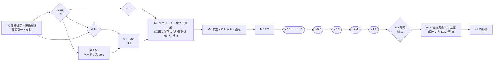

# 08. ロードマップ (Roadmap)

| 項目 | 内容 |
|---|---|
| 文書ID | 08-roadmap |
| 状態 | ドラフト |
| 前提 | [01-requirements](01-requirements.md) (要件 ID・優先度・版) / [10-decisions](10-decisions.md) (ADR・OQ) / [09-testing-quality](09-testing-quality.md) (品質ゲート) |
| 正本 | 版 (v0.1〜v1.0、v1.L、v1.X) の範囲・順序・ゲート、**P0 検証スパイクの一覧と合否基準**、実装着手ゲート、繰り越し記録、1.0 の判定と **TUI 完成の定義** ([02 §12.1](02-architecture.md#121-文書と-crate-の対応)) |

> 本書は要件を追加しない (要件の追加・変更は 01 で行う)。各版の範囲は 01 の要件 ID と「版」列で表す。日付ではなく **ゲート (終了条件)** で区切る (個人開発 + AI コーディング支援・仕様書駆動のため)。
>
> 方針 (確定): **リリース最優先の段階リリース** ([ADR-0028](10-decisions.md#adr-0028-リリース最優先の段階リリース))。確定 (ユーザー回答): v0.1 の範囲 (OQ-40 / 110 / 63。**最小核 (案 L)**: 単一文書・リテラル検索・ヘルプ画面なし等、[ADR-0042](10-decisions.md#adr-0042-v01-の最小核-案-lwindows-のみの出荷日本語のみの-ui) と 10 の「v0.1 の範囲から外した項目」)、**v0.1 は Windows のみ出荷** (Windows 11 の Windows Terminal と conhost。Windows 10 は v0.2 以降の候補。**macOS / Linux は v0.2 で出荷**、OQ-15)、**v0.1 の利用者向け文書は日本語を正** (英語版は v0.2、OQ-21)、**ブランチと公開の運用** (`main` はリリース用で `main` の docs/ はリリースした版の仕様、開発は `develop` (開発の本線。作業ブランチから PR で入れる)、機能リリースは `0.y.0` 単位、バグ修正のリリースはパッチ版 (`0.y.z` の z)、v0.1.0 までの `0.0.x` は内部カウンタ、OQ-167。公開リポジトリは public のまま開発し、docs/ も最初の push から公開する、OQ-168)、**UI の文言は v0.1 は日本語のみで、英語 UI は v0.2** (OQ-21。起動前・パニック時の文言も同じ、OQ-67)、crates.io への公開は **1.0 の前** (OQ-20、確定 (ユーザー回答))、v0.1 で ISO-2022-JP を含む日本語レガシー文字コードを読み書きする (OQ-03)、スワップは v0.2 の最優先 (OQ-42)、AI は **ローカル LLM を一級市民として先に深く** 対応する (ADR-0034 / 0036)、実装着手ゲートに必須の ADR (スパイクに依存する ADR-0004 / 0005 / 0016 / 0023 / 0026 は条件付き確定)、キー操作の基本規則 (OQ-02 / 26 / 29 / 30 / 38)、改行コードの保持 (OQ-04)、ISO-2022-JP の保存方式と S-01 不合格時の退路 (OQ-162)、補完の送信範囲 (OQ-132 / 135)。状態の一覧は [10](10-decisions.md)。ライセンス・配布は [12-licensing-distribution](12-licensing-distribution.md)。ゲートの細目のうち未決のものは提案中 (OQ を付けた)。

---

## 1. 版の概観



> v1.L は 1.0 の後に始めてよい (TUI 完成 (§8.1) を待たなくてよい)。

| 版 | 名称 | 目的 | 1.0 との関係 |
|---|---|---|---|
| P0 | 仕様確定・技術検証 | 仕様書の確定と、技術的前提 (ropey・crossterm/Windows・IME・文字コード・保存) の実測 | — (成果物にコードを含めない) |
| **v0.1** | 最小核 | 「Windows の主要端末 (Windows Terminal・conhost) で、1 つのテキストファイル (UTF-8 と Shift_JIS / EUC-JP / ISO-2022-JP 等) を開き、日本語で編集し、文字列で検索し、元の形式のまま原子的に保存できる。異常終了しても未保存の内容は退避される。TrueColor で速い。UI は日本語」(01 §4.1)。加えて再読込・改行コードの変換・リテラルのすべて置換・全角スペースとタブの可視化 (確定 (ユーザー回答)、§2.2)。macOS / Linux は出荷しない | 0.x |
| v0.2 | 日常の不足を埋める | スワップ (最優先)、v0.1 で外した項目 (複数文書・正規表現の検索・ヘルプ画面・OSC 52 等、10 の「v0.1 の範囲から外した項目」)、ソフトラップ、1 件ずつの置換、マウス、行操作、ユーザーキーマップ (単一キー)、外部変更のフォーカス復帰時確認。**macOS / Linux の出荷、英語 UI** (確定 (ユーザー回答)) | 0.x |
| v0.3 | 日本語と巨大ファイルの完成版 | 保持方式、不正バイト文書の編集、Partial 表示、複数行正規表現、長大行 50 ms、ユーザーの言語ファイル (候補、提案中。日本語 UI は v0.1、英語 UI は v0.2) | 0.x |
| v0.4 | 実用化 | 日常使いに要る機能 (分割・ファインダ・横断検索・監視・ハイライト・複数カーソル・チョード・言語別/ワークスペース設定・配布チャネル) | 1.0 候補 |
| **v1.0** | 安定化 | v0.4 + 不具合修正 + 長時間稼働・ユーザーテスト・カバレッジのゲート | 1.0 ([OQ-44](10-decisions.md#oq-44-10-の判定条件)) |
| v1.L | 言語支援・AI 基盤 | LSP クライアント、AI プロバイダ抽象。**ローカル LLM (llama-server 等) を一級市民として先に深く対応** する。段階は v1.L-a (承認基盤 + ローカル LLM での指示編集 (v1.L-a1) と FIM 補完 (v1.L-a2)) / v1.L-b (チャット・クラウド・MCP サーバ候補・ローカルサーバの管理モード) (ADR-0036 で確定) | 1.x |
| v1.X | 拡張 | 外部プラグイン、外部エージェント連携 (ACP)、リモートのインライン補完と補完の高度化、MCP クライアント | 1.x〜 |

---

## 2. 各版の定義

**各版に共通の成果物 (v0.1 以降、ADR-0040)**: エディタ内に更新機能を持たないので、各リリースで **更新手順の文書** を出す。(1) リリースノートの「更新の方法」(配布経路ごとの手順と、その版で要る移行手順 (設定キーの改名等))。(2) 配布経路やデータの扱いが変わった版では、利用者向け README の「更新」節 (05 §18.10〜§18.12) を改訂する。(3) 脆弱性の修正を含む版は `SECURITY.md` と GitHub Security Advisory でも知らせる (05 §18.14、OQ-164)。確認の手順は 09 §8.2 / §9.2。

### 2.1 P0: 仕様確定・技術検証

| 項目 | 内容 |
|---|---|
| 目的 | (1) docs/ を PO 確認済みの状態にする (少なくとも v0.1 の範囲)。(2) v0.1 の技術的前提をスパイクで実測し、関係する ADR とスパイク区分の OQ を確定させる。(3) 開発運用の文書と設定 (11-dev-workflow、`CLAUDE.md`、`.claude/`) を用意する (ADR-0033。コードではないので ADR-0001 の対象外) |
| 成果物 | 確定版の仕様書 (ADR・OQ の状態の更新)、OQ の回答記録 (10)、スパイク報告 (`spikes/<ID>/REPORT.md` に結果・計測値・結論。端末のスパイクのコードは使い捨て。S-01 の判定に使うテストは本番 crate (eve-encoding) に置く、ADR-0001)、07 の v0.1 CommandId カタログ、11-dev-workflow と `CLAUDE.md` 初版などの M0c の成果物 (§4。手書きの最小限で、規範行 ID は付けない) |
| 終了条件 | [§5 実装着手ゲート](#5-実装着手の条件-仕様確定のゲート) の G1a (ヘッドレス core の着手) |
| 主要リスク | (a) Windows の入力の自前ループ (`ReadConsoleInputW`) のバースト検出で FR-206 / NFR-111 が成立しない (S-07) → N・T の調整と既知の制約。(b) ratatui 差分と曖昧幅 2 の衝突 (S-06) → 自前差分。(c) ropey の性能・メモリが NFR-104/202 未達 (S-02。M1 のマイクロベンチで暫定判定、最終は M3) → crop 切替 (`TextStorage` で隔離済み)。(d) PO 回答の遅延 → 着手遅延 (G1a を v0.1 関係に絞って緩和)。Windows のログオフ・シャットダウン時の退避は v0.1 では作らず既知の制約にする (隠しウィンドウ方式は v0.2) |
| 依存 | PO の回答 (10 の「人間 (PO) が決める事項 (残件)」)、基準機 (Windows の開発 PC、OQ-23 で確定) |

### 2.2 v0.1: 最小核

| 項目 | 内容 |
|---|---|
| 目的 | 01 §4.2 の Must を満たす最小エディタを Windows 向けに出す。公開面 (01 §4.2 の表) は v0.1 で形を決め、後の版の拡張点 (01 §4.4) を壊さない形で入れる。v0.1 で外した項目 (10 の「v0.1 の範囲から外した項目」) は、後で入れても公開面が壊れない (additive な) 形で名前と型を予約する |
| 範囲 | 01 §4.2 (各要件の「版」列が v0.1 のもの)。Should は記録・監視 (例: NFR-708 のトレーサビリティは v0.1 は AC ID のチェックリスト、v0.2 で `xtask trace`) と、v0.1 で実装する次の機能 (確定 (ユーザー回答)、[ADR-0043](10-decisions.md#adr-0043-v01-の範囲に-filereloadfileset_line_endingリテラルのすべて置換全角スペースタブの最小可視化を含める)): 明示の再読込 `file.reload` (FR-117 の Should の部分)、改行コードの変換 `file.set_line_ending` (FR-113、Must)、リテラルのすべて置換 (FR-403 の v0.1 の範囲、Should)、全角スペースとタブの最小の可視化 (FR-508 の v0.1 の範囲、Could)。このうち Should / Could のものはリリースゲートに含めず、間に合わなければ v0.2 へ繰り越して §7 に記録する (01 §1.2)。対象は Windows 11 の Windows Terminal と conhost (確定 (ユーザー回答)、OQ-15。Windows 10 は検証環境が無いので v0.2 以降の候補、05 §1.1)。macOS / Linux は出荷しない (v0.2 で出荷)。core 系 crate は OS に依存しないまま保ち、Linux CI 対象 (core 系 crate と `eve-host`・`eve-testkit`、02 §4.7) の CI の Linux のビルドとヘッドレスのテストで移植性を守る |
| 成果物 | crate: eve-text / eve-encoding / eve-view / eve-config / eve-core / eve-platform / eve-host / eve-tui / evoeditor (bin) / eve-testkit (ヘッドレス参照レンダラを含む)。GitHub Releases (**Windows x86_64 のアーカイブ (zip)** + SHA256SUMS + minisign、05 §18) と `cargo install --locked --git <repo> --tag v0.1.0 evoeditor` (crates.io への公開は 1.0 の前。OQ-20、確定 (ユーザー回答))。macOS / Linux のバイナリは出さない。日本語の UI (同梱の言語ファイル `ja`。確定 (ユーザー回答)、OQ-21)。アーカイブに同梱する `LICENSE`・`NOTICE` (M0e で作る、§4・12 §3.2)・`THIRD-PARTY-NOTICES.md`・`config.example.toml` (05 §18.2)。CHANGELOG。**利用者向けの文書は日本語を正** (README・リリースノート・`docs/user/`。英語版は v0.2、確定 (ユーザー回答)、OQ-21): 利用者向け README の「インストール」節 (05 §18.2a)・「アンインストール」節 (05 §18.8)・署名の検証の手順 (05 §18.9)、既知の制約をリリースノートと利用者向け README に明記 (01 §4.6。ヘルプ画面は v0.2)。リリースノートは「概要・インストールと検証の手順・更新の方法・移行手順・既知の制約・報告の窓口」の節を持つ雛形を M5 で用意し、各版で使う。**更新手順の文書** (ADR-0040、確定 (ユーザー回答)): 利用者向け README の「更新」節 (配布経路ごとの更新手段・更新とダウングレード・直前の版に戻す手順。v0.1 は Windows のアーカイブと `cargo install` の手順、05 §18.10〜§18.12) とリリースノートの「更新の方法」(01 §4.2 の利用者向け文書) |
| 内部マイルストーン | **M1** ヘッドレス core (eve-text + eve-encoding + eve-core + testkit で開く・編集・Undo・保存 (`MemFs`) のシナリオが通る。M1 の「開く」は UTF-8 だけで、文字コードの判定と変換 (FR-108 / 109) は M3。開く文書は 1 つだが、文書の集合 (`DocumentId` の表) は内部で残す。境界型は C0 流動。**S-02 の判定** (時期は提案、OQ-173): ropey 1.6 を条件付きで採用し、M1 では eve-text 単体のマイクロベンチ BM-S02 (入力はメモリ上のバイト列、09 §5.2) で暫定判定する。BM-105 は M1 の core 完成後 (ヘッドレス・`MemFs`)、BM-104 / 202 は実 Port で読み込める M3 で測り、ADR-0004 の最終判定は M3 の完了時 (M5 で再確認)。不合格なら crop に切り替える) → **M2** TUI 表示と入力 (Windows Terminal・conhost。ratatui 描画、キーマップ、IME 位置、全 UI 部品を一度描く。境界型は C1 = TUI とヘッドレスの Frame 消費者 (ASCII・ヘッドレス参照レンダラ) の二重消費) → **M3** 文字コード (ISO-2022-JP の保存を含む)・保存 (Windows の手順、05 §4.2)・緊急退避 (往復コーパス・kill テスト・未知の `format_version` の退避を変更・移動・削除しないテスト (09 §3.4)。**`fuzz_decode` の導入** (`fuzz/` のターゲットと最小コーパス、夜間ジョブでの 10 分の実行と暗号化したクラッシュ入力の artifact。09 §3.3 / §6.3) も M3 の完了の条件に含める (リリースゲートの 7 日の観測を M5 に間に合わせるため)。**M2 の完了時 (M3 の端末に依存する部分を始める時点) に境界型を C2 ソフト凍結する** (推奨、OQ-123 で確定する (提案中))。M3 のうち端末に依存しない部分 (eve-encoding の判定・変換・照合、eve-platform の保存 (G1c の後)、退避の manifest と書き手) は M1 と並行して進めてよい。M3 の完了は M2 の後 (緊急退避の kill テストと往復の確認に TUI と bin を使う)) → **M4** 検索 (リテラルと大文字小文字の区別)・パレット・設定 → **M5** RC (互換性マトリクス (Windows Terminal と conhost、05 §9.4)・性能の判定・リリースのチェックリスト (09 §8.2) の記入) |
| 要件の割当 (01 §4.2。v0.1 の Must は 87 件) | 各マイルストーンで実装し AC を通す主な要件。細かな割当はタスク分割 (11) で決め、漏れはトレーサビリティのチェックリスト (AC ID の一覧) で検出する。**M1**: FR-104 / 107 / 124、FR-201〜204、FR-301〜306、FR-601 (権限判定フックと `CommandSpec.permission`。値は 07 §11.6 の `perm` 列)、NFR-105 / 203 / 406 / 701 / 704 / 706 / 707 (AC は下の「M1 で通す AC」)。**M2**: FR-101 (bin `evoeditor` の起動と CLI。G1b の後)、FR-205 (Windows のクリップボードと内部レジスタ) / 206、FR-501〜507 / 511 / 512 / 513 (と Could の FR-508 の全角スペースとタブの可視化)、FR-603 / 605 / 606 / 609、NFR-101〜103 / 106 (読み取り専用での表示) / 201 / 204 / 403 / 503 / 604 / 605。**M3**: FR-101 AC-2 / FR-104 AC-3 (実際のファイルシステムへの保存)、FR-105 / 106 / 107 AC-2 (コンソールクローズでの緊急退避) / 108 / 109 / 111〜117 (FR-113 の変換コマンドと、Should の FR-117 の明示の再読込 `file.reload` を含む) / 122 / 127、NFR-104 / 107 / 202 / 301〜304 / 404 / 502 AC-1 / 504 / 505。**M4**: FR-401 / 402 (大文字小文字の区別) / 404 (と Should の FR-403 のリテラルのすべて置換)、FR-514 (パレットで代用)、FR-601 AC-1 (`--list-commands` とパレット)、FR-602、FR-701〜703、NFR-602 (全エラーメッセージのレビュー) / 603 (全文言)。**M5**: v0.1 の Must の AC の全件判定 (NFR-305 の fuzz、NFR-401 / 402 の Windows の端末、NFR-501 AC-1 / 502 AC-2 / 507、NFR-707 AC-2、性能の判定値) |
| M1 で通す AC | M1 の完了の判定に使う AC (ヘッドレス。保存先は `MemFs`、開くのは UTF-8 だけ)。FR-104 AC-1、FR-107 AC-1 / AC-3、FR-124 AC-1、FR-201 AC-1、FR-202 AC-1、FR-203 AC-1〜AC-3、FR-204 AC-1〜AC-4、FR-301 AC-1 / AC-2、FR-302 AC-1、FR-303 AC-1 / AC-2、FR-304 AC-1、FR-305 AC-1、FR-306 AC-1、FR-601 AC-2 (**判定方法**: M1 は eve-core のテスト (`eve-docs-tables` で 07 §11.6 の `perm` 列を読み、組込みコマンドの `CommandSpec.permission` と突合する、09 §6.2 の `docs-tables` の (3)) とレビューのチェックリストの「権限」の行。M1 の時点では登録済みのコマンドが少なく合格が自明になるので、コマンドがそろう M4 で再判定し (M2 以降は eve-tui と bin の `--list-commands` の突合も加わる)、M5 で全件を判定する)、NFR-105 (NFR-101〜105 AC-1 のうち NFR-105)、NFR-203 AC-1 / AC-2、NFR-406 AC-1、NFR-701 AC-1、NFR-704 AC-1 (**判定方法**: M1 は `unsafe` を持たない crate (core 系・eve-testkit・eve-host の端末に依存しない部分) の `#![forbid(unsafe_code)]` の検査 (`xtask check-deps`、09 §7 R5) とレビュー。`unsafe` を持つ eve-platform / eve-tui の FFI が入る **M2 以降に再判定** し (SAFETY コメントと `cargo geiger` の記録)、M5 で全件を判定する)、NFR-706 AC-1、NFR-707 AC-4 / AC-5 / AC-6。**M1 で通さない AC** (同じ要件でも後のマイルストーンの成果に依存するもの): FR-101 AC-1 (bin の起動と終了コード。G1b の後の M2)、FR-101 AC-2 と FR-104 AC-3 (実際のファイルシステムへの保存と mtime。M3)、FR-107 AC-2 (コンソールクローズでの緊急退避。M3)、FR-601 AC-1 (`--list-commands` とパレット。M4)、NFR-707 AC-2 (v0.1 の全 AC の Harness での表現。M5)。S-02 の判定ベンチは BM-S02 が M1、BM-105 が M1 の core 完成後、BM-104 / 202 が M3 (提案、OQ-173)。NFR-104 / 202 の AC の判定は M3 と M5 |
| 文言カタログ (v0.1 のタスク) | **文言カタログ (`ja`)** (NFR-603、07 §17): M1 で MessageKey の列挙と `locales/ja.toml` を core のメッセージから起こし、キー集合の検査 (`ja` とコードの MessageKey 一覧の差分、09 §11) を CI に入れる → M2 でヒント幅の検査を入れる (04 §15.1 の文言表を設計入力に) → M4 でパレットのコマンド名 (`cmd.*`) を含む全文言を揃え、文言の人手レビュー (11 §8) を終える → M5 で主要画面のスナップショットと手動シナリオを確認する。文言の追加は各タスクの PR で行う (後でまとめて書かない)。英語の文言カタログ・設定項目の説明 (`config.*`)・言語の選択は v0.2 (確定 (ユーザー回答)、§2.3) |
| リリースゲート | **判定の正本は 09 §8.2 の表とリリースのチェックリスト** (`docs/compat/<version>/release-checklist.md`)。本欄は v0.1 で判定する項目の要約で、各項目は 09 §8.2 のどれかの行で判定する。(1) v0.1 の Must の AC (01 §5.1〜5.4) がすべて合格 (暫定 AC は P0 / 実装中の計測で確定済み)。このうち NFR-603 は、同梱の `ja` とコードの MessageKey 一覧の **キー集合の差分ゼロ**、ヒント幅の検査、全シナリオの合格を含む。(2) 01 §3 の v0.1 の判定値を基準機 (Windows の開発 PC、OQ-23) で満たす (01 §5.4 の NFR-101〜107 と NFR-201〜204 の AC。NFR-101 / 102 は (a) プロセス内と (b) spawn からの両方、NFR-104 は 1/10/100 MB、NFR-106 は閾値超の行を含む文書の読み取り専用での表示、NFR-107 は保存中の入力)。CI での回帰検知 (iai) は v0.2。(3) データ保全のテストが合格: 保存の kill テスト (Windows)、往復コーパス (区分 A と無編集保存、ISO-2022-JP の編集後保存)、表現不能・黙示置換の検出 (ISO-2022-JP の半角カナを含む)、区分 B (ISO-2022-JP のエスケープ選択を含む) の検出と確認、緊急退避 (パニック注入・CTRL_CLOSE・CTRL_C / CTRL_BREAK の外部送信・メインがブロックした状態の CTRL_CLOSE)、ダウングレードの検査 (未知の `format_version` の退避を読まず・変更・移動・削除しない、01 NFR-302 AC-6)。(4) fuzz の `fuzz_decode` (01 NFR-305): リリース候補のコミットで 1 時間回してクラッシュ 0、かつ **リリース候補の先頭 (`develop`。凍結中は `develop` への merge を保留する) を対象にした** 直近 7 日の夜間 fuzz (10 分) が毎日実行されクラッシュ 0 (パッチ版も同じ) (7 日の観測は 1 時間の実行の代わりにならない。暦日がかかるので RC と並行して回す。09 §8.2 の fuzz の行)。cargo-deny と cargo-audit が通る。無通信は Windows の配布ビルドの依存の禁止 crate のリスト (cargo-deny) と依存規則 R3 の検査とレビューで判定する (01 NFR-501 AC-1。Linux の CI でのネットワークのシステムコールの検査は v0.2 の NFR-501 AC-2)。(5) Windows Terminal と conhost (NFR-402) で手動シナリオ「開く・日本語入力・検索・保存・終了」が通る。(6) 既知の制約 (v0.1 は Windows 11 のみ、単一文書、長大行は読み取り専用、Windows のログオフ・シャットダウン時の退避なし、署名なしの exe と Smart App Control 等、01 §4.6) を **日本語の** リリースノートと利用者向け README に明記 (英語版は v0.2、OQ-21)。インストール・アンインストール・署名の検証の手順 (05 §18.2a / §18.8 / §18.9) がある。(7) C を含む依存 0 (NFR-207)。(8) リリース前のセキュリティの確認 (01 NFR-502 AC-2): 開くファイルのパスの扱い (UNC パスを開いたときに認証情報が送られ得ることを既知の制約に書くか)、実行ファイルと同じフォルダの DLL を読み込まない設定 (DLL の検索順) を確かめ、結果を記録する (ゲートの判定は「確かめて記録した」こと)。(9) 報告窓口の確認: 報告窓口 (Issues・`SECURITY.md`・private vulnerability reporting) は M0e で有効にしてある (12 §5.6 の PC-7)。リリースを publish する前に、パニック時の文言が案内する Issue の URL (04 §14.4) がこの窓口を指すことと、`SECURITY.md` に更新方法の案内があることを確かめる。(10) ライセンスと名称: 12 §3.8 の LR-1 (Apache-2.0 の特許条項と `NOTICE` の運用の確認) と LR-4 (名称の商標の簡易照会) が済んでいる (09 §8.2 の「ライセンス・名称」の行)。(11) 配布経路の検証 (タグの後に draft の成果物で行い、結果は Release のノートに書く): `cargo install --tag` の経路 (MSRV のツールチェーン)・クリーンな Windows 11 (Visual C++ 再頒布パッケージなし。`+crt-static`) での手動インストール・Smart App Control での挙動を確かめる (09 §8.2 の「配布経路の検証」の行)。**報告するがゲートにしないもの** ([ADR-0039](10-decisions.md#adr-0039-v01-の範囲の整合と先行投資の縮小)): 推移的依存の数 (目安 ≤ 90、NFR-207 は Should)、境界型の `CONTRACT_VERSION` の値 (v0.1 は C2 ソフト凍結を維持し、契約版 1 の固定 (C3) は v0.1 の後に行う、02 §8.4)。NFR-601 の簡易ユーザーテストは v0.2 (OQ-106) |
| CI・夜間 (v0.1) | ブランチは OQ-167 (11 §9.1): 作業ブランチ → `develop` → `main` (リリース時だけ)。CI のトリガは 09 §6。GitHub Actions は M1 のタスク (0) で CI を置いたときから有効にする (public のリポジトリでは標準のランナーが無料、OQ-168)。PR と `develop`・`main` は Windows x86_64 (全テスト・ConPTY の E2E 10 シナリオ) + Linux x86_64 (Linux CI 対象 (core 系 crate と `eve-host`・`eve-testkit`、02 §4.7) のビルドとヘッドレスのテスト。移植性の確認)。macOS の CI と Tier B のビルドは v0.2。夜間は `fuzz_decode` (10 分。M3 で導入)・audit (`fuzz/` を含む)。夜間ジョブの対象は `develop` (変数 `NIGHTLY_REF` の既定も `develop`。リリース候補の期間も `develop` の先頭を対象にするので切り替えは不要、09 §6.1)。1 時間の soak・iai・補助ジョブ (msrv・min-features・cargo-hack・udeps・outdated・docs-rs・geiger・area-check) は v0.2 (09 §6)。トレーサビリティは AC のチェックリスト (`tests/ac-checklist.toml`、11 §3.3) で代用し (`spec:` は節 ID、`verifies:` は AC ID で書く)、`xtask trace` は v0.2。駆動 API の CI は駆動 API の実装と同時 (v0.2 以降)。**運用ワークフローの作成時期** (推奨案、提案、OQ-172。作成の工数は工数の見立ての「CI・テスト・計測」に含み、配分は変えない): `ci.yml` は M1 のタスク (0)。09 §6.2 の 2 段目の必須チェックは、そのジョブを足す PR のマイルストーンで必須に加える: `i18n`・`docs-tables` は M1 (タスク (0) の `xtask` と `eve-docs-tables` と同時)、`e2e`・`build-release-smoke`・`check-themes` と `docs.yml` の生成リファレンスの検査 (`xtask gen-reference --check`) は M2 (bin ができる)。`bench.yml` は M2 (bin ができて BM-101a・BM-103a・BM-205 を測れる。手動実行)、`nightly.yml` は M3 (`fuzz_decode` の導入と同時)、`release.yml` と `docs.yml` の完成は M5 まで (`release.yml` は M4 までに dry-run を一度通す) |
| 最初の縦切り (M1 のタスク順) | (0) リポジトリの準備 (M0e で push 済みの `develop` に PR で入れる)・`Cargo.toml` を含む workspace の骨格・`.gitattributes` への `testdata/** -text` 等の追加 (09 §4。テキストの改行を LF に固定する行は M0e で置く)・`.cargo/config.toml` (Windows の CRT の静的リンク `+crt-static`、11 §1)・**`deny.toml`** (05 §17.1 の許可リスト。ADR-0018 は確定 (ユーザー回答、2026-10-20) で暫定ではない。`NCSA` は `fuzz/` 側のみ、§5)・CI の最小構成 (Windows と Linux。GitHub Actions はここから有効。`dco` と `gitleaks` 相当の秘密検出 (OQ-169) を含み、最初の必須セット (09 §6.2) をブランチ保護の必須の CI に加える)・`xtask` (gen-corpus・check-deps・i18n の検査・速い車線 `xtask check` (中身は 09 §6.1 / 11 §8.1 と同じ: fmt・clippy・`nextest -p eve-text -p eve-encoding -p eve-core`・check-deps・`tests/ac-checklist.toml` の軽い検査・変更した crate の `Harness` のシナリオテスト)。`gen-reference` は bin ができる M2 から使う。spec-index の生成と scenario run は v0.2。v0.1 の `xtask` は計 8 個 (`check`・`check-deps`・`check-themes`・`i18n`・`gen-corpus`・`gen-reference`・`nightly`・`bench`、11 §1) で、v0.1 の中で順次追加する: タスク (0) は `check`・`check-deps`・`i18n`・`gen-corpus`、M2 は `gen-reference`・`check-themes`・`bench`、M3 は `nightly`) と、docs の表を読む `eve-docs-tables` (`publish = false`)。リポジトリ直下の `.gitignore` が製品のパス (`bins/evoeditor/` 等) を除外していないことを確かめる (11 §1) → (1) eve-text (ChangeSet・Undo のプロパティテスト) と S-02 の暫定判定のマイクロベンチ (BM-S02) → (2) eve-testkit のハーネス (Rust の `Harness`・`MemFs`・手動時計) → (3) eve-core / eve-host の端末に依存しない部分 (`Host::step`・ジョブ) で「開く・編集・Undo・保存 (MemFs)」のシナリオと BM-105 (S-02) → (4) ヘッドレスでの起動から最初の Frame の生成までのベンチ (端末への書出しまでを測る BM-101a は eve-tui が入る M2 で測る)。タスク (0) の `xtask` は開発用ツールで、ゲートの対象外 (§5) |
| 主要リスク | 日本語周り (IME・幅) の端末差 (Windows Terminal と conhost)、Windows 端末の入力経路、性能目標 (プロセス内起動 8 ms・入力 2 ms) の未達、スコープ肥大 (01 §4 で抑制) |
| 工数の見立て | **約 26〜40 週** (フルタイム換算、1 人 + AI 支援)。根拠は次の分類別の合計 (週) で、合計は約 33.1 週: P0・開発運用 2.6、基盤 (型・Port・crate) 4.9、ファイル・保存・文字コード・緊急退避 7.7、編集・移動・検索 5.3、表示・入力 7.3、設定・CLI・文言 1.2、CI・テスト・計測 3.6、配布・利用者向け文書 0.5。このうち安全と日本語の核 (ファイル・保存・文字コード・緊急退避 7.7、表示・入力 7.3) が 15.0 週 (約 45%)。幅は合計の約 0.78〜1.2 倍。再読込・改行コードの変換・リテラルのすべて置換・全角スペースとタブの可視化の分は約 2.4 週で、内訳は再読込 (読込の経路は開き直しと共用、Undo できる全置換と書式の戻し、確認ダイアログ) 0.6 と改行コードの変換 (同期とジョブの ChangeSet、`default_eol` の戻し) 0.4 をファイルの分類に、リテラルのすべて置換 (置換欄、ジョブの ChangeSet と作り直し) 0.8 を編集・移動・検索に、全角スペースとタブの可視化 (Frame 生成とロール) 0.3 を表示・入力に、パレットの引数・文言 0.1 を設定・CLI・文言に、シナリオと Frame の検査 0.2 を CI・テスト・計測に含む |
| 依存 | G1a / G1b / G1c (§5) |

### 2.3 v0.2: 日常の不足を埋める

| 項目 | 内容 |
|---|---|
| 目的 | 日常的に使って足りないものを埋める。データ保全の残り (スワップ) を最優先で入れる |
| 範囲 | 01 §4.3 の v0.2 行。**最優先: FR-118 / NFR-307 (swap-lite と復旧 UI)** (OQ-42)。**v0.1 で外した項目** (10 の「v0.1 の範囲から外した項目」の「実装される版」が v0.2 のもの): 複数文書とバッファ一覧・全保存 (FR-103)、`+行` (FR-102)、正規表現の検索、ヘルプ画面、OSC 52、Windows のログオフ・シャットダウン時の退避 (隠しウィンドウ方式、S-11 の残り)、長大行の編集、読み取り専用の解除コマンド、ヒントバーの非表示と文脈の細分、色の 256 / 16 段の明示値、v0.1 で公開しなかった設定キー・コマンド・CLI オプション、TOML のシナリオ DSL、`fuzz_editor`、iai・soak・補助ジョブ、規範行 ID と `ownership.toml`。**対象の拡大 (確定 (ユーザー回答))**: (1) **macOS / Linux の出荷** (OQ-15): 05 の「v0.2 (macOS / Linux 出荷時)」の Unix の実装 (保存手順・モードと所有者・シンボリックリンク / ハードリンク・シグナル・XDG のパス・クリップボード)、Must 端末 Terminal.app・iTerm2 (macOS)・GNOME Terminal・tmux (Linux)、§3.1 の項目の確認 (S-10、S-11 の Unix 分、S-06 / S-08 / S-14 / S-20 の macOS / Linux 分、手動受入)、署名・公証の準備 (OQ-76。Windows のコード署名 OQ-75 は v0.4)、実機確認の手段の確保 (基準機の追加、OQ-23 (d)。v0.2 着手前に実施)、CI の macOS ジョブ。(2) **英語 UI** (OQ-21): MessageKey に `en` を加え、`ui.locale`・`--locale`・`EVE_LANG`・OS ロケールによる言語の選択と、言語間のキー集合の差分の CI 検査を入れる。(3) 起動前・パニック時の文言の英語 (ASCII) の行の併記 (OQ-67) と、利用者向け文書 (README・リリースノート・`docs/user/`) の英語版 (OQ-21)。(4) **候補**: Windows 10 を対象に加えるか (検証環境を用意できた場合。確認事項は 05 §1.1。加えるかは v0.2 着手前に決める)。ほかに起動時の復旧提案 (Windows)、ソフトラップ (OQ-110)、1 件ずつ確認する置換と正規表現の置換 (FR-403。リテラルのすべて置換は v0.1)、マウス (OQ-63)、行操作とインデント、単一キーのキーマップ上書き、フォーカス復帰時の外部変更確認 (明示の再読込 `file.reload` は v0.1)、空白の可視化の切替の設定 (`view.show_whitespace`。全角スペースとタブの可視化は v0.1)、`path:行:桁`、メッセージ履歴、サスペンド、単語単位検索、Backspace の単位の設定、xattr・ACL・ADS の保持、設定の手動再読込 (`config.reload`、FR-706。自動再読込は v0.4)、CLI の追加、背景を塗る組込みテーマ (`ansi` を含む) とテーマファイル、パレットのファジー検索、端末ごとの幅補正表、which-key、拡張キーボードプロトコル、LazyFS の夜間ジョブ、wall-clock の A/B (NFR-703)、`xtask trace`、更新後の初回起動の要点表示 (FR-518、Could。07 §18.8 の `last_version.toml`)。基盤のうち v0.1 で型・名前だけ予約したもの (ADR-0039) は最初の利用者と同時に入れる: 駆動 API (dev、S-21)、フォーカスイベント (フォーカス復帰時の確認と同時) |
| 成果物 | GitHub Releases に Windows x86_64 の zip に加えて、macOS aarch64 の tar.gz (ad-hoc 署名、OQ-76) と Linux x86_64 / aarch64 の musl 静的版の tar.gz (OQ-112)。いずれも `SHA256SUMS` + minisign。Tier B のビルド (macOS x86_64・Windows aarch64)。同梱の言語ファイル `ja` と `en`。CI の macOS ジョブ。macOS / Linux の互換性マトリクス (05 §9.4) の記入と性能の記録 (OQ-23 (d))。利用者向け README の macOS / Linux の導入・更新の手順 (quarantine の解除を含む、05 §18.4) |
| 追加ゲート | SIGKILL 後の復旧テスト (01 §5.5 FR-118)、NFR-307、v0.2 の Must の AC (Linux の CI でのネットワークのシステムコール 0 の検査 (01 NFR-501 AC-2) を含む)。**macOS / Linux**: S-10 と S-11 の Unix の経路の合格、Unix の kill テスト、§3.1 の項目の実機での確認、Terminal.app・iTerm2・GNOME Terminal・tmux での手動受入 (09 L7)、CI の macOS ジョブの合格。**英語 UI**: 同梱の `ja` と `en` のキー集合がコードの MessageKey 一覧と一致し、言語間の差分もゼロ (CI)、両言語でシナリオが合格、`en` のヒント幅の検査。**前提**: macOS / Linux の出荷には実機確認の手段 (基準機の追加、OQ-23 (d)) の確保が要る。確保できない OS は出荷を次の版に延期する (提案中) |
| 工数の見立て | v0.1 から外して v0.2 に入れる項目 (10 の「v0.1 の範囲から外した項目」の #24〜#49 のうち v0.2 のもの。v0.1 で実装する `file.reload` を除く) は約 9.0 週。うち macOS / Linux の出荷が約 2.4 週、英語 UI と言語の選択が約 0.7 週 (起動前・パニック時の英語の行を含む)。これに macOS / Linux の実機確認の環境の準備 (OQ-23 (d)) と、v0.2 で新たに入れる機能 (スワップ・ソフトラップ・1 件ずつの置換・マウス等) が加わる。v0.2 全体の見積りは v0.2 着手前に行う (提案中) |
| 依存 | v0.1 リリース。OQ-17 / 48 / 109 の回答。macOS / Linux の出荷は OQ-23 (d) (基準機の追加)・OQ-76・OQ-112 の回答 |

### 2.4 v0.3: 日本語と巨大ファイルの完成版

| 項目 | 内容 |
|---|---|
| 目的 | 日本語のレガシー資産と巨大ファイルの扱いを完成させる |
| 範囲 | 01 §4.3 の v0.3 行。ADR-0026 (2) 保持方式 (NFR-303 の区分 B をバイト一致に)、NFR-304 不正バイトを含む文書の編集、その他の文字コード、CP932 互換文字の検索での同一視 (OQ-41)、Partial による先行表示、複数行の正規表現 (S-04)、NFR-106 の 50 ms (列チェックポイント)、標準入力、バックアップ、ユーザーの言語ファイル (`locales/<lang>.toml`。v0.2 以降の候補で推奨は v0.3、OQ-21)、高コントラストテーマ、幅プローブ (S-15)、clippy の pedantic と `missing_docs` (NFR-705) |
| 追加ゲート | 往復コーパス全体のバイト一致 (区分 B を含む) |
| 依存 | v0.2 リリース。OQ-41 / 60 / 108 の回答 |

### 2.5 v0.4: 実用化

| 項目 | 内容 |
|---|---|
| 目的 | 日常使いのエディタにする |
| 範囲 | 01 §4.3 の v0.4 行。FR-509 分割、FR-125 ファインダ、FR-405 横断検索、FR-117 監視、FR-801 / 802 / NFR-110 tree-sitter、FR-123、FR-211 複数カーソル、FR-604 チョード、FR-704 / 705 言語別・ワークスペース設定 (信頼の仕組み、OQ-35)、FR-706 設定の自動再読込、FR-510 タブライン、FR-308〜311 / 209 / 210 / 212 / 214 / 216 等、NFR-405、互換性マトリクスの全項目、配布チャネル (Homebrew / Scoop / AUR / winget / binstall、SBOM、補完、man)、Windows コード署名 (OQ-75)。README の「更新」節に各チャネルの更新コマンドを加える (05 §18.10)。明示実行の更新確認 `evoeditor --check-update` (ADR-0041。コマンド名は確定 (ユーザー回答)、採否は提案中) を採るかを着手前に検討する |
| 追加ゲート | NFR-205 (30 MB)、互換性マトリクスの全項目、カバレッジのゲート (NFR-702) |
| 依存 | v0.3 リリース。ADR-0015 の確定、OQ-22 / 35 / 103 / 120 の回答、ADR-0041 (明示実行の更新確認) の採否。v0.4 着手前の追加スパイク (§3 末尾) |

### 2.6 v1.0: 安定化

| 項目 | 内容 |
|---|---|
| 目的 | 1.0 として互換性維持を約束できる品質にする |
| 範囲 | v0.4 + 不具合修正、NFR-306 (8 時間)、NFR-601 (5/5)。リリース前に β チャネルを設けるかを決める (OQ-166。v0.x の間は stable 1 本、ADR-0040) |
| ゲート | 09 のリリースゲート全体 (v0.4 までの全 Must の AC、NFR-306 / 601 / 702)。CommandId と設定キーの互換性維持を開始 (ADR-0025) |

### 2.7 v1.L: 言語支援・AI 基盤

| 項目 | 内容 |
|---|---|
| 目的 | LSP と AI 連携の基盤を、承認・送信制御・差分提示の安全モデルとともに入れる。AI は **ローカル LLM を一級市民** とし、クラウド API より先に・より深く対応する (ADR-0036 は確定 (ユーザー回答)。ADR-0034 は一部提案中 (方針は確定 (ユーザー回答)、細目 OQ-128 / 133 は提案中)。ADR-0035 は提案中。[ADR-0034](10-decisions.md#adr-0034-ローカル-llm-を一級市民とする接続方式) / [ADR-0035](10-decisions.md#adr-0035-llm-の能力モデルとキャッシュを活かすプロンプト構築) / [ADR-0036](10-decisions.md#adr-0036-ai-段階の再編-ローカル先行)) |
| 範囲 (Must) | FR-515 / 517 (診断・仮想テキスト・差分ビュー)、FR-804 (LSP: 診断・補完・定義)、FR-901〜903 / 905〜908 / 917 / NFR-115 / 506 / 509 / 510 (AI 有効化・プロバイダ・指示編集・送信前プレビュー・除外・資格情報・ストリーミング・ローカル LLM サーバとの密な連携・入力遅延の維持・ループバック既定・オフライン完結)。Should: FR-904 (チャット)、FR-909 (監査ログ)、FR-910 (ローカルの FIM 補完)、FR-916 (使用量)、NFR-116 (補完の体感遅延)。Could: FR-918 (ローカルサーバの管理モード)、FR-213 (Undo の木構造)、FR-215 (マクロ)、FR-406 (横断置換)、FR-805 (構文ベースの選択拡張・折りたたみ)、FR-913 / 914 |
| 段階 (ADR-0036 で確定) | **v1.L-a** (ADR-0036 の v1.L-a1 と v1.L-a2 の総称) = 承認基盤 + **ローカル LLM** (`llama-server` ネイティブと OpenAI 互換のローカルサーバ) での **指示編集** (文法 / JSON schema 制約の構造化出力。承認基盤・能力検出・送信プレビュー・監査を含む。**v1.L-a1**) → **FIM インライン補完** (ループバック限定。**v1.L-a2**)。**v1.L-b** = チャット、診断説明、クラウドプロバイダ (Anthropic・OpenAI 互換のリモート)、MCP サーバ (sidecar) の候補 (OQ-11)、ローカルサーバの管理モード (FR-918)。LSP は v1.L-a と並行 |
| 成果物 | eve-lsp、eve-ai (tokio・HTTP は feature `ai` で分離。TLS はクラウド用の feature `ai-remote` に分け、ローカル専用ビルドは TLS を含まない)、`ProcessRunner::spawn_long_lived` (LSP と管理モード)、`SecretStore`、`pending_changes` (02 §5.3)、Proposal の生成、模擬 llama-server (eve-testkit、06 §16) |
| 終了条件 | v1.L の Must の AC 合格。06 の性質テスト (除外ファイルが送信に現れない、AI 無効時の無通信、ループバック既定) をリリースゲートの Must に含める。v0.x のバイナリに tokio が含まれていなかったことの確認を継続 |
| 主要リスク | ローカルサーバの API の変化 (llama-server は版ごとに API が増減する。能力検出と契約テストで吸収、OQ-128)、モデルごとのテンプレート・FIM トークンの差 (OQ-130)、プロバイダ API の変化 (OQ-81)、秘密情報の検出漏れ、承認疲れ、MCP / ACP の仕様安定度 (OQ-11) |
| 依存 | v1.0、OQ-25 / 36 / 128〜 の回答 (OQ-09 / 10 / 11 は確定)。v1.L 着手前のスパイク S-22 (ローカル LLM サーバ連携)、v1.L-b 着手前の S-23 (管理モード) |
| AI 連携の位置づけ | AI は **v1.L から**。v0.x では AI のコードを持たないが、拡張点 (Transaction の Origin、ChangeSet の外部生成・適用、Proposal の型 (eve-view)、権限判定フック、編集範囲付きの `EditorEvent::DocumentChanged`、`Query` API) は v0.1 から設計に含める (06 §17)。リモートの補完・外部エージェント・ツール実行は v1.X |

### 2.8 v1.X: 拡張

| 項目 | 内容 |
|---|---|
| 目的 | 外部拡張と高度な AI 連携 |
| 範囲 | FR-708 (外部プラグイン、OQ-12)、FR-910 (リモートのインライン補完)、FR-911 / NFR-508 (ツール実行の権限)、FR-912 (MCP クライアント)、FR-915 (ACP、OQ-11)、mmap 閲覧モード (OQ-05)、ローカル埋め込みによる文脈検索 (OQ-87) |
| 終了条件 | 各要件の AC 合格。プラグイン権限の表示 (OQ-43) と署名 (OQ-98) の確定 |
| 主要リスク | プラグイン API の互換性維持、権限の誤解 (OQ-43)、エージェントの安全性 (OQ-88 / 89) |
| 依存 | v1.L、OQ-12 / 43 / 89 の回答。プラグインのプロトコルは駆動 API (02 §10.5) のメソッドに登録系を足したものにする |

---

## 3. P0 検証スパイク一覧

**本節が P0 検証項目の正本** である。各文書は本節を参照するだけにする。

- 実施方法: ADR-0001 に従い `spikes/<ID>/` に使い捨てコードとして作る (配布物に含めない)。ただし判定に使うテストを本番 crate に置いてよいもの (S-01 は eve-encoding のテスト、S-02 は M1 のベンチ) は、別のスパイクを作らない (ADR-0001 の運用)。結果は `spikes/<ID>/REPORT.md` に「計測環境・手順・結果・結論・確定させた ADR/OQ」を記録し、10 に反映する。
- 優先度: **A** = 該当する着手ゲート (§5) の条件。**B** = 実装中または後の版までに結論が必要。**C** = 条件付き (条件に当たったときだけ行う)。**G1c** = 別のスパイクを作らず、本番コードの kill テストと電源断の模擬として実装と同時に行う。**v0.2** = macOS / Linux を出荷する版で行う (v0.1 は Windows のみ出荷)。
- 計測環境は 01 §3.0 の基準環境 (Windows 11 の開発 PC 1 台、OQ-23)。端末は NFR-402 の v0.1 Must 端末 (Windows Terminal と conhost)。v0.1 の OS は Windows 11 だけ (OQ-15)。Windows 10 は v0.2 以降の候補で、対象に加える版で S-06 / S-07 / S-08 / S-11 / S-20 を Windows 10 の環境 (実機または VM) でも行う (05 §1.1)。
- **v0.1 の検証は Windows に限る** (v0.1 は Windows のみ出荷、OQ-15)。macOS / Linux の端末・IME・ファイルシステムを対象とする検証は v0.2 以降 (macOS / Linux 出荷時) に回し、§3.1 の一覧に記録する。
- **欠番**: S-16〜S-19 は欠番 (未使用)。番号は詰めず、S-20 以降を不変の ID として使う。

**v0.1 での区分 (正本は本表)**

| 区分 | スパイク | v0.1 での範囲 |
|---|---|---|
| 着手前に必須 (G1a と並行) | S-01 | 本番の eve-encoding のテストとして行う。範囲は変えない (ISO-2022-JP を含む) |
| 着手前に必須 (G1b) | S-06 / S-07 / S-08 / S-20 | OS は Windows 11、端末は Windows Terminal と conhost。S-08 は MS-IME と Google 日本語入力。S-20 は truecolor と mono の 2 段 |
| 実装と同時 (G1c) | S-09 / S-11 | S-11 は Windows の経路 (CTRL_CLOSE・パニック・メインがブロックした状態の CTRL_CLOSE) だけ |
| 実装中 | S-02 / S-03 / S-12 / S-14 | S-02 は M1 のマイクロベンチ (BM-S02) で暫定判定し、BM-105 (M1 の core 完成後) と BM-104 / 202 (M3) で最終判定する (提案、OQ-173。G1a の条件にしない)。S-03 は読み取り専用での長大行の表示。S-12 と S-14 は Windows のみ |
| 条件付き | S-13 | 基準機で NFR-103 が未達のときだけ |
| v0.2 (macOS / Linux 出荷時) | S-10、S-11 の Unix 分と隠しウィンドウ方式、S-14 の macOS / Linux 分 | §3.1 |
| 後でよい | S-04 (v0.3)、S-15 (v0.3)、S-21 (v0.2)、S-22 / S-23 (v1.L) | — |
| 不要 | S-05 | 実装中の単体テストで代える |

| ID | 優先 | 時期 | 目的 | 検証内容 | 合否基準 | 確定・検証する ADR / OQ / 要件 | 不合格時の退路 |
|---|---|---|---|---|---|---|---|
| S-01 | A (G1a と並行) | P0 (本番の eve-encoding のテストとして行う) | 文字コード往復の実態 (v0.1 の範囲) | encoding_rs + chardetng 1.0 で: (a) ISO-2022-JP の判定順序と判定条件 (ESC 検出を ASCII 判定より前に。0x80 以上のバイトが無く `ESC $ @` / `ESC $ B` / `ESC ( I` を含み Malformed なしで復号できる場合のみ。ANSI エスケープを含むログを誤判定しない)、(a') **ISO-2022-JP のエンコーダの挙動**: 出力するエスケープの集合 (`ESC $ B` / `ESC ( J` / `ESC ( B`)、`last = true` での ASCII 状態への復帰、行末の前の状態 (特に **`¥` / `‾` を含む行 (ローマ字状態) の改行の前の状態**。全文を 1 回で符号化したときの予想出力 (確認対象。製品の期待値ではない): `"¥\nabc"` → `ESC ( J 5C 0A 61 62 63 ESC ( B` で、改行の前に `ESC ( B` が入らない。**製品の期待値** は行ごとにエンコーダを閉じる方式 (OQ-162) の出力 `ESC ( J 5C ESC ( B 0A 61 62 63` (03 §22.3 の ISO-2022-JP の (i))。この方式の出力と照合の両立も確かめる)、半角カナの全角化 (照合で検出できるか)、チャンク境界での状態の引継ぎ、元ファイルのエスケープ選択 (`ESC $ @`・`ESC ( J` の ASCII 等) と再エンコードの差を区分 B として数えられるか、(b) encode→decode 照合で黙示置換文字 (`¥` `‾` `−` 半角カナ、全角版の各組) を全件検出できるか、(c) CP932 の重複符号化・NEC/IBM 拡張の写像表と、読込時の区分 B 検出 (件数・位置) の正しさ。WAVE DASH 系: CP932 側の復号結果 (0x8160 / 0x8161 / 0x817C / 0x8191 / 0x8192 / 0x81CA / 0x815C → U+FF5E / U+2225 / U+FF0D / U+FFE0 / U+FFE1 / U+FFE2 / U+2015) は **往復する側** (区分 A。区分 B に数えない) で、JIS 系の文字 (U+301C・U+2016・U+2212・U+00A2・U+00A3・U+00AC・U+00A6・U+2014、Shift_JIS / EUC-JP では `¥` `‾` も) が Shift_JIS / EUC-JP / ISO-2022-JP で表現不能として検出され、E3 の「置換して保存」の互換文字の表 (03 §8.6 (a')、確定 (ユーザー回答)) の置換後の文字が 3 つの文字コードで往復すること。CP932 の **外字** (0xF040〜0xF9FC ↔ U+E000〜U+E757): `eve-encoding` の自前の逆算 (03 §8.7、確定 (ユーザー回答)) で全 1,880 コードが「復号 → 符号化 → 元の 2 バイト」になり、encoding_rs のエンコーダはその全部を `Unmappable` で返すこと (逆算が必要な根拠)、外字を含む文書の読込で区分 B に数えないこと、(d) チャンク境界をまたぐ Malformed と PUA エスケープ (表示用)、(e) Shift_JIS 100 MB の読込・保存時間、(f) **OQ-138 の判断材料**: 実コーパス (メール・旧 Windows ツール・JIS 規格書由来) のうち encoding_rs で復号できず読み取り専用になる ISO-2022-JP ファイルの比率と、原因 (`ESC $ ( D` / 冗長エスケープ / 8 bit バイト / `SO` `SI`) の内訳の記録。(保持方式 (ADR-0026 (2)) の検証は v0.3 の着手前に追加で行う) | 区分 A がバイト一致 (CP932 の外字・互換文字の復号結果を含む。外字は全 1,880 コードの往復)。黙示置換の検出率 100% (ISO-2022-JP の半角カナ、JIS 系の互換文字を含む)。互換文字の置換後の文字が Shift_JIS / EUC-JP / ISO-2022-JP で往復。区分 B の検出漏れ 0、区分 B の誤検出 0 (外字・互換文字を数えない)。ISO-2022-JP の編集後保存を再読込してテキスト一致。100 MB Shift_JIS の読込が NFR-104 の 1.5 倍以内 | ADR-0009, ADR-0026, OQ-03, OQ-16, OQ-47, OQ-138, FR-109/112, NFR-303/304 | **確定 (ユーザー回答、[OQ-162](10-decisions.md#oq-162-iso-2022-jp-保存時の行末の状態と-s-01-不合格時の退路))**: ISO-2022-JP の行末の状態は行ごとにエンコーダを閉じる方式で解決する (FR-109 AC-3 を維持)。照合が成立しない文字コードは v0.1 では **読込のみ** (別の文字コードでの保存は可) とし、リリースノートに記載してリリースは止めない。ただし **Shift_JIS / EUC-JP の照合が成立しなければ v0.1 のリリースを止める**。最後の退路は UTF-8 のみ (ADR-0028)。結果は ADR-0026 (条件付き確定) の確定の条件として記録する |
| S-02 | B | v0.1 M1〜M3 (独立したスパイクにせず、BM-S02 (M1 の eve-text 単体のマイクロベンチ)・BM-105 (M1 の core 完成後)・BM-104 / 202 (M3) で判定。最終判定の時期は提案、OQ-173。G1a の条件にしない) | テキストバッファの選定 | ropey 1.6 を条件付きで採用し、BM-S02 (eve-text 単体。入力はメモリ上のバイト列で、実ファイルの読込を含む値は M3 の BM-104 / 202) で: 100 MB (平均行長 80 B) の読込時間と RSS 倍率 (Windows の基準機)、`cr_lines` 有効・`unicode_lines` 無効での行計算、CRLF がチャンク境界で分割されない保証、byte⇔char 変換コスト、clone コスト、中央への 1 文字挿入 + Undo、チャンク跨ぎの書記素判定、**1 バイト削除を Snapshot で保持したときの未計上メモリ** (02 §14.1 MR1 の閾値の根拠) | NFR-104 / 105 / 202 を満たす。03 §2.4 の行の定義を実装できる。**選択基準**: ropey 1.6 (安定版の最新は 1.6.1) が基準を満たせば 1.6 を採用する。ropey 2.0 (2026-10 時点で `2.0.0-beta.1` のまま) と crop は、1.6 が不合格のときに比べる | ADR-0004 (条件付き確定の判定), ADR-0010 (変換コストの確認), OQ-06, OQ-53 | crop へ切替 (`TextStorage` で隔離済み。ADR-0004 の代替) |
| S-03 | B | v0.1 実装中 | 長大行の表示 (v0.1 は読み取り専用) | 閾値 (1 MiB) を超える行を含む文書を読み取り専用で開き、その行の先頭 64 KiB だけを表示する経路で、10 MB 行での表示・End・スクロール。閾値未満の長い行 (例: 300 KB の日本語の段落) での NFR-103。char 近似と ASCII 高速経路での編集は v0.2 | 各操作 p99 ≤ 100 ms (NFR-106 の v0.1 値)。閾値未満の長い行で NFR-103 を満たす | OQ-31, NFR-106, NFR-103 | 閾値未満の長い行が遅い場合は、行ごとの (Pos, 表示列) キャッシュを強化する (行ごとに直前に計算した (Pos, 表示列) を保持して再計算を省く。03 の幅計算に追加) |
| S-04 | B | v0.3 着手前 | 複数行正規表現の rope 実行 | regex-cursor のキャプチャ・CRLF モード・`(?i)`・Unicode クラス、最新 regex / regex-automata との互換、チャンク境界の正しさ (fuzz)、100 MB の性能。行連結・自前実装との比較。**採用したバッファとの適合**: regex-cursor 0.1.5 の `ropey` feature は ropey ^1.6.1 にだけ対応する。S-02 の結論が ropey 1.x 以外 (ropey 2.x・crop) なら、`Cursor` を自前で実装する工数を見積もって比較に含める | 行連結比で 2 倍以上遅くない。互換に問題がない | OQ-60 | 小さい文書は全文連結、大きい文書は複数行パターン非対応のまま |
| S-05 | — (スパイク不要) | v0.1 実装中 | 日本語の単語境界 | 文字種の遷移規則で 03 §13.3 の期待表 (20 例以上) を満たすことを単体テストで確認する (スパイクではなく実装中のテスト) | 期待表と全件一致 | FR-302 (規則は OQ-117 で確定 (ユーザー回答)) | 規則の修正 (期待表は維持) |
| S-06 | **A (G1b)** | P0 | ratatui 差分と core 幅の整合 | 曖昧幅 1/2、VS16、ZWJ 家族絵文字、国旗、PUA (Nerd Font)、半角カナを含む行を、Windows の Must 端末 (Windows Terminal・conhost) で描画し、部分更新の差分出力でずれが出ないか (macOS / Linux の端末は v0.2、§3.1)。継続セルの明示書込と CUP 挿入による回避策。TrueColor の SGR による出力量の増加。**eve-tui 自身が描く記号・罫線の幅と字形** (04 §3.7): conhost と Windows Terminal で、罫線 (`─│┌┐└┘`)・`●`・`▶`・`…`・`‹›`・`↑↓`・`✓`・`⚠` `✖` `ℹ` が何セルで描かれ、グリフがあるか (代替表示や豆腐にならないか)。日本語フォント (各端末の既定のフォントと、日本語の等幅フォント) で曖昧幅の文字が 2 セルで描かれるか (端末種別ごとの曖昧幅の推定値 `ambiguous_width_hint` の表を決める材料、04 §5.2)。**比較の手順**: 実端末の表示は vt100 では再現できないので、(i) 更新の後に全再描画した画面とのスクリーンショット比較、または (ii) 各行の末尾に置いた目印の後で `CSI 6n` (カーソル位置の報告) を送り、期待列との一致を検査する。**版の固定**: 採用する ratatui / crossterm の版を本スパイクの時点で固定する (2026-10 の最新は ratatui 0.30.2 / crossterm 0.29.0。ratatui は 0.30 で crate が分割されたので、版で API と依存数が変わる。02 §13.2) | Windows Terminal と conhost で、曖昧幅 2 の設定で、ZWJ 列・VS16・国旗 (RI の組) を含む行の 1,000 回のランダム更新後も表示が一致。継続セルを ratatui の `skip` とする前提 (04 §4.2) で差分出力が崩れないこと。記号・罫線: Windows Terminal (曖昧幅 1) で、04 §3.7 の対応表の Unicode 側の記号がすべて 1 セルで描かれ、グリフがあること (2 セルで描かれる記号・グリフの無い記号は常に ASCII に縮退する記号として 04 §3.7 に反映する)。conhost と曖昧幅 2 では ASCII 縮退で枠・ガター・ステータスバーがずれないこと。結果を `ambiguous_width_hint` の表 (04 §5.2) に反映する | OQ-68, OQ-64, ADR-0005, NFR-605 | 自前差分 (crossterm 単体、02 §13.2 の退路) |
| S-07 | **A (G1b)** | P0 | Windows の入力経路 | 入力経路は自前の `WaitForSingleObject` + `ReadConsoleInputW` のループ (確定 (ユーザー回答)、OQ-33、04 §4.8 / §6.6)。これを Windows Terminal と conhost で検証する: **バースト検出** (10 MB・複数行・制御文字を含む本文の貼り付けで、1 回の読取 (待ちなしで読める分をすべて読み切る) で文字を生成する `KeyDown` が何件届くか、読取の間隔、`WaitForSingleObject(hIn, T)` の実効の待ち (タイマ分解能 15.6 ms で 16〜31 ms の見込み)。**N と T** (暫定 N = 16、T = 16 ms) の実測。貼り付けた本文のタブ・0x08・ESC・改行が届くときの仮想キーコードと `UnicodeChar` を記録し、バースト中は `UnicodeChar` から本文を作ることで `Key{ Tab }` / `Key{ Backspace }` / `Key{ Esc }` / `Key{ Enter }` にならず本文 (改行) として入ること (04 §6.6 の「バースト中の本文の作り方」))、**IME** (MS-IME・Google 日本語入力の確定文字列 (サロゲートペアを含む) が `Text` になり、長い確定でも N の影響を受けないこと、確定の Enter が漏れないこと)、**AltGr** (欧州配列の文字が `Text` になる)、**日本語キー** (半角/全角・変換・無変換・カタカナひらがな・`¥` 等の記号キー)、**Ctrl+Break** (`CTRL_BREAK_EVENT` が届き、ループが詰まらない。05 §11.2)、Press / Release とキーリピートの区別、Ctrl+Shift・Alt の区別、`Ctrl+H` / `Ctrl+I` / `Ctrl+M` / `Ctrl+[` の写像 (04 §6.2)、`MOUSE_EVENT` / `FOCUS_EVENT` を捨てても詰まらないこと。Text の集約 (64 KiB) の効果。描画先が `CONOUT$` (標準出力のリダイレクト時) のとき、UTF-16 に変換して **`WriteConsoleW`** で書くと文字化けしないこと (05 §6 / §9.1) | FR-206 / 606 / 609 を満たし、10 MB 貼り付けが 1 つの `Paste` になって NFR-111 を満たし、受信口の滞留が 1 万件以下。conhost は機能 (入力が届くこと) を必須とし、描画品質は best effort (OQ-15 で確定)。出口条件 (04 §6.6): (a) バースト検出の N と T の決定 (N は 1 回の読取で届いた、文字を生成する `KeyDown` の件数で測り直す。暫定値の確認または変更。定数で、設定キーにしない) と、バースト中のタブ・0x08・ESC・改行が本文として入ること、(b) IME の確定が `Text` で届き確定の Enter が漏れない、(c) AltGr の文字が `Text` になる、(d) 日本語キーで入力が詰まらない、(e) `Ctrl+Break` で `CTRL_BREAK_EVENT` が届く、(f) `ReadConsoleInputW` の `KEY_EVENT_RECORD` から `InputEvent` への写像 (`Ctrl+H` / `Ctrl+I` / `Ctrl+M` / `Ctrl+[` / `Ctrl+Shift+文字`、Press / Release・キーリピート。04 §6.2 の「入力経路ごとの写像」)、(g) Windows Terminal で、ブラケットペースト無効のアプリへの複数行・大きなテキストの貼り付けに出る確認ダイアログ (`multiLinePasteWarning` / `largePasteWarning`) の出る条件と版による違い (04 §6.4)、(h) conhost の設定「Ctrl キーショートカットを有効にする」での `Ctrl+V` / `Ctrl+F` 等の横取り (04 §7.3a)、(i) `WT_SESSION` の誤判定の実態 (04 §5.2a)。実測値を REPORT.md に記録する | OQ-33, ADR-0005, FR-206/606/609 の AC | N・T を実測で決められない場合は暫定値で出荷し、短い貼り付けの既知の制約 (04 §6.6) をリリースノートに書く。貼り付け本文の制御文字はコマンド扱いしない |
| S-08 | **A (G1b)** | P0 | IME 候補窓の位置 | ハードウェアカーソル配置時の候補窓位置を Windows Terminal と conhost で実機確認する。対象の IME は MS-IME と Google 日本語入力 (macOS / Linux の IME は v0.2、§3.1)。REPORT.md に IME・端末・OS の版を記録する。同期出力の有無、オーバーレイ入力欄、非入力契機の再描画中も含める | Windows Terminal と conhost で候補窓がカーソルから 1 行以内 | FR-605 の AC, 04 §6.7 | 端末別の既知制約として互換性マトリクスに記載 |
| S-09 | G1c | v0.1 M3 | Windows の保存 | ReplaceFileW の失敗モード (共有違反、READONLY の T (書込アクセスが要るので失敗する見込み)、HIDDEN/SYSTEM、ADS/ACL の保持、**属性 (READONLY / HIDDEN / SYSTEM) と所有者が保たれるか** (Microsoft の文書に記載が無い)、SMB/Samba、OneDrive プレースホルダ、コントロールされたフォルダー アクセス、Defender の一時ロック)、置換途中の TerminateProcess と保存中フラグ、一時ファイルの DACL 指定、新規ファイルを上書きしない置換 (`MoveFileExW` で `MOVEFILE_REPLACE_EXISTING` なし)、長い名前 (255 UTF-16 単位に近い日本語名) での一時ファイル名の切り詰め、in-place の容量不足 (書く前の領域確保で元ファイルが変わらないこと) とバックアップ失敗時の中止、`FileRenameInfoEx` (POSIX semantics) との比較。同じスパイクで外部変更検知のハッシュ **XXH3-64 の速度** (05 §5.5) だけを計測する。あわせて、**`+crt-static` (CRT の静的リンク、`.cargo/config.toml`) でビルドした exe がクリーンな Windows 11 (Visual C++ 再頒布パッケージを入れていない環境) で起動し、保存できる** ことを確かめる | 全ケースで元ファイルが無傷か、その場で退避パス付きで報告できる。属性・読み取り専用属性が保持される (ACL・ADS は v0.2)。クリーンな Windows 11 で起動できる。05 §4.2 の `ReplaceFileW` (フラグ 0) の確認項目: マージに失敗したときのエラーコードと T・tmp・退避名が置換前のままであること、成功したときに T の DACL が置換前のまま保たれること (保てない環境があれば `SaveWarning::AclNarrowed` の事後検査の採否を決める)、置換後の T の FileId が tmp 側のものになること (05 §4.1 手順 7 の FileId の確認の前提)。05 §3.2 の確認項目: Rust std の `metadata` / `File::open` が名前付きパイプのパスで実際に接続するか | ADR-0016, OQ-34, OQ-73, NFR-301, FR-106 | フォールバック条件を「置換失敗かつ元ファイル無傷」で判定し、利用者の確認を経て直接上書き (乾式走査が必須、05 §4.4)。`MoveFileExW` などの別の置換手段には切り替えない (05 §4.2) |
| S-10 | v0.2 | v0.2 (macOS / Linux 出荷時。LazyFS も同時) | Unix の保存とクラッシュ一貫性 | ext4 / xfs / btrfs / APFS で rename + fsync 手順を確認し、LazyFS または dm-log-writes で電源断を模擬。macOS の F_FULLFSYNC の時間と、失敗する FS (SMB・外部ドライブ) での fsync へのフォールバック (std はフォールバックしない)。NFS / SMB / WSL の `/mnt/c` での挙動。新規ファイルの `RENAME_NOREPLACE` / `RENAME_EXCL` | 全切断点で元ファイルまたは新ファイルが完全に残る | NFR-301, NFR-107, OQ-77 | FS 種別ごとの FsyncLevel 既定 (OQ-77) |
| S-11 | G1c | v0.1 M3 (Windows の経路)。隠しウィンドウ方式と Unix の経路は v0.2 | 異常終了経路と緊急退避 | **v0.1 (Windows)**: CTRL_CLOSE_EVENT が Windows Terminal のタブ閉じ / conhost / VS Code 端末で届くか、パニック、**メインスレッドが端末書込でブロックした状態での CTRL_CLOSE**、保存の置換中の CTRL_CLOSE (置換の完了を待つ)、退避時間 (100 MB)、**CTRL_CLOSE の猶予 (約 5 秒) が利用者の設定に依らない固定値か** と、05 §11.2 の時系列表 (受信から ≤ 4.5 s で `TRUE`) で間に合うか。**クリーンな Windows 11 (Visual C++ 再頒布パッケージを入れていない環境) で `+crt-static` の exe が起動し、パニック・CTRL_CLOSE の退避が動くこと**。**v0.2**: ログオフ・シャットダウン (Windows Terminal / ConPTY が CTRL_CLOSE を送るか、起動時に作る非表示のトップレベルウィンドウ (05 §11.2。`HWND_MESSAGE` ではない) で `WM_QUERYENDSESSION` / `WM_ENDSESSION` を受けられるかと猶予の長さ (`ShutdownBlockReasonCreate` の効果を含む)。CTRL_LOGOFF / CTRL_SHUTDOWN は対話的なアプリに届かない (Microsoft の文書) ので検証の対象にしない)。Unix (macOS / Linux 出荷時): SSH 切断 (SIGHUP と入力の EOF が同時に来ても、退避が一度だけ書かれ途中で切れないこと。05 §11.4)、tmux kill、SIGTERM、メインスレッドが端末書込でブロックした状態での SIGTERM、保存の置換中の SIGTERM | パニック / Fatal の経路で 5 秒以内 (フラグ待ちを含む合計、02 §11.2.1) に dirty 文書 (100 MB まで) を退避でき、シグナルの経路 (CTRL_C / CTRL_BREAK は 2.5 s、CTRL_CLOSE は 3.5 s) では退避の段の予算で打ち切って書けた分を `complete = false` で残せる (NFR-302 AC-5、09 §3.6 (8))。経路ごとの到達可否を表にする | ADR-0023, NFR-302 の AC, OQ-42 | 到達しない経路を v0.1 の既知の制約として明記し (01 §4.6・NFR-302 の備考・リリースノート)、v0.2 で作り込む。Windows のログオフ・シャットダウン時の退避は v0.1 の既知の制約 (「退避されないことがある」) |
| S-12 | B | v0.1 実装中 | 起動時間・メモリ・サイズ・依存数 | v0.1 の依存一式で、起動 (a) プロセス内・(b) spawn から、アイドル RSS、バイナリサイズ、推移的依存数を Windows の基準機 (環境 ID `ENV-W1`。サードパーティ製のウイルス対策ソフト有効・Defender 無効。Defender 有効の値は取れたときに別記、09 §5.3 (c)) で測る。macOS / Linux の計測と musl / glibc の比較は v0.2 (macOS / Linux 出荷時) | NFR-101 / 201 / 205 / 207 | OQ-23, OQ-113, NFR-101/201/205/207 | 依存の見直し |
| S-13 | C (条件付き) | v0.1 実装中 (基準機で NFR-103 が未達のときだけ行う) | 端末込みの入力遅延 | ConPTY で「入力バイト書込 → 出力バイト到着」と、プロセス内の区間 (入力スレッド → チャネル → core → ratatui 差分 → write) を分解して測る。同期出力 2026 の有無、TrueColor の出力量を比較 | NFR-103 (01 §3.0.1 の (b)) の p50 / p99 (p99.9 は参考値) | OQ-66, OQ-113, 09 BM-103b | 出力専用スレッド (OQ-66)、Windows 専用の値 (OQ-113) |
| S-14 | B | v0.1 実装中 (Windows のみ。macOS / Linux 分は v0.2) | クリップボード (v0.1 の方式) | **v0.1**: Win32 API 直接 (所有者のウィンドウの扱いは 05 §8.2) で、日本語・サロゲートペア・CRLF・大きな選択 (05 §8.4 の上限) の往復を Windows Terminal と conhost で確認。**v0.2 (macOS / Linux 出荷時)**: `/usr/bin/pbcopy`・`pbpaste` (`LANG` が無い環境での日本語)、`/usr/bin` の `wl-copy`・`xclip`・`xsel` の検出と動作 (copy 側の stdout / stderr を null にしてデーモン化で待たないこと) を GNOME (Wayland)、KDE、X11、WSL (`clip.exe` に UTF-16LE で渡す・`powershell.exe` の出力を UTF-8 にする)、ヘッドレス環境で確認。OSC 52 (tmux / Windows Terminal) | FR-205 の v0.1 の範囲 (Windows のシステムのクリップボードと内部レジスタ) が実環境で成り立つ | ADR-0021, FR-205, OQ-111 (方式は確定、本スパイクは実環境での確認) | arboard (feature 最小。退路として確定 (ユーザー回答)、OQ-111) |
| S-15 | B | v0.3 着手前 | 端末の幅プローブ | `CSI 6n` (CPR) で曖昧幅文字・絵文字の実幅を測れるか、所要時間、tmux / ConPTY 越しの信頼性 | `ui.probe_char_width` の実現可否を判定 | NFR-605, 04 §4.7 (e) | Could のまま見送り |
| **S-20** | **A (G1b)** | P0 | 色縮退の品質と色深度の判定 | 組込みテーマ `default` を **truecolor と mono (無色) の 2 段** で描き、選択・現在の一致・検索一致・ステータスバー・メッセージ種別・制御文字の可視記号の判別性を、Windows Terminal と conhost と `NO_COLOR` で確認する。256 / 16 色は truecolor の値から eve-tui の近似表 (04 §12.3) で自動変換し、区別は記号・属性 (NFR-604) で保つ (明示値と実機確認は v0.2)。コントラスト比の自動検査 (01 FR-513 AC-2) は 2 段に行う。色深度の判定表 (04 §5) の Windows の行の実機確認 (macOS / Linux の行は v0.2、§3.1)。`COLORFGBG` の信頼性 (OQ-124)。REPORT.md に 07 §8.2 の `default` テーマのロール表の **truecolor と mono の確定値** と、07 §8.1 のコントラスト基準 (本文 4.5:1 / UI 部品 3.0:1) の **ロールごとの実測値と合否判定** を記録する | FR-513 の v0.1 の AC (truecolor と mono の段) を満たす | ADR-0027, OQ-27, OQ-124, 04 §5 / §12, 07 §8 | 近似で区別できないロールは記号・属性を足す / 判定表の行を修正 |
| **S-21** | B | v0.2 着手前 (駆動 API の実装は v0.2 以降、ADR-0039) | ヘッドレス駆動 API | `evoeditor --headless --rpc stdio --fake-ports` で JSON-RPC からシナリオを流し、Frame JSON / ASCII を取得できるか。serde_json による起動時間・サイズの増分。AI コーディングエージェントが stdio 越しに「開く → キー → Frame を見る」を回せるか | 全ヘッドレス統合シナリオを RPC 経由で再現できる。増分を計測済み | OQ-120, 02 §10.5 | dev feature のみに留める (配布しない) |
| **S-22** | B | v1.L 着手前 | ローカル LLM サーバとの連携 | `llama-server` (最新版) と Ollama / LM Studio / vLLM / llamafile の OpenAI 互換で: (a) 能力の取得 (`/props`・`/v1/models`・`/slots` 等) で 06 §4.4 の `LlmCaps` を埋められるか、(b) `/tokenize` の往復時間と予算計算の正確さ、(c) プレフィックス安定のプロンプトでのキャッシュ再利用率 (`cache_prompt`、応答の `timings` の再利用トークン数) と TTFT、(d) `/infill` と FIM テンプレート (Qwen2.5-Coder 等) の品質・遅延、(e) GBNF / JSON schema 制約の生成で Proposal (06 §7.2) の構造化出力が通るか、(f) 接続切断によるキャンセルで生成が止まりスロットが解放されるまでの時間、(g) 生成中のエディタの NFR-103 (CPU 推論で全コアを使う場合を含む)、(h) Unix ドメインソケットでの待受の可否 (要確認)。成果物: 追従する API の版を固定し、REPORT.md に `/props` / `/slots` / `/infill` / `/tokenize` の応答例を残す (09 §3.9 の `MockLlamaServer` のカセット初版と `llama_api.md` の素材、OQ-146) | NFR-116 の基準条件と数値を決められる。キャンセルからスロット解放まで 100 ms 以内。生成中も NFR-103 を維持 | ADR-0034 / 0035, OQ-128〜134, NFR-115 / 116 | 能力が取れないサーバは OpenAI 互換の最小能力で扱う。キャッシュ再利用が効かないサーバでは補完を既定無効 |
| **S-23** | B | v1.L-b 着手前 | ローカル LLM サーバの管理モード | `llama-server` を子プロセスとして 3 OS で起動・停止: 空きポートの取得 (`--port 0` 相当が使えるか **要確認**、使えなければエディタが空きポートを選ぶ)、起動ごとの API キー、`/health` によるモデル読込完了の待機、標準出力のログの上限付き取得、エディタ終了・異常終了・ログオフでの子プロセスの後始末 (Windows はジョブオブジェクト、Unix はプロセスグループ)、優先度を下げた起動 (nice / BELOW_NORMAL)、モデルの必要メモリと空きメモリの比較。追加 (05 §13.7): Windows で evoeditor 自身が Job 内で起動されている場合の `CREATE_BREAKAWAY_FROM_JOB` の要否、`127.0.0.1` の bind でファイアウォールのダイアログが出ないこと、macOS Gatekeeper の隔離属性による起動拒否の再現、Unix で evoeditor が SIGKILL された後の孤児サーバの検出 (pid ファイル) | 3 OS で子プロセスが残らない。起動〜要求可能までの時間とメモリを記録 | FR-918, ADR-0034, OQ-129 / 133 / 140 | 管理モードを提供せず外部接続のみ (ユーザーが自分で起動) |

**v0.4 着手前に追加するスパイク**: 実行ファイル探索の安全性 (cwd に偽バイナリを置く試験、05 §13)、ワークスペース設定の所有者検査 (OQ-35)、notify の自己イベント抑制と WSL / ネットワーク FS での縮退、tree-sitter 文法のサイズと C 依存 (OQ-22、NFR-207 の見直し)、ワーカープールの再評価 (OQ-103)。

### 3.1 v0.2 (macOS / Linux 出荷時) の対象

v0.1 は Windows のみ出荷する (確定 (ユーザー回答)、[OQ-15](10-decisions.md#oq-15-対応-os端末の範囲)。対象 OS は [01 §4.6](01-requirements.md#46-v01-の既知の制約-リリースノートとヘルプに明記する))。macOS / Linux は v0.2 で出荷し (確定 (ユーザー回答))、次の項目を v0.2 で確認する。出荷には実機確認の手段 (基準機の追加、OQ-23 (d)) の確保が前提で、確保できない OS は出荷を次の版に延期する (提案中)。v0.1 の間も core 系 crate は OS に依存しないまま保ち、Linux CI 対象 (core 系 crate と `eve-host`・`eve-testkit`、02 §4.7) の CI の Linux のビルドとヘッドレスのテストで移植性を守る。Unix 向けの実装の仕様は 05 に「v0.2 (macOS / Linux 出荷時)」として残す。

| 項目 | macOS / Linux 出荷時に確認する内容 | v0.1 (Windows) での扱い | 確認の手段 |
|---|---|---|---|
| S-06 (描画差分) | Terminal.app・iTerm2・GNOME Terminal での部分更新の差分出力と幅の一致 | Windows Terminal・conhost で合否判定 | 実機、または利用者の協力 |
| S-08 (IME 候補窓) | macOS の日本語入力・Google 日本語入力、Linux の mozc (ibus / fcitx5) での候補窓の位置 (FR-605) | MS-IME・Google 日本語入力で合否判定 | 同上 |
| S-20 (色縮退・色深度の判定) | Terminal.app (macOS 26 の 24bit 対応を含む)・iTerm2・GNOME Terminal・tmux・`TERM=linux` での色深度の判定表の行と判別性、256 / 16 段の明示値 | Windows の端末で truecolor と mono を判定。コントラスト比の自動検査は OS に依らない | 同上 |
| S-10 (Unix の保存) | APFS・ext4・xfs・btrfs での rename + fsync と電源断の模擬、macOS の F_FULLFSYNC の時間 | ReplaceFileW 系は S-09 で確認 | CI のランナーで確認できる範囲は CI、実機は同上 |
| S-11 (異常終了経路) | SSH 切断・tmux kill・端末を閉じたときの SIGHUP の到達、SIGTERM | Windows の経路 (CTRL_CLOSE・パニック) を実機で確認 | CI のシグナル注入テストと実機 |
| S-14 (クリップボード) | `pbcopy` / `pbpaste`、GNOME (Wayland)・KDE・X11・WSL での `wl-copy` / `xclip` / `xsel` / `clip.exe` (FR-205)、OSC 52 | Win32 API で確認 | CI のヘッドレス経路は自動テスト。実デスクトップは実機 |
| NFR-402 / 09 L7 | macOS / Linux の端末での手動受入シナリオ (開く・日本語入力・検索・保存・終了) | Windows Terminal と conhost で実施 | 実機 |
| 互換性マトリクス | 05 §9.4 の macOS / Linux の端末の列 | Windows Terminal と conhost の列を記入 | 実機 |
| 性能 (NFR-101〜105) | macOS / Linux の値 (OQ-23 (d)) と musl / glibc の比較 | 基準機で判定 | 実機または CI の相対比較 |

---

## 4. マイルストーン

| ID | マイルストーン | 完了の判定 |
|---|---|---|
| M0a | 仕様の整備 | docs/00〜12 のドラフトが段階リリース・core と frontend の境界設計・TrueColor 既定・AI 連携に適した開発構成の方針と整合し、OQ の採番が完了 |
| M0b | PO 回答 | 10 の「人間 (PO) が決める事項 (残件)」のうち G1a〜G1c と v0.1 の AC に要るものと、PO 区分の OQ (期限が P0 末のもの) に回答済み。ADR の状態 (確定・条件付き確定・却下) が記入済み。v0.1 に関係しない OQ は期限を後の版に置く |
| M0c | 開発運用の準備 (**手書きの最小限**。**M0c の定義の正本は本行**。10 の「v0.1 の範囲から外した項目」・11 §1 / §5・README は本行を参照する) | 次の (a)〜(e) がそろうこと。(a) 11-dev-workflow のドラフト。(b) 手書きの `CLAUDE.md` 初版 (書く項目は 11 §5) と `.claude/settings.json`。(c) 索引 `docs/spec-index.toml` の初版: **手書きの TOML で、節 ID → ファイルの対応だけ** を持つ (行番号は持たない)。(d) トレーサビリティのチェックリスト **`tests/ac-checklist.toml`** (v0.1 の Must の AC ID (01 の AC をそのまま `AC-FR-105-1` の形で使う) の一覧。人が更新する。形式と検査は 11 §3.3) の初版。(e) [README の v0.1 必読節リスト](README.md#31-v01-の実装で読む節) の確認。**規範行 ID は v0.1 では付けない**: コミットとテストの `spec:` は節 ID (`03 §9.3`)、`verifies:` は AC ID で書く (11 §3)。**v0.2 に回すもの**: 設計の規範行 ID (`<文書>-<節>-<連番>`、11 §3.1) の付与、`docs/ownership.toml`、`.claude/task-template.md`、`xtask spec-index` (行番号付きの生成)、`xtask check-docs` (OQ-147 / 148)。**含めないもの**: `AGENTS.md` とその生成器、`.claude/agents/` と `.claude/commands/`。**開発用ツール (`xtask`・`spikes/`) は ADR-0001 の着手ゲートの対象外** (製品コードではない。[10 ADR-0001](10-decisions.md#adr-0001-仕様書駆動での開発)) |
| M0d | カタログ確定 (G1a の条件 (8)。M1 で使う CommandId と引数は G1a までに確定する) | 07 の v0.1 CommandId カタログ (実装 63 個、07 §11.6)、設定キー (公開 7 個、07 §5.0)、CLI (公開 5 個と隠し 2 個、07 §18.3) が完了し、04 の既定キー表と一致。v0.1 で外したコマンド・キー・オプションには版の注記があり、名前空間を予約している (ADR-0039) |
| M0e | 公開準備と最初の push ([OQ-168](10-decisions.md#oq-168-開発期間中のリポジトリの公開状態)。G1a を待たない。docs/ がバージョン管理とバックアップの外にある期間を短くするため、早く行う) | **完了 (2026-10-20)**: PC-1〜PC-7 を実施し、GitHub の設定を適用して、`develop` を push した (記録は行末)。完了の判定は次のとおり。(a) [12 §5.6](12-licensing-distribution.md#56-公開前チェック-最初の-push-の前oq-160--168) の公開前チェック PC-1〜PC-7 が完了している: docs/ の公開範囲 (OQ-160、10 の残件 #4) は回答済み (2026-10-20、全文書を公開リポジトリに置く。確定 (ユーザー回答)) なので、PO の回答待ちはない。PC-1〜PC-7 の実施が M0e の条件)、リポジトリ直下の `README.md` (開発中であること・docs/ は作業中の版・外部からの PR はまだ受けない、PC-3)・`NOTICE`・`SECURITY.md` (最小の版)・`CONTRIBUTING.md` (最小の版) (PC-4)・`.gitattributes` (テキストの改行を LF に固定)・`.github/` の Issue と PR のテンプレートと `.github/dependabot.yml` (週 1・グループ化、09 §6.3)、GitHub の設定 (PC-5: Issues・外部からの PR の扱い (OQ-171)・Actions の既定の権限と fork の PR の承認・secret scanning と push protection (OQ-169)・PC-5 (8) の Dependabot と Dependabot alerts)、著者情報とテストデータの規則の確認 (PC-6)、利用者の報告窓口 (PC-7: Issues のテンプレート・`SECURITY.md`・private vulnerability reporting)。リポジトリに置く鍵の公開部分: `.github/allowed_signers` (リリースのタグの SSH 署名の公開鍵、11 §9.7)・`minisign.pub` (リリースの署名の公開鍵、05 §18.9)・`.github/fuzz-recipients.txt` (fuzz のクラッシュ入力を暗号化する `age` の受取人の公開鍵、09 §6.3) もこのときに置く。(b) 最初の push: 手元で `main` (初期コミット) から `develop` を作り、docs/ と初期ファイル (その時点でできている M0c の成果物を含む。`Cargo.toml` を含む製品コードと CI のワークフローは G1a の後の M1 のタスク (0)) を `develop` にコミットして、`develop` を push する (`main` は初期コミットのまま) (手順は [11 §9.1](11-dev-workflow.md#91-ブランチ))。(c) push の直後に既定ブランチ (OQ-170) とブランチ・タグの保護を設定する。**記録 (2026-10-20)**: (a) PC-1〜PC-7 を実施済み (再 grep、`README`・`NOTICE`・`SECURITY.md`・`CONTRIBUTING.md`、`.gitattributes`、`.github/` の Issue と PR のテンプレートと `dependabot.yml`、鍵の公開部分 `minisign.pub`・`.github/allowed_signers`・`.github/fuzz-recipients.txt`、著者情報)。GitHub の設定を適用済み (Wiki 無効、secret scanning と push protection 有効、Dependabot alerts / security updates 有効、private vulnerability reporting 有効、Actions の既定の権限は読み取りのみ、fork の PR は全員承認制)。(b) `develop` を作って docs/ と初期ファイルをコミットし (署名付き 6 コミット)、push 済み。`main` は初期コミットのまま。(c) 既定ブランチは `develop`。`main` と `develop` はブランチ保護済み (PR 必須、承認 0、管理者もバイパス不可、force push・削除禁止)。タグ `v*` はルールセットで保護済み (作成・更新・削除は管理者ロールのみ)。必須のステータスチェックは CI ができてから加える |
| **G1a / G1b / G1c** | **実装着手ゲート** | §5 |
| M1〜M5 | v0.1 内部マイルストーン | §2.2 |
| TUI 完成 | TUI 完成の判定 | §8.1 |
| v0.1 / v0.2 / v0.3 / v0.4 / v1.0 リリース | 各版 | §2.2〜§2.6 のゲート |
| v1.L / v1.X | 1.0 以降の段 | §2.7 / §2.8 |
| 外部寄稿の受付開始 | 外部からの PR を受け付け始める時点 (12 §3.5・§3.8。受付前に来た PR の扱いは OQ-171) | (提案、OQ-174) 12 §3.8 の LR-1〜LR-3 (弁護士の確認) が完了し、`CONTRIBUTING.md` の完全な版 (09 §11.4) を置いた後。時期は v0.1 のリリースの後・v0.2 の着手前を推奨する |

---

## 5. 実装着手の条件 (仕様確定のゲート)

実装 (Cargo.toml を含む) は、次のゲートを **部分ごとに** 通過したときに始めてよい (**確定 (ユーザー回答)**、[OQ-115](10-decisions.md#oq-115-実装着手ゲートの分割)。10 §0.3 の正本)。ADR-0001 (仕様を確定するまで実装しない) は「**その版の範囲の仕様を確定してから、その範囲を実装する**」と読む。ゲートを 1 つにまとめると範囲が広いほど重くなり、リリースを遅らせる最大の要因になるため分ける。

| ゲート | 着手できるもの | 条件 | 確認方法 |
|---|---|---|---|
| **G1a** | ヘッドレス core: eve-text / eve-encoding / eve-view / eve-config / eve-core / eve-testkit と、eve-host の端末に依存しない部分 (`Host::step`・ジョブ・`JobSpawner`) (端末に依存しないので端末スパイクの結果に左右されない) | (1) G1a に必須の ADR が確定している (条件付き確定を含む)。区分は 10 に従う: スパイクの結果に依存する ADR-0004 / 0026 は条件付き確定で可 (確定の条件は 10 の [条件付き確定の ADR の一覧](10-decisions.md#条件付き確定の-adr-の一覧))、ADR-0016 / 0023 は **方針** を G1a で確定し条件の判定は G1c、ADR-0005 は G1b、ADR-0013〜0015 は v0.4 / v1.L の前でよい (一括確定・条件付き確定の手続きは 10 [§0.3](10-decisions.md#03-確定手続き) の 4)。(2) 10 の [実装着手前 (G1a / G1b) に必須](10-decisions.md#実装着手前-g1a--g1b-に必須) の OQ のうち G1a の分が確定している。PO 区分は回答、裁量区分は期限到来で推奨確定、P0 区分はスパイクの結果による。**列挙の正本は 10 の表** で、本書は件数とリンクだけを持つ。(3) テキストバッファは ropey 1.6 を条件付きで採用し、S-02 は M1 のマイクロベンチで暫定判定し、M3 までのベンチで最終判定する (OQ-173。不合格なら crop に切り替える。`TextStorage` で隔離済み)。S-01 は並行して進めてよいが、eve-encoding の照合部分は S-01 の結論を待つ。(4) M0c (§4 の (a)〜(e)。手書きの最小限) が完了している (`xtask` は対象外)。(5) 境界型の契約規則 (02 §8.4) が文書化済み。(6) 二重定義がない (README の正本マップに載る概念について、03〜09 / 11 が正本を再定義していない) ことを文書レビューで確かめ、PO が v0.1 の範囲の文書 (README §3.1 の節) を確認した (§2.1 の P0 の目的 (1))。(7) v0.1 の Must の受入基準 (01 §5.1〜5.4) が確定 (端末に依存しない部分) し、トレーサビリティのチェックリスト (AC ID の一覧) に登録済み。(8) M0d (§4) が完了している: 07 の v0.1 CommandId カタログ・引数 (`ArgSchema`)・設定キー・CLI が確定し、04 の既定キー表と一致する (M1 で使う CommandId と引数はここで確定する)。(9) 依存ライセンスの許可リスト (正本は 05 §17.1、ADR-0018) の確認の依頼を、G1a の条件の確認と同じ依頼で PO に出している (**満たした**。依頼済み・回答済み、2026-10-20、確定 (ユーザー回答)。M1 のタスク (0) の `deny.toml` は 05 §17.1 の許可リストで作る。暫定ではない。`NCSA` は `fuzz/` 側のみ) | 10 §0.4 の状態欄、10 §2、文書レビュー。現状は §5.1 |
| **G1b** | eve-tui (と bin `evoeditor`、eve-host の端末依存部)、eve-platform の保存以外 (Windows: クリップボード・ディレクトリ・コンソール・実ファイルシステムでの読込) | G1a + S-06 / S-07 / S-08 / S-20 が Windows Terminal と conhost で合否判定済み (S-08 は MS-IME と Google 日本語入力、S-20 は truecolor と mono の 2 段) で、結果が ADR-0005・OQ-33 / 68・04 §5 の色深度の判定表と 07 §8.2 の `default` テーマの 2 段の値 (S-20)・01 の暫定 AC (FR-605 / 606 / 609、NFR-605) に反映済み (不合格の場合は退路を選んで反映)。CommandId カタログ (M0d) は G1a の条件 (8) で確定済みで、S-07 の結果で既定キーを変える場合は 07 §11.6 と 04 の既定キー表を同時に改める | `spikes/*/REPORT.md` と 10 の記録 |
| **G1c** | 保存・退避の本実装 (eve-platform の保存と eve-host の退避。v0.1 は Windows) | G1a。本実装の前に、退避の manifest のスキーマと原子的な更新、退避の書き手を一度だけにする規則 (いずれも [02 §11.2.1](02-architecture.md#1121-緊急退避の方式-正本adr-0023))、`state_dir` を作れないときの退避先 (OQ-163)、in-place 保存の手順 (05 §4.4)、Windows のコンソールイベントの受け方 (05 §11.2)、保存エラー・退避の案内・パニック時の文言の目録 (MessageKey と文言、04) が文書化されている。S-09 と S-11 (Windows の経路) は **別のスパイクを作らず実装と同時に** kill テストとして行い、同じ時期に未知の `format_version` の退避を変更・移動・削除しないテスト (09 §3.4。未知のキー付きのフィクスチャで (a) 本文を読まない (b) 退避の場所を示す (c) 元のファイルが変わらない) を書いて通し、結果を ADR-0016 / 0023 と NFR-301 / 302 の AC に反映してから v0.1 の M3 を終える。また、`FsyncLevel` の Windows の既定 (OQ-77) を S-09 の結果で確定して 10 に記録してから M3 を終える。退避の到達表は CTRL_CLOSE・パニック・メインがブロックした状態の CTRL_CLOSE。S-10 (Unix の保存) は v0.2 (macOS / Linux 出荷時) | 09 のテスト結果と 10 の記録 |

ゲートを通過したら 10 に通過を記録し、00 / README の「ステータス」を更新する。

- **依存ライセンスの許可リストの手順** (G1a の条件 (9)。依頼済み・回答済み): 許可リスト (正本は 05 §17.1、ADR-0018。確定 (ユーザー回答、2026-10-20)) は M1 のタスク (0) で作る `deny.toml` の入力になる。確認の依頼は G1a の条件の確認の依頼に含めて出し (これが条件 (9)。docs/ の公開範囲 (OQ-160) は回答済み、§4 の M0e)、2026-10-20 に「推奨で OK」と回答があり 10 に記録した。**M1 のタスク (0) の `deny.toml` は 05 §17.1 の許可リストで作る (暫定ではない)**。`NCSA` は `fuzz/` 側の `deny.toml` (または検査の例外) に限る。個別承認の記録 (MPL-2.0・`ring` / `aws-lc-rs` 等) は、該当の依存を入れる時に行う。
- **M1 のタスク (0) の前提**: M0e (公開準備と最初の push、§4) は完了した (2026-10-20)。タスク (0) は push 済みの `develop` に PR で入れる。
- **「要確認」「要調査」は着手を止めない**: 仕様書の「要確認」「要調査」(外部の事実 (ライブラリの版・端末やサービスの挙動・規約) を確かめていない箇所) は、どのゲートの条件でもない。v0.1 に関わるものはスパイク (§3) と実装中の確認で確かめ、結果を該当の文書に反映する。後の版に関わるものは、その版の着手時に確かめる。着手を止めるのは本節の表の条件だけである。

### 5.1 G1a の条件の状態

**G1a は未通過**。条件 (1)〜(5)・(7)〜(9) は満たした (確認日 2026-10-20)。名称 OQ-01 と基準機 OQ-23 (計測の運用 (a)〜(d) を含む) は確定 (ユーザー回答)、テキストバッファの判定 (S-02) は M1 以降のベンチで行うので G1a を止めない。M0c と M0d は完了し、条件 (7) の AC のチェックリストへの登録も済んだ。条件 (6) の文書レビューは済み (不一致 0 件)。**残る条件は (6) の PO による v0.1 の範囲の確認だけ**で、その確認の中で M0c (e) の必読節リストの過不足 (下の「未決の確認事項」) の扱いを決める。

| 条件 | 状態 | 残り |
|---|---|---|
| (1) G1a に必須の ADR の確定 | **満たした**。ADR-0003 / 0006〜0012 / 0017 / 0020〜0022 / 0025 / 0030〜0032 と ADR-0033 の細目は確定、ADR-0004 / 0026 は条件付き確定 (ADR-0016 / 0023 の方針も確定。ADR-0005 は G1b の条件) | 条件付き確定の判定: ADR-0004 は S-02 (M1 のマイクロベンチで暫定、M3 で最終、OQ-173)、ADR-0026 は S-01 (eve-encoding の照合部分だけが S-01 の結論を待つ) |
| (2) G1a に必須の OQ の確定 | **満たした**。PO 区分は確定 (OQ-01 名称・OQ-23 基準機)。スパイク区分の OQ-06 / 53 (S-02) は M1 のマイクロベンチで暫定判定し M3 までに確定する (G1a の条件にしない) | なし |
| (3) テキストバッファの採用 | ropey 1.6 を条件付きで採用 (ADR-0004)。判定は M1 のマイクロベンチ (暫定) と M3 までの BM-105 / 104 / 202 (最終) | M1 で BM-S02、M1 の core 完成後に BM-105、M3 で BM-104 / 202 |
| (4) M0c | **満たした** (2026-10-20)。(a) 11-dev-workflow はドラフトがある。(b) `CLAUDE.md` と `.claude/settings.json` (hook `.claude/hooks/guard-git.py` を含む) を作成しコミット済み。(c) `docs/spec-index.toml` の初版を作成済み (790 節、節 ID → ファイルのみ)。(d) `tests/ac-checklist.toml` の初版を作成済み (v0.1 の Must 87 要件・AC 174 件、すべて `status = todo`)。(e) 必読節リスト (README §3.1) の確認は済み。ただし過不足がある (下の「未決の確認事項」。PO の確認で扱う) | なし (過不足の扱いは条件 (6) の PO の確認で決める) |
| (5) 境界型の契約規則の文書化 | 02 §8.4 に記述済み (ADR-0030 は確定) | なし |
| (6) 二重定義がない・PO の確認 | 二重定義(正本と食い違う再定義)の文書レビューは **実施済み**で、不一致 0 件 (87・63・512 MiB・64 KiB・1 MiB などの再掲は正本と一致、確認日 2026-10-20)。**PO による v0.1 の範囲の確認は未実施** | PO の確認 (M0c (e) の必読節リストの過不足の扱いの決定を含む)。通過したら README の「仕様書」の状態を「v0.1 の範囲は確認済み」に改め、G1a を通過とする |
| (7) v0.1 の Must の受入基準の確定 | **満たした** (2026-10-20)。端末に依存しない部分の AC は 01 §5 にある。性能の判定値 (01 §3) は **基準機の条件を満たした** (Windows の開発 PC、01 §3.0)。計測の運用 (OQ-23 (a)〜(d)) も確定 (ユーザー回答、2026-10-20。実施の期限は v0.1 の M5 の前で、G1a を止めない) | なし。**満たした**: 87 要件すべてに AC があり、`tests/ac-checklist.toml` に登録済み (AC 174 件、すべて `status = todo`、2026-10-20) |
| (8) M0d (カタログの確定) | **満たした** (確認日 2026-10-20)。07 §11.6 の v0.1 コマンド 63 個 (ファイル・アプリ 11 + 編集 14 + 移動・選択 26 + 検索・表示 6 + オーバーレイ内 6)、版注記付き 25 個、パレット表示 57 個 (非表示 6)、設定キー 7 個、CLI 公開 5 個 + 隠し 2 個を数えて確認し、04 §7.2 の既定キー表との CommandId・キー割当の不一致は 0 件。`--wait` は「受理して無視」の互換オプションで、CLI の 5 個には数えない | なし |
| (9) 依存ライセンスの許可リストの確認の依頼 | **満たした**。依頼済み・回答済み (2026-10-20、確定 (ユーザー回答))。ADR-0018 の依存方針は 05 §17.1 の案どおり確定 | なし (M1 のタスク (0) の `deny.toml` は 05 §17.1 の許可リストで作る。暫定ではない。`NCSA` は `fuzz/` 側のみ。下の「M1 のタスク (0) と PO の回答」) |

**未決の確認事項** (条件 (6) の PO による v0.1 の範囲の確認で扱う。M0c (e) で README §3.1 の必読節リストを確認して見つけた過不足で、README §3.1 は直していない): (i) 02 §13.6 / §13.7 が欠けている。(ii) 02 §17.2 の v0.1 に関わる行が左列に無い。(iii) 12 §3.2 と §4.1〜§4.3 が無い。(iv) 10 の ADR-0038 が範囲外 (ADR-0038 は確定済み)。(v) 08 §1 / §6 と S-05 が漏れている。(vi) 05 の「§1〜§10」に後の版の §2.5〜§2.7 が含まれる。

**M1 のタスク (0) と PO の回答**: G1a そのものは PO の回答を待たない。(i) **OQ-160** (docs/ の公開範囲、10 の残件 #4): 回答済み (2026-10-20、確定 (ユーザー回答))。タスク (0) の前提の M0e (最初の push) は OQ-160 の回答待ちではなくなった。M0e の条件は、回答ではなく実施事項の PC-1〜PC-7 (12 §5.6) で、M0e は 2026-10-20 に完了した (§4 の M0e)。(ii) **ADR-0018 の依存ライセンスの許可リスト**: 回答済み (2026-10-20、確定 (ユーザー回答))。タスク (0) の `deny.toml` は 05 §17.1 の許可リストで作る (暫定ではない。`NCSA` は `fuzz/` 側のみ)。G1a の条件 (9) の依頼は済み、タスク (0) の開始も完了も PO の回答を待たない。

**PO 事項と着手への影響** (残るのは、期限が来るまでに回答があればよいほかの PO 区分の OQ だけ): crates.io への公開の時期 (OQ-20 / 157) は回答済み (2026-10-20、1.0 の前。確定 (ユーザー回答)) で、G1a を止めない。docs/ の公開範囲 (OQ-160) も回答済みで、M1 のタスク (0) はこの回答を待たない (最初の push の前の PC-1〜PC-7 は実施済み、2026-10-20)。依存ライセンスの許可リスト (ADR-0018) も回答済み (2026-10-20、確定 (ユーザー回答)) で、条件 (9) の依頼は済み、タスク (0) の `deny.toml` は 05 §17.1 の許可リストで作る。基準機の計測の運用 (OQ-23 (a)〜(d)) も回答済み (確定 (ユーザー回答)) で、実施は v0.1 の M5 (性能の判定) の前 ((d) の macOS / Linux の基準機の追加は v0.2 着手前) に行う。macOS / Linux の出荷と英語 UI (v0.2、確定 (ユーザー回答)) は v0.1 に影響しない。

---

## 6. 依存関係とクリティカルパス

```
PO 回答 (OQ) ────────────┐
(S-01) ──────────────────┤
M0c (手書きの最小限) ────┼─▶ G1a ─┬─▶ M1 (ヘッドレス core。開くのは UTF-8 のみ。S-02 をベンチで判定) ─▶ M2 (TUI)
M0d (07 カタログ確定) ───┘        │                                                                    ▲   │
                                  ├─▶ G1b (+ S-06/07/08/20) ──────────────────────────────────────────┘   │ C2 ソフト凍結 (M2 の完了時が推奨、OQ-123)
                                  │                                                                        ▼
                                  └─▶ G1c ─▶ M3 の端末に依存しない部分 (M1 と並行) ─────────────────▶ M3 の完了 (kill テスト・往復コーパス) ─▶ M4 ─▶ M5 ─▶ v0.1

PC-1〜PC-7 (実施済み) ─▶ M0e (公開準備と最初の push。完了、2026-10-20) ─▶ M1 のタスク (0) (G1a の後、M1 の最初のタスク)

M2 の設計レビュー (02 §8.4 の C1 候補表) は M2 の中で行う。S-03・S-12・S-14 は実装中 / S-13 は条件付き / S-21 は v0.2 着手前

v1.0 ─▶ TUI 完成 (§8.1)
```

- M0e (公開準備と最初の push) は G1a を待たずに行い、2026-10-20 に完了した (M1 のタスク (0) の前提は満たされた)。条件は OQ-160 (残件 #4) の回答ではなく、12 §5.6 の公開前チェック PC-1〜PC-7 の実施だった。G1a より前に終えたので、クリティカルパスには乗らない。
- クリティカルパスは「PO 回答・M0c・M0d → G1a → M1」と「S-07 (Windows 入力) / S-06 → G1b → M2」。S-02 は M1 のベンチで判定するのでクリティカルパスに乗らない。入力経路は自前の `ReadConsoleInputW` のループに確定しているので (OQ-33)、S-07 の結果で変わるのはバースト検出の N・T とキーの写像の調整である。M0c は手書きの最小限 (規範行 ID を付けない) なので、P0 の間に終えられる見込み (§4)。実装中の律速は M2 の Windows の入力経路と M3 の退避 (kill テスト) と見込む。
- v0.2 の最優先は FR-118 (スワップ、swap-lite)。v0.1 はスワップなしでリスクを受容する (確定 (ユーザー回答)、OQ-42)。
- v1.L のクリティカルパスは「S-22 → v1.L-a (ローカル LLM の指示編集 → FIM 補完)」。

---

## 7. 繰り越し記録

Should 要件を版の中で実装しなかった場合、ここに記録する (01 §1.2)。

| 要件 | 元の版 | 繰り越し先 | 理由 | 記録日 |
|---|---|---|---|---|
| (未発生) | | | | |

---

## 8. 1.0 の判定

- 推奨 (提案中): **v1.0 (v0.4 の後の安定化の版) を 1.0** とする。NFR-601 / NFR-306 のゲートを満たした時点 ([OQ-44](10-decisions.md#oq-44-10-の判定条件))。v0.1〜v0.4 は 0.x。理由: スワップ復旧 (FR-118)・分割・ハイライト・ファインダが揃って初めて日常使いの品質になる。
- 1.0 以降は SemVer に従い、CommandId と設定キー (ADR-0025)、境界型の契約版 (02 §8.4) を公開 API として互換維持する (廃止は alias で移行)。外部の消費者が公開 crate を使う場合の依存範囲と並行期間は [12 §4](12-licensing-distribution.md#4-公開-api-の安定性-外部の消費者)。

### 8.1 TUI 完成の定義 (OQ-151)

**TUI 完成 = v1.0 のリリース + 重大不具合ゼロ** は **確定 (ユーザー回答、[OQ-151](10-decisions.md#oq-151-tui-完成の定義))**。「重大不具合」の判定基準 (下の SB-1〜SB-4 と判定の手順) は **提案中**。

| # | 条件 | 確認方法 |
|---|---|---|
| TC-1 | **v1.0 がリリース済み** (上記の 1.0 判定: v0.4 までの全 Must の AC、NFR-306 / 601 / 702 を含む 09 のリリースゲート) | §2.6 のゲート |
| TC-2 | **重大不具合ゼロ**: 下の SB-1〜SB-4 に当たる報告のうち、最新の 1.0.x で未修正のものが 0 件 | Issue の分類 (下の判定の手順) |

**「重大不具合」の判定基準 (提案)**: 次のどれかに当たり、再現が確認された (または原因がコードで特定された) 報告を「重大」とする。

| ID | 区分 | 当たるもの (例) | 当たらないもの (例) |
|---|---|---|---|
| SB-1 | **データ損失** | 保存・名前を付けて保存・緊急退避・スワップ・復旧で利用者の内容が失われる、または黙って変わる (文字コード変換の黙示置換、改行コード・BOM の意図しない変更、別ファイルへの上書きを含む) | 利用者が確認ダイアログで明示的に破棄を選んだ場合 |
| SB-2 | **クラッシュ・ハング** | 通常の操作 (Must の機能の範囲) でのパニック・異常終了、または入力を受け付けなくなる状態 (端末を閉じるほかに抜けられない) | 対応環境外 (01 §3、OQ-15) の端末だけで起きる描画の乱れ |
| SB-3 | **セキュリティ** | 承認を経ない外部への送信 (AI・ネットワーク)、ワークスペース設定の信頼の迂回 (07 §12)、作成するファイルの権限の誤り (NFR-505)、細工したファイルを開くだけで任意のコマンドが動く | 依存の脆弱性のうち、evoeditor の使い方では到達しないもの (到達しないことを記録した場合) |
| SB-4 | **保存の失敗** | 書込み可能な通常のファイルに保存できない、または保存に失敗したのに成功と表示する | 権限・容量不足を正しくエラー表示した場合 |

- **判定の手順 (提案)**: SB-1〜SB-4 に当たる Issue には重大度のラベル (例: `severity:critical`) を付け、判定時にそのラベルの付いた未解決の Issue が 0 件であること、かつ修正が最新の 1.0.x のリリースに入っていることを確かめる。ラベルの付与は人間が行う (11)。報告の受付から判定までの観測期間 (例: 1.0 のリリース後 30 日) を置くかは細目として TUI 完成の判定の前に決める。

TUI 完成を判定したら 10 に記録する。TUI は完成後も継続して改善する。
